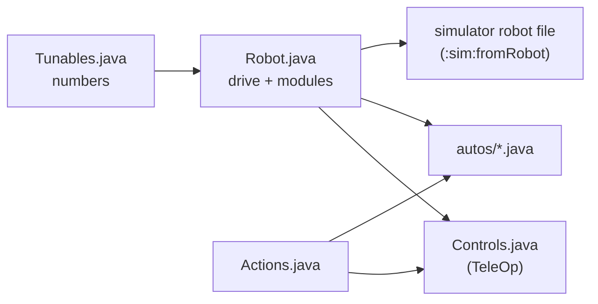

# Robot module (the robot in five files)

> **Work in progress:** this library and its docs are still changing. Something wrong or unclear? [Tell us](https://github.com/crossbotics/ftc-helper-lib/issues).

Package: `com.crossbotics.ftchelper.robot`

Learn it hands-on: [Lesson 1: The robot in five files](../tutorials/start/01-robot-in-five-files.md). Worked
examples: [`examples/.../gobildabot`](../../examples/src/main/java/com/crossbotics/ftchelper/examples/gobildabot)
(goBILDA's starter bot), [`flywheelbot`](../../examples/src/main/java/com/crossbotics/ftchelper/examples/flywheelbot)
and [`turretbot`](../../examples/src/main/java/com/crossbotics/ftchelper/examples/turretbot).
Quick answers with code to copy: the [cookbook](../cookbook.md) (driving, buttons, mechanisms, actions, autonomous).

A team's whole robot program in five files a student can read in one sitting. This is the
recommended way to use the library, and the one the main-track lessons teach: start with lesson 1
(above), or the [Quick start](../quick-start.md) for a driving robot in 30 minutes. Each mechanism
is a **module**: one line in `Robot.java` that brings its own numbers, buttons and autonomous steps.
Each file answers one question, so you always know where to look:

| File | Answers | Changes when |
| --- | --- | --- |
| `Robot.java` ([`RobotDefinition`](#robotdefinition)) | What is on the robot, and its name in the configuration? | a part is added, moved or renamed |
| `Tunables.java` | What are the numbers? | tuning (speeds, positions, PID, auto distances) |
| `Controls.java` ([`ControlMap`](#controlmap)) | Which button does what? (it is also the TeleOp) | the drivers change their minds |
| `Actions.java` ([`Action`](#action)) | Which steps use several parts together? | a new combo move |
| `autos/` ([`Auto`](#auto)) | What does the robot do on its own? | new or changed autonomous programs |

A new robot: `./gradlew :sim:newRobot -Pconfig=... -PteamCode=...` writes the five files from the
robot configuration ([below](#making-the-files)). A mechanism added later is one line in `Robot.java`:
its numbers, its standard buttons and its simulator lines come with it.



| Class | Use it to |
| --- | --- |
| [`RobotDefinition`](#robotdefinition) | describe the robot in `Robot.java`: `drive(...)` and one `add(...)` per mechanism |
| [`Drive`](#drive) | the drivetrain: mecanum or tank, motor names, motor, wheel, IMU |
| [`Odometry`](#odometry) | where the robot is on the field: a goBILDA Pinpoint, a SparkFun OTOS, or dead wheels |
| [`Intake`](#intake) | a roller on a motor and/or CR servos: in, out, on at the start |
| [`Lift`](#lift) | a slide on a motor with named heights and a bottom switch |
| [`Arm`](#arm) | an arm on a motor with named angles in degrees |
| [`Claw`](#claw) | a claw servo: open, closed |
| [`Wrist`](#wrist) | a wrist servo with named positions |
| [`Positioner`](#positioner) | any servo with named positions (deploy, fold, gate) |
| [`Turret`](#turret) | a turret inside its limits, by hand or following the camera's goal |
| [`Launcher`](#launcher) | a flywheel and its [`Indexer`](#indexer): spin up, fire, speed from distance |
| [`Indexer`](#indexer) | feeds one piece at a time (servo, CR servo or motor) |
| [`Hood`](#hood) | a launcher's hood (servo or motor): its angle from the shot table, by hand, a trim |
| [`Camera`](#camera) | a Limelight or webcam; the alliance's goal |
| [`Pieces`](#pieces-and-piecesensor), [`PieceSensor`](#pieces-and-piecesensor) | which game piece is at a spot (colour sensor, distance sensor, second webcam); how many the robot holds and which fires next |
| [`Lights`](#lights), [`LightColor`](#lights) | a colored light for the drivers (goBILDA RGB Indicator Light or REV Blinkin): which color when |
| [`Action`](#action) | steps across several parts that never block (never make the loop wait) |
| [`Mode`](#modes) | a rule a module follows every loop while the mode is on |
| [`ControlMap`](#controlmap), [`Pad`](#controlmap) | `Controls.java`: the TeleOp and the button map |
| [`Auto`](#auto), [`Steps`](#auto) | one autonomous as a list of steps |
| [`Toggleable`](#controlmap) | anything one button switches on and off |
| [`Motors`](#motors) | look up the encoder counts and speed of common motors, by catalog id (a part's name in the [parts catalog](../guides/parts-catalog.md), e.g. `"gobilda-5203-312"`) |
| [`Shape`](#shapes-and-parts), [`Parts`](#shapes-and-parts) | how each part looks and where it sits, for the simulator; wheels, rollers and servos by catalog id |
| [`Module`](#module), [`MotorPositions`](#lift), [`ServoPositions`](#claw), [`Devices`](#module) | what the modules share (you rarely use these by name) |

---

## RobotDefinition

```java
public class Robot extends RobotDefinition {
    public Intake intake;
    public Lift lift;
    public Claw claw;

    @Override protected void define() {
        drive(Drive.mecanum("front_left", "front_right", "back_left", "back_right")
                .motor("gobilda-5203-312").wheelMm(96)
                .imu("imu", LogoFacingDirection.UP, UsbFacingDirection.FORWARD));
        intake = add(Intake.motor("intake"));
        lift = add(Lift.slide("lift").bottomSwitch("lift_bottom"));
        claw = add(Claw.servo("claw"));
        atStart(() -> Actions.deployIntake(this));   // optional: an action right after START
    }
}
```

`define()` only describes the robot. It runs in INIT, and also without a robot (to write the
simulator file). The OpMode classes make the hardware ([`setup`](#robotdefinition)) and update every
part each loop. Nothing moves in INIT.

| In `define()` | |
| --- | --- |
| `drive(Drive d)` | the drivetrain (required) |
| `odometry(Odometry o)` | optional: what tells the robot where it is on the field ([Odometry](#odometry)) |
| `follower(PathFollower.Maker m)` | optional: a path follower, e.g. `follower(Pedro.follower(...))` ([PathFollower](#pathfollower)); needs an `odometry(...)` line |
| `T add(T module)` | a mechanism; hands it back, so you can keep it in a field (`lift = add(...)`) |
| `atStart(Supplier<Action>)` | an action that runs once right after START, in autonomous and TeleOp |
| `Interlock keepApart(name, zoneA, zoneB)` | an interlock rule: two parts never in their zones at the same time (after the parts' `add` lines; numbers in `Tunables.<name>`) ([Interlock](#interlock)) |
| `tunables(Class)` | the Tunables class if it is not `Tunables` in the same folder |
| `chassisMm(l, w, h)`, `heightMm(h)`, `fixed(Shape...)` | for the simulator: the chassis box, the whole robot's height, parts the code does not move ([Shapes](#shapes-and-parts)) |

| For your code | |
| --- | --- |
| `run(Action)`, `cancel(Action)`, `cancelAll()` | start or stop actions |
| `interlocks()` | the interlock rules from `define()` (read only) |
| `alliance()` | this match's alliance (from autonomous's menu; TeleOp remembers it) |
| `notes()` | INIT notes: missing Tunables sections or fields (the library's defaults are used) |
| `modules()`, `drive()`, `all()` | the parts, the drivetrain, the update group |
| `pose()` | where the robot is now, from the odometry: a [`FieldPose`](util.md#fieldpose) (x in right, y in away from your wall, heading 0 = away, counterclockwise +); a copy; null with no odometry line |
| `odometry()`, `odometrySpec()`, `odometryChecked()` | the running [`PoseTracker`](odometry.md#posetracker) (null before `setup`), the odometry line as written, and `Tunables.Odometry.checked` |
| `resetPose()` | "set pose here": the pose becomes the reset spot in `Tunables.Odometry` (`resetX`, `resetY` inches, `resetHeading` degrees, as seen from your wall, written for BLUE; RED mirrored like the start spot). False (nothing changed) with no odometry or no spot. TeleOp's G1 START held 1 s calls it |
| `resetPose(x, y, headingDeg)` | the same with a spot of your own (for BLUE, mirrored for RED); stops with a message if there is no odometry |
| `follower()`, `hasFollower()`, `makeOdometry(hardwareMap)` | the running path follower (null before `setup`), whether there is a follower line, and the odometry alone for a tool (Pedro's tuners) |
| `robotConfig()` | the drive settings for `EasyTeleOp`/`EasyAuto` |
| `simLines()` | the simulator robot file's lines from the code |
| `setup(hardwareMap)` | makes every module's hardware (the OpMode classes call it in INIT) |
| `tunablesClass()` | the Tunables class found (null if none) |
| `static changedTunables()` | values tuned on the robot that differ from Tunables.java, as lines to copy back |
| `static sectionName(device)` | the Tunables section a device reads: "intake_deploy" -> `IntakeDeploy` |

Checked at INIT: a device name used twice, two parts (or a part and an interlock rule) reading the same
Tunables section, an indexer added twice. Each stops with the name.

### Tunables.java

```java
public class Tunables {
    public static class Drive { public static double maxPower = 1.0, practiceMaxPower = 0.6, slowSpeed = 0.3; ... }
    public static class Lift {
        public static double min = 0, max = 2600;            // the safe range (not tunable live)
        public static double kP = 0.004, kI = 0, kD = 0.0002, kF = 0.05;
        public static double down = 0, low = 900, high = 2400;   // named heights: any names
    }
    public static class Claw { public static double open = 0.20, closed = 0.75; }
}
```

- **Every number of every part**, with its units, default, whether it is in the tuning menu and which
  finder measures it: [the Tunables reference](../guides/tunables.md). `tools/check_tunables.py` keeps it complete.
- **One section per part**, named after its configuration name in CamelCase: `intake_deploy` reads
  `IntakeDeploy`. Pick another with `.tunables("Name")` on the module.
- **Sections for your own code** (no part reads them, like `Tunables.Auto` with the autonomous's
  distances): every `public static` number that is not `final` is in the tuning menu too
  ("Auto/parkInches"). The menu's value is written into the field, so your code reads
  `Tunables.Auto.parkInches` as usual. Tune it in the TeleOp, save it (A), run the autonomous: it
  uses the saved value from its INIT, with no rebuild. **Then copy the good value into
  `Tunables.java`** (INIT lists it): a value saved only on the hub is lost with a new Control Hub.
  True/false settings and tables stay as written.
- **The code is the record.** The numbers you tune most become [`Tunable`](tuning.md)s ("Lift/kP"):
  the tuning menu (PRACTICE profile, after START hold GUIDE 1 s) changes them and saves them on the Control Hub. INIT then
  shows "Tuned on this robot (copy into Tunables.java)" with the lines to copy back.
- **Missing numbers are not errors**, with a few exceptions: the library's default is used and INIT
  says which (`Tunables.Lift: kD, kF not written: library defaults used (fine)`). **The exceptions are
  safety numbers** (a safety limit never comes from a library default): a Lift's or Arm's `min` and
  `max`, a Hood's `posA` and `posB` (or its `calibration`), a servo Turret's `posA`, `angleA`, `posB`,
  `angleB`, a Turret's `homeAngle` with a home switch, and an interlock rule's zone numbers. For a
  Lift or Arm, `max` must also be more than `min`. Otherwise INIT stops:
  `Tunables.Lift has no max: write max (the top of the safe range, in counts: Motor Finder, B). A safety limit never comes from a library default.`
  (no section at all: `Tunables.java has no Lift section: ...`; an Arm's are in `deg`; `min` points
  to Motor Finder X). With `max` not above `min`: `Tunables.Lift: max (...) must be more than min (...)`.
  `min` and `max` must be `public static` numbers (`public static double max = 2900;`); not `public`, or
  not a number, and INIT stops with `Tunables.Lift.max must be a public static number (like "public static double max = 1000;"): ...`.
- **A name that looks like a setting stops INIT.** Every number that is not a known setting is a
  named position. So these field names stop INIT:
  - **Always:** a known setting with other capitals or an `_` added: `Max`, `MAX` or `MIN` for
    `max`/`min`, `kp`, `KP` or `k_P` for `kP`. (All capitals is a common habit: it stops too.)
  - **Only when that setting itself is not written:** for names of 5 letters or more, up to two
    letters off (`maxPowr` or `maxPwr` for `maxPower`). So `slowZone2` next to a written `slowZone`
    is a position, but `slowZon` with no `slowZone` stops INIT.

  The message: `Tunables.Lift.Max looks like "max" (capitals and spelling count). Fix the name in Tunables.java; a position must not look like a setting.`
  Before, it quietly became a position called `Max`, and `max` stayed the library default. The same
  check runs for Claw, Wrist and Positioner (their setting: `travelSec`).
- **A field no part reads stops INIT, in every part's section.** A typo like `inPowr` in
  `Tunables.Intake` (or `goalx` in `Tunables.Aim`, `nominalVolt` in `Tunables.Launcher`) would be
  quietly ignored, and the part would use the library's default. Now INIT stops before anything is set up:
  `Tunables.Intake.inPowr is not a setting of Intake (did you mean inPower?): the robot would quietly ignore it. Fix the name (capitals count) or delete the line. Known: inPower, outPower (docs/guides/tunables.md)`.
  It checks the sections of Drive, Odometry, Aim, Buttons, every part on the robot and every interlock
  rule. Names you pick are fine: a Lift's, Arm's or servo part's named positions (any number), a piece
  sensor's kinds (`POLLEN`), a launcher's `speedByDistance...` tables, and an interlock rule's
  `<part>From`, `<part>To`, `<part>Above`, `<part>Below` and `<part>Margin` for its own two parts. A field
  of the part that this robot does not use (a servo turret's `posA` on a motor turret) is fine too.
  Sections no part reads (your own `Tunables.Auto`) are never checked.
- **Safety:** a tuned position stays inside `min`..`max`; limits are read once and cannot be tuned.
- `public static` fields: FTC Dashboard can show them too.
- The menu's names ("Lift/kP") are shared by the whole robot app: keep one Robot class per app.

Which numbers are in the tuning menu (used at once, or from the next INIT) and which are read only
from the code: the **Live** column of [the Tunables reference](../guides/tunables.md#the-live-column-the-tuning-menu).
Your own sections (`Auto`...): every number is in the menu (a TeleOp reads the field each time; an
autonomous reads it when it builds its steps, at INIT); `final` numbers, true/false and tables are not.

---

## Drive

```java
drive(Drive.mecanum("front_left", "front_right", "back_left", "back_right")
        .motor("gobilda-5203-312").wheelMm(96).imu("imu", LogoFacingDirection.UP, UsbFacingDirection.FORWARD));
drive(Drive.tank("left_drive", "right_drive").reversed("right_drive"));
```

| Method | |
| --- | --- |
| `mecanum(fl, fr, bl, br)`, `tank(left, right)`, `tank(fl, fr, bl, br)` | the type and motor names |
| `motor(id)` | the drive motor's [catalog id](#motors) (default `gobilda-5203-312`; the other parts use `part(id)`) |
| `wheelMm(mm)`, `gearRatio(r)` | wheel diameter (default 96), motor turns per wheel turn |
| `wheel(id)` | the wheel by its [catalog id](#shapes-and-parts), e.g. `"gobilda-hogback-96"`: its diameter comes from the catalog |
| `wheelsAtMm(track, wheelBase)` | for the simulator: wheel centres side to side and front to back, mm |
| `reversed(names...)` | exactly these motors run reversed (default: the left side) |
| `imu(name, logo, usb)`, `noImu()` | the IMU and how the hub is mounted (default "imu", UP, FORWARD) |

`Tunables.Drive` ([all its numbers](../guides/tunables.md#drive)): `maxPower`, `practiceMaxPower` (PRACTICE profile), `slowSpeed` (the slow trigger),
`strafeCorrection`, `turnKp`, `turnKd`, `moveMinPower`, and `calibrated` (autonomous refuses to run
until it is `true`: tune with the Drive Tuner first, [lesson 6](../tutorials/start/06-first-autonomous.md)).
The Drive Tuner and the Shot Tuner take the whole robot: `@Override protected RobotDefinition robot() { return new Robot(); }`;
every finder shows `Tunables.` lines to copy ([finders](finders.md)).

---

## Odometry

```java
odometry(Odometry.pinpoint("pinpoint").offsetsMm(-84, -168));   // in define(), after drive(...)
```

| Method | |
| --- | --- |
| `pinpoint(name)` | a goBILDA Pinpoint: `offsetsMm(xPodLeft, yPodForward)`, `podsSwingarm()`, `ticksPerMm(n)`, `reversed("x", "y")` |
| `otos(name)` | a SparkFun OTOS: `mountIn(forward, left, headingDeg)` |
| `threeWheels(left, right, perp)` | three dead wheels on encoder ports: `trackWidthIn(in)` (required), `perpForwardIn(in)` |
| `twoWheels(parallel, perp)` | two dead wheels and the drive's IMU: `parallelLeftIn(in)`, `perpForwardIn(in)` |

`Tunables.Odometry` ([all its numbers](../guides/tunables.md#odometry)): `checked` (set true after the Odometry Tuner; until then `driveTo` steps are
skipped on a real robot), for an OTOS `linearScalar` and `angularScalar`, and optional
`resetX, resetY, resetHeading`: the "set pose here" spot ([`resetPose()`](#robotdefinition); RED
mirrors it unless `mirrorForRed = false`, as on a field turned half a turn: BIOBUZZ needs `false`). With it: `robot.pose()`
every loop, `driveTo` steps in [autonomous](#auto), and TeleOp starting where autonomous ended. The
odometry is updated first each loop, before every part. Everything, with sketches of the offsets:
[odometry module](odometry.md); hands-on: [lesson 7](../tutorials/start/07-odometry.md).

**The three `mirrorForRed`s.** One question, "is RED's half a mirror image of BLUE's?", asked in three
places: your autos' `mirrorForRed()` method (routes and start spots; default true), `Tunables.Aim.mirrorForRed`
(the goal point; default true) and `Tunables.Odometry.mirrorForRed` (the reset spot). The reset spot
falls back to `Tunables.Aim`'s when `Tunables.Odometry` has none, then to true; the other two have no
fallback. Give all three the same answer: on BIOBUZZ's turned field, `false` in each. INIT shows the
one used for the reset spot (`Reset spot for RED: ...`) and the aim's.

---

## PathFollower

The small plug a path-following add-on fills in, so the core library never needs that other library.
The [pedro module](pedro.md) is one: `follower(Pedro.follower(PedroConstants.foresight))` in `define()`,
then `follow(label, path)` steps in autonomous.

| Method | What it does |
| --- | --- |
| `follow(path, mirrorX)` | starts a path (mirrored for RED when routes are mirrored) |
| `isBusy()`, `cancel()`, `remainingIn()` | still going; stop now; inches left (for the "stuck" check) |
| `isReady()` | false while its pose source is not ready (the step then ends `NO_ODOMETRY`) |
| `check(path)` | at INIT: throws if it cannot follow this kind of path |
| `totalIn()`, `partNow()`, `parts(path)` | optional (they have defaults): the path's length, the part it drives now (from 1), how many parts a path has. [`PathAt`](#pathat) uses them; without them it takes the distance left at the start as the length, and `PathAt.part(n)` fires at the end |

It is updated every loop right after the odometry, and drives the wheels only while a path runs.
`remainingIn()` is for the WHOLE path (all its parts), so `PathAt.inchesLeft` and `fraction` are right.

### PathAt

Things to start ALONG a `follow` (or `driveTo`) step while the robot keeps driving. Each fires once.
Full page: [pedro module, Do things along the path](pedro.md#do-things-along-the-path).

| Method | Fires |
| --- | --- |
| `PathAt.inchesDone(in, label, command)` | after `in` inches of the path |
| `PathAt.inchesLeft(in, label, command)` | when `in` inches are left |
| `PathAt.fraction(f, label, command)` | when that much of the WHOLE path is done (0.5 = halfway, all parts counted) |
| `PathAt.part(n, label, command)` | where part `n` of a `then` path starts (INIT stops if the path has fewer parts) |
| `PathAt.near(x, y, withinIn, label, command)` | when the robot is within `withinIn` of a field point (mirrored for RED) |

For example `PathAt.inchesLeft(12, "Spin up", robot.launcher::spinUp)` (your own part names). Each also
takes an [Action](#action) from your `Actions.java` instead of a label and a command:
`PathAt.inchesLeft(12, Actions.scoreHigh(robot))`, or any action you wrote.

## Intake

```java
intake = add(Intake.motor("intake"));
intake = add(Intake.motor("intake").onAtStart());
intake = add(Intake.crServos("left_intake", "right_intake").reversed("right_intake"));
intake = add(Intake.motor("intake").withCrServos("left_wheel", "right_wheel").reversed("right_wheel"));
```

| Method | |
| --- | --- |
| `in()`, `out()`, `stop()`, `toggle()` | run in / out until stopped; on/off |
| `reverse()`, `endReverse()` | push out while a button is held, then back to what it was doing |
| `isRunning()`, `isPushingOut()` | running at all; pushing out now |
| `onAtStart()` | runs in from START until stopped |
| `holds(n)` | for the simulator: how many pieces it carries (default: a guess of 3) |
| `stopsWhen(condition)`, `isHeldBack()`, `heldBackSec()` | never runs IN while the condition is true (pushing out still works), e.g. `stopsWhen(() -> pieces.isFull())` ([Pieces](#pieces-and-piecesensor)); how long it has been held back |
| `inAnyway()` | runs in even though `stopsWhen` says no, until `stop()` or `out()` (the count was wrong) |
| `isRunningOut()` | pushing out now (`out()`, or `reverse()` held) |

`Tunables.Intake` ([all its numbers](../guides/tunables.md#intake)): `inPower` (1.0), `outPower` (0.7). Buttons: hold operator RT in, LT out; with
`onAtStart()`: RT switches it on/off, hold LT pushes out. With `stopsWhen`: hold RT for 1 s to run in
anyway (with `onAtStart()`: tap RT switches, hold it 1 s runs in anyway), and the Driver Station warns
when it has been held back for more than 2 s, so the drivers notice a count that says "full" too soon.

---

## Lift

[`MotorPositions`](#lift) is what Lift and Arm share: `goTo(name)` (capitals do not matter; a typo
shows a warning and does nothing), `stepUp()`, `stepDown()`, `manual(power)` (0 holds where it was
let go), `hold()`, `stop()`, `isAtTarget()`, `isAt(name)`, `position()`, `positions()`, `part()`
(the [`PositionMotor`](mechanism.md#positionmotor) inside), and `.reversed()` when positive power moves
it down. Every number but `min` and `max` has a default, so a part works before it is tuned; `min`
and `max` must be in `Tunables.java` (from the [Motor Finder](../guides/finders.md)), or INIT stops.

```java
lift = add(Lift.slide("lift").bottomSwitch("lift_bottom"));
```

`Tunables.Lift` ([all its numbers](../guides/tunables.md#lift-and-arm)) (encoder counts): `min`, `max`, `kP`, `kI`, `kD`, `kF` (the steady push that holds it
up), `maxPower`, `slowZone`, `slowZonePower`, `tolerance`; every other number is a named height.
Buttons (operator): A lowest, Y highest (2 or more heights), X second (3 or more), D-pad up/down next height, left stick by hand.
With a bottom switch, the lift only goes down (slowly) until the switch has been pressed once, and the
switch sets 0. **Without one, 0 is wherever the lift is at INIT** (the encoder starts from there):
press INIT with the lift all the way down, also for TeleOp after an autonomous that left it up, or
`max` will be too high by that much. INIT reminds you.

For the simulator: `.looks(Shape.slide().atMm(...).sizeMm(...).travelMm(421))` (the stage's travel from
`min` to `max`); a wrist or claw rides on it with `Shape.arm().on(lift)` ([Shapes](#shapes-and-parts)). A
lift's zone for an [interlock rule](#interlock): `lift.zoneAbove()` or `lift.zoneBelow()`.

## Arm

```java
arm = add(Arm.motor("arm", "gobilda-5203-117").gearRatio(2));
```

The same as Lift, in degrees (`gearRatio`: motor turns per arm turn; `bottomSwitch(name)` like the
lift's). 0 degrees is where the arm is
when the program starts. Button: operator right stick Y by hand.

---

## Claw

[`ServoPositions`](#claw) is what Claw, Wrist and Positioner share: `goTo(name)`, `isDone()` (it should
have arrived: a guess from `travelSec`), `isAt(name)`, `positions()`, `part()` (the
[`PositionServo`](mechanism.md#positionservo) inside), `reversed()`. In Tunables every number is a
named position (0 to 1) except `travelSec` ([reference](../guides/tunables.md#claw-wrist-and-positioner)). A servo does not move until the first command after START.

```java
claw = add(Claw.servo("claw"));       // Tunables.Claw: open, closed (both needed)
```

**A servo's full range: `.fullRange()`.** The hub sends a servo a pulse: 600 microseconds (us) for
position 0 and 2400 us for 1. That is the FTC SDK's normal range, and the library keeps it. Most FTC
servos take 500 to 2500 us, so on the normal range they turn a bit less than the seller says: a goBILDA
2000 servo turns 270 degrees over 0 to 1, not 300. `.fullRange()` on a Claw, Wrist or Positioner (and on
`Hood.servo`, `Turret.servo`, `Indexer.servo`) sends the servo's whole pulse range (the catalog part's from
`part(...)`, else 500 to 2500 us) at INIT, so 0 to 1 turns all 300 degrees. **Measure your positions after
turning it on** (the Servo Finder has the same switch: Y while choosing): the same number points
somewhere else once the range changes. A servo that cannot change its pulse (not on a REV hub) keeps
its range and INIT says so. The hub keeps a pulse range until the next INIT. Recipe:
[How do I get my servo's full range?](../cookbook.md#how-do-i-get-my-servos-full-range)

```java
wrist = add(Wrist.servo("wrist").part("gobilda-2000-speed").fullRange());   // 0 to 1 = 300 degrees
```

`open()`, `close()`, `toggle()`, `isClosed()`. Button: operator B opens/closes.

## Wrist

```java
wrist = add(Wrist.servo("wrist"));    // Tunables.Wrist: any positions, e.g. down, level, up
```

`next()`, `previous()` (by value). Buttons: operator D-pad left/right. For the simulator, a wrist
swings an arm shape (`.looks(Shape.arm().on(lift)...angle("folded", -90).angle("flower", -213))`) and a
claw can ride on it (`Claw ... .looks(Shape.claw().on(wrist)...)`).

## Positioner

```java
intakeDeploy = add(Positioner.servo("intake_deploy"));   // Tunables.IntakeDeploy: stowed, deployed
```

`goTo(name)`, `next()`. No suggested buttons: use it from Controls.java or an action. For the simulator,
it swings an arm shape: `.looks(Shape.arm()...angle("stowed", 90).angle("deployed", 20))`, and can push a
passive part over (`Shape.dropsWhen`, [Shapes](#shapes-and-parts)).

---

## Turret

Every way to build a turret (what turns it, how it knows its angle, its range, homing, a hood, a camera)
is on one page, with the exact lines for each: [Setting up a turret](../guides/turret-setup.md).

```java
turret = add(Turret.motor("turret", "gobilda-5203-117").gearRatio(5).follows(camera));     // a motor
turret = add(Turret.motor("turret", "gobilda-5203-312").gearRatio(2.75).homeSwitch("turret_home"));
turret = add(Turret.servo("turret").follows(camera));                                     // a servo
turret = add(Turret.crServo("turret").encoder("turret_enc", 8192));                       // CR servo + Through Bore
turret = add(Turret.crServo("turret").analogEncoder("turret_pos").continuous());          // slip ring + absolute encoder
```

| Made with | |
| --- | --- |
| `Turret.motor(name, motorId)` | a motor; its encoder counts the angle |
| `Turret.servo(name)` | a standard servo (it goes to an angle by itself): `posA`, `angleA`, `posB`, `angleB`, `travelSec` in Tunables; no PID, no homing |
| `Turret.crServo(name)` + `encoder(port, countsPerRev)` | a CR servo with an encoder on a motor port (REV Through Bore: 8192); the port may also run another part's motor (only its count is read) |
| `Turret.crServo(name)` + `analogEncoder(port)` | a CR servo with an absolute encoder on an analog port: it knows its angle at once (`encoderOffset`) |

| Option | |
| --- | --- |
| `gearRatio(r)` | turns per turret turn of what counts: the motor (a motor turret), the encoder (a CR servo turret) |
| `reversed()`, `encoderReversed()` | + power turns it clockwise: flip it; a CR servo's encoder counts the wrong way |
| `homeSwitch(name)` | a touch sensor or a magnetic switch (a "Digital Device", active low): it homes at START, slowly (`homeAngle`, `homeDirection`, `homingPower`, `homingTimeout`), and sets its angle again each time it passes the switch. Missing from the configuration: an INIT note and `startAngle` is used |
| `continuous()` | a slip ring: no limits, always the shortest way, never "out of range"; the angle shows -180 to 180 |
| `follows(camera)` | follows the camera's goal; with odometry and `Tunables.Aim.goalX, goalY` the odometry takes over while the camera does not see it ([Aim](#aim)) |
| `followsOdometry()` | follows the goal with no camera: from the odometry and `Tunables.Aim`'s goal point |
| `cameraOnBody()` | the camera is on the robot, not on the turret |
| `fullRange()` | a servo turret: the servo's whole turn (500-2500 us, a goBILDA 2000 servo 300 degrees instead of 270); measure `posA`/`posB` after turning it on ([full range](#claw)) |

| Method | |
| --- | --- |
| `followMode()` | the [mode](#modes) that follows the goal (on from START with `follows` or `followsOdometry`) |
| `aimAt(deg)` | turn to an angle (stops following) |
| `manual(power)` | by hand; following pauses while the stick moves |
| `isAimed()` | at the target within the tolerance; while FOLLOWING: at the goal NOW (a goal seen this moment, homed, in range, not held by an interlock, error within the larger of `tolerance` and `Tunables.Aim.toleranceDeg`), so a launcher gated on it never fires after the goal is lost |
| `isHomed()` | its angle is known (homed on its switch, or no switch) |
| `isHeld()` | an [interlock rule](#interlock) holds it back from where it should point |
| `isOutOfRange()`, `angle()`, `part()` | the goal is past its range (at a limit, or holding while it is behind); the angle; the `launcher.Turret` inside |
| `aimErrorDeg()`, `aimSource()` | degrees from the goal now (NaN = unknown); where the goal came from (CAMERA, ODOMETRY, NONE) |
| `zone()` | its zone for an [interlock rule](#interlock) (degrees, repeats every 360) |
| `static forgetAngles()` | forget the angle carried from the last program (tests; turning it by hand between programs) |

`Tunables.Turret` ([all its numbers](../guides/tunables.md#turret)): `min`, `max` (degrees, counterclockwise +, 0 = forward: it never turns past them; a
goal outside waits at the limit and the Driver Station says "goal out of turret range"; past +/-180 it
picks the way round that stays inside them), `startAngle` (where it points at INIT with no switch,
default 0), `kP`, `kI`, `kD`, `maxPower`, `tolerance`, `slowZone`, `slowZonePower`, `cameraOffset`,
`outOfRangeHold` (default 10: an odometry goal this many degrees past a limit, behind the robot, makes it
HOLD where it points instead of swinging limit to limit as the heading wobbles; it follows again once the
goal is back within half of that). With a switch: `homeAngle` (needed), `homeDirection`, `homingPower`,
`homingTimeout`. Absolute encoder: `encoderOffset`. Servo: `posA`, `angleA`, `posB`, `angleB`,
`travelSec`. `keepAngle` (default true): TeleOp starts from the angle the last program ended at (within
5 minutes, same robot app run), so it does not home again after autonomous.

A following turret and whole-robot aim are separate modes: see [Aim](#aim). Buttons: operator right
stick X by hand, BACK following on/off. The Driver Station shows `turret: 12 deg following: camera`
(or `odometry`, or `no goal`: it holds where it points), and `homing: looking for the switch` after START.

## Interlock

Two parts that share space (a turret over the back and a lift at the back; an arm and an intake) must
never be in their zones at the same time. One line in `Robot.java`, the numbers in `Tunables.java`, and
the library keeps to it every loop, whoever moves the parts. Guide with examples:
[Two parts that must not collide](../guides/interlocks.md).

```java
// Robot.java, after the parts:
turretLift = keepApart("TurretLift", turret.zone(), lift.zoneAbove());

// Tunables.java: the zones, in each part's units
public static class TurretLift {
    public static double turretFrom = 130, turretTo = 218;   // degrees
    public static double liftAbove = 270;                    // counts
    public static double liftMargin = 80;                    // optional safety distance
}
```

| Zone | Tunables fields (in the rule's section; [all of them](../guides/tunables.md#interlock-rules)) |
| --- | --- |
| `part.zone()` | `<part>From`, `<part>To`: between two numbers (a turret's repeats every 360 degrees) |
| `part.zoneAbove()` | `<part>Above`: from there to the top |
| `part.zoneBelow()` | `<part>Below`: from there to the bottom |
| `Zone.when(words, condition)` | none: a condition for something the library cannot move (your own sensor) |

`<part>` is the part's Tunables name with a small first letter (`Turret` -> `turretFrom`). Units: degrees
(turret, arm), counts (lift), servo position 0 to 1 (claw, wrist, positioner). Parts with a zone: Turret,
Lift, Arm, Claw, Wrist, Positioner, Hood. Optional `<part>Margin` (default: the larger of 3 degrees and
twice the turret's tolerance; twice a lift's or arm's tolerance and at least 1/50 of its range; 1/50 of a
hood's range; 0.02 for a servo).

| `Interlock` | |
| --- | --- |
| `name()` | the rule's name (its Tunables section) |
| `isHolding()`, `status()` | a part is held back now; the Driver Station line ("" when nothing is held) |
| `words()` | the rule in words: `Turret between 130 and 218 deg / Lift above 270 counts` |
| `Zone.part()`, `Zone.words()` | the part (null for a condition); the zone in words |

Who yields: **whoever is in its zone first keeps it; the other part waits outside its own zone**, two
margins away, with its target kept (it goes on when the first one leaves). Both want in at once: the
first zone in `keepApart` goes first. A turret whose way to its target crosses its zone goes the other way
round if its range allows (a slip ring, or -270 to 270), else waits at the edge. Both in their zones (pushed
there, or found so at START): each may only move out. A part whose position is not known (a turret not
homed yet, a servo still moving: it counts as anywhere between where it was and where it was sent until its
`travelSec` is over) counts as in its zone. Every command goes through it: buttons, sticks, actions,
autonomous steps, a following turret, shooting on the move. A held turret is never `isAimed()`.

The Driver Station shows one line per rule while it holds something: `TurretLift : Lift held at 110 counts:
Turret is between 130 and 218 deg`. INIT lists each rule, and stops with the reason for: a missing section
or number, an empty zone, a zone outside the part's range or covering all of it, a negative margin, a part
with no position. The zones are read once at INIT and are **not** in the tuning menu: a zone moving while
the parts move could put both in their zones at once.

---

## Launcher

```java
launcher = add(Launcher.flywheel("launcher", "gobilda-5203-6000").feeder(Indexer.servo("indexer")));
launcher = add(Launcher.flywheel("launcher", "gobilda-5203-6000").feeder(Indexer.servo("indexer"))
        .speedFromDistance(camera).requireReady("turret aimed", () -> turret.isAimed()));
```

| Method | |
| --- | --- |
| `spinUp()`, `idle()`, `toggle()` | to the shot speed; back to `idleRpm` |
| `fire()`, `fire(n)` | spins up if needed, feeds as soon as it is at speed (gives up after 3 s, saying why) |
| `fireWhileHeld()`, `ceaseFire()` | for a held button: one shot, then the next as soon as it is fed; on release no more (a tap still fires its one shot) |
| `adjust(steps)` | speed +/- steps x `stepRpm` (not saved) |
| `trimPercent(change)`, `setTrim(percent)`, `resetTrim()`, `speedTrim()` | the [speed trim](#speed-trim-and-battery-compensation): every shot speed (table or fixed) +/- that many percent, e.g. `trimPercent(+2)`; kept to +/- `trimMaxPercent` and to the motor's top speed; `resetTrim()` also clears `adjust` |
| `atMotorLimit()` | true when the trimmed speed is cut to the motor's top speed ("(motor limit)"; more trim up does nothing) |
| `lastTrimOffered()`, `useLastTrim()` | the trim used last time (since the robot app started), offered at INIT ("+3%", "" if none); use it (double-tap D-pad up does). Never applied by itself |
| `speedMode()` | the [mode](#modes) that sets the speed from the distance to the goal |
| `speedFromDistance(camera)` | speed from the camera's distance; with odometry and `Tunables.Aim.goalX, goalY`, from the odometry's while the camera does not see the goal ([Aim](#aim)) |
| `speedFromOdometry()` | speed from the odometry's distance only (no camera) |
| `useTable(name)`, `nextTable()` | the shot table to use ("pollen" for `speedByDistancePollen`, case does not matter); the next one. A name with no table warns and keeps the one in use |
| `tableFrom(() -> name)` | let code (a game-piece sensor) choose: each time its answer changes to a table's name, that table is used; null, "NONE" and "UNKNOWN" change nothing |
| `tableFor(table, kinds...)` | which table some game-piece kinds use, e.g. `.tableFor("nectar", "RED_NECTAR", "BLUE_NECTAR")`; a kind named like a table ("POLLEN") needs no line |
| `startTable(name)` | the table at the start (default: `speedByDistance` if there is one, else the first by name) |
| `tableName()`, `tableNames()`, `tableField(name)`, `distanceIn()`, `distanceSource()` | |
| `table(name)`, `speedRpm()` | a shot table as Tunables.java has it (null if none); `Tunables.Launcher.speedRpm` (the Shot Tuner starts from them) |
| `isReady()`, `isShooting()`, `targetRpm()`, `part()` | |
| `requireReady(what, check)` | another check before each feed (e.g. the turret is aimed) |
| `spinAtStart()` | spins up at START (autonomous and TeleOp), ready for the first shot |
| `hood(Hood)`, `hood()` | the launcher's [hood](#hood): its angle from the table's third column; the launcher waits for it before feeding |
| `shotAngle(deg)` | for the simulator: which way a piece leaves, degrees up from the wheel shape's forward (the robot's forward for a wheel mounted level; 135 = up and out of the back) |

`Tunables.Launcher` ([all its numbers](../guides/tunables.md#launcher)): `speedRpm`, `stepRpm`, `readyBandRpm`, `idleRpm`, `shotIntervalSec`,
`speedByDistance` (`{{inches, rpm}, ...}`, blended between rows; with no goal in view the last speed
stays), or one table per game piece: `speedByDistancePollen`, `speedByDistanceNectar` (any names after
`speedByDistance`), and `kP`, `kI`, `kD`, `kF` (the hub's speed control; only used when `kF` is there: the
[Flywheel Finder](../guides/finders.md) finds them, and `nominalVolts`, the battery voltage they were found
at). Buttons (operator): LB spin up/down, RB fire one (hold: keep firing, `fireWhileHeld()` / `ceaseFire()` on release),
D-pad up/down the speed trim +/- `trimStepPercent` with speed from distance, or +/- `stepRpm` with a fixed
speed (held: one more step every 0.25 s); double-tap D-pad down = no trim; double-tap D-pad up = last
time's trim (when offered); D-pad right the next shot table (two or more). Each only when free.
With a [hood](#hood), a row is `{inches, rpm, hood}`: the hood is blended between rows like the speed
(two-number rows still work: the hood is then set by hand). Double-tap D-pad down also sets the hood
trim back to 0.

```java
public static double[][] speedByDistancePollen = {{24, 2200}, {48, 2550}, {72, 2900}};   // Tunables.Launcher
public static double[][] speedByDistanceNectar = {{24, 2400}, {48, 2800}, {72, 3200}};
// a button: g2.x.press(() -> robot.launcher.useTable("nectar"));   an action: .then(() -> r.launcher.useTable("nectar"))
```

The Driver Station shows `Shot table: POLLEN, 48 in (camera)` (`odometry`, or `last seen` while no
goal is seen); with one table, `Shot distance: 48 in (camera)`.

### Speed trim and battery compensation

**Speed trim**: a fix during a match, when every shot is a bit short or long (a worn wheel, softer
balls). `trimPercent(+2)` makes every shot speed 2% faster than the table (or `speedRpm`) says. It
starts at 0 at every INIT, is the same for every shot table, stops at +/- `trimMaxPercent` (15) and at
the motor's top speed (`(motor limit)`), and is the launcher's first line: `Speed trim: +3%  READY`. The
trim used last time is remembered until the robot app restarts and offered at INIT
(`Trim last time: +3% (double-tap D-pad up after START to use it)`), never applied by itself. The Shot
Tuner never uses it, so tables are recorded clean.

With `kF` set the battery is already compensated (below), so a trim you need match after match points
at the wheel or the balls: the table is off. Make it part of the table, then trim back to 0. A +3% trim
all season: every speed times 1.03, so `{48, 2550}` becomes `{48, 2627}` (2550 x 1.03 = 2626.5), in
every row of every table. Or tune the table again with the Shot Tuner.

**Battery compensation** (on when `kF` is set): every 0.25 s the launcher reads the battery and gives the
hub F x (`nominalVolts` / volts): tuned at 12.6 V, at 11.5 V F x 1.10. The F gain gives the same POWER
for a speed, and the same power spins the wheel slower on a weaker battery; the hub's I gain only makes
it up slowly. Scaled, the wheel gets back to speed after a shot as fast at 11.5 V as on a full battery.
"volts" is the highest reading of the last second, so a dip while the drive pulls hard does not raise
F; the hubs are asked on the library's helper thread (`Devices.batteryReader()`), so the loop never
waits. Under 11.5 V the Driver Station warns. `nominalVolts` comes from the Flywheel Finder; without it
the launcher uses 12.8 V (`Flywheel.DEFAULT_NOMINAL_VOLTS`, a charged battery under load).
`batteryCompensation = false` turns it off. Details: [Flywheel](launcher.md#battery-compensation).

> **Battery compensation: on by default, easy to turn off, not yet proven on a robot.**
> The RPM control already fixes a low battery by itself, but slowly (the small I gain). Compensation
> only makes that faster: it helps the first shot after spin-up and quick shots in a row. It cannot help
> when the battery is too low for the speed you ask (the motor is already at full power).
> - **Turn it off:** `public static boolean batteryCompensation = false;` in `Tunables.Launcher`.
> - **Test it on your robot:** with a battery at about 11.5 V, fire 4 shots quickly and watch the
>   launcher's measured RPM against its target on the Driver Station. Do it with compensation on, then
>   off. If you see no difference, leave it off; if the wheel overshoots after a battery swap, turn it
>   off and tell us.

```java
public static double kP = 1.17, kI = 0.117, kD = 0, kF = 11.70, nominalVolts = 12.6;   // Tunables.Launcher
public static double trimStepPercent = 1, trimMaxPercent = 15;   // optional (the defaults)
// a button: g2.y.press(() -> robot.launcher.trimPercent(+3));   an action: .then(() -> r.launcher.setTrim(+5))
```

## Indexer

`Indexer.servo(name)` (Tunables: `rest`, `push`, `pushSec`, `returnSec`), `Indexer.crServo(name)` and
`Indexer.motor(name)` (`power`, `feedSec` per piece), `.reversed()`, and for a servo indexer
`.fullRange()` (the servo's whole turn: [full range](#claw); set `rest` and `push` again after). Usually given to a launcher with
`.feeder(...)`; added on its own its button is operator RB (feed one). A servo indexer goes to `rest`
at START. Commands: `feedOne()`, `isBusy()`, `isFeeding()`, `isJammed()`, `clearJam()`. `onFeed(runnable)`
runs your code each time a feed really starts. A [Pieces](#pieces-and-piecesensor) counter counts the
piece out only once it has gone: its ready sensor sees it leave, or the feed ends without a jam (a feed
stopped part way, or jammed, leaves the count as it was).

## Hood

A launcher's hood: the part that tilts to make the shot leave steeper or flatter. Any design fits: a
servo or a motor with an encoder, a straight gear or a linkage, any range, either direction.

```java
launcher = add(Launcher.flywheel("launcher", "gobilda-5203-6000").feeder(Indexer.servo("indexer"))
        .hood(Hood.servo("hood"))                            // or Hood.motor("hood", "gobilda-5203-117")
        .speedFromDistance(camera));

public static class Hood {                                   // Tunables.java
    public static double posA = 0.20, posB = 0.65;           // a hair off its two stops (Hood Finder)
    public static double angleA = 0, angleB = 25;            // optional: its angle there
    public static double travelSec = 0.5;                    // stop to stop (a servo cannot say where it is)
}
public static double[][] speedByDistance = {{24, 2200, 4}, {48, 2550, 12}, {72, 2900, 18}};   // Tunables.Launcher
```

**Calibration.** `posA` and `posB` are the servo positions (encoder ticks for `Hood.motor`) a hair off the
hood's two hard stops. They are the hood's **hard limits**: every angle (a table row, a trim, a stick) is
kept between them. Both must be in Tunables.java (INIT stops without them); the
[Hood Finder](../guides/finders.md#hood-finder) finds them. Then pick one:

| You write | The hood's "angle" is | The table's third column holds |
| --- | --- | --- |
| `posA`, `posB` only | the servo position (or ticks) itself: no measuring needed | servo positions, `{48, 2550, 0.42}` |
| `posA`, `posB`, `angleA`, `angleB` | your angle, on a straight line between the two stops (any scale, either way round) | angles, `{48, 2550, 12}` |
| `calibration = {{0.20, 0}, {0.32, 8}, {0.45, 18}, {0.65, 30}}` | a linkage or cam: {position, angle} rows blended between them; the first and last rows are the stops | angles |

**Ready.** The launcher feeds only when the hood has arrived ("hood" in its why-not-ready). A motor hood
knows (its encoder, within `tolerance`); a servo hood is a time estimate: `travelSec` for the whole range,
a share of it for a shorter move. A distance that jitters a little does not move the hood (changes under
1/100 of its range are not sent), so it never stays "moving".

**By hand and the trim.** Suggested operator stick: left stick Y (up = a bigger angle). While the shot
table sets the angle it is a **hood trim**: added to the table, at most +/- `trimMax`, back to 0 with the
launcher's double-tap D-pad down (and at every INIT). With a fixed speed (or a table without hood
angles) the stick moves the hood itself. Why a hood trim next to the speed trim: the speed trim fixes
shots that land short or long; the hood trim fixes shots that arrive at the wrong slope (they bounce off
the rim, or worn balls launch flatter). Use the speed trim first.

| Method | |
| --- | --- |
| `Hood.servo(name)`, `Hood.motor(name, motorId)`, `reversed()` | a standard servo; a motor with an encoder (its ticks count from where the hood is at INIT: start with the hood on stop A) |
| `fullRange()`, `pulseRangeUs()` | a servo hood: the servo's whole turn ([full range](#claw)), at INIT and in the Hood Finder; find `posA`/`posB` after turning it on. `pulseRangeUs()`: `{500, 2500}`, or null without it |
| `shotAngles(atA, atB)` | for the simulator: the launcher's shot angle with the hood at `angleA` and at `angleB` (the simulated shot follows the hood servo) |
| `setAngle(a)`, `home()`, `step(n)`, `byHand(stick)` | go to an angle (kept inside the stops); to `homeAngle`; `n` x `stepAngle` (a trim while the table sets it); the stick, every loop |
| `trimBy(a)`, `setTrim(a)`, `resetTrim()`, `trim()` | the hood trim (added to the table's angle) |
| `angle()`, `currentAngle()`, `isArrived()`, `followsTable()` | where it is going; where it is (encoder, or the time estimate); arrived; the table sets it now |
| `minAngle()`, `maxAngle()`, `homeAngle()`, `usesAngles()`, `isMotor()`, `isReversed()`, `part()` | `part()` is the [`AngleDevice`](mechanism.md#angledevice) the launcher drives |

`Tunables.Hood` ([all its numbers](../guides/tunables.md#hood)) (optional ones scale with the range, so they suit degrees, positions and ticks):
`homeAngle` (where it goes at START; default angleA), `stepAngle` (1/25 of the range), `byHandPerSec`
(the whole range in 2.5 s at full stick), `trimMax` (1/5 of the range), `travelSec` (servo, 0.5). A
motor hood: `kP` (power per tick, 0.005), `maxPower` (0.5), `tolerance` (1/50 of the range); it never
pushes further past a stop. Nothing moves in INIT: the hood goes to `homeAngle` at START. The Driver
Station shows `Hood: 12.5 deg (table, trim +1.0 deg)` (`moving` until it should be there).

Not built yet: a CR servo with an absolute encoder. It fits the same way: anything that is an
[`AngleDevice`](mechanism.md#angledevice) can be a hood of the [plain launcher](launcher.md#launcher)
(`new Launcher(...).hood(myHood)`).

---

## Camera

```java
camera = add(Camera.limelight("limelight").goal("BLUE SCORING", "RED SCORING"));
camera = add(Camera.webcam("Webcam 1"));
```

`goal()` (the alliance's goal, or null), `target(name)`, `target(id)`, `source()` (the
[`TargetSource`](vision.md) inside). Tunables (Limelight): `pipeline` ([all its numbers](../guides/tunables.md#camera)). It starts in INIT.

Venue lighting ([vision.md](vision.md#venue-lighting)): the camera tries a few settings in INIT and
keeps the one that sees the most AprilTags.

```java
camera = add(Camera.limelight("limelight").autoPipelines(0, 1, 2).goal("BLUE SCORING", "RED SCORING"));
camera = add(Camera.webcam("Webcam 1").autoExposure());          // auto, 3, 6, 12 ms; or autoExposure(6, 3, 12)
```

At INIT the Driver Station shows `limelight lighting: pipeline 2 (9 of 10 pictures saw tags)` (a
warning while no tag is seen), and the two lines that skip the test at this venue next time:

```java
public static double pipeline = 2;
public static boolean autoLighting = false;
```

Put them in `Tunables.Limelight` (change the `pipeline` line; add `autoLighting` if it is not there).
A webcam shows `public static double exposureMs = 6;` instead: a new line in its section.
`lighting()` gives the test itself. At START the test stops and keeps the best setting so far, so
have a tag in view at INIT. A camera missing from the robot configuration is a warning at INIT, not
a stop: the OpMode runs and the camera sees nothing.

Its optional Tunables (leave them out for the defaults):

| Number | Default | What it does |
| --- | --- | --- |
| `autoLighting` | true | false = skip the test: use `pipeline` (Limelight) or `exposureMs` and `gain` (webcam) |
| `lightingSettleMs` | 300 | wait after a switch before counting pictures (ms) |
| `lightingPictures` | 10 | pictures counted per setting |
| `lightingMinPictures` | 3 | pictures with tags a setting needs to count as good |
| `lightingAfterStartMs` | 0 | after START, how long to keep trying (ms); 0 = stop at START with the best so far. No targets while it tries |
| `exposureMs` (webcam) | -1 | a fixed manual exposure (ms) when the test is off; -1 = the camera's own |
| `gain` (webcam) | -1 | the gain for manual exposures; -1 = the camera's highest |

These are read once, in INIT, and are not in the tuning menu: change them in `Tunables.java` and
install again.

## Aim

Where the goal is, for everything that aims: `robot.aim()`. **The camera first; the odometry as a
backup.** While the camera sees the goal (a picture newer than 150 ms, `cameraMaxAgeMs`), that is used. When it does not,
and the robot has an [`odometry(...)`](#odometry) line and `Tunables.Aim.goalX, goalY`, the goal's
direction and distance come from where the robot is. A following turret, a launcher's speed from
distance, whole-robot aim and the aim buzz all use it.

```java
public static class Aim {                                   // Tunables.java (every line optional; all: see below)
    public static double goalX = -58, goalY = 55;           // the goal on the field, inches (odometry backup)
    public static boolean mirrorForRed = false;             // default true; BIOBUZZ's turned field: false
    public static double turnKp = 0.02, turnKd = 0.002, maxTurnPower = 0.5, minTurnPower = 0, toleranceDeg = 2;
    public static double cameraOffset = 0, rumbleDeg = 4;
    public static double maxGoalDistance = 170, cameraOdometryAgree = 6;   // inches: odometry checks
    public static boolean shootOnMove = false;              // shooting while driving (below): off until tuned
    public static double flightSec = 0.8, flightSecPerIn = 0, maxLeadIn = 24;
    public static double shooterForwardIn = 0, shooterLeftIn = 0, cameraForwardIn = 0, cameraLeftIn = 0;
}
```

Every `Tunables.Aim` number, with its default and whether it is in the tuning menu:
[the Tunables reference](../guides/tunables.md#aim).

The goal point uses `driveTo`'s numbers: seen from your drivers' wall, x inches right of the field's
centre line, y from the centre toward the far wall, written for BLUE. `mirrorForRed` (default true,
like autonomous): RED mirrors x; false for a field turned half a turn (the same numbers from the red
wall). Put the point where the camera measures to (the goal's tags), so one shot table fits both
distances. INIT shows the alliance and the choice: `Aim: RED, goal x -58, y 55 in (mirrorForRed = false: the same numbers from each wall)`.

**A wrong pose must not aim the robot.** The odometry is only as good as its pose: autonomous's start
spot, carried into TeleOp. So the backup is OFF (camera only, and a warning on the Driver Station:
`Aim odometry: the pose was never set ...`) until the pose was set: autonomous ran in this match, or
your code called `robot.odometry().setPose(...)` (holding BACK to reset "forward" changes only the
heading and does not count). It is also off while it says the goal is farther than `maxGoalDistance`
(170 in: more than the field allows). While the camera and the odometry both see the goal and their
distances differ by more than `cameraOdometryAgree` (6 in), the Driver Station warns
(`Aim: camera says 60 in, odometry 48 in: ...`).

**Turret-following and whole-robot aim are separate modes: use one.** A turret that follows the goal
(`follows(camera)`, `followsOdometry()`) aims by itself; `robot.aimMode()` is for a robot with no turret
(or one that does not follow). Both at once would chase the same error with two motors and swing back
and forth, so `robot.aimMode()` stops at INIT with a message on a robot whose turret follows the goal.

**Whole-robot aim** (no turret): one line in `Controls.java`. While it is on, the robot turns to face
the goal and the driver keeps forward and sideways; moving the turn stick still turns it by hand. Off
at START. `turnKp`, `turnKd`, `maxTurnPower`, `minTurnPower` (the least power that turns the robot),
`toleranceDeg` and `cameraOffset` are its numbers. The Driver Station shows `Aim: camera, 1.5 deg off  AIMED`.

```java
g1.rb.toggle(robot.aimMode()).says("aim the robot at the goal on/off").rumble();   // Controls.java
```

**Shooting on the move** (`shootOnMove = true`; **off by default: tune it on the real robot first**,
[lesson 9, section 14](../tutorials/start/09-shooter-and-camera.md#14-extra-shooting-while-moving)).
A piece keeps the robot's speed, so the goal every part gets (`goal()`, the turret, `isAimed()`, the
launcher's distance) becomes the **virtual goal**: the goal - the shooter's speed x `flightSec` (+
`flightSecPerIn` x the distance), at most `maxLeadIn` (24 in) away. A camera's picture is first brought
forward to now: the robot's turn and move since it was taken (its age from the camera's own timestamp;
`cameraLatencyMs` replaces it if written). Needs odometry (the robot's speed). It works with a turret
that follows the goal (camera on the turret, `cameraOnBody()`, or `followsOdometry()`) and with
whole-robot aim (a fixed shooter). `shooterForwardIn, shooterLeftIn`: the turret's pivot (or a fixed
launcher's exit) from the robot's centre, inches; the distance is from there, and a turning robot swings
it sideways. `cameraForwardIn, cameraLeftIn`: a camera on the body (a camera on the turret is taken to
sit at the pivot). INIT shows `Moving shot: ON: flight 0.80 s ...`; TeleOp shows
`Aim: moving shot: lead 12.3 deg, 18 in` while the robot moves, and a debug line with every number.
Off: nothing changes. The math: [MovingShot](vision.md#movingshot).

**The aim buzz**: `g2.rumbleWhenAimed();` buzzes that gamepad while the aim is within `rumbleDeg`, the
closer the stronger and longer (an [AimRumble](gamepad.md)). It follows a turret that is following, or
whole-robot aim; nothing while neither aims, or while paused.

| Method | |
| --- | --- |
| `goal()`, `source()` | the goal now (null if neither), and CAMERA, ODOMETRY or NONE |
| `fromOdometry()` | the goal from the odometry alone (a [TargetObservation](vision.md) with id `ODOMETRY`), or null (no pose set, or farther than `maxGoalDistance`) |
| `odometryProblem()`, `disagreement()` | why the odometry backup is off now, ""  if it works; the camera/odometry distance warning, "" if they agree |
| `hasGoalPoint()` | `Tunables.Aim` has `goalX` and `goalY` |
| `mode()` (= `robot.aimMode()`) | whole-robot aim (stops with a message on a robot whose turret follows the goal) |
| `errorDeg()`, `isAimed()`, `rumbleDeg()` | degrees off now (NaN = unknown); aimed (whole robot within `toleranceDeg`, or the following turret's `isAimed()`: on the goal now). While shooting on the move: off the virtual goal |
| `movingShotMode()` | shooting on the move on/off (on from START with `shootOnMove = true`): `g2.a.toggle(robot.aim().movingShotMode())` |
| `isMovingShot()`, `lead()` | it is on and the robot moves (over 2 in/s or 5 deg/s); the last lead (a [MovingShot](vision.md#movingshot) `Result`: `leadDeg`, `leadIn`, `distanceIn`), null if none |

---

## Pieces and PieceSensor

Which game piece is at a spot, how many the robot holds, and which one fires next.

```java
public Pieces pieces;                                             // at the top of Robot.java
pieces = add(Pieces.kinds("POLLEN", "RED_NECTAR", "BLUE_NECTAR")  // your kinds: also Tunables names
        .comingIn(PieceSensor.color("intake_color"))              // sees each piece come in
        .readyToFire(PieceSensor.color("ready_color"))            // optional: the next to fire
        .max(4)                                                   // BIOBUZZ G407: at most 4
        .startsWith(4, "POLLEN"));                                // the preload
intake = add(Intake.motor("intake").stopsWhen(() -> pieces.isFull()));   // no 5th piece
```

**How it counts.** Each new piece the intake sensor sees counts one IN, with its kind: the spot was
empty, or a different kind is right behind, or (colour and distance sensors) the distance went up and
down again by `gapMm`: two touching pieces of the same kind. Each feed of an
[`Indexer`](#indexer) (alone or in a launcher) counts one OUT, the oldest first (the robot fires in the
order the pieces came in), once the piece has really gone: the ready sensor sees it leave the slot, or,
without a ready sensor, the feed ends without a jam. A jammed feed, or one stopped part way, counts
nothing; with a ready sensor, a feed while the slot is empty counts nothing either. While the intake
pushes out (`out()` or a held `reverse()`), each piece that leaves past the intake sensor counts one
OUT (the newest) and nothing counts in, so backing a jam out and taking it in again counts right. The
ready sensor, if there is one, has the last word on the next piece: it corrects the kind, and a piece
it sees that was never counted is added. After a shot it is trusted again once the slot reads empty,
or a new steady reading begins (the next piece). Not when the feed ends: the sensor's answer lags a
little (`steadyMs`), and its old reading would put the piece just fired back in the count. A jammed
feed (nothing went) trusts it again at once.

**The count is a helper, not a guarantee.** A piece that bounces out, or two pieces read as one, make it
wrong. The drivers, not the count, are responsible for G407 (at most 4) until the robot has a hardware
stop. When it is wrong: hold the operator's **left stick button** for 1 s (count = 0; Pieces suggests
it; with one driver that button is the library's slow switch, so give `clear` a button in
Controls.java), and hold the intake's in-button (RT) for 1 s to pull in although it says full. The
Driver Station warns when the intake has been held back for more than 2 s.

| Method | |
| --- | --- |
| `count()`, `count(kind)` | how many it holds (a piece being fed counts until it has gone); of one kind |
| `next()` | the next to fire: a kind, `Pieces.UNKNOWN`, or `Pieces.NONE` (empty); during a feed, the one after it |
| `nextIs(kind)`, `isFull()`, `isEmpty()` | true/false |
| `held()` | the list, next to fire first |
| `atIntake()`, `atReady()` | what each sensor sees now |
| `added(kind)`, `removed()`, `clear()`, `set(kinds...)` | change the count by hand (a claw, a button) |
| `nextKind()` | `next` as a `Supplier<String>`: for a part that asks every loop |
| `whenFull()`, `whenEmpty()`, `whenNextIs(kind)` | conditions (`BooleanSupplier`) for LEDs, `rumbleWhen`, `stopsWhen`, an action's wait |

**Hooks for other parts.** A shot table per kind, chosen by the next piece:

```java
launcher = add(Launcher.flywheel("launcher", "gobilda-5203-6000").feeder(Indexer.servo("indexer"))
        .speedFromDistance(camera)
        .tableFrom(pieces.nextKind())                          // the next piece picks the table...
        .tableFor("nectar", "RED_NECTAR", "BLUE_NECTAR"));     // ...both NECTAR colours use "nectar"
```

"POLLEN" uses the `pollen` table by its name; "NONE" and "UNKNOWN" keep the table in use, and a driver's
button still works until the next piece changes. Lights (`import com.crossbotics.ftchelper.robot.LightColor;`
in Controls.java): `robot.lights.show(LightColor.GREEN).when(robot.pieces.whenFull());` and
`robot.lights.show(LightColor.RED).when(robot.pieces.whenEmpty());` ([Lights](#lights)).
No feed with nothing in: `Launcher...requireReady("a piece to fire", () -> !pieces.isEmpty())`.

**The sensors** (`PieceSensor`, one spot each; also alone: `add(PieceSensor.color("x").kinds("POLLEN"))`):

| Sensor | Part (checked 2026-10-21) | Tells apart | Cannot |
| --- | --- | --- | --- |
| `PieceSensor.color(name)` | REV Color Sensor V3, REV-31-1557 ($20.75): colour + distance 1-10 cm (Broadcom APDS-9151) | every colour: yellow POLLEN, red and blue NECTAR | see a piece more than ~5 cm away; mount it 1-2 cm from the piece |
| `PieceSensor.distance(name)` | REV 2m Distance Sensor, REV-31-1505 ($31.50): 5-200 cm, 1 mm resolution, 25° cone (VL53L0X) | sizes: a 3.6 in NECTAR is 20 mm bigger than a 2.8 in POLLEN | colours (red from blue NECTAR); read closer than 5 cm |
| `PieceSensor.camera(webcamName)` | a second UVC webcam, SDK `PredominantColorProcessor` | colours, from farther away | distance: "is one there" means "the box is colourful" (`minSaturation`); a grey background helps |

BIOBUZZ numbers (game manual TU01, section 9.8): POLLEN about 2.8 in (7.1 cm) yellow balls (AndyMark
am-5851_yellow), NECTAR about 3.6 in (9.1 cm) red or blue balls (am-5852_red, am-5852_blue); "not
perfectly spherical and may vary in size". G407: a robot may not CONTROL more than 4 at a time. G408:
never control the OPPONENT's NECTAR, so a team that picks up NECTAR needs colour, not only size.

**Tunables** (one section per sensor, named after its device: `intake_color` reads `Tunables.IntakeColor`; [reference](../guides/tunables.md#piecesensor)):

```java
public static class IntakeColor {
    public static double POLLEN = 75, RED_NECTAR = 8, BLUE_NECTAR = 215;   // hues (degrees), from the Piece Tuner
    public static double nearMm = 40;                                      // a piece is there below this
}
```

| Number | Default | What it does |
| --- | --- | --- |
| one per kind (`POLLEN`) | none: that kind reads `UNKNOWN` until tuned (INIT says so): run the Piece Tuner | colour sensor and camera: the kind's hue, 0-360 degrees; distance sensor: the mm it reads with that piece |
| `nearMm` | 40 (colour), 100 (distance) | a piece is there when the distance is below this |
| `hueTolerance` / `sizeToleranceMm` | 30 deg / 8 mm | how far from a kind's number still counts as that kind |
| `minSaturation` | 0.35 (camera), 0 (colour) | how colourful (0-1) it must be; a camera's "is a piece there" |
| `steadyMs` | 30 | a reading must stay this long before it counts (no flicker counts) |
| `gapMm` | 8 | colour and distance sensors: the distance going up, then down again, by this much while a piece is there is a second piece touching the first (0 = off) |
| `gain` | the sensor's own | colour sensor only, optional: its gain |

A piece "is there" when the distance is below `nearMm`. A colour sensor with no distance reading
(not a REV Color Sensor V3) uses its colour instead: there when the saturation is at least
`minSaturation`, and never below 0.2 (grey is "empty"). A camera: there when the box is at least
`minSaturation` colourful. A piece that is there but matches no kind's number reads `UNKNOWN`.

Find them with the **Piece Tuner** ([`PieceTunerOpMode`](finders.md#piecetuneropmode)): it shows each
sensor's readings and writes the lines to copy into `Tunables.java`. Changed one with the tuning
menu (and saved it)? Copy it back into `Tunables.java`: the saved value is only on this Control Hub, and
the file is the record.

**A second webcam** with an AprilTag webcam: each camera gets its own VisionPortal; the colour camera
uses 320x240 pictures and no live view (the Driver Station can show one portal unless the code splits
the view with `VisionPortal.makeMultiPortalView`). Two webcams share the Control Hub's USB: plug them
into different USB ports (one is USB 3.0), or use a Limelight for the AprilTags. A camera that is
missing or fails to start warns and sees nothing; the OpMode goes on.

**A sensor that is missing or stops answering** never stops the OpMode: a colour or distance sensor
missing from the robot configuration warns at INIT and sees nothing; a sensor (or camera) with no new
reading for 0.5 s warns ("no new reading") and sees nothing until readings come back
(`isWorking()` is false). Meanwhile Pieces counts nothing with it. The loop never waits for a sensor:
a REV 2m Distance Sensor reading can take up to 0.2 s, so it is read on a helper thread, and a reading
older than 0.25 s is thrown away.

**Where to put the sensors.** The intake sensor where each piece passes once and is already held (past
the rollers), so a piece that bounces out is not counted, and the intake does not stop with a piece
half in. Pieces that touch each other pass as one piece unless they are different kinds, or the
distance dips between them (`gapMm`; check it with two touching pieces): a gap (a spacer, or a short
indexer step) is safer. The ready sensor where the next piece waits, so it sees each one leave.

Not done yet: the count does not carry over from the autonomous into the TeleOp (the TeleOp starts
with `startsWith(...)`; a ready sensor corrects an empty count). The simulator ([robot file](../guides/simulator.md#game-pieces):
`color.NAME = at=ready`, `distance.NAME = at=intake, acrossMm=150`) simulates colour and distance
sensors, not the camera.

---

## Lights

A colored light the drivers can see: green when the robot is ready to fire, orange blinking when it is
jammed, a white flash for each piece fired, yellow in the last 20 seconds. **Why:** the drivers watch the robot,
not the Driver Station.

```java
lights = add(Lights.gobilda("light"));      // Robot.java: a goBILDA RGB Indicator Light ("Servo" in the configuration)
lights = add(Lights.blinkin("blinkin"));    // or a REV Blinkin LED Driver and its LED strip ("REV Blinkin LED Driver")
```

Which color when goes in `Controls.java`, inside `buttons(...)`: one line per rule. `Controls.java`
needs `import com.crossbotics.ftchelper.robot.LightColor;` at the top for the color names.

```java
robot.lights.show(LightColor.YELLOW).blinking().inLastSeconds(20);     // the most important first
robot.lights.show(LightColor.GREEN).when(robot.launcher::isReady);     // ready to fire
robot.lights.show(LightColor.PURPLE).when(() -> robot.turret.followMode().isOn());   // a turret robot
robot.lights.show(LightColor.PURPLE).when(() -> robot.aimMode().isOn()); // or: whole-robot aim on (no turret)
robot.lights.otherwise(LightColor.OFF);                                 // when no rule is true
robot.lights.show(LightColor.WHITE).whenCountGoesUp(() -> robot.launcher.part().getShotsFired());   // a 0.5 s flash per piece fired
```

| Method | |
| --- | --- |
| `show(color).when(test)` | that color while `test` is true |
| `show(color).blinking().when(test)` | blinks 2 times a second; `blinking(1)`: once a second (any number above 0, at most 5) |
| `show(color).whenStarts(test)` | a 0.5 s flash each time `test` turns from false to true (`.forSeconds(1)` first: longer) |
| `show(color).whenCountGoesUp(count)` | a 0.5 s flash each time the number goes up: `() -> robot.launcher.part().getShotsFired()` flashes once per piece fired (`fire(3)`: three flashes; `whenStarts(robot.launcher::isShooting)` would flash once for all three) |
| `show(color).inLastSeconds(20)` | in the last 20 s of TeleOp's 2:00, counted from START |
| `otherwise(color)` | when no rule is true (default `OFF`) |
| `flash(color)`, `flash(color, seconds)` | flash now, over every rule: from a button or an action step |
| `color()`, `showing()`, `isFlashing()`, `clearRules()` | the color the rules pick; what is lit this instant (OFF in a blink's dark half) |
| `allianceAtInit(false)`, `showsAllianceAtInit()` | turn off the alliance at INIT ([below](#the-alliance-at-init)); is it on |
| `allianceColors(blue, red)` | the colors for the alliance at INIT, for a light that shows red or blue badly |
| `blinkinPattern(color, pattern)` | a Blinkin only: your own pattern for a color, e.g. `blinkinPattern(LightColor.BLUE, BlinkinPattern.BLUE_VIOLET)` |

- **The first true rule wins**, in the order written. A flash beats every rule while it lasts.
- **Any true/false works:** `robot.intake::isRunning`, a mode (`() -> robot.turret.followMode().isOn()`),
  or your own (`() -> robot.lift.position() > 1000`). A rule that fails counts as false and the Driver
  Station warns.
- It works from INIT (the drivers see it light up), goes dark at STOP, and is never "claimed" by an action.
- **At most one change every 0.1 s** (`Lights.MIN_CHANGE_SEC`): a rule that turns on and off every loop,
  or flash after flash, still switches the light at most 5 times on and off a second (R202 J below). A
  change asked for sooner waits a loop or two; a flash shorter than 0.1 s may not show.
- **Colors** (`LightColor`): `RED`, `ORANGE`, `YELLOW`, `GREEN`, `BLUE`, `PURPLE`, `WHITE`, `OFF`. Each
  light turns them into its own signal:

| LightColor | goBILDA position | Blinkin pattern |
| --- | --- | --- |
| RED | 0.280 | RED |
| ORANGE | 0.333 | ORANGE |
| YELLOW | 0.388 | YELLOW |
| GREEN | 0.500 | GREEN |
| BLUE | 0.611 | BLUE |
| PURPLE | 0.700 | VIOLET |
| WHITE | 1.0 | WHITE |
| OFF | 0.0 | BLACK |

The goBILDA numbers are from the seller's chart (3118-0808-0002, Product Insight #4, checked 2026-10-21):
off below 1100 microseconds, red to violet up to 1900, white above, with the hub's normal servo signal
(0 = 600, 1 = 2400 microseconds). RED and PURPLE sit a little inside that window (the chart's 0.277 and
0.722 are right on its edges). The Blinkin (REV-11-1105) uses the SDK's `RevBlinkinLedDriver`; with no
signal it shows its own rainbow "color waves".

**Game rules (2026-27 manual):** lights that flash faster than about 5 times a second (R202 J) or very
bright lights (R202 F) can be switched off by the referees, so `blinking` stops at 5 and the light never
changes faster than every 0.1 s. A light in your alliance's color is allowed (the manual has no rule
against it: R202 F and J, R401, R402 checked); the ROBOT SIGNS must still show it (R401, R402). Do not
shine lights onto the field (G302 example). In the simulator, the light is a dot on the robot and on the
3D view.

### The alliance at INIT

On by default, on every robot with a light. **Why:** a wrong alliance pick in INIT makes the robot aim
at the other alliance's goal all match; the drive team sees the light from the field, not the Driver
Station's small text.

- **INIT:** solid `RED` or `BLUE` once the alliance is picked (TeleOp: gamepad 1 X or B, or the one
  autonomous left; autonomous: its INIT menu). Not picked yet: **white blinking once a second**
  ("choose the alliance"). Your rules wait until START.
- **START:** a 1 s flash of the alliance (TeleOp after autonomous: the one it got), then your rules.
- **Alliance switched in TeleOp** (the opt-in `lib.switchAlliance(...)`): a 1 s flash of the new one.
- Keep your rules' colors away from red and blue (the examples use purple and orange), so nobody reads
  "intake on" as "BLUE alliance".

Off, in `Tunables.java` (the light's section, named after its device, e.g. `Tunables.Light`; [reference](../guides/tunables.md#lights)):

```java
public static class Light {
    public static boolean allianceAtInit = false;   // the rules show in INIT too, and no alliance flashes
}
```

Or in `Controls.java`: `robot.lights.allianceAtInit(false);`. A light that shows red or blue badly:
`robot.lights.allianceColors(LightColor.PURPLE, LightColor.ORANGE);` (blue's color first), or for a
Blinkin a pattern of your own: `robot.lights.blinkinPattern(LightColor.BLUE, BlinkinPattern.BLUE_VIOLET);`
(`import com.qualcomm.hardware.rev.RevBlinkinLedDriver.BlinkinPattern;`).

## Action

```java
public static Action scoreHigh(Robot r) {
    return Action.named("Score high")
            .then(() -> r.lift.goTo("high"))
            .waitUntil("lift at the top", r.lift::isAtTarget, 2.0)
            .then(r.claw::open)
            .waitSeconds(0.3)
            .then(() -> r.lift.goTo("down"));
}
// Controls.java:  g2.y.press(Actions.scoreHigh(robot));    an autonomous:  s.action(Actions.scoreHigh(robot));
```

| Method | |
| --- | --- |
| `named(name)` | a new action |
| `then(Runnable...)` | do these at once (several parts together), then go on |
| `waitSeconds(s)` | wait (the robot keeps running) |
| `waitUntil(what, condition, timeoutSec)` | wait until true; if it times out the action STOPS and says why |
| `waitUntil(condition, timeoutSec)` | the same, with "the condition" as its words |
| `name()`, `isRunning()`, `status()`, `result()` | "Score high: step 2 of 5 (lift at the top)"; "done", "cancelled", "stopped: Lift moved by hand" |

- **Never blocks:** an action does a little every loop.
- **Parts are claimed:** an action owns the parts it commands while it runs. Another action that
  commands one of them stops it ("taken by ..."); so does the driver moving it by hand (a button or a
  stick away from the middle): the driver always wins.
- **Press again to cancel** (a button bound with `press(action)`). A stopped action (cancelled, taken
  over, timed out) stops what it started, safely: a lift or arm holds its height, a turret its angle,
  shots still waiting are dropped, an intake stops. An action that finishes keeps its last commands.
  A failed action in an autonomous says why in the report.

## Modes

A [`Mode`](#modes) is a rule a module follows every loop while it is on: `Turret.followMode()`,
`Launcher.speedMode()`, `robot.aimMode()` ([whole-robot aim](#aim)). `on()`, `off()`, `toggle()`, `isOn()`; a button switches it with
`g2.back.toggle(robot.turret.followMode())`. Modes are for "always" rules, actions for steps that end.

---

## ControlMap

```java
@TeleOp(name = "TeleOp")
public class Controls extends ControlMap<Robot> {
    public static boolean oneDriver = false;   // true: everything on gamepad 1

    @Override protected void buttons(Robot robot, Pad g1, Pad g2) {
        g2.y.press(Actions.scoreHigh(robot)).says("score high");
    }
}
```

`Controls.java` is the TeleOp ([`EasyTeleOp`](teleop.md) underneath). Every module on the robot already
has its standard buttons; write only what differs. A [`Pad`](#controlmap) has every input by name:
`a b x y lb rb lt rt back start guide dpadUp dpadDown dpadLeft dpadRight leftStickButton rightStickButton`
(buttons; a trigger counts as pressed past half way) and `leftStickX leftStickY rightStickX rightStickY`
(sticks, up and right +).

| On a button | |
| --- | --- |
| `press(Runnable)` | once per press |
| `press(Action)` | starts it; press again cancels |
| `release(Runnable)` | once when let go |
| `hold(whileHeld)`, `hold(whileHeld, onRelease)` | every loop while held (and once on release) |
| `toggle(Toggleable)` | switches a part on/off (an intake, a launcher, a claw, a mode: a [`Toggleable`](#controlmap)) |
| `toggle(onEnable, onDisable)` | each press flips |
| `tapOrDoubleTap(tap, doubleTap)` | the "no waiting" double-tap: a tap runs `tap` at once; a second tap within 0.35 s (`Pad.DOUBLE_TAP_SEC`) runs `doubleTap` after it (the first tap has already run `tap`: e.g. tap = intake on/off, double-tap = push out). For a tap that must not run on a double-tap, use `tap(...).doubleTap(...)` (the tap waits 0.35 s) |
| `tap(job)`, `doubleTap(job)`, `taps(n, job)`, `heldFor(sec, job)` | **gestures**, several on one button: once per quick tap; on the second quick tap; on the n-th (2 to 5); once after held `sec` s. Each also takes an `Action` |
| `hold(...)` with other gestures | every loop while held, from 0.3 s on (`Tunables.Buttons.holdSec`), so a quick tap stays a tap |
| `tapThenHold(whileHeld)`, `tapThenHold(whileHeld, onRelease)` | a quick tap, then press again and hold: every loop while held |
| `with(other, job)` | a pair: hold this button (the shift key, no job of its own), press `other` (same gamepad): `job` once. `other` keeps its own job alone |
| `rumble()`, `rumble(n)` | feedback: buzzes when the job (or the gesture just before) runs; a toggle buzzes 2 = on, 1 = off |
| `slow()` | one driver (or two after `lib.slow(null)`): on a trigger, drives slower the further it is pulled (down to `slowSpeed`); on a button, slow while held |
| `free()` | no job: the button stays free, even if a module suggested one for it |
| `says(words)` | the words on the help page |
| on a pad: `g2.rumbleWhen(test)`, `rumbleWhen(test, n)` | feedback from the robot: a buzz each time `test` becomes true |
| on a pad: `g2.rumbleWhenAimed()` | buzzes while the aim is close, the closer the stronger ([Aim](#aim)) |
| on a stick: `use(DoubleConsumer)` | its value every loop (small dead zone, gentle curve) |
| on a stick: `free()`, `says(words)` | as on a button |
| in `buttons(...)`: `show(label, value)` | your own value on the Driver Station, read again every loop, e.g. `show("Lift ticks", robot.lift::position);` or `show("Ready", () -> robot.launcher.isReady());`. Not shown while the tuning menu or the button map is open. `value` must not wait; an error in it shows as `error: ...` instead of stopping |

While the robot is paused (BACK), no button or stick job runs, with one exception: a hold's stop job
(the second job of `hold(job, stopJob)`) still runs when the button is let go, or when the pause starts
during a gesture's hold, so the part stays stopped. A gesture's job runs at once unless the
button has a longer gesture that starts the same way; then it waits until it knows (let go, or
`Tunables.Buttons.tapGapSec`, 0.35 s). Both times are in `Tunables.Buttons` (optional: leave it out for the defaults; [reference](../guides/tunables.md#buttons)) and the tuning menu; copy
a tuned value back into `Tunables.java`.
Every option as a menu: [the button menu](../guides/buttons.md).

In `Controls.java` you can also override `useStandardButtons()` (return false: only your own jobs, no
module suggestions) and `libraryButtons(LibraryButtons lib, Pad g1, Pad g2)` (move or free the
library's own buttons, below); `robot()` and `oneDriver()` read the robot and the one-driver switch.

**Moving the library's buttons:** every library job can go on another button, or none (`null`):

```java
@Override protected void libraryButtons(LibraryButtons lib, Pad g1, Pad g2) {
    lib.fieldCentric(g1.x).slow(g1.rt);       // Y and LT are free for buttons(...)
    lib.setPose(g1.dpadDown);                 // hold D-pad down 1 s: set pose here
    lib.switchAlliance(g1.back, g1.start);    // optional: turn on the alliance switch in TeleOp
}
```

| [`LibraryButtons`](teleop.md#moving-the-librarys-buttons) | Default |
| --- | --- |
| `pause(key)`, `resetForward(key)` | G1 BACK (a press pauses at once, a tap goes on; held 1 s also resets "forward", field-centric only) |
| `debug(key, with)` | G1 START + BACK (hold START, then press BACK: debug lines, when let go; BACK first is just a pause) |
| `switchAlliance(key, with)` | **off**; `switchAlliance(g1.back, g1.start)` turns it on (START, then BACK, both held 1.5 s) |
| `setPose(key)` | G1 START held 1 s, drive sticks let go, in INIT or the match (robots with odometry: [`resetPose()`](#robotdefinition)); START + A/B (pairing a gamepad) cancels it |
| `slow(key)`, `slowToggle(key)` | G1 LT (one driver: left stick click, on/off) |
| `fieldCentric(key)` | G1 Y (one driver: right stick click) |
| `buttonMap(key)`, `tuningMenu(key)` | G1 GUIDE (a tap: the map; held 1 s: the tuning menu) |
| `allianceInInit(blue, red)` | G1 X = BLUE, G1 B = RED (INIT only) |
| `swapSticks(true)` | false (the left stick drives, the right stick X turns) |

The whole table, with how to move each: [the button menu](../guides/buttons.md#moving-the-librarys-buttons).

**The standard map** (two drivers; with `oneDriver = true` the operator's buttons move to gamepad 1):

| Input | Gamepad 1 (driver) | Gamepad 2 (operator) |
| --- | --- | --- |
| Left stick | drive (and strafe) | lift by hand (Y) |
| Right stick | turn (X) | arm by hand (Y), turret by hand (X) |
| LT / RT | slow (the further, the slower) / free | intake out (hold) / intake in (hold, or on/off) |
| LB / RB | free | launcher spin up/down / fire one (hold: keep firing) |
| A / X / Y / B | free / free / field-centric on/off (mecanum) / free | lift lowest / second / highest / claw |
| D-pad up/down | free | lift next height, or launcher speed |
| D-pad left/right | free | wrist |
| BACK | press: **pause** everything at once (stopped on brake), a tap again: go on; held 1 s (field-centric on): also "forward" = away from you now (with odometry: its heading becomes 0, x and y stay), still paused | turret following on/off (with a turret; else free) |
| START | hold 1 s: **set pose here** (with odometry: the pose becomes `Tunables.Odometry`'s reset spot) | free |
| START + BACK | hold START, then press BACK: debug lines (when let go); with `lib.switchAlliance(g1.back, g1.start)`, both held 1.5 s: **switch the alliance**. BACK first is only a pause | |
| GUIDE | tap: the button map, without the free buttons (during the match too); hold 1 s: the tuning menu (PRACTICE) | free |

**One driver:** the left stick click switches slow on/off and the right stick click switches
field-centric. To put slow on a trigger instead, give it `.slow()`: `g1.lt.slow();` slows the robot
the further LT is pulled (down to `slowSpeed` at a full squeeze, like the two-driver LT). On a button,
`.slow()` is slow while held. Write the switch exactly as `public static boolean oneDriver = true;`
(INIT stops with a message if it is not static).

**Reset "forward"** works only with field-centric on; in robot-centric driving the held BACK shows a
note instead ("forward" means nothing there).

**Switch the alliance** (optional, off by default: turn it on with `lib.switchAlliance(g1.back, g1.start)`):
hold START, then BACK, both 1.5 s (BACK first is just a pause). Both gamepads buzz twice and the Driver Station says
`Alliance now RED (was BLUE)`. Everything that reads `robot.alliance()` follows at once: the camera's
goal tag (`Camera.goal()`), the aim's goal point (mirrored for RED), light rules you wrote with it, and
`MatchMemory` (a TeleOp started again gets it). The pose follows too (autonomous ran as the wrong
alliance): on a mirrored field (the reset spot's `mirrorForRed` true) it is mirrored in place (x and
heading flip); on a turned field (`mirrorForRed = false`, BIOBUZZ) it counts as not set, so the aim's
odometry backup is off until "set pose here" (the note says so). INIT's `Switch alliance` line says
whether it is on.

**Set pose here** (robots with odometry; autonomous was stopped early or did not run): park the robot
on the reset spot, let go of the drive sticks (and whole-robot aim off), hold gamepad 1 START 1 s, in
INIT (before the match) or during it. Gamepad 1 buzzes twice and the Driver Station says
`Pose set: x -56, y -61 in, heading 0 (BLUE)`; while the robot moves it says `Pose NOT set: stop first`.
START + A or B (pairing a gamepad on the Driver Station) never sets it. INIT shows the button, the
spot and the mirroring used for RED (`Reset spot for RED: ...`). The spot:
`Tunables.Odometry.resetX, resetY, resetHeading, mirrorForRed` ([`resetPose()`](#robotdefinition)).

**Freed library jobs are said at INIT:** no pause button (a warning), no slow at all (a warning), no
field-centric button (a line).

**Checked at INIT:** a module whose button is taken gets none (INIT notes it). Two jobs on one button
in Controls.java, or a job on one of the library's buttons, stop with the button's name. INIT shows
the whole map and the free buttons.

---

## Auto

```java
@Autonomous(name = "Score and Park", preselectTeleOp = "TeleOp")
public class ScoreAndPark extends Auto<Robot> {
    @Override protected void steps(Steps s, Robot robot) {
        s.start("Back wall, 2nd tile from the left, facing the field", 0)
         .menuYesNo("Score", true)
         .run("Hold the piece", robot.claw::close)
         .move("Leave the wall", 4, 0, 0.4)
         .onlyIf("Score")
             .run("Lift up", () -> robot.lift.goTo("high"))
             .move("Drive to the goal", 24, 0, 0.6)
             .waitUntil("Lift at the top", robot.lift::isAtTarget, 2.0)
             .run("Drop", robot.claw::open)
         .end()
         .parkWithSeconds(4)
         .move("Park", 20, 90, 0.7);
    }
}
```

What [`Steps`](#auto) can do:

| Step | |
| --- | --- |
| `start(where, headingDeg)` | where to place the robot (shown in INIT) and which way it faces |
| `start(where, xIn, yIn, headingDeg)` | the same, plus the spot in inches. The simulator puts the robot there in INIT (see below) |
| `menuYesNo(label, yes)`, `menuChoice(label, options...)` | a choice for the drivers in INIT |
| `onlyIf(label)` / `onlyIf(label, option)` ... `end()` | the steps in between run only for that choice; a `start(...)` or `parkWithSeconds(...)` in between is used only for that choice, and the INIT note follows the menu ([choose the start in INIT](../guides/autos.md#example-2-one-opmode-the-drivers-choose-in-init)) |
| `isYes(label)`, `choice(label)` | read a choice |
| `move(label, inches, directionDeg, power)` | drive (0 forward, 90 right) |
| `turn`, `turnTo` | turn by an angle / to a heading |
| `driveTo(label, xIn, yIn, headingDeg, power[, toleranceIn][, PathAt...])` | drive to a field point and heading with the odometry, correcting all the way (mecanum; needs `Tunables.Odometry.checked` on a robot) ([driveTo](../guides/autonomous-builder.md#drive-to-a-field-point-driveto)); [`PathAt`](#pathat) starts things on the way |
| `follow(label, path[, timeoutSec][, PathAt...])` | follow a path with the robot's [path follower](#pathfollower) ([pedro](pedro.md)); [`PathAt`](#pathat) starts things along it |
| `run(label, command)` | start something and go on at once |
| `waitSeconds`, `waitUntil` | wait (the robot keeps running) |
| `action(action[, timeout])` | run an [Action](#action) and wait until it is done |
| `alongside(action)` | run an action during the next steps |
| `step(label, AutoStep)` | your own step |
| `parkWithSeconds(s)` | the steps after it get the last s seconds (see [Keep time to park](#keep-time-to-park)) |

**The spot in `start(where, xIn, yIn, headingDeg)`** is seen from your wall and written for BLUE:

- x = inches right of the centre line; y = inches from the centre toward the far wall (negative = your half).
- RED works like the routes: mirrored, or, on a turned field like BIOBUZZ with `mirrorForRed()` false,
  the same numbers seen from the red wall.
- Both alliances at one wall, like DECODE: override `alliancesOnOneWall()` to return true.
- With odometry, the first step ("Start") sets the pose to the spot (mirrored for RED the same way),
  and at the end the whole pose goes to TeleOp. Without a spot the pose starts at (0, 0).

The full guide, with every step and a tested example: [The autonomous builder](../guides/autonomous-builder.md).

### Keep time to park

Parking points come at the very end of autonomous, so the steps that park must never run out of time.
`parkWithSeconds(4)` in the list splits the steps in two:

- **The steps before it** (main steps) run while more than 4 s of the 30 s are left. When the 4 s mark
  comes, the step that is running stops at once (a move stops, a wait stops waiting), and the main
  steps not started yet are skipped.
- **The steps after it** (park steps) always run, until autonomous ends.

The report at the end (Driver Station, and TeleOp's INIT) says which main steps were "cut short (time
for park)" or "skipped (time for park)". Choose the seconds from a timed run: how long the park steps
take, plus about a second. Without `parkWithSeconds`, every step is a main step and nothing keeps time
for the end. It is [`EasyAuto`](../guides/easy-autos.md#time-for-parking)'s `thenPark()` and
`parkReserveSec()` in one call.

The steps are read in INIT (for the menu, the start position and the park time; nothing runs), again
in INIT whenever a menu choice changes (so a `start(...)` inside an `onlyIf` follows the menu:
[several autos](../guides/autos.md)), and after START. Everything else is [`EasyAuto`](auto.md#easyauto): alliance and delay menu, mirroring for RED,
the timer, stopping everything, the report. When its steps are done it ends at once (even with time
left), so the Driver Station moves to its TeleOp; TeleOp's INIT shows the report and the alliance (or
lets the drivers choose it: X = BLUE, B = RED). Until `Tunables.Drive.calibrated` is true it says
"AUTONOMOUS IS OFF" and does nothing (in the simulator it runs anyway, with a warning).

---

## Shapes and parts

`Robot.java` can also say what each part IS (its catalog id) and how it LOOKS (a `Shape`). Then
`./gradlew :sim:fromRobot` writes the simulator robot file with no TODO shape guesses: the 3D view draws the robot,
the size rules are checked on it, and each shape moves with its part, so the simulator shows whether the
controls do what they should (the intake drops, the rollers spin, a piece is fired). Worked example:
[`flywheelbot/Robot.java`](../../examples/src/main/java/com/crossbotics/ftchelper/examples/flywheelbot/Robot.java);
a lift with a wrist and a claw riding on it: [`v2bot/Robot.java`](../../examples/src/main/java/com/crossbotics/ftchelper/examples/v2bot/Robot.java).

**Name the part, give only what is not known.** A part in the [parts catalog](../guides/parts-catalog.md)
brings its numbers: a motor its speed and encoder counts, a servo its speed and range, a wheel or roller
its diameter (and width, when the seller gives it). Places are always the robot's own. A servo's range is
what positions 0 to 1 really turn it: on the hub's normal 600-2400 us a goBILDA 2000 servo turns 270
degrees (its seller's 300 needs [`.fullRange()`](#claw)). In code: `Parts.servoPart(id)` gives `rangeDeg`
(the seller's), `pulseMinUs`/`pulseMaxUs`, `sdkRangeDeg()` (270) and `degreesOver(lowUs, highUs)`.

```java
drive(Drive.tank("left_drive", "right_drive").motor("gobilda-5203-312").wheel("gobilda-hogback-96")
        .wheelsAtMm(380, 290).reversed("right_drive"));
chassisMm(400, 400, 100);                     // the chassis box, mm
heightMm(300);                                // the whole robot

intakeDeploy = add(Positioner.servo("intake_deploy").part("gobilda-2000-torque")
        .looks(Shape.arm().name("kicker").atMm(150, 90, 100).sizeMm(60, 20, 15)
                .angle("stowed", 90).angle("deployed", 20)));
intake = add(Intake.motor("intake").part("gobilda-5203-1150").holds(3)
        .looks(Shape.arm().name("intake_arm").atMm(150, 0, 100).sizeMm(110, 200, 20)
                        .range(-15, 90).startAt(90).dropsWhen(intakeDeploy, "deployed", -15),
               Shape.roller("gobilda-gecko-48-rex").on("intake_arm").atMm(110, 0, 0).lengthMm(300)));
launcher = add(Launcher.flywheel("launcher", "gobilda-5203-6000").feeder(Indexer.servo("indexer").part("gobilda-2000-speed"))
        .looks(Shape.flywheel("gobilda-hogback-96").atMm(-40, 0, 170)).shotAngle(50));
fixed(Shape.box("tower").atMm(-90, 0, 40).sizeMm(50, 180, 260));
```

| On a part | |
| --- | --- |
| `part(id)` | the main motor's or servo's catalog id (a typo stops with the list of ids). A launcher's motor is in `Launcher.flywheel(name, id)`, the drive's in [`Drive.motor(id)`](#drive). On a CR servo the id is only a note (the simulator turns every CR servo at one speed) |
| `looks(Shape...)` | how it looks. Intake, Positioner, Launcher, Indexer, Lift, Wrist and Claw take shapes; the others are drawn in the robot file ([simulator guide](../guides/simulator.md#robot-shapes)) |

| `Shape` | What it is | Moved by |
| --- | --- | --- |
| `roller(ids...)` | a cylinder; several ids (90 mm and 60 mm rollers taking turns) draw one as big as the biggest. In the simulator every roller of an Intake takes pieces in, and any roller drags the pieces it touches | spins with its part's motor or CR servo |
| `flywheel(id)`, `flywheel()` | a launcher wheel (no id: give `diameterMm` and `lengthMm`) | spins with the launcher's motor |
| `arm()` | swings about a hinge: `atMm` is the hinge, `sizeMm(length, width, thickness)` reaches forward at 0 degrees | a Positioner's, Wrist's or Claw's servo (`angle(position, deg)` twice), or nothing (`passive`) |
| `slide()` | moves in a straight line along its axis (default up): `sizeMm` is one stage | a Lift's motor (`travelMm`: how far the stage moves from its `min` to its `max`), or nothing (`passive`, `travelMm`) |
| `claw()` | two fingers that open and close; it can hold a game piece in the simulator | a Claw's servo |
| `box(name)` | does not move: `atMm` is the middle of its bottom | nothing |

| Setting | |
| --- | --- |
| `atMm(forward, left, up)` / `atIn` | from the middle of the chassis on the tiles, or from the hinge (or middle) of the shape it rides on |
| `sizeMm(forward, left, up)` / `sizeIn` | its box (not needed for a catalog roller or flywheel) |
| `lengthMm(mm)`, `diameterMm(mm)` | a roller's length along its axle (needed when the catalog has no width); a part not in the catalog |
| `axis(dir)` | `up`, `down`, `forward`, `back`, `left`, `right`: a roller's axle (`up` = lying flat), an arm's hinge |
| `on(part)`, `on("name")` | rides on another part's first shape, or on a shape by its name |
| `name(n)` | its name in the robot file (default: the part's name, then `name_2`...) |
| `angle(position, deg)` | an arm on a servo: its angle at a named position; give two (0 = level forward, +90 up) |
| `passive()`, `range(min, max)`, `startAt(deg)`, `travelMm(mm)` | moved by gravity or springs, not the code: drawn at its start, the size rules try its whole range (its hard stops) |
| `dropsWhen(servoPart, position, toDeg)` | a passive arm that a servo pushes over: once the servo is three quarters of the way to the position, it falls to `toDeg` and stays (a folded intake) |
| `note(text)` | where a number came from ("est.", "measured 2026-10-20"), written after the line |
| `color(c)` | its colour in the 3D view, e.g. `"#2fa84f"` |
| `tiltDeg(deg)` | mounted at an angle on its parent, about the left-right line (front up +): a spinner kept level on an arm that is down at -40 degrees has 40 |
| `soft()` | a soft roller (surgical tubing, flaps): it bends against the field, so in the simulator only game pieces touch it. It still counts for the size rules |
| `reversed()` | a roller that turns the other way from its motor (geared) |

Mistakes stop with the part's name: a typo in an id (with the known ids), a roller with no length, an
arm with fewer than two angles or an unknown position name (the names in `angle(...)` must be positions in
that part's Tunables section), shapes on a part that cannot take them, a setting that does not fit the
shape (`angle` on a passive arm, `range` on a servo arm, `travelMm` on anything but a slide,
`lengthMm` on a box or arm), riding `on` a part that has no shape, an intake whose looks have no roller,
one `Shape` given to two parts, two parts with one name in the robot file, and a `shotAngle` outside
0 to 180.
Lines without a shape stay as before: guesses marked TODO.

---

## Motors

`Motors.get("gobilda-5203-312")` gives `countsPerRev` and `freeRpm`; `Motors.all()` lists them. The ids
are the simulator's [parts catalog](../guides/parts-catalog.md) (a test keeps the two the same).

## Module

[`Module`](#module) is what every mechanism shares: `name()` (its Tunables section), `deviceName()`,
`tunables(section)`. [`Devices`](#module) is where modules find their hardware: `Devices.of(hardwareMap)`
on the robot; tests give pretend devices. `Devices.batteryVolts()` is the battery now (NaN in tests; it waits for the hubs, so not in the loop);
`Devices.batteryReader()` is the same for code in the loop (asked on the library's helper thread). A new kind of module is a change to the library (its parts are
package-private, see AGENTS.md); in team code, use the plain parts ([mechanism](mechanism.md)) in
your own class and call it from Controls.java and your autos.

**Pause** (gamepad 1 BACK in a Controls.java TeleOp, or `robot.pauseAll()` / `resume()` /
`togglePause()`, `isPaused()`): every part stops at once with its motors on brake, the wheels hold still, actions wait
(their time limits too), and the Driver Station says PAUSED. Going on, each part does what it did before
(an intake runs again, a lift goes on to its height, a launcher spins up again). STOP at the end of a
program (TeleOp or autonomous) brakes everything the same way.

**`stop()` on any module** switches it off now (a launcher fully off, until `spinUp()`/`fire()`), and
counts as the driver's command: an action using that part stops. To let a launcher coast while keeping
it ready, use `idle()`.

---

## Making the files

```bash
./gradlew :sim:newRobot -Pconfig=path/to/config.xml -PteamCode=../TeamCode
```

Writes `Robot.java`, `Tunables.java`, `Controls.java`, `Actions.java` and `autos/LeaveStart.java` from
the robot configuration (the XML file the Driver Station keeps on the Control Hub). Each device gets
its module from its name and type ("lift" is a Lift, a servo called "claw" a Claw, one called "light" or
"led" and a REV Blinkin are Lights; a servo called "hood" goes on the launcher, `.hood(Hood.servo("hood"))`,
with a `TODO` for the Hood Finder); a goBILDA Pinpoint
or SparkFun OTOS becomes the `odometry(...)` line (offsets 0 and a `TODO` for the Odometry Tuner) with a
`Tunables.Odometry` section; every guess it is not sure of is a `TODO` in Robot.java. It never overwrites a file.

```bash
./gradlew :sim:fromRobot -PteamCode=../TeamCode
```

Writes (or refreshes) `simulator/robot.properties` from Robot.java and Tunables.java: every device
name, the drive, each module's lines (from its part and shapes when Robot.java gives them,
[Shapes](#shapes-and-parts)). Lines it writes end with `# from Robot.java`; your own lines
(measured, from photos or CAD) are kept. It stops if the file describes a device differently from
the code. See the [simulator guide](../guides/simulator.md#a-robot-file-from-robotjava).
