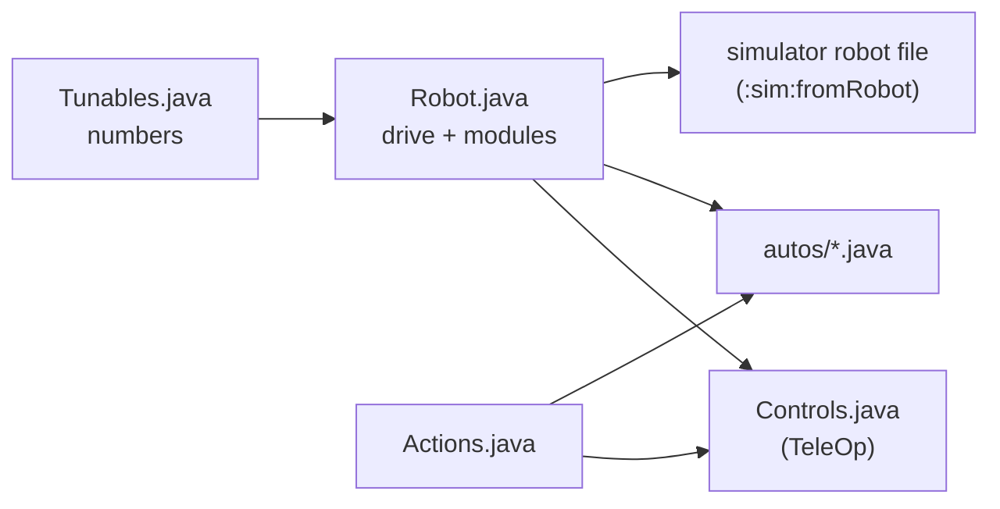

# Robot module (the robot in five files)

Package: `io.github.jasoncross.ftchelper.robot`

Learn it hands-on: [22 The robot in five files](../tutorials/22-robot-in-five-files.md). Worked
examples: [`examples/.../gobildabot`](../../examples/src/main/java/io/github/jasoncross/ftchelper/examples/gobildabot)
(goBILDA's starter bot), [`flywheelbot`](../../examples/src/main/java/io/github/jasoncross/ftchelper/examples/flywheelbot)
and [`turretbot`](../../examples/src/main/java/io/github/jasoncross/ftchelper/examples/turretbot).

A team's whole robot program in five files a student can read in one sitting. Each file answers one
question, so you always know where to look:

| File | Answers | Changes when |
| --- | --- | --- |
| `Robot.java` ([`RobotDefinition`](#robotdefinition)) | What is on the robot, and its name in the configuration? | a part is added, moved or renamed |
| `Tunables.java` | What are the numbers? | tuning (speeds, positions, PID, auto distances) |
| `Controls.java` ([`ControlMap`](#controlmap)) | Which button does what? (it is also the TeleOp) | the drivers change their minds |
| `Actions.java` ([`Action`](#action)) | Which steps use several parts together? | a new combo move |
| `autos/` ([`Auto`](#auto)) | What does the robot do on its own? | new or changed autonomous programs |

A new robot: `./gradlew :sim:newRobot -Pconfig=... -PteamCode=...` writes the five files from the
robot configuration ([below](#making-the-files)). A mechanism added later is one line in `Robot.java`:
its numbers, its standard buttons and its simulator lines come with it.



| Class | Use it to |
| --- | --- |
| [`RobotDefinition`](#robotdefinition) | describe the robot in `Robot.java`: `drive(...)` and one `add(...)` per mechanism |
| [`Drive`](#drive) | the drivetrain: mecanum or tank, motor names, motor, wheel, IMU |
| [`Intake`](#intake) | a roller on a motor and/or CR servos: in, out, on at the start |
| [`Lift`](#lift) | a slide on a motor with named heights and a bottom switch |
| [`Arm`](#arm) | an arm on a motor with named angles in degrees |
| [`Claw`](#claw) | a claw servo: open, closed |
| [`Wrist`](#wrist) | a wrist servo with named positions |
| [`Positioner`](#positioner) | any servo with named positions (deploy, fold, gate) |
| [`Turret`](#turret) | a turret inside its limits, by hand or following the camera's goal |
| [`Launcher`](#launcher) | a flywheel and its [`Indexer`](#indexer): spin up, fire, speed from distance |
| [`Indexer`](#indexer) | feeds one piece at a time (servo, CR servo or motor) |
| [`Camera`](#camera) | a Limelight or webcam; the alliance's goal |
| [`Action`](#action) | steps across several parts that never block |
| [`Mode`](#modes) | an always-on rule a module follows while it is on |
| [`ControlMap`](#controlmap), [`Pad`](#controlmap) | `Controls.java`: the TeleOp and the button map |
| [`Auto`](#auto), [`Steps`](#auto) | one autonomous as a list of steps |
| [`Toggleable`](#controlmap) | anything one button switches on and off |
| [`Motors`](#motors) | encoder counts and speed of the common motors, by catalog id |
| [`Module`](#module), [`MotorPositions`](#lift), [`ServoPositions`](#claw), [`Devices`](#module) | what the modules share (you rarely use these by name) |

---

## RobotDefinition

```java
public class Robot extends RobotDefinition {
    public Intake intake;
    public Lift lift;
    public Claw claw;

    @Override protected void define() {
        drive(Drive.mecanum("front_left", "front_right", "back_left", "back_right")
                .motor("gobilda-5203-312").wheelMm(96)
                .imu("imu", LogoFacingDirection.UP, UsbFacingDirection.FORWARD));
        intake = add(Intake.motor("intake"));
        lift = add(Lift.slide("lift").bottomSwitch("lift_bottom"));
        claw = add(Claw.servo("claw"));
        atStart(() -> Actions.deployIntake(this));   // optional: an action right after START
    }
}
```

`define()` only describes: it runs in INIT, and also without a robot (to write the simulator file).
The OpMode classes make the hardware ([`setup`](#robotdefinition)) and update every part each loop.
Nothing moves in INIT.

| In `define()` | |
| --- | --- |
| `drive(Drive d)` | the drivetrain (required) |
| `T add(T module)` | a mechanism; hands it back for the field |
| `atStart(Supplier<Action>)` | an action that runs once right after START, in autonomous and TeleOp |
| `tunables(Class)` | the Tunables class if it is not `Tunables` in the same folder |

| For your code | |
| --- | --- |
| `run(Action)`, `cancel(Action)`, `cancelAll()` | start or stop actions |
| `alliance()` | this match's alliance (from autonomous's menu; TeleOp remembers it) |
| `notes()` | INIT notes: missing Tunables sections or fields (the library's defaults are used) |
| `modules()`, `drive()`, `all()` | the parts, the drivetrain, the update group |
| `robotConfig()` | the drive settings for `EasyTeleOp`/`EasyAuto` |
| `simLines()` | the simulator robot file's lines from the code |
| `setup(hardwareMap)` | makes every module's hardware (the OpMode classes call it in INIT) |
| `tunablesClass()` | the Tunables class found (null if none) |
| `static changedTunables()` | values tuned on the robot that differ from Tunables.java, as lines to copy back |
| `static sectionName(device)` | the Tunables section a device reads: "intake_deploy" -> `IntakeDeploy` |

Checked at INIT: a device name used twice, two parts reading the same Tunables section, an indexer
added twice. Each stops with the name.

### Tunables.java

```java
public class Tunables {
    public static class Drive { public static double maxPower = 1.0, practiceMaxPower = 0.6, slowSpeed = 0.3; ... }
    public static class Lift {
        public static double min = 0, max = 2600;            // the safe range (not tunable live)
        public static double kP = 0.004, kI = 0, kD = 0.0002, kF = 0.05;
        public static double down = 0, low = 900, high = 2400;   // named heights: any names
    }
    public static class Claw { public static double open = 0.20, closed = 0.75; }
}
```

- **One section per part**, named after its configuration name in CamelCase: `intake_deploy` reads
  `IntakeDeploy`. Pick another with `.tunables("Name")` on the module.
- **The code is the record.** The numbers you tune most become [`Tunable`](tuning.md)s ("Lift/kP"):
  the tuning menu (GUIDE, PRACTICE profile) changes them and saves them on the Control Hub. INIT then
  shows "Tuned on this robot (copy into Tunables.java)" with the lines to copy back.
- **Missing numbers are not errors:** the library's default is used and INIT says which.
- **Safety:** a tuned position stays inside `min`..`max`; limits are read once and cannot be tuned.
- `public static` fields: FTC Dashboard can show them too.
- The menu's names ("Lift/kP") are shared by the whole robot app: keep one Robot class per app.

| | In the tuning menu, used at once | In the tuning menu, used from the next INIT | Code only (read at INIT) |
| --- | --- | --- | --- |
| Drive | | every number | `calibrated` |
| Intake | `inPower`, `outPower` | | |
| Lift, Arm | `kP`, `kI`, `kD`, `kF`, every named position | | `min`, `max`, `maxPower`, `slowZone`, `slowZonePower`, `tolerance` |
| Claw, Wrist, Positioner | every named position | | `travelSec` |
| Turret | `kP`, `kI`, `kD` | | `min`, `max`, `maxPower`, `tolerance`, `slowZone`, `slowZonePower`, `cameraOffset` |
| Launcher | `speedRpm`, `stepRpm` | | `readyBandRpm`, `idleRpm`, `shotIntervalSec`, `speedByDistance`, `kP`..`kF` |
| Indexer | every number | | |
| Camera | | | `pipeline` |

---

## Drive

```java
drive(Drive.mecanum("front_left", "front_right", "back_left", "back_right")
        .motor("gobilda-5203-312").wheelMm(96).imu("imu", LogoFacingDirection.UP, UsbFacingDirection.FORWARD));
drive(Drive.tank("left_drive", "right_drive").reversed("right_drive"));
```

| Method | |
| --- | --- |
| `mecanum(fl, fr, bl, br)`, `tank(left, right)`, `tank(fl, fr, bl, br)` | the type and motor names |
| `motor(id)` | the drive motor's [catalog id](#motors) (default `gobilda-5203-312`) |
| `wheelMm(mm)`, `gearRatio(r)` | wheel diameter (default 96), motor turns per wheel turn |
| `reversed(names...)` | exactly these motors run reversed (default: the left side) |
| `imu(name, logo, usb)`, `noImu()` | the IMU and how the hub is mounted (default "imu", UP, FORWARD) |

`Tunables.Drive`: `maxPower`, `practiceMaxPower` (PRACTICE profile), `slowSpeed` (the slow trigger),
`strafeCorrection`, `turnKp`, `turnKd`, `moveMinPower`, and `calibrated` (autonomous refuses to run
until it is `true`: tune with the Drive Tuner first, [tutorial 09](../tutorials/09-first-auto.md)).

---

## Intake

```java
intake = add(Intake.motor("intake"));
intake = add(Intake.motor("intake").onAtStart());
intake = add(Intake.crServos("left_intake", "right_intake").reversed("right_intake"));
intake = add(Intake.motor("intake").withCrServos("left_wheel", "right_wheel").reversed("right_wheel"));
```

| Method | |
| --- | --- |
| `in()`, `out()`, `stop()`, `toggle()` | run in / out until stopped; on/off |
| `reverse()`, `endReverse()` | push out while a button is held, then back to what it was doing |
| `isRunning()` | |
| `onAtStart()` | runs in from START until stopped |

`Tunables.Intake`: `inPower` (1.0), `outPower` (0.7). Buttons: hold operator RT in, LT out; with
`onAtStart()`: RT switches it on/off, hold LT pushes out.

---

## Lift

[`MotorPositions`](#lift) is what Lift and Arm share: `goTo(name)` (capitals do not matter; a typo
shows a warning and does nothing), `stepUp()`, `stepDown()`, `manual(power)` (0 holds where it was
let go), `hold()`, `isAtTarget()`, `isAt(name)`, `position()`, `positions()`, `part()`
(the [`PositionMotor`](mechanism.md#positionmotor) inside).

```java
lift = add(Lift.slide("lift").bottomSwitch("lift_bottom"));
```

`Tunables.Lift` (encoder counts): `min`, `max`, `kP`, `kI`, `kD`, `kF` (the steady push that holds it
up), `maxPower`, `slowZone`, `slowZonePower`, `tolerance`; every other number is a named height.
Buttons (operator): A lowest, X second, Y highest, D-pad up/down next height, left stick by hand.
With a bottom switch, the lift only goes down (slowly) until the switch has been pressed once, and the
switch sets 0. **Without one, 0 is wherever the lift is at INIT** (the encoder starts from there):
press INIT with the lift all the way down, also for TeleOp after an autonomous that left it up, or
`max` will be too high by that much. INIT reminds you.

## Arm

```java
arm = add(Arm.motor("arm", "gobilda-5203-117").gearRatio(2));
```

The same as Lift, in degrees (`gearRatio`: motor turns per arm turn; `bottomSwitch(name)` like the
lift's). 0 degrees is where the arm is
when the program starts. Button: operator right stick Y by hand.

---

## Claw

[`ServoPositions`](#claw) is what Claw, Wrist and Positioner share: `goTo(name)`, `isDone()` (it should
have arrived: a guess from `travelSec`), `isAt(name)`, `positions()`, `part()` (the
[`PositionServo`](mechanism.md#positionservo) inside), `reversed()`. In Tunables every number is a
named position (0 to 1) except `travelSec`. A servo does not move until the first command after START.

```java
claw = add(Claw.servo("claw"));       // Tunables.Claw: open, closed (both needed)
```

`open()`, `close()`, `toggle()`, `isClosed()`. Button: operator B opens/closes.

## Wrist

```java
wrist = add(Wrist.servo("wrist"));    // Tunables.Wrist: any positions, e.g. down, level, up
```

`next()`, `previous()` (by value). Buttons: operator D-pad left/right.

## Positioner

```java
intakeDeploy = add(Positioner.servo("intake_deploy"));   // Tunables.IntakeDeploy: stowed, deployed
```

`goTo(name)`, `next()`. No suggested buttons: use it from Controls.java or an action.

---

## Turret

```java
turret = add(Turret.motor("turret", "gobilda-5203-117").gearRatio(5).follows(camera));
```

| Method | |
| --- | --- |
| `followMode()` | the [mode](#modes) that follows the camera's goal (on from START with `follows`) |
| `aimAt(deg)` | turn to an angle (stops following) |
| `manual(power)` | by hand; following pauses while the stick moves |
| `isAimed()`, `isOutOfRange()`, `angle()`, `part()` | |
| `cameraOnBody()` | the camera is on the robot, not on the turret |

`Tunables.Turret`: `min`, `max` (degrees, counterclockwise +, 0 = forward: it never turns past them; a
goal outside waits at the limit and the Driver Station says "goal out of turret range"), `kP`, `kI`,
`kD`, `maxPower`, `tolerance`, `slowZone`, `slowZonePower`, `cameraOffset`. Buttons: operator right
stick X by hand, BACK following on/off.

---

## Launcher

```java
launcher = add(Launcher.flywheel("launcher", "gobilda-5203-6000").feeder(Indexer.servo("indexer")));
launcher = add(Launcher.flywheel("launcher", "gobilda-5203-6000").feeder(Indexer.servo("indexer"))
        .speedFromDistance(camera).requireReady("turret aimed", () -> turret.isAimed()));
```

| Method | |
| --- | --- |
| `spinUp()`, `idle()`, `toggle()` | to the shot speed; back to `idleRpm` |
| `fire()`, `fire(n)` | spins up if needed, feeds as soon as it is at speed (gives up after 3 s, saying why) |
| `adjust(steps)` | speed +/- steps x `stepRpm` (not saved) |
| `speedMode()` | the [mode](#modes) that sets the speed from the camera's distance |
| `isReady()`, `isShooting()`, `targetRpm()`, `part()` | |
| `requireReady(what, check)` | another check before each feed (e.g. the turret is aimed) |

`Tunables.Launcher`: `speedRpm`, `stepRpm`, `readyBandRpm`, `idleRpm`, `shotIntervalSec`,
`speedByDistance` (`{{inches, rpm}, ...}`, blended between rows; with no goal in view the last speed
stays), and `kP`, `kI`, `kD`, `kF` (the hub's speed control; only used when `kF` is there: the
[Flywheel Finder](../guides/finders.md) finds them). Buttons (operator): LB spin up/down, RB fire one,
D-pad up/down speed (when free and no speed-from-distance).

## Indexer

`Indexer.servo(name)` (Tunables: `rest`, `push`, `pushSec`, `returnSec`), `Indexer.crServo(name)` and
`Indexer.motor(name)` (`power`, `feedSec` per piece), `.reversed()`. Usually given to a launcher with
`.feeder(...)`; added on its own its button is operator RB (feed one). A servo indexer goes to `rest`
at START.

---

## Camera

```java
camera = add(Camera.limelight("limelight").goal("BLUE SCORING", "RED SCORING"));
camera = add(Camera.webcam("Webcam 1"));
```

`goal()` (the alliance's goal, or null), `target(name)`, `target(id)`, `source()` (the
[`TargetSource`](vision.md) inside). Tunables (Limelight): `pipeline`. It starts in INIT.

---

## Action

```java
public static Action scoreHigh(Robot r) {
    return Action.named("Score high")
            .then(() -> r.lift.goTo("high"))
            .waitUntil("lift at the top", r.lift::isAtTarget, 2.0)
            .then(r.claw::open)
            .waitSeconds(0.3)
            .then(() -> r.lift.goTo("down"));
}
// Controls.java:  g2.y.press(Actions.scoreHigh(robot));    an autonomous:  s.action(Actions.scoreHigh(robot));
```

| Method | |
| --- | --- |
| `named(name)` | a new action |
| `then(Runnable...)` | do these at once (several parts together), then go on |
| `waitSeconds(s)` | wait (the robot keeps running) |
| `waitUntil(what, condition, timeoutSec)` | wait until true; if it times out the action STOPS and says why |
| `waitUntil(condition, timeoutSec)` | the same, with "the condition" as its words |
| `name()`, `isRunning()`, `status()`, `result()` | "Score high: step 2 of 5 (lift at the top)"; "done", "cancelled", "stopped: Lift moved by hand" |

- **Never blocks:** an action does a little every loop.
- **Parts are claimed:** an action owns the parts it commands while it runs. Another action that
  commands one of them stops it ("taken by ..."); so does the driver moving it by hand (a button or a
  stick away from the middle): the driver always wins.
- **Press again to cancel** (a button bound with `press(action)`). A stopped action (cancelled, taken
  over, timed out) stops what it started, safely: a lift or arm holds its height, a turret its angle,
  shots still waiting are dropped, an intake stops. An action that finishes keeps its last commands.
  A failed action in an autonomous says why in the report.

## Modes

A [`Mode`](#modes) is a rule a module follows every loop while it is on: `Turret.followMode()`,
`Launcher.speedMode()`. `on()`, `off()`, `toggle()`, `isOn()`; a button switches it with
`g2.back.toggle(robot.turret.followMode())`. Modes are for "always" rules, actions for steps that end.

---

## ControlMap

```java
@TeleOp(name = "TeleOp")
public class Controls extends ControlMap<Robot> {
    public static boolean oneDriver = false;   // true: everything on gamepad 1

    @Override protected void buttons(Robot robot, Pad g1, Pad g2) {
        g2.y.press(Actions.scoreHigh(robot)).says("score high");
    }
}
```

`Controls.java` is the TeleOp ([`EasyTeleOp`](teleop.md) underneath). Every module on the robot already
has its standard buttons; write only what differs. A [`Pad`](#controlmap) has every input by name:
`a b x y lb rb lt rt back start dpadUp dpadDown dpadLeft dpadRight leftStickButton rightStickButton`
(buttons; a trigger counts as pressed past half way) and `leftStickX leftStickY rightStickX rightStickY`
(sticks, up and right +).

| On a button | |
| --- | --- |
| `press(Runnable)` | once per press |
| `press(Action)` | starts it; press again cancels |
| `release(Runnable)` | once when let go |
| `hold(whileHeld)`, `hold(whileHeld, onRelease)` | every loop while held (and once on release) |
| `toggle(Toggleable)` | switches a part on/off (an intake, a launcher, a claw, a mode: a [`Toggleable`](#controlmap)) |
| `toggle(onEnable, onDisable)` | each press flips |
| `free()` | no job: the button stays free, even if a module suggested one for it |
| `says(words)` | the words on the help page |
| on a stick: `use(DoubleConsumer)` | its value every loop (small dead zone, gentle curve) |

**The standard map** (two drivers; with `oneDriver = true` the operator's buttons move to gamepad 1):

| Input | Gamepad 1 (driver) | Gamepad 2 (operator) |
| --- | --- | --- |
| Left stick | drive (and strafe) | lift by hand (Y) |
| Right stick | turn (X) | arm by hand (Y), turret by hand (X) |
| LT / RT | slow (hold) / free | intake out (hold) / intake in (hold, or on/off) |
| LB / RB | free | launcher spin up/down / fire one |
| A / X / Y / B | free / free / field-centric on/off (mecanum) / free | lift lowest / second / highest / claw |
| D-pad up/down | free | lift next height, or launcher speed |
| D-pad left/right | free | wrist |
| BACK | "forward" = away from you now | turret following on/off |
| START + BACK, GUIDE | debug lines, tuning menu | |

One driver: left stick click is slow on/off and right stick click field-centric. Write the switch
exactly as `public static boolean oneDriver = true;` (INIT stops with a message if it is not static). A module whose
button is taken gets none (INIT notes it). Checked at INIT: two jobs on one button in Controls.java,
or a job on a driving button, stop with the button's name. INIT shows the whole map and the free
buttons.

---

## Auto

```java
@Autonomous(name = "Score and Park", preselectTeleOp = "TeleOp")
public class ScoreAndPark extends Auto<Robot> {
    @Override protected void steps(Steps s, Robot robot) {
        s.start("Back wall, 2nd tile from the left, facing the field", 0)
         .menuYesNo("Score", true)
         .run("Hold the piece", robot.claw::close)
         .move("Leave the wall", 4, 0, 0.4)
         .onlyIf("Score")
             .run("Lift up", () -> robot.lift.goTo("high"))
             .move("Drive to the goal", 24, 0, 0.6)
             .waitUntil("Lift at the top", robot.lift::isAtTarget, 2.0)
             .run("Drop", robot.claw::open)
         .end()
         .parkWithSeconds(4)
         .move("Park", 20, 90, 0.7);
    }
}
```

[`Steps`](#auto): `start(where, headingDeg)`, `menuYesNo(label, yes)`, `menuChoice(label, options...)`,
`onlyIf(label)` / `onlyIf(label, option)` ... `end()`, `isYes(label)`, `choice(label)`,
`move(label, inches, directionDeg, power)` (0 forward, 90 right), `turn`, `turnTo`,
`run(label, command)` (starts and goes on), `waitSeconds`, `waitUntil`, `action(action[, timeout])`
(waits until done), `alongside(action)` (runs during the next steps), `step(label, AutoStep)`,
`parkWithSeconds(s)` (the steps after it get the last s seconds).

The steps are read twice: in INIT (for the menu and the start position; nothing runs) and after
START. Everything else is [`EasyAuto`](auto.md#easyauto): alliance and delay menu, mirroring for RED,
the timer, stopping everything, the report. Autonomous refuses to run until `Tunables.Drive.calibrated`.

---

## Motors

`Motors.get("gobilda-5203-312")` gives `countsPerRev` and `freeRpm`; `Motors.all()` lists them. The ids
are the simulator's [parts catalog](../guides/parts-catalog.md) (a test keeps the two the same).

## Module

[`Module`](#module) is what every mechanism shares: `name()` (its Tunables section), `deviceName()`,
`tunables(section)`. [`Devices`](#module) is where modules find their hardware: `Devices.of(hardwareMap)`
on the robot; tests give pretend devices. A new kind of module is a change to the library (its parts are
package-private, see AGENTS.md); in team code, use the plain parts ([mechanism](mechanism.md)) in
your own class and call it from Controls.java and your autos.

**`stop()` on any module** switches it off now (a launcher fully off, until `spinUp()`/`fire()`), and
counts as the driver's command: an action using that part stops. To let a launcher coast while keeping
it ready, use `idle()`.

---

## Making the files

```bash
./gradlew :sim:newRobot -Pconfig=path/to/config.xml -PteamCode=../TeamCode
```

Writes `Robot.java`, `Tunables.java`, `Controls.java`, `Actions.java` and `autos/LeaveStart.java` from
the robot configuration (the XML file the Driver Station keeps on the Control Hub). Each device gets
its module from its name and type ("lift" is a Lift, a servo called "claw" a Claw); every guess it is
not sure of is a `TODO` in Robot.java. It never overwrites a file.

```bash
./gradlew :sim:fromRobot -PteamCode=../TeamCode
```

Writes (or refreshes) `simulator/robot.properties` from Robot.java and Tunables.java: every device
name, the drive, each module's lines. Lines it writes end with `# from Robot.java`; your own lines
(measured, from photos or CAD) are kept. It stops if the file describes a device differently from
the code. See the [simulator guide](../guides/simulator.md#a-robot-file-from-robotjava).
