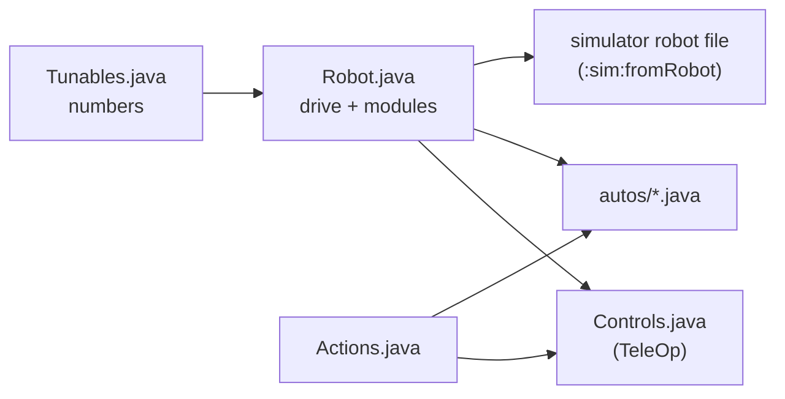

# Robot module (the robot in five files)

> **Work in progress:** this library and its docs are still changing. Something wrong or unclear? [Tell us](https://github.com/jasoncross/ftc-helper-lib/issues).

Package: `io.github.jasoncross.ftchelper.robot`

Learn it hands-on: [22 The robot in five files](../tutorials/22-robot-in-five-files.md). Worked
examples: [`examples/.../gobildabot`](../../examples/src/main/java/io/github/jasoncross/ftchelper/examples/gobildabot)
(goBILDA's starter bot), [`flywheelbot`](../../examples/src/main/java/io/github/jasoncross/ftchelper/examples/flywheelbot)
and [`turretbot`](../../examples/src/main/java/io/github/jasoncross/ftchelper/examples/turretbot).

A team's whole robot program in five files a student can read in one sitting. Each file answers one
question, so you always know where to look:

| File | Answers | Changes when |
| --- | --- | --- |
| `Robot.java` ([`RobotDefinition`](#robotdefinition)) | What is on the robot, and its name in the configuration? | a part is added, moved or renamed |
| `Tunables.java` | What are the numbers? | tuning (speeds, positions, PID, auto distances) |
| `Controls.java` ([`ControlMap`](#controlmap)) | Which button does what? (it is also the TeleOp) | the drivers change their minds |
| `Actions.java` ([`Action`](#action)) | Which steps use several parts together? | a new combo move |
| `autos/` ([`Auto`](#auto)) | What does the robot do on its own? | new or changed autonomous programs |

A new robot: `./gradlew :sim:newRobot -Pconfig=... -PteamCode=...` writes the five files from the
robot configuration ([below](#making-the-files)). A mechanism added later is one line in `Robot.java`:
its numbers, its standard buttons and its simulator lines come with it.



| Class | Use it to |
| --- | --- |
| [`RobotDefinition`](#robotdefinition) | describe the robot in `Robot.java`: `drive(...)` and one `add(...)` per mechanism |
| [`Drive`](#drive) | the drivetrain: mecanum or tank, motor names, motor, wheel, IMU |
| [`Intake`](#intake) | a roller on a motor and/or CR servos: in, out, on at the start |
| [`Lift`](#lift) | a slide on a motor with named heights and a bottom switch |
| [`Arm`](#arm) | an arm on a motor with named angles in degrees |
| [`Claw`](#claw) | a claw servo: open, closed |
| [`Wrist`](#wrist) | a wrist servo with named positions |
| [`Positioner`](#positioner) | any servo with named positions (deploy, fold, gate) |
| [`Turret`](#turret) | a turret inside its limits, by hand or following the camera's goal |
| [`Launcher`](#launcher) | a flywheel and its [`Indexer`](#indexer): spin up, fire, speed from distance |
| [`Indexer`](#indexer) | feeds one piece at a time (servo, CR servo or motor) |
| [`Camera`](#camera) | a Limelight or webcam; the alliance's goal |
| [`Action`](#action) | steps across several parts that never block |
| [`Mode`](#modes) | an always-on rule a module follows while it is on |
| [`ControlMap`](#controlmap), [`Pad`](#controlmap) | `Controls.java`: the TeleOp and the button map |
| [`Auto`](#auto), [`Steps`](#auto) | one autonomous as a list of steps |
| [`Toggleable`](#controlmap) | anything one button switches on and off |
| [`Motors`](#motors) | encoder counts and speed of the common motors, by catalog id |
| [`Shape`](#shapes-and-parts), [`Parts`](#shapes-and-parts) | how each part looks and where it sits, for the simulator; wheels, rollers and servos by catalog id |
| [`Module`](#module), [`MotorPositions`](#lift), [`ServoPositions`](#claw), [`Devices`](#module) | what the modules share (you rarely use these by name) |

---

## RobotDefinition

```java
public class Robot extends RobotDefinition {
    public Intake intake;
    public Lift lift;
    public Claw claw;

    @Override protected void define() {
        drive(Drive.mecanum("front_left", "front_right", "back_left", "back_right")
                .motor("gobilda-5203-312").wheelMm(96)
                .imu("imu", LogoFacingDirection.UP, UsbFacingDirection.FORWARD));
        intake = add(Intake.motor("intake"));
        lift = add(Lift.slide("lift").bottomSwitch("lift_bottom"));
        claw = add(Claw.servo("claw"));
        atStart(() -> Actions.deployIntake(this));   // optional: an action right after START
    }
}
```

`define()` only describes: it runs in INIT, and also without a robot (to write the simulator file).
The OpMode classes make the hardware ([`setup`](#robotdefinition)) and update every part each loop.
Nothing moves in INIT.

| In `define()` | |
| --- | --- |
| `drive(Drive d)` | the drivetrain (required) |
| `T add(T module)` | a mechanism; hands it back for the field |
| `atStart(Supplier<Action>)` | an action that runs once right after START, in autonomous and TeleOp |
| `tunables(Class)` | the Tunables class if it is not `Tunables` in the same folder |
| `chassisMm(l, w, h)`, `heightMm(h)`, `fixed(Shape...)` | for the simulator: the chassis box, the whole robot's height, parts the code does not move ([Shapes](#shapes-and-parts)) |

| For your code | |
| --- | --- |
| `run(Action)`, `cancel(Action)`, `cancelAll()` | start or stop actions |
| `alliance()` | this match's alliance (from autonomous's menu; TeleOp remembers it) |
| `notes()` | INIT notes: missing Tunables sections or fields (the library's defaults are used) |
| `modules()`, `drive()`, `all()` | the parts, the drivetrain, the update group |
| `robotConfig()` | the drive settings for `EasyTeleOp`/`EasyAuto` |
| `simLines()` | the simulator robot file's lines from the code |
| `setup(hardwareMap)` | makes every module's hardware (the OpMode classes call it in INIT) |
| `tunablesClass()` | the Tunables class found (null if none) |
| `static changedTunables()` | values tuned on the robot that differ from Tunables.java, as lines to copy back |
| `static sectionName(device)` | the Tunables section a device reads: "intake_deploy" -> `IntakeDeploy` |

Checked at INIT: a device name used twice, two parts reading the same Tunables section, an indexer
added twice. Each stops with the name.

### Tunables.java

```java
public class Tunables {
    public static class Drive { public static double maxPower = 1.0, practiceMaxPower = 0.6, slowSpeed = 0.3; ... }
    public static class Lift {
        public static double min = 0, max = 2600;            // the safe range (not tunable live)
        public static double kP = 0.004, kI = 0, kD = 0.0002, kF = 0.05;
        public static double down = 0, low = 900, high = 2400;   // named heights: any names
    }
    public static class Claw { public static double open = 0.20, closed = 0.75; }
}
```

- **One section per part**, named after its configuration name in CamelCase: `intake_deploy` reads
  `IntakeDeploy`. Pick another with `.tunables("Name")` on the module.
- **The code is the record.** The numbers you tune most become [`Tunable`](tuning.md)s ("Lift/kP"):
  the tuning menu (hold GUIDE 1 s, PRACTICE profile) changes them and saves them on the Control Hub. INIT then
  shows "Tuned on this robot (copy into Tunables.java)" with the lines to copy back.
- **Missing numbers are not errors:** the library's default is used and INIT says which.
- **Safety:** a tuned position stays inside `min`..`max`; limits are read once and cannot be tuned.
- `public static` fields: FTC Dashboard can show them too.
- The menu's names ("Lift/kP") are shared by the whole robot app: keep one Robot class per app.

| | In the tuning menu, used at once | In the tuning menu, used from the next INIT | Code only (read at INIT) |
| --- | --- | --- | --- |
| Drive | | every number | `calibrated` |
| Intake | `inPower`, `outPower` | | |
| Lift, Arm | `kP`, `kI`, `kD`, `kF`, every named position | | `min`, `max`, `maxPower`, `slowZone`, `slowZonePower`, `tolerance` |
| Claw, Wrist, Positioner | every named position | | `travelSec` |
| Turret | `kP`, `kI`, `kD` | | `min`, `max`, `maxPower`, `tolerance`, `slowZone`, `slowZonePower`, `cameraOffset` |
| Launcher | `speedRpm`, `stepRpm` | | `readyBandRpm`, `idleRpm`, `shotIntervalSec`, `speedByDistance`, `kP`..`kF` |
| Indexer | every number | | |
| Camera | | | `pipeline` |

---

## Drive

```java
drive(Drive.mecanum("front_left", "front_right", "back_left", "back_right")
        .motor("gobilda-5203-312").wheelMm(96).imu("imu", LogoFacingDirection.UP, UsbFacingDirection.FORWARD));
drive(Drive.tank("left_drive", "right_drive").reversed("right_drive"));
```

| Method | |
| --- | --- |
| `mecanum(fl, fr, bl, br)`, `tank(left, right)`, `tank(fl, fr, bl, br)` | the type and motor names |
| `motor(id)` | the drive motor's [catalog id](#motors) (default `gobilda-5203-312`; the other parts use `part(id)`) |
| `wheelMm(mm)`, `gearRatio(r)` | wheel diameter (default 96), motor turns per wheel turn |
| `wheel(id)` | the wheel by its [catalog id](#shapes-and-parts), e.g. `"gobilda-hogback-96"`: its diameter comes from the catalog |
| `wheelsAtMm(track, wheelBase)` | for the simulator: wheel centres side to side and front to back, mm |
| `reversed(names...)` | exactly these motors run reversed (default: the left side) |
| `imu(name, logo, usb)`, `noImu()` | the IMU and how the hub is mounted (default "imu", UP, FORWARD) |

`Tunables.Drive`: `maxPower`, `practiceMaxPower` (PRACTICE profile), `slowSpeed` (the slow trigger),
`strafeCorrection`, `turnKp`, `turnKd`, `moveMinPower`, and `calibrated` (autonomous refuses to run
until it is `true`: tune with the Drive Tuner first, [tutorial 09](../tutorials/09-first-auto.md)).

---

## Intake

```java
intake = add(Intake.motor("intake"));
intake = add(Intake.motor("intake").onAtStart());
intake = add(Intake.crServos("left_intake", "right_intake").reversed("right_intake"));
intake = add(Intake.motor("intake").withCrServos("left_wheel", "right_wheel").reversed("right_wheel"));
```

| Method | |
| --- | --- |
| `in()`, `out()`, `stop()`, `toggle()` | run in / out until stopped; on/off |
| `reverse()`, `endReverse()` | push out while a button is held, then back to what it was doing |
| `isRunning()` | |
| `onAtStart()` | runs in from START until stopped |
| `holds(n)` | for the simulator: how many pieces it carries (default: a guess of 3) |

`Tunables.Intake`: `inPower` (1.0), `outPower` (0.7). Buttons: hold operator RT in, LT out; with
`onAtStart()`: RT switches it on/off, hold LT pushes out.

---

## Lift

[`MotorPositions`](#lift) is what Lift and Arm share: `goTo(name)` (capitals do not matter; a typo
shows a warning and does nothing), `stepUp()`, `stepDown()`, `manual(power)` (0 holds where it was
let go), `hold()`, `isAtTarget()`, `isAt(name)`, `position()`, `positions()`, `part()`
(the [`PositionMotor`](mechanism.md#positionmotor) inside).

```java
lift = add(Lift.slide("lift").bottomSwitch("lift_bottom"));
```

`Tunables.Lift` (encoder counts): `min`, `max`, `kP`, `kI`, `kD`, `kF` (the steady push that holds it
up), `maxPower`, `slowZone`, `slowZonePower`, `tolerance`; every other number is a named height.
Buttons (operator): A lowest, X second, Y highest, D-pad up/down next height, left stick by hand.
With a bottom switch, the lift only goes down (slowly) until the switch has been pressed once, and the
switch sets 0. **Without one, 0 is wherever the lift is at INIT** (the encoder starts from there):
press INIT with the lift all the way down, also for TeleOp after an autonomous that left it up, or
`max` will be too high by that much. INIT reminds you.

## Arm

```java
arm = add(Arm.motor("arm", "gobilda-5203-117").gearRatio(2));
```

The same as Lift, in degrees (`gearRatio`: motor turns per arm turn; `bottomSwitch(name)` like the
lift's). 0 degrees is where the arm is
when the program starts. Button: operator right stick Y by hand.

---

## Claw

[`ServoPositions`](#claw) is what Claw, Wrist and Positioner share: `goTo(name)`, `isDone()` (it should
have arrived: a guess from `travelSec`), `isAt(name)`, `positions()`, `part()` (the
[`PositionServo`](mechanism.md#positionservo) inside), `reversed()`. In Tunables every number is a
named position (0 to 1) except `travelSec`. A servo does not move until the first command after START.

```java
claw = add(Claw.servo("claw"));       // Tunables.Claw: open, closed (both needed)
```

`open()`, `close()`, `toggle()`, `isClosed()`. Button: operator B opens/closes.

## Wrist

```java
wrist = add(Wrist.servo("wrist"));    // Tunables.Wrist: any positions, e.g. down, level, up
```

`next()`, `previous()` (by value). Buttons: operator D-pad left/right.

## Positioner

```java
intakeDeploy = add(Positioner.servo("intake_deploy"));   // Tunables.IntakeDeploy: stowed, deployed
```

`goTo(name)`, `next()`. No suggested buttons: use it from Controls.java or an action. For the simulator,
it swings an arm shape: `.looks(Shape.arm()...angle("stowed", 90).angle("deployed", 20))`, and can push a
passive part over (`Shape.dropsWhen`, [Shapes](#shapes-and-parts)).

---

## Turret

```java
turret = add(Turret.motor("turret", "gobilda-5203-117").gearRatio(5).follows(camera));
```

| Method | |
| --- | --- |
| `followMode()` | the [mode](#modes) that follows the camera's goal (on from START with `follows`) |
| `aimAt(deg)` | turn to an angle (stops following) |
| `manual(power)` | by hand; following pauses while the stick moves |
| `isAimed()`, `isOutOfRange()`, `angle()`, `part()` | |
| `cameraOnBody()` | the camera is on the robot, not on the turret |

`Tunables.Turret`: `min`, `max` (degrees, counterclockwise +, 0 = forward: it never turns past them; a
goal outside waits at the limit and the Driver Station says "goal out of turret range"), `kP`, `kI`,
`kD`, `maxPower`, `tolerance`, `slowZone`, `slowZonePower`, `cameraOffset`. Buttons: operator right
stick X by hand, BACK following on/off.

---

## Launcher

```java
launcher = add(Launcher.flywheel("launcher", "gobilda-5203-6000").feeder(Indexer.servo("indexer")));
launcher = add(Launcher.flywheel("launcher", "gobilda-5203-6000").feeder(Indexer.servo("indexer"))
        .speedFromDistance(camera).requireReady("turret aimed", () -> turret.isAimed()));
```

| Method | |
| --- | --- |
| `spinUp()`, `idle()`, `toggle()` | to the shot speed; back to `idleRpm` |
| `fire()`, `fire(n)` | spins up if needed, feeds as soon as it is at speed (gives up after 3 s, saying why) |
| `fireWhileHeld()`, `ceaseFire()` | for a held button: one shot, then the next as soon as it is fed; on release no more (a tap still fires its one shot) |
| `adjust(steps)` | speed +/- steps x `stepRpm` (not saved) |
| `speedMode()` | the [mode](#modes) that sets the speed from the camera's distance |
| `isReady()`, `isShooting()`, `targetRpm()`, `part()` | |
| `requireReady(what, check)` | another check before each feed (e.g. the turret is aimed) |
| `spinAtStart()` | spins up at START (autonomous and TeleOp), ready for the first shot |
| `shotAngle(deg)` | for the simulator: which way a piece leaves, degrees up from the wheel shape's forward (the robot's forward for a wheel mounted level; 135 = up and out of the back) |

`Tunables.Launcher`: `speedRpm`, `stepRpm`, `readyBandRpm`, `idleRpm`, `shotIntervalSec`,
`speedByDistance` (`{{inches, rpm}, ...}`, blended between rows; with no goal in view the last speed
stays), and `kP`, `kI`, `kD`, `kF` (the hub's speed control; only used when `kF` is there: the
[Flywheel Finder](../guides/finders.md) finds them). Buttons (operator): LB spin up/down, RB fire one (hold: keep firing, `fireWhileHeld()` / `ceaseFire()` on release),
D-pad up/down speed (when free and no speed-from-distance).

## Indexer

`Indexer.servo(name)` (Tunables: `rest`, `push`, `pushSec`, `returnSec`), `Indexer.crServo(name)` and
`Indexer.motor(name)` (`power`, `feedSec` per piece), `.reversed()`. Usually given to a launcher with
`.feeder(...)`; added on its own its button is operator RB (feed one). A servo indexer goes to `rest`
at START.

---

## Camera

```java
camera = add(Camera.limelight("limelight").goal("BLUE SCORING", "RED SCORING"));
camera = add(Camera.webcam("Webcam 1"));
```

`goal()` (the alliance's goal, or null), `target(name)`, `target(id)`, `source()` (the
[`TargetSource`](vision.md) inside). Tunables (Limelight): `pipeline`. It starts in INIT.

---

## Action

```java
public static Action scoreHigh(Robot r) {
    return Action.named("Score high")
            .then(() -> r.lift.goTo("high"))
            .waitUntil("lift at the top", r.lift::isAtTarget, 2.0)
            .then(r.claw::open)
            .waitSeconds(0.3)
            .then(() -> r.lift.goTo("down"));
}
// Controls.java:  g2.y.press(Actions.scoreHigh(robot));    an autonomous:  s.action(Actions.scoreHigh(robot));
```

| Method | |
| --- | --- |
| `named(name)` | a new action |
| `then(Runnable...)` | do these at once (several parts together), then go on |
| `waitSeconds(s)` | wait (the robot keeps running) |
| `waitUntil(what, condition, timeoutSec)` | wait until true; if it times out the action STOPS and says why |
| `waitUntil(condition, timeoutSec)` | the same, with "the condition" as its words |
| `name()`, `isRunning()`, `status()`, `result()` | "Score high: step 2 of 5 (lift at the top)"; "done", "cancelled", "stopped: Lift moved by hand" |

- **Never blocks:** an action does a little every loop.
- **Parts are claimed:** an action owns the parts it commands while it runs. Another action that
  commands one of them stops it ("taken by ..."); so does the driver moving it by hand (a button or a
  stick away from the middle): the driver always wins.
- **Press again to cancel** (a button bound with `press(action)`). A stopped action (cancelled, taken
  over, timed out) stops what it started, safely: a lift or arm holds its height, a turret its angle,
  shots still waiting are dropped, an intake stops. An action that finishes keeps its last commands.
  A failed action in an autonomous says why in the report.

## Modes

A [`Mode`](#modes) is a rule a module follows every loop while it is on: `Turret.followMode()`,
`Launcher.speedMode()`. `on()`, `off()`, `toggle()`, `isOn()`; a button switches it with
`g2.back.toggle(robot.turret.followMode())`. Modes are for "always" rules, actions for steps that end.

---

## ControlMap

```java
@TeleOp(name = "TeleOp")
public class Controls extends ControlMap<Robot> {
    public static boolean oneDriver = false;   // true: everything on gamepad 1

    @Override protected void buttons(Robot robot, Pad g1, Pad g2) {
        g2.y.press(Actions.scoreHigh(robot)).says("score high");
    }
}
```

`Controls.java` is the TeleOp ([`EasyTeleOp`](teleop.md) underneath). Every module on the robot already
has its standard buttons; write only what differs. A [`Pad`](#controlmap) has every input by name:
`a b x y lb rb lt rt back start dpadUp dpadDown dpadLeft dpadRight leftStickButton rightStickButton`
(buttons; a trigger counts as pressed past half way) and `leftStickX leftStickY rightStickX rightStickY`
(sticks, up and right +).

| On a button | |
| --- | --- |
| `press(Runnable)` | once per press |
| `press(Action)` | starts it; press again cancels |
| `release(Runnable)` | once when let go |
| `hold(whileHeld)`, `hold(whileHeld, onRelease)` | every loop while held (and once on release) |
| `toggle(Toggleable)` | switches a part on/off (an intake, a launcher, a claw, a mode: a [`Toggleable`](#controlmap)) |
| `toggle(onEnable, onDisable)` | each press flips |
| `free()` | no job: the button stays free, even if a module suggested one for it |
| `says(words)` | the words on the help page |
| on a stick: `use(DoubleConsumer)` | its value every loop (small dead zone, gentle curve) |

**The standard map** (two drivers; with `oneDriver = true` the operator's buttons move to gamepad 1):

| Input | Gamepad 1 (driver) | Gamepad 2 (operator) |
| --- | --- | --- |
| Left stick | drive (and strafe) | lift by hand (Y) |
| Right stick | turn (X) | arm by hand (Y), turret by hand (X) |
| LT / RT | slow (hold) / free | intake out (hold) / intake in (hold, or on/off) |
| LB / RB | free | launcher spin up/down / fire one (hold: keep firing) |
| A / X / Y / B | free / free / field-centric on/off (mecanum) / free | lift lowest / second / highest / claw |
| D-pad up/down | free | lift next height, or launcher speed |
| D-pad left/right | free | wrist |
| BACK | tap: **pause** everything (stopped on brake), tap again: go on; hold 1 s: "forward" = away from you now | turret following on/off |
| START + BACK | debug lines | |
| GUIDE | tap: the button map, without the free buttons (during the match too); hold 1 s: the tuning menu (PRACTICE) | |

One driver: left stick click is slow on/off and right stick click field-centric. To put slow on a
trigger instead, give it `.slow()`: `g1.lt.slow();` slows the robot the further LT is pulled (down to
`slowSpeed` at a full squeeze, like the two-driver LT); on a button, `.slow()` is slow while held. Write the switch
exactly as `public static boolean oneDriver = true;` (INIT stops with a message if it is not static). A module whose
button is taken gets none (INIT notes it). Checked at INIT: two jobs on one button in Controls.java,
or a job on a driving button, stop with the button's name. INIT shows the whole map and the free
buttons.

---

## Auto

```java
@Autonomous(name = "Score and Park", preselectTeleOp = "TeleOp")
public class ScoreAndPark extends Auto<Robot> {
    @Override protected void steps(Steps s, Robot robot) {
        s.start("Back wall, 2nd tile from the left, facing the field", 0)
         .menuYesNo("Score", true)
         .run("Hold the piece", robot.claw::close)
         .move("Leave the wall", 4, 0, 0.4)
         .onlyIf("Score")
             .run("Lift up", () -> robot.lift.goTo("high"))
             .move("Drive to the goal", 24, 0, 0.6)
             .waitUntil("Lift at the top", robot.lift::isAtTarget, 2.0)
             .run("Drop", robot.claw::open)
         .end()
         .parkWithSeconds(4)
         .move("Park", 20, 90, 0.7);
    }
}
```

[`Steps`](#auto): `start(where, headingDeg)`, `start(where, xIn, yIn, headingDeg)` (also the spot, seen from
your wall and written for BLUE; RED as the routes: mirrored, or the same from the red wall on a turned
field like BIOBUZZ with `mirrorForRed()` false: x right of the centre line, y from the centre toward the far wall,
negative = your half; the simulator puts the robot there in INIT), `menuYesNo(label, yes)`, `menuChoice(label, options...)`,
`onlyIf(label)` / `onlyIf(label, option)` ... `end()`, `isYes(label)`, `choice(label)`,
`move(label, inches, directionDeg, power)` (0 forward, 90 right), `turn`, `turnTo`,
`run(label, command)` (starts and goes on), `waitSeconds`, `waitUntil`, `action(action[, timeout])`
(waits until done), `alongside(action)` (runs during the next steps), `step(label, AutoStep)`,
`parkWithSeconds(s)` (the steps after it get the last s seconds).

The steps are read twice: in INIT (for the menu and the start position; nothing runs) and after
START. Everything else is [`EasyAuto`](auto.md#easyauto): alliance and delay menu, mirroring for RED,
the timer, stopping everything, the report. When its steps are done it ends at once (even with time
left), so the Driver Station moves to its TeleOp; TeleOp's INIT shows the report and the alliance (or
lets the drivers choose it: X = BLUE, B = RED). Until `Tunables.Drive.calibrated` is true it says
"AUTONOMOUS IS OFF" and does nothing (in the simulator it runs anyway, with a warning).

---

## Shapes and parts

`Robot.java` can also say what each part IS (its catalog id) and how it LOOKS (a `Shape`). Then
`./gradlew :sim:fromRobot` writes the simulator robot file with no TODO shape guesses: the 3D view draws the robot,
the size rules are checked on it, and each shape moves with its part, so the simulator shows whether the
controls do what they should (the intake drops, the rollers spin, a piece is fired). Worked example:
[`flywheelbot/Robot.java`](../../examples/src/main/java/io/github/jasoncross/ftchelper/examples/flywheelbot/Robot.java).

**Name the part, give only what is not known.** A part in the [parts catalog](../guides/parts-catalog.md)
brings its numbers: a motor its speed and encoder counts, a servo its speed and range, a wheel or roller
its diameter (and width, when the seller gives it). Places are always the robot's own.

```java
drive(Drive.tank("left_drive", "right_drive").motor("gobilda-5203-312").wheel("gobilda-hogback-96")
        .wheelsAtMm(380, 290).reversed("right_drive"));
chassisMm(400, 400, 100);                     // the chassis box, mm
heightMm(300);                                // the whole robot

intakeDeploy = add(Positioner.servo("intake_deploy").part("gobilda-2000-torque")
        .looks(Shape.arm().name("kicker").atMm(150, 90, 100).sizeMm(60, 20, 15)
                .angle("stowed", 90).angle("deployed", 20)));
intake = add(Intake.motor("intake").part("gobilda-5203-1150").holds(3)
        .looks(Shape.arm().name("intake_arm").atMm(150, 0, 100).sizeMm(110, 200, 20)
                        .range(-15, 90).startAt(90).dropsWhen(intakeDeploy, "deployed", -15),
               Shape.roller("gobilda-gecko-48-rex").on("intake_arm").atMm(110, 0, 0).lengthMm(300)));
launcher = add(Launcher.flywheel("launcher", "gobilda-5203-6000").feeder(Indexer.servo("indexer").part("gobilda-2000-speed"))
        .looks(Shape.flywheel("gobilda-hogback-96").atMm(-40, 0, 170)).shotAngle(50));
fixed(Shape.box("tower").atMm(-90, 0, 40).sizeMm(50, 180, 260));
```

| On a part | |
| --- | --- |
| `part(id)` | the main motor's or servo's catalog id (a typo stops with the list of ids). A launcher's motor is in `Launcher.flywheel(name, id)`, the drive's in [`Drive.motor(id)`](#drive). On a CR servo the id is only a note (the simulator turns every CR servo at one speed) |
| `looks(Shape...)` | how it looks. Intake, Positioner, Launcher and Indexer take shapes; the others are drawn in the robot file ([simulator guide](../guides/simulator.md#robot-shapes)) |

| `Shape` | What it is | Moved by |
| --- | --- | --- |
| `roller(ids...)` | a cylinder; several ids (90 mm and 60 mm rollers taking turns) draw one as big as the biggest. In the simulator every roller of an Intake takes pieces in, and any roller drags the pieces it touches | spins with its part's motor or CR servo |
| `flywheel(id)`, `flywheel()` | a launcher wheel (no id: give `diameterMm` and `lengthMm`) | spins with the launcher's motor |
| `arm()` | swings about a hinge: `atMm` is the hinge, `sizeMm(length, width, thickness)` reaches forward at 0 degrees | a Positioner's servo (`angle(position, deg)` twice), or nothing (`passive`) |
| `slide()` | moves in a straight line along its axis (default up): `sizeMm` is one stage | nothing (`passive`, `travelMm`) |
| `box(name)` | does not move: `atMm` is the middle of its bottom | nothing |

| Setting | |
| --- | --- |
| `atMm(forward, left, up)` / `atIn` | from the middle of the chassis on the tiles, or from the hinge (or middle) of the shape it rides on |
| `sizeMm(forward, left, up)` / `sizeIn` | its box (not needed for a catalog roller or flywheel) |
| `lengthMm(mm)`, `diameterMm(mm)` | a roller's length along its axle (needed when the catalog has no width); a part not in the catalog |
| `axis(dir)` | `up`, `down`, `forward`, `back`, `left`, `right`: a roller's axle (`up` = lying flat), an arm's hinge |
| `on(part)`, `on("name")` | rides on another part's first shape, or on a shape by its name |
| `name(n)` | its name in the robot file (default: the part's name, then `name_2`...) |
| `angle(position, deg)` | an arm on a servo: its angle at a named position; give two (0 = level forward, +90 up) |
| `passive()`, `range(min, max)`, `startAt(deg)`, `travelMm(mm)` | moved by gravity or springs, not the code: drawn at its start, the size rules try its whole range (its hard stops) |
| `dropsWhen(servoPart, position, toDeg)` | a passive arm that a servo pushes over: once the servo is three quarters of the way to the position, it falls to `toDeg` and stays (a folded intake) |
| `note(text)` | where a number came from ("est.", "measured 2026-10-20"), written after the line |
| `color(c)` | its colour in the 3D view, e.g. `"#2fa84f"` |
| `tiltDeg(deg)` | mounted at an angle on its parent, about the left-right line (front up +): a spinner kept level on an arm that is down at -40 degrees has 40 |
| `soft()` | a soft roller (surgical tubing, flaps): it bends against the field, so in the simulator only game pieces touch it. It still counts for the size rules |
| `reversed()` | a roller that turns the other way from its motor (geared) |

Mistakes stop with the part's name: a typo in an id (with the known ids), a roller with no length, an
arm with fewer than two angles or an unknown position name (the names in `angle(...)` must be positions in
that part's Tunables section), shapes on a part that cannot take them, a setting that does not fit the
shape (`angle` on a passive arm, `range` on a servo arm, `travelMm` on anything but a passive slide,
`lengthMm` on a box or arm), riding `on` a part that has no shape, an intake whose looks have no roller,
one `Shape` given to two parts, two parts with one name in the robot file, and a `shotAngle` outside
0 to 180.
Lines without a shape stay as before: guesses marked TODO.

---

## Motors

`Motors.get("gobilda-5203-312")` gives `countsPerRev` and `freeRpm`; `Motors.all()` lists them. The ids
are the simulator's [parts catalog](../guides/parts-catalog.md) (a test keeps the two the same).

## Module

[`Module`](#module) is what every mechanism shares: `name()` (its Tunables section), `deviceName()`,
`tunables(section)`. [`Devices`](#module) is where modules find their hardware: `Devices.of(hardwareMap)`
on the robot; tests give pretend devices. A new kind of module is a change to the library (its parts are
package-private, see AGENTS.md); in team code, use the plain parts ([mechanism](mechanism.md)) in
your own class and call it from Controls.java and your autos.

**Pause** (gamepad 1 BACK in a Controls.java TeleOp, or `robot.pauseAll()` / `resume()` /
`togglePause()`): every part stops at once with its motors on brake, the wheels hold still, actions wait
(their time limits too), and the Driver Station says PAUSED. Going on, each part does what it did before
(an intake runs again, a lift goes on to its height, a launcher spins up again). STOP at the end of a
program (TeleOp or autonomous) brakes everything the same way.

**`stop()` on any module** switches it off now (a launcher fully off, until `spinUp()`/`fire()`), and
counts as the driver's command: an action using that part stops. To let a launcher coast while keeping
it ready, use `idle()`.

---

## Making the files

```bash
./gradlew :sim:newRobot -Pconfig=path/to/config.xml -PteamCode=../TeamCode
```

Writes `Robot.java`, `Tunables.java`, `Controls.java`, `Actions.java` and `autos/LeaveStart.java` from
the robot configuration (the XML file the Driver Station keeps on the Control Hub). Each device gets
its module from its name and type ("lift" is a Lift, a servo called "claw" a Claw); every guess it is
not sure of is a `TODO` in Robot.java. It never overwrites a file.

```bash
./gradlew :sim:fromRobot -PteamCode=../TeamCode
```

Writes (or refreshes) `simulator/robot.properties` from Robot.java and Tunables.java: every device
name, the drive, each module's lines (from its part and shapes when Robot.java gives them,
[Shapes](#shapes-and-parts)). Lines it writes end with `# from Robot.java`; your own lines
(measured, from photos or CAD) are kept. It stops if the file describes a device differently from
the code. See the [simulator guide](../guides/simulator.md#a-robot-file-from-robotjava).
