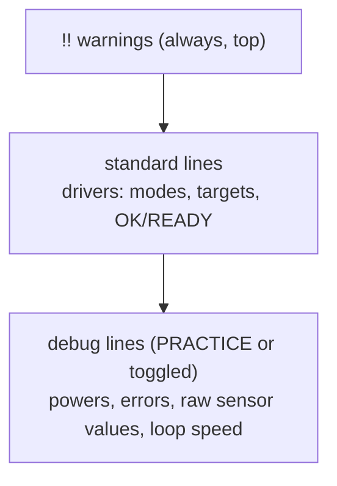

# Telemetry module

> **Work in progress:** this library and its docs are still changing. Something wrong or unclear? [Tell us](https://github.com/jasoncross/ftc-helper-lib/issues).

Package: `io.github.jasoncross.ftchelper.telemetry`

Learn it hands-on: [06 A fast, clear loop](../tutorials/06-fast-clear-loop.md).

Driver Station telemetry that is easy to read during a match and useful when debugging.

| Class | Use it to |
| --- | --- |
| [`RobotTelemetry`](#robottelemetry) | two levels (standard for drivers, debug for programmers), warnings on top, rate limit |
| [`TelemetryHelper`](#telemetryhelper) | one-line helpers for plain SDK telemetry |

## RobotTelemetry

```java
RobotTelemetry t = new RobotTelemetry(telemetry);       // debug ON in PRACTICE, OFF in COMPETITION
controls.bindPress(Pad.G1, Btn.BACK, t::toggleDebug);   // let the driver switch it
// every loop:
t.section("Lift");
t.line("Height", lift.getTargetName());                 // standard: always shown
t.debug("Power", "%.2f", power);                        // debug: only when debug is on
if (battery < 11.5) t.warn("Battery low!");             // warnings: always, at the top
robot.addTelemetry(t);                                  // every mechanism adds its own lines
t.update();                                             // ONCE, at the end of the loop
```

| Method | What it does |
| --- | --- |
| `section(title)` | `--- title ---` heading (standard) |
| `debugSection(title)` | heading shown only in debug |
| `line(label, value)` / `line(label, format, args...)` | a driver line |
| `text(text)` | a plain driver line |
| `debug(label, value)` / `debug(label, format, args...)` | a programmer line (only in debug) |
| `warn(text)` | `!! text` at the top, always; the same warning once per loop |
| `setDebug(on)`, `toggleDebug()`, `isDebug()` | debug level |
| `setMinIntervalMs(ms)` | send at most every N ms (100 = 10/s is plenty) for a faster loop. Warnings from skipped loops are kept for the next send |
| `update()` | send (warnings first) and start a fresh screen |
| `pending()`, `raw()` | the lines waiting (for tests); the SDK telemetry |

**Standard or debug?** Ask: "does the DRIVER need this during a match?" Yes = `line`. No = `debug`.
Mechanism helpers already split their lines this way.



## TelemetryHelper

```java
// Each line only ADDS text; nothing is shown until telemetry.update().
TelemetryHelper.section(telemetry, "Lift");
TelemetryHelper.motor(telemetry, "Lift", liftMotor);   // power, position, speed
TelemetryHelper.value(telemetry, "Target", liftTarget, "ticks");
TelemetryHelper.flag(telemetry, "At bottom", lift.isAtLower());   // true/false shown as yes/no
telemetry.update();                                                // send: once per loop
```

The Driver Station shows:

```
--- Lift ---
Lift : pwr 0.45 | pos 1203 | vel 812/s
Target : 1500.00 ticks
At bottom : no
```

| Method | Adds |
| --- | --- |
| `section(telemetry, title)` | a heading line: `--- title ---` |
| `value(telemetry, label, number, unit)` | `label : number unit`, 2 decimals |
| `value(telemetry, label, number, decimals)` | `label : number`, with the decimals you choose |
| `flag(telemetry, label, boolean)` | `label : yes` or `label : no` |
| `motor(telemetry, label, motor)` | power, encoder position and speed (counts per second) on one line |
| `servo(telemetry, label, servo)` | the servo's last commanded position. (A normal servo cannot report where it really is.) |
| `num(number, decimals)` | the number as text, e.g. `num(0.4567, 2)` = `"0.46"`. NaN shows as `--`. |

These only ADD lines. You still call `telemetry.update()` once at the end of the loop.

## Tips

- One `telemetry.update()` per loop. More than one makes the screen flicker and slows the loop.
- Show what the driver needs during a match at the top; put debug numbers lower.
- Show the loop speed while you test: `TelemetryHelper.value(telemetry, "Loop", loopTimer.getHz(), "Hz")`
  (see `LoopTimer` in [util](util.md)).
