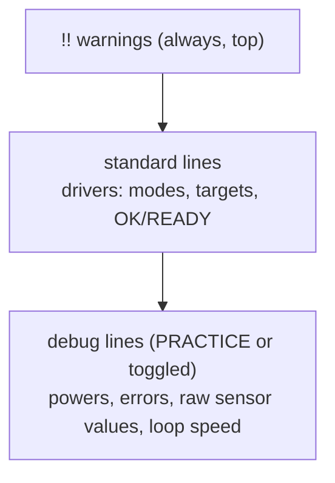

# Telemetry module

> **Work in progress:** this library and its docs are still changing. Something wrong or unclear? [Tell us](https://github.com/crossbotics/ftc-helper-lib/issues/new/choose).

Package: `com.crossbotics.ftchelper.telemetry`

Learn it hands-on: [06 A fast, clear loop](../tutorials/06-fast-clear-loop.md).

**Telemetry** is the text your program shows on the Driver Station screen. This module makes that text
clear during a match and useful when you hunt for a bug. [`EasyTeleOp`](teleop.md) and the
[robot in five files](../reference/robot-java.md) set it up for you, and every mechanism adds its own lines. Use this page
to add your own lines, or in an OpMode you write yourself. Start with tutorial 06.

| Class | Use it to |
| --- | --- |
| [`RobotTelemetry`](#robottelemetry) | show lines at two levels (standard for drivers, debug for programmers), warnings on top, and send less often for a faster loop |
| [`TelemetryHelper`](#telemetryhelper) | add common lines (a motor, a yes/no) to the SDK's plain `telemetry` in one call |

## RobotTelemetry

```java
RobotTelemetry t = new RobotTelemetry(telemetry);       // debug ON in PRACTICE, OFF in COMPETITION
controls.bindPress(Pad.G1, Btn.BACK, t::toggleDebug);   // let the driver switch it
// every loop:
t.section("Lift");
t.line("Height", lift.getTargetName());                 // standard: always shown
t.debug("Power", "%.2f", power);                        // debug: only when debug is on
if (battery < 11.5) t.warn("Battery low!");             // warnings: always, at the top
robot.addTelemetry(t);                                  // every mechanism adds its own lines
t.update();                                             // ONCE, at the end of the loop
```

| Method | What it does |
| --- | --- |
| `section(title)` | a `--- title ---` heading (standard) |
| `debugSection(title)` | a heading that shows only in debug |
| `line(label, value)` / `line(label, format, args...)` | a driver line |
| `text(text)` | a plain driver line |
| `debug(label, value)` / `debug(label, format, args...)` | a programmer line (only in debug) |
| `warn(text)` | `!! text` at the top, always. The same warning shows once per loop |
| `warnFirst(text)` | a warning above every other one, even the ones added before it. The library uses it for a part that is OFF in COMPETITION. Several `warnFirst` warnings keep their order |
| `setDebug(on)`, `toggleDebug()`, `isDebug()` | set, switch or read the debug level |
| `setMinIntervalMs(ms)` | for a faster loop: send at most every N ms (100 = 10 per second is enough). The next send keeps the warnings from the loops it skipped |
| `update()` | sends the screen (warnings first) and starts a fresh one. It turns button marks such as `{A}` into the names on the driver's controller ([ButtonNames](gamepad.md#buttonnames)) |
| `pending()`, `raw()` | the lines that wait to be sent (for tests); the SDK telemetry |

**To choose standard or debug:** ask whether the DRIVER needs this during a match. Yes = `line`. No = `debug`.
The mechanism helpers already split their lines this way.



## TelemetryHelper

```java
// Each line only ADDS text; nothing is shown until telemetry.update().
TelemetryHelper.section(telemetry, "Lift");
TelemetryHelper.motor(telemetry, "Lift", liftMotor);   // power, position, speed
TelemetryHelper.value(telemetry, "Target", liftTarget, "ticks");
TelemetryHelper.flag(telemetry, "At bottom", lift.isAtLower());   // true/false shown as yes/no
telemetry.update();                                                // send: once per loop
```

The Driver Station shows:

```
--- Lift ---
Lift : pwr 0.45 | pos 1203 | vel 812/s
Target : 1500.00 ticks
At bottom : no
```

| Method | Adds |
| --- | --- |
| `section(telemetry, title)` | a heading line: `--- title ---` |
| `value(telemetry, label, number, unit)` | `label : number unit`, 2 decimals |
| `value(telemetry, label, number, decimals)` | `label : number`, with the decimals you choose |
| `flag(telemetry, label, boolean)` | `label : yes` or `label : no` |
| `motor(telemetry, label, motor)` | power, encoder position and speed (counts per second) on one line |
| `servo(telemetry, label, servo)` | the last position the code sent to the servo. A normal servo cannot report where it is. |
| `num(number, decimals)` | the number as text, for example `num(0.4567, 2)` = `"0.46"`. NaN shows as `--`. |

These methods only ADD lines. You still call `telemetry.update()` once, at the end of the loop.

## Tips

- One `telemetry.update()` per loop. More than one makes the screen flicker and slows the loop.
- Put what the driver needs during a match at the top. Put the debug numbers lower.
- Show the loop speed while you test: `TelemetryHelper.value(telemetry, "Loop", loopTimer.getHz(), "Hz")`
  (`LoopTimer` is in [util](util.md)).
