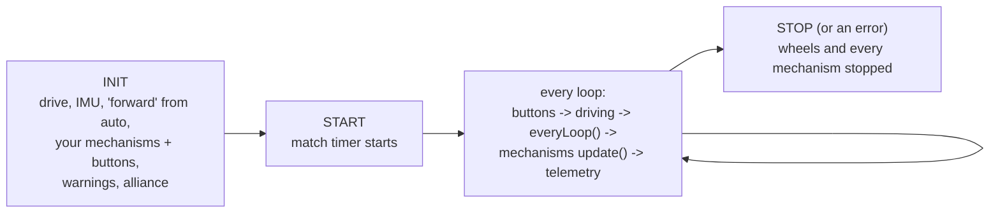

# TeleOp module

> **Work in progress:** this library and its docs are still changing. Something wrong or unclear? [Tell us](https://github.com/crossbotics/ftc-helper-lib/issues).

Package: `com.crossbotics.ftchelper.teleop`

Learn it hands-on: [20 Easy TeleOp](../tutorials/20-easy-teleop.md). Ready to copy: the
[starter kit](../starter-kit.md)'s `MainTeleOp`.

A whole TeleOp (the driver-controlled part of the match) where you only write what is special
about your robot. Driving, the match timer, safety at START and STOP, and the tuning menu come
ready-made. The [robot in five files](robot.md#controlmap)'s `Controls.java` is built on it, so with
five files start there. Use `EasyTeleOp` directly with the [starter kit](../starter-kit.md) or your own classes.

| Class | Use it to |
| --- | --- |
| [`EasyTeleOp`](#easyteleop) | a whole TeleOp OpMode: give it your robot settings and mechanisms, add the operator's buttons |



---

## EasyTeleOp

```java
@TeleOp(name = "Main TeleOp")
public class MainTeleOp extends EasyTeleOp {
    private Robot robot;

    // the robot's settings, shared with every autonomous
    @Override protected RobotConfig robotConfig() { return new RobotSettings(); }

    // the mechanisms: updated every loop, shown, stopped at the end
    @Override protected Subsystems createSubsystems() {
        robot = new Robot(hardwareMap);
        return robot.all;
    }

    // the operator's buttons (gamepad 2)
    @Override protected void bindButtons(ControllerBindings driver, ControllerBindings operator) {
        operator.bindPress(Pad.G2, Btn.RB, () -> robot.claw.toggle("OPEN", "CLOSED"));
    }

    // anything else, every loop (here: the lift by hand)
    @Override protected void everyLoop() {
        robot.lift.manual(StickShaping.shape(-gamepad2.left_stick_y, 0.1, 1));
    }
}
```

### What it does for you

| | |
| --- | --- |
| Driving (gamepad 1) | left stick drive, right stick X turn, left trigger slow. Mecanum and tank, picked by your `DriveConfig`. See [`DriverControls`](drive.md#drivercontrols). |
| Field-centric | starts robot-centric (stick up = the way the robot faces). **Y** turns field-centric (stick up = away from the driver) on/off (two buzzes = on, one = off). Mecanum with an IMU only. |
| "Forward" | carries on from where autonomous ended ([`DriverHeading`](drive.md#driverheading)), even after INIT, STOP, INIT again. Press and let go of **BACK** alone (one buzz) = "the robot now faces away from me". With `backTap()`, a tap of BACK does your job instead, and holding BACK 1 s sets "forward". Either way, "forward" is only reset while field-centric is on; in robot-centric driving BACK does not reset it, and the Driver Station says why for 3 s: `BACK: "forward" is only reset in field-centric driving (turn it on first).` |
| Alliance | the one autonomous chose, from [`MatchMemory`](match.md). If none came (no autonomous ran, or the robot app restarted), INIT says "Choose the alliance": gamepad 1 **X** = BLUE, **B** = RED (also to change it). INIT also shows autonomous's report. |
| Match timer | 2:00, both gamepads buzz at 1:00 and 0:20. The time is on the screen. |
| Tuning menu | **GUIDE** opens it (PRACTICE profile only). Gamepad 1 runs the menu; the wheels hold still. With a button map (`buttonHelp()`, as `ControlMap` has): a tap of GUIDE shows the map during the match (the robot still drives) and holding GUIDE 1 s opens the tuning menu. |
| Telemetry | your mechanisms' lines, drive mode, time; **START + BACK together** (either order) = debug lines on/off. |
| Warnings | PRACTICE profile, tuned values that differ from the code, slow button actions or `update()`s. |
| Safety | buttons held through START are ignored; the wheels and every mechanism stop at the end, even after an error. |

### Fill in

| Method | Required? | What you return / do |
| --- | --- | --- |
| `robotConfig()` | yes* | `new RobotSettings()`: the [`RobotConfig`](core.md#robotconfig) shared with autonomous |
| `createSubsystems()` | no | your mechanisms. Default: none |
| `bindButtons(driver, operator)` | no | your buttons. Gamepad 2 on `operator`; extra gamepad 1 buttons on `driver` (they pause while the tuning menu is open). Taken on gamepad 1: Y (field-centric, when the drive has it), BACK, START (with BACK: debug lines), GUIDE. |
| `everyLoop()` | no | your code for every loop (sticks for mechanisms, simple rules). Must not wait. |
| `addTelemetry(t)` | no | extra screen lines |
| `backTap()` | no | a job for a tap of BACK (a Controls.java TeleOp: pause everything); then holding BACK 1 s resets "forward" |
| `buttonHelp()` | no | the button map's lines: then a tap of GUIDE shows them, and holding GUIDE 1 s opens the tuning menu |
| `addInitTelemetry(t)` | no | extra screen lines during INIT |
| `onStart()` | no | runs once right after START, before the first loop (the first moment anything may move) |

\* Starter kit: `return new RobotSettings();`. Tutorials (09-20): `return RobotSettings.config();`
(the tutorial `RobotSettings` keeps its settings in `static` methods, so `config()` wraps them).
Or, without a `RobotConfig`: override `driveConfig()` and `createImu()`.

Note: the bindings name the gamepad (`Pad.G1`, `Pad.G2`) themselves. A `Pad.G1` button put on
`operator` works, but it does not pause while the tuning menu is open: put gamepad 1 buttons on `driver`.

### Optional settings

| Method | Default | |
| --- | --- | --- |
| `startFieldCentric()` | false | true = start in field-centric |
| `slowSpeed()` | 0.3 | speed at a full squeeze of the slow trigger |
| `fieldCentricButton()` | `Btn.Y` | the gamepad 1 button for field-centric on/off; null = none |
| `buzzAtSecondsLeft()` | {60, 20} | when both gamepads buzz |
| `drive(gamepad)` | the standard controls | replace it to drive your own way, e.g. two-stick tank style: `driving().tank(-gamepad.left_stick_y, -gamepad.right_stick_y, 1)` |

### For your code

| Method | Gives |
| --- | --- |
| `alliance()` | RED or BLUE |
| `robotTelemetry()` | the screen helper ([RobotTelemetry](telemetry.md)) |
| `driving()` | the [`DriverControls`](drive.md#drivercontrols) (field-centric, slow) |
| `heading()` | the [`DriverHeading`](drive.md#driverheading), or null without an IMU |
| `matchTimer()` | the [`MatchTimer`](match.md) |
| `isTuningMenuOpen()` | true while the menu has gamepad 1: do not read gamepad 1's sticks then |

`runOpMode()` is `final`: your class cannot replace it, so the safety steps always run. Need a
completely different loop? Write a plain `LinearOpMode` (tutorials 04 and 12) with the same parts.
