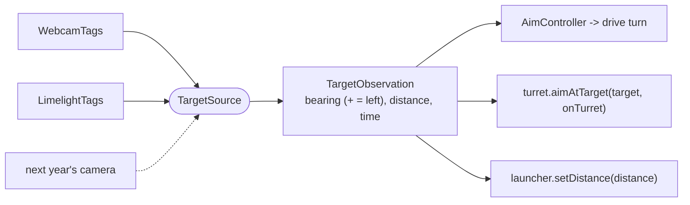

# Vision module

> **Work in progress:** this library and its docs are still changing. Something wrong or unclear? [Tell us](https://github.com/crossbotics/ftc-helper-lib/issues/new/choose).

Package: `com.crossbotics.ftchelper.vision`

Learn it hands-on: [18 Vision aiming](../tutorials/18-vision-aim.md).

Find **AprilTags** (square black-and-white field markers, each with an id number) with a USB webcam,
a Limelight 3A or a HuskyLens camera, and aim at them. Your code talks to ONE interface (a set of methods every
camera has), so you switch cameras by changing one line. With the [robot in five files](../reference/parts/camera.md),
its `Camera` part sets this up: start with [Add a camera](../add-to-robot/07-camera.md).
Use this page to aim in your own code (tutorial 18).

The **bearing** is how far the robot must turn to face a target, in degrees (+ = the target is to the left).

| Class | Use it to |
| --- | --- |
| [`TargetSource`](#targetsource) | talk to any camera the same way (the interface) |
| [`WebcamTags`](#webcamtags) | find AprilTags with a USB webcam (the SDK's tag finder; SDK 12 clusters too) |
| [`HuskyLensCamera`](#huskylenscamera) | find taught AprilTags, colors or an object with a HuskyLens |
| [`LimelightTags`](#limelighttags) | find AprilTags with a Limelight 3A |
| [`TagGroup`](#taggroup) | report a row of tags as one target with a Limelight or a HuskyLens |
| [`TargetObservation`](#targetobservation) | read one target: id, name, bearing, distance, picture time |
| [`AimController`](#aimcontroller) | turn the bearing into a turn power, safely |
| [`MovingShot`](#movingshot) | the math of shooting while moving: an old picture brought to now, the lead for the flight time |
| [`DistanceFilter`](#distancefilter) | keep camera glitches out of a distance (the middle of the last pictures, and a jump check) |



**2026-27 note:** BIOBUZZ tags are on the HIVE cells, and the cells MOVE. So the tags are good for
aiming, but not for finding the robot's position on the field. SDK 12 also adds tag
**clusters** (groups of tags with one aiming point). `WebcamTags` reports a cluster as a target
with id `TargetObservation.CLUSTER` and its name. `LimelightTags` reports the same groups by the
same names ([TagGroup](#taggroup)), so `camera.target("RED SCORING")` works with either camera.

**Aim at the up CELL only.** Each HIVE has two CELLs. A robot can score only in the up one, and a tip
swaps them. A CELL's tags read **right side up** only while that CELL is up. The down CELL's tags read
upside down. `TagGroup.goalTarget(camera, "RED SCORING")` gives the red HIVE's group that reads right
side up now ("RED SCORING" or "RED AUDIENCE"). It gives null when only an upside-down CELL is in view,
for example from under the HIVE: the robot must never aim at the underside of a down CELL. The five-files
[`Camera`](../reference/parts/camera.md) module's `goal()` uses it. `camera.target(name)` still gives the named
group, upside down or not.

---

## TargetSource

| Method | What it does |
| --- | --- |
| `start()` | starts the camera (in INIT; a webcam needs 1-2 s) |
| `update()` | every loop: gets the newest picture's targets |
| `targets()` | everything in the newest picture. It drops targets older than 500 ms, so a camera that stops sending never leaves old targets |
| `target(id)` / `target(name)` | one target, or null when the camera does not see it |
| `isWorking()`, `status()` | whether it is streaming, and its state, for example "STREAMING 28 fps", "not connected" |
| `close()` / `stop()` | frees the camera |
| `addTelemetry(t)` | a warning when it is not working. In debug: the status and every target |

## WebcamTags

```java
WebcamTags camera = WebcamTags.create(hardwareMap, "Webcam 1")
        .resolution(640, 480)    // pixels: a good start
        .decimation(2)           // 2 = default balance of speed and range
        .exposure(6, 85);        // optional: short exposure = sharp tags while driving
camera.start();                  // in INIT: a webcam needs 1-2 s to start
```

| Method | What it does |
| --- | --- |
| `.resolution(w, h)` | 640x480 to start. A higher one sees farther but is slower |
| `.decimation(d)` | how much the camera shrinks the picture before the tag search: 1 = slow/far, 2 = default, 3 = fast/near |
| `.liveView(on)` | the picture on the Robot Controller screen (it costs speed) |
| `.library(lib)` | another tag library (default: this season's, from the SDK) |
| `.exposure(ms, gain)` | manual exposure. `status()` says when the camera refused it |
| `.autoExposure()` / `.autoExposure(6, 3, 12, 0)` | [venue lighting](#venue-lighting): tries exposures in INIT (ms; 0 = the camera's own automatic) and keeps the best |
| `.gain(g)` | the gain for `autoExposure`'s manual exposures (default: the camera's highest) |
| `lighting()` / `matchStarted()` | the lighting test (null without `autoExposure`); tells it that the driver pressed ▶ (start on the Driver Hub) |
| `.keepTargetsMs(ms)` | how long targets stay in `targets()` without a new picture (default 500) |
| `.pitchDeg(degrees)` | the camera's tilt up (0 = level, the default), so bearings and distances are along the floor ([CameraTilt](#cameratilt)) |
| `WebcamTags.convert(detection)` / `convert(detection, pitchDeg)` | turns an SDK detection into a TargetObservation (level, or tilted) |

For better distances, calibrate the camera (the FTC docs explain "camera calibration"). Or use a
camera the SDK already knows (Logitech C270/C920 at common resolutions).


## CameraTilt

A camera tilted up (to see a high goal) measures in its own tilted view. So a goal off to the side
reads too few degrees: 27.5 degrees left reads about 22 with the camera 35 degrees up (goal 48 inches away along the floor,
35 inches above the lens). Its distance is
the slanted line from the lens up to the goal. The aim and the odometry need the bearing and the
distance **along the floor**. `CameraTilt` turns the camera's numbers flat again to give them.

```java
WebcamTags camera = WebcamTags.create(hardwareMap, "Webcam 1").pitchDeg(35);   // tilted 35 degrees up
// In the robot in five files: Tunables.Webcam1.pitchDeg = 35
```

| Method | What it does |
| --- | --- |
| `CameraTilt.bearingDeg(right, forward, up, pitchDeg)` | the floor's bearing (+ = left) of a point in the camera's view (right, along the lens, up in the picture) |
| `CameraTilt.floorDistance(right, forward, up, pitchDeg)` | its distance along the floor (same length unit) |

`pitchDeg`: + = tilted up, 0 = level (nothing changes). Measure it on the robot: put a phone's level app on
the camera's face. A webcam and a Limelight use it. A HuskyLens does not use it yet.

## LimelightTags

```java
LimelightTags camera = LimelightTags.create(hardwareMap, "limelight")
        .pipeline(0)        // pipeline 0, set up on the Limelight's web page
        .pollRate(100);     // results per second
camera.start();
```

A **pipeline** is a saved set of Limelight settings for one kind of target. First set up an AprilTag
(fiducial) pipeline in the Limelight's web page (http://limelight.local:5801
on the robot network). For distances, set the correct tag size there.

| Method | What it does |
| --- | --- |
| `.pipeline(n)` | which pipeline. If the camera has already started, it also switches at once |
| `.autoPipelines(0, 1, 2)` | [venue lighting](#venue-lighting): tries these pipelines in INIT and keeps the best (replaces `.pipeline`) |
| `.pitchDeg(degrees)` | the Limelight's tilt up (0 = level, the default), so bearings and distances are along the floor ([CameraTilt](#cameratilt)) |
| `lighting()` / `matchStarted()` | the lighting test (null without `autoPipelines`); tells it that the driver pressed ▶ |
| `.pollRate(hz)` | results per second |
| `setRobotHeading(deg)` | for the Limelight's MegaTag2 position feature (aiming does not need it). Safe every loop: the library sends it in the background |
| `fieldSighting()` | **alpha**: the robot's field position from the newest picture (`FieldSighting`: `mt2XIn`, `mt2YIn`, `mt1XIn`, `mt1YIn`, `mt1YawDeg`, `tags`, `timeNanos`, `number`), in the Limelight's field frame; NaN when there is none. The [camera fix](odometry.md#camera-fix-alpha) uses it |
| `.keepTargetsMs(ms)` | how long targets stay without a new picture (default 500) |
| `.groups(list)` | tag groups to report as one target each (default `TagGroup.currentSeason()`; empty list = off) |
| `getLimelight()` | the SDK object, for color pipelines and more |
| `LimelightTags.distanceInches(pose)` | the distance from a 3D pose |

The Limelight's pipeline switch and heading updates are network requests that wait for an answer.
The library sends them on a background thread, so they never slow the loop.

The library flips the sign of the Limelight's `tx`, so the bearing is **positive to the LEFT**, like
everywhere else. The picture time includes the Limelight's own capture and processing time, so
the picture's age is honest. The library never reports the same picture twice.

## HuskyLensCamera

A [DFRobot HuskyLens](https://wiki.dfrobot.com/sen0305/) is a small camera with a screen and two buttons.
It finds AprilTags, colors or one object by itself. It plugs into an I2C sensor port of a hub, not USB.
The FTC docs suggest bus 1, 2 or 3, because bus 0 has the hub's IMU. It does not use the SDK's
VisionPortal. The SDK has the driver, and the
[FTC docs](https://ftc-docs.firstinspires.org/en/latest/devices/huskylens/huskylens.html) show the wiring.
goBILDA sells one with a cable that fits a REV hub. Configure it as `HuskyLens`.

```java
HuskyLensCamera camera = HuskyLensCamera.create(hardwareMap, "huskylens")
        .tag(1, 34).tag(2, 35)   // taught number 1 is AprilTag 34, taught number 2 is AprilTag 35 // (1)!
        .hfovDeg(60)             // its view angle: measure yours // (2)!
        .sizeIn(3.25);           // for a rough distance: the tag's black square, in inches // (3)!
camera.start();
// every loop:
camera.update();
TargetObservation tag = camera.target(34);
```

1. **It never says a tag's real number.** It says the number you taught it. Without `tag(...)`, `target(34)` finds nothing.
2. The seller gives no view angle, so the library uses a guess of 60 until you measure it. See below.
3. Without `sizeIn`, `distanceIn` is `NaN` (no distance).

**Teach it, on the camera.** Turn the dial to Tag Recognition. Long press the dial, turn on **Learn
Multiple**, and save. Point the `+` at a tag and press the learning button: that tag is ID1. For ID2,
press the learning button again before the countdown ends, and so on. An untaught tag has the number 0.
This comes from the camera's protocol, and test AIM-06 checks it.
Write the list down: the numbers in `tag(...)` must match the order you taught.

| Method | What it does |
| --- | --- |
| `create(hardwareMap, name)` | finds it in the robot configuration |
| `mode(Mode.TAGS / COLORS / OBJECTS)` | what to look for (default `TAGS`). `OBJECTS` follows ONE taught object. You can change it in a running OpMode |
| `tag(taughtNumber, tagNumber)` | which real AprilTag a taught number is |
| `label(taughtNumber, name)` | a name for `target(name)`, for example a taught color: `label(1, "POLLEN")` |
| `hfovDeg(degrees)` | the view angle, from the left edge to the right edge of the picture |
| `sizeIn(inches)` | the real size of what it looks at (its longest side as the camera sees it), for a rough distance |
| `groups(list)`, `keepTargetsMs(ms)` | the same as on the Limelight |
| `mode()`, `latestBlocks()`, `getHuskyLens()` | the mode now, the SDK's boxes, the SDK's object (for example for line tracking's arrows) |
| `HuskyLensCamera.answers(device)` | asks "are you there?" and checks the answer. It is slow, so never call it in the robot's loop |
| `start()`, `update()`, `targets()`, `target(...)`, `isWorking()`, `status()`, `close()` | see [`TargetSource`](#targetsource) |

**Measure the view angle.** Stand a thin stick 24 in straight in front of the lens. Move it sideways until
it touches the edge of the screen. Measure how far it moved, in inches (`s`). The angle is
`2 * atan(s / 24)`: 14 in sideways gives about 60 degrees. A wrong angle makes bearings too big or too
small. But 0 is still straight ahead, so aiming still ends in the right place.

**What it cannot do as well as the other cameras:**

- **Distance is rough.** It comes only from the size of a box (a thing twice as far looks half as big),
  and a slanted tag has a smaller box. Make your shot table with this camera, and check it. For long or
  exact shots, use a Limelight or a webcam.
- **A single tag has no "right side up".** A tag group has one, from the order of its tags in the picture, as
  with the Limelight ([`TagGroup`](#taggroup)). So a goal needs 2 taught tags of the group in view.
- **At most 6 boxes in one reading.** That is the SDK driver's limit. With more in view, it leaves some out.
- **Colors change with the light.** The seller says so too. If you can, teach them at the venue.
- **A cable that comes off takes about a second to show.** The SDK cannot tell an unplugged HuskyLens from one
  that sees nothing: on a REV hub an empty port reads as zeros, and its `knock()` still says true. So while
  the camera sees nothing, this class asks "are you there?" about once a second and checks the answer itself.

Reading the camera is a slow I2C request, so `update()` hands it to a helper thread and never waits.

!!! warning "Not yet tried on a real robot"
    We tested this class with the SDK's own HuskyLens class and pretend I2C answers, not with a real
    camera. Test it first ([test AIM-06](https://github.com/crossbotics/ftc-helper-lib/blob/main/testing/tests/AIM-06.md)), and please tell us what you find.

## Venue lighting

Every venue has different light: a bright gym, a dim practice room, spotlights at an event. A camera
setting that finds tags well in one place can miss them in another. During INIT, the lighting test picks
the setting for the place you are in, by itself:

1. It asks the camera to switch to the first setting. Once the camera has truly switched, the test waits
   300 ms for the picture to settle. Then it counts the next 10 pictures that see at least
   one AprilTag. Pictures from before that do not count.
2. It does the same with each setting in the list.
3. The setting with the most pictures with tags wins. A tie goes to the one earlier in the list, so
   **put your usual setting first**.
4. When no setting saw at least 3 pictures with tags (the robot is not facing a tag yet), the test starts
   over. It keeps trying all through INIT.
5. **At ▶ it stops at once** and keeps the best setting so far (the first one when none saw a tag).
   So the robot never aims with a setting the test is only trying. **Have a tag in view at INIT** (the
   robot's start spot for the match is fine), or the test cannot help. You can also put the test on a
   button. The driver aims at a tag and presses, and the test runs again (up to 5 s, or
   `lightingAfterStartMs`; see `relight()` on the [Camera page](../reference/parts/camera.md)).

Some settings get no score: a setting the camera refuses (a webcam without manual exposure), or a
Limelight pipeline that sends no pictures (not set up). The test skips such a setting from then on, and
the Driver Station shows it (`no pictures from pipeline 2 (missing?)`). When a camera is not in the robot
configuration, or not working after 3 s, INIT shows a warning. The OpMode still runs.

The test never waits: each switch goes to a background helper, and the test is one quick step per loop.

**At an event:** in the queue, INIT once with the robot facing a tag. The Driver Station shows the
result and two lines for `Tunables.java`, for example `public static double pipeline = 2;` and
`public static boolean autoLighting = false;`. With them, every match there uses that setting with
no test. Set `autoLighting = true` again at home. A webcam shows `exposureMs` (a new line to add).

**Limelight:** on the Limelight's web page, set up one AprilTag pipeline per kind of light. For
example: 0 = normal, 1 = bright (lower exposure), 2 = dim (higher exposure and gain). The Exposure
slider is in the pipeline's Input tab at http://limelight.local:5801. Every step:
[Setting up Limelight lighting pipelines](../guides/limelight-lighting.md). Then:

```java
LimelightTags camera = LimelightTags.create(hardwareMap, "limelight").autoPipelines(0, 1, 2);
```

Only pictures taken with the pipeline under test count. The Limelight says which pipeline made
each picture.

**Webcam:** the test tries manual exposures. The exposure is how long each picture collects light.

```java
WebcamTags camera = WebcamTags.create(hardwareMap, "Webcam 1").autoExposure();   // auto, 3, 6, 12 ms
WebcamTags camera = WebcamTags.create(hardwareMap, "Webcam 1").autoExposure(6, 3, 12, 0);   // your own list
```

`0` is the camera's own automatic exposure. A short exposure gives sharp tags while the robot moves,
but a dark picture. The gain (a brightness boost) makes up for it. Manual exposures use the gain from
`.gain(g)` or `.exposure(ms, gain)`, or else the camera's highest. "auto" gets the camera's own gain back
(the test reads it before the first manual setting). It is the same idea as the FTC SDK's sample
`ConceptAprilTagOptimizeExposure`, done for you. Not every webcam allows manual exposure. When it does
not, `status()` says "exposure not supported".

In the five-files robot it is one word on the camera's line:
`Camera.limelight("limelight").autoPipelines(0, 1, 2)` or `Camera.webcam("Webcam 1").autoExposure()`
(see the [Camera page](../reference/parts/camera.md)). The Driver Station shows the result at INIT. It also
shows the lines to copy into `Tunables.java` to skip the test at this venue next time.

## LightingSweep

The helper behind the lighting test. It tries settings one after the other and keeps the one whose
pictures see the most tags. `LimelightTags` and `WebcamTags` make one for you. Get it with
`lighting()` to read its result or to change its numbers.

| Method | What it does |
| --- | --- |
| `new LightingSweep(labels, apply, clock)` | one label per setting (usual first); `apply` switches to setting i and must not wait; the clock is `System::nanoTime` |
| `update(tags)` | every loop: the tags in a new picture from the setting under test, `LightingSweep.NO_PICTURE`, or `LightingSweep.OTHER_SETTING` (a picture from the setting before) |
| `switched()` | tells it the camera has the setting under test (settling starts now) |
| `switchFailed()` | tells it the camera refused the setting: no score, and the test skips it from now on |
| `waitingForCamera()` | call it instead of `update` while the camera is not ready (it checks only the time limits) |
| `.settleMs(ms)` | the wait after the switch lands, before counting (default 300; Tunables `lightingSettleMs`) |
| `.pictures(n)` | pictures counted per setting (default 10; `lightingPictures`) |
| `.trialMs(ms)` | the most time per setting, once switched (default 2000) |
| `.switchTimeoutMs(ms)` | the most time for the camera to switch (default 1500). If only pictures from another setting come in that time, the setting is "missing" |
| `.minPictures(n)` | pictures with tags a setting needs to count as good (default 3; `lightingMinPictures`) |
| `.giveUpAfterStartMs(ms)` | after ▶, how long to keep trying (default 0 = stop at ▶ with the best so far; Tunables `lightingAfterStartMs`). The cameras report no targets while it tries after ▶ |
| `matchStarted()`, `matchHasStarted()` | tells it that the driver pressed ▶; whether the driver pressed ▶ |
| `restart()` | tries every setting again during the match. It gets `giveUpAfterStartMs` from now, or `RESTART_IN_MATCH_MS` (5 s) when that is 0. When it sees no tag, it goes back to the setting it had. The five-files `Camera.relight()` calls it |
| `newSession()` | tells it the camera was closed and started again, so it does INIT again (the cameras call it in `close()`) |
| `isDone()`, `gaveUp()`, `chosen()`, `chosenLabel()`, `current()`, `noTagsYet()`, `skipped(i)` | the result |
| `status()`, `scores()`, `problems()` | "dim (9 of 10 pictures saw tags)"; "normal 2/10, bright 0/10, dim 9/10"; "no pictures from pipeline 2 (missing?)" |

## TagGroup

A Limelight reports each tag on its own. `LimelightTags` also reports each **group** of tags in a row
as one target, with the same name as the webcam's SDK cluster. In BIOBUZZ, a group is the 4 tags under
each CELL (`TagGroup.biobuzz()`).

**Right side up or not:** the tag numbers in a row rise to the right when the tags are right side up
(as printed). So the order of the tags in the picture says how the row is turned: the group's
`rollDeg` (0 = right side up, 180 = upside down). This needs only the tags' places. The Limelight
also sends each tag's turn in its pose. But the Limelight's docs and the FTC SDK do not agree on which
number in that list is the roll. So a single tag's `rollDeg` is the SDK's reading.

**Where it aims:** at the middle of the tag row, worked out from the tags in view. The two seen tags
farthest apart give the row's direction. Then the library steps back from each seen tag along the row,
by that tag's place in the group. It needs at least 2 of the group's tags and their 3D poses (set the
tag size in the pipeline).

**The webcam aims somewhere else.** Its cluster target is the SDK's own aiming point, not the tag row.
The SDK puts it 7.2 in toward the tags' printed top and 5.6 in behind them. In BIOBUZZ the printed
bottom faces the field center. So the point is about 9 in farther from a robot in front of the CELL,
1 in higher than the row, and not at the CELL opening. The two cameras give about the same bearing but a
different distance. Make the shot table with the camera the robot uses.

```java
// Next season, or your own targets: a name, the tag ids, each tag's place along the row (inches
// from the middle, + = right as printed).
TagGroup goal = new TagGroup("GOAL", new int[] {1, 2, 3}, new double[] {-5, 0, 5});
camera.groups(java.util.Arrays.asList(goal));
```

| Method | What it does |
| --- | --- |
| `TagGroup.biobuzz()` / `TagGroup.currentSeason()` | this season's groups |
| `contains(id)`, `alongRowIn(id)`, `ids()` | what is in a group |
| `element` | the field element the group is on, for example "RED HIVE" (BIOBUZZ: each HIVE has two groups, one per CELL). Null when you did not give one (`new TagGroup(name, ids, places, element)` gives one) |
| `TagGroup.goalTarget(camera, name)` | the target to aim at for a goal named `name`. For a group on a HIVE: that HIVE's group that reads right side up now (the up CELL), or null when only an upside-down one is in view. For any other name: `camera.target(name)` |
| `TagGroup.whyNoGoal(camera, name)` | why there is no goal while the camera sees part of it, for example "RED SCORING is upside down (a down CELL)". Otherwise "" |
| `LimelightTags.groupTarget(group, places, time)` | the group's target from tag places in camera space (public for tests) |

## TargetObservation

| Field / method | Meaning |
| --- | --- |
| `id`, `name` | the tag id and name. `CLUSTER` = -1 for clusters. `ODOMETRY` = -2 for a goal worked out from the odometry instead of seen |
| `fromOdometry()` | whether it is a goal from the odometry ([Aim](../reference/parts/aim.md)). Its bearing is from the robot's front, and its distance from the robot's center |
| `bearingDeg` | how far to turn to face it; **+ = it is to the left** |
| `distanceIn` | inches from the camera, flat in the camera's own view (its up/down left out), or NaN when unknown. It is the floor distance only for a level camera. A camera tilted up reads more. It means the same for both cameras, but make the shot table with the camera mounted as on the robot |
| `timeNanos` | when the camera took the picture |
| `rollDeg`, `isUpright()` | how far it is turned in the picture: 0 = right side up, 180 (or -180) = upside down, NaN when the camera cannot tell. `isUpright()`: whether it is turned less than 90 degrees either way (false for NaN). Webcam: the SDK's `ftcPose.roll` (for a cluster, the turn of its row). Limelight: a group's, from the order of its tags ([TagGroup](#taggroup)) |
| `ageMs(now)`, `isFresh(now, maxAgeMs)` | how old it is, and whether it is newer than `maxAgeMs`. Never aim with an old picture |
| `hasBearing()`, `hasDistance()` | whether the camera worked out a bearing, and a distance |

## AimController

```java
AimController aim = new AimController(0.02, 0.003)   // kP and kD, on the bearing in degrees
        .deadband(1.5)      // close enough
        .maxPower(0.5)      // never turn harder than this while aiming
        .maxAgeMs(150)      // ignore pictures older than 150 ms (they point the wrong way)
        .offset(0);         // where the target sits in view when the launcher is aimed (left = +); Aim Tuner finds it
// camera.target("RED SCORING") = that tag group, or null if not seen now; turnPower(null) gives 0
drive.drive(forward, strafe, aim.turnPower(camera.target("RED SCORING")));   // ready for any drive's turn
```

`turnPower` is **clockwise positive**, the same as every drive's `turn` argument, so it plugs straight
in. `ccwPower` gives the same power counterclockwise positive, for your own heading math.

`turnPower` gives **0** when there is no target, the picture is old, or there is no bearing. So the
robot never turns toward something it cannot see now. The D part changes only on a NEW picture, so a
repeated picture never fakes motion. Also: `isAimed()`, and `reset()` (call it when the driver lets go
of the aim button).

The robot in five files has this built in. `g1.rb.toggle(robot.aimMode())` turns the whole robot to
the goal while the driver drives, with the odometry as a backup ([Aim](../reference/parts/aim.md)). It is
for a robot with no turret. A turret that follows the goal is a separate mode: use one, not both.

For a turret, use `turret.aimAtTarget(target, cameraOnTurret)`. It uses only fresh pictures, and each
picture once: an old bearing used again would push the turret further and further. It holds still
when there is no target. See [launcher.md: Turret](launcher.md#turret).

## MovingShot

The math behind `Tunables.Aim.shootOnMove` ([Aim](../reference/parts/aim.md)), for your own code and
tests. A piece keeps the shooter's speed. So aim at the **virtual goal** = the goal - the shooter's
speed x the flight time. Also, a camera picture is old. So the math first turns the goal back by the
robot's turn since the picture, and moves it by the robot's motion since then. Everything is in one
frame, the robot's: x forward, y left, from the robot's center, angles counterclockwise +.

```java
MovingShot shot = new MovingShot()
        .shooterAt(-4, 0)        // the shooter (a turret's pivot) 4 in behind the robot's center
        .onTurret()              // a turret aims (leave out: the whole robot turns, a fixed shooter)
        .flightSec(0.8, 0)       // seconds in the air (+ seconds per inch)
        .maxLeadIn(24);          // never lead more than this
double[] goal = MovingShot.seenFrom(bearing, distance, 7, 0, 0);       // a camera 7 in in front, facing forward
double[] v = MovingShot.toRobotFrame(odo.velocityX(), odo.velocityY(), odo.pose().headingDeg);
MovingShot.Result r = shot.solve(goal[0], goal[1], v[0], v[1], odo.turnDegPerSec(), pictureAgeSec);
// r.aimDeg: the turret angle (or how far to turn the robot); r.distanceIn: for the launcher's speed
```

| Method / field | |
| --- | --- |
| `shooterAt(forwardIn, leftIn)` | where the shooter is from the robot's center (default 0, 0). A turning robot swings an off-center shooter sideways, and the lead includes that speed too |
| `onTurret()` | makes `aimDeg` a turret angle from the turret's pivot. Without it, `aimDeg` is how far to turn the whole robot so a fixed shooter's line (parallel to the robot's front, `leftIn` to the side) passes through the goal |
| `flightSec(sec, perIn)`, `maxLeadIn(in)` | the flight time (`sec + perIn x distance`; the distance is the virtual goal's, worked out a few times), and the largest lead (0 = no cap) |
| `solve(goalForward, goalLeft, vForward, vLeft, turnDegPerSec, latencySec)` | where to aim now: a `Result` |
| `Result`: `aimDeg`, `distanceIn`, `leadDeg`, `leadIn`, `flightSec` | the aim; inches from the shooter to the virtual goal; how much the motion moved the aim (deg) and the aim point (in); the flight time used |
| `seenFrom(bearing, distance, camForward, camLeft, camYaw)` | a camera's target as {forward, left} from the robot's center (camYaw: a turret's angle for a camera on it) |
| `toRobotFrame(fieldVx, fieldVy, headingDeg)` | the robot's field speed as {forward, left} |

It leaves out three things. First, the turret's own turn during the picture's age. Second, air drag:
it slows the piece's sideways speed a little. In the simulator, a 30 in/s strafe missed by 21 in
without the lead, and by 3.5 in with it. Third, a change of speed during the flight.

## DistanceFilter

Keeps camera glitches out of a distance. A camera sometimes gives one picture with a wrong distance
(a tag half hidden, a blur, a reflection). If the robot uses that picture as it comes, the flywheel
speed changes for a moment, and a shot fired then goes long or short. The five-files launcher's
`speedFromDistance(camera)` uses a filter for you. Its numbers are in `Tunables.Launcher`:
`distanceMedianOf`, `distanceJumpIn`, `distanceJumpAgreeIn`.

The filter does two checks, one after the other:

1. **The middle of the last 5 pictures** (the median): sort them and take the one in the middle. One or
   two bad pictures end up at the ends of the list, so the filter never uses them. It costs about 2
   pictures of delay (0.07 s at 30 pictures a second).
2. **The jump check:** the filter uses a distance more than 12 in from the one in use only after 3
   pictures in a row, each within 4 in of the one before. A camera never gives the exact same number
   twice, so the check needs that tolerance. A real move gets through in about 0.1 s. A glitch of a
   few pictures does not.

**After a gap it starts over.** After 0.5 s with no new picture (the goal out of view), a big change is
normal: the HIVE tipped, or the robot drove away for pieces. So the first distance after the gap skips
the jump check. It still waits for 3 pictures, so one glitch as the goal comes into view stays out.

Only NEW pictures count (each picture's own time, `timeNanos`). So a loop faster than the camera does not
count one picture many times.

| Method | What it does |
| --- | --- |
| `new DistanceFilter()` | the defaults: the middle of 5, and jumps over 12 in need 3 pictures within 4 in |
| `new DistanceFilter(medianOf, jumpIn, agreeIn)` | your own numbers: `medianOf` 1 to 15 (1 = off), `jumpIn` in inches (0 = no jump check), `agreeIn` in inches |
| `add(goal, nowNanos)` | every loop: give it the goal now (or null). It gives the distance to use (inches), or NaN when there is none yet (then keep what you had) |
| `distance()` | the distance in use, or NaN when there is none |
| `jumpWaiting()` | whether a jump is waiting to be sure |
| `reset()` | forgets everything. The next distance skips the jump check |

```java
DistanceFilter filter = new DistanceFilter();
// every loop:
double d = filter.add(camera.target("RED SCORING"), System.nanoTime());
if (!Double.isNaN(d)) launcher.setDistance(d);   // else keep the speed you have
```
