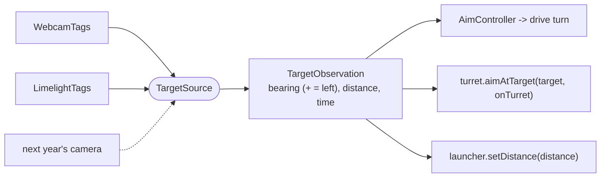

# Vision module

> **Work in progress:** this library and its docs are still changing. Something wrong or unclear? [Tell us](https://github.com/crossbotics/ftc-helper-lib/issues).

Package: `com.crossbotics.ftchelper.vision`

Learn it hands-on: [18 Vision aiming](../tutorials/18-vision-aim.md).

Find **AprilTags** (square black-and-white field markers, each with an id number) with a USB webcam
or a Limelight 3A camera, and aim at them. Your code talks to ONE interface (a set of methods every
camera has), so switching cameras is a one-line change. With the [robot in five files](robot.md#camera),
its `Camera` part sets this up; start with [lesson 7](../tutorials/start/07-shooter-and-camera.md).
Use this page to aim in your own code (tutorial 18).

The **bearing** is how far the robot must turn to face a target, in degrees (+ = the target is to the left).

| Class | Use it to |
| --- | --- |
| [`TargetSource`](#targetsource) | talk to any camera the same way (the interface) |
| [`WebcamTags`](#webcamtags) | find AprilTags with a USB webcam (the SDK's tag finder; SDK 12 clusters too) |
| [`LimelightTags`](#limelighttags) | find AprilTags with a Limelight 3A |
| [`TagGroup`](#taggroup) | report a row of tags as one target with a Limelight |
| [`TargetObservation`](#targetobservation) | read one target: id, name, bearing, distance, picture time |
| [`AimController`](#aimcontroller) | turn the bearing into a turn power, safely |



**2026-27 note:** BIOBUZZ tags are on the HIVE cells and the cells MOVE, so they are good for
aiming but not for finding the robot's position on the field. SDK 12 also adds tag
**clusters** (groups of tags with one aiming point); `WebcamTags` reports a cluster as a target
with id `TargetObservation.CLUSTER` and its name. `LimelightTags` reports the same groups by the
same names ([TagGroup](#taggroup)), so `camera.target("RED SCORING")` works with either camera.

---

## TargetSource

| Method | What it does |
| --- | --- |
| `start()` | start the camera (in INIT; a webcam needs 1-2 s) |
| `update()` | every loop: get the newest picture's targets |
| `targets()` | everything in the newest picture (dropped once older than 500 ms: a camera that stops sending never leaves old targets) |
| `target(id)` / `target(name)` | one target, or null |
| `isWorking()`, `status()` | is it streaming? e.g. "STREAMING 28 fps", "not connected" |
| `close()` / `stop()` | free the camera |
| `addTelemetry(t)` | warning if not working; debug: status and every target |

## WebcamTags

```java
WebcamTags camera = WebcamTags.create(hardwareMap, "Webcam 1")
        .resolution(640, 480)    // pixels: a good start
        .decimation(2)           // 2 = default balance of speed and range
        .exposure(6, 85);        // optional: short exposure = sharp tags while driving
camera.start();                  // in INIT: a webcam needs 1-2 s to start
```

| Method | What it does |
| --- | --- |
| `.resolution(w, h)` | 640x480 to start; higher sees farther but is slower |
| `.decimation(d)` | how much the picture is shrunk before the tag search: 1 = slow/far, 2 = default, 3 = fast/near |
| `.liveView(on)` | picture on the Robot Controller screen (costs speed) |
| `.library(lib)` | another tag library (default: this season's, from the SDK) |
| `.exposure(ms, gain)` | manual exposure; `status()` says if the camera refused |
| `.autoExposure()` / `.autoExposure(6, 3, 12, 0)` | [venue lighting](#venue-lighting): tries exposures in INIT (ms; 0 = the camera's own automatic), keeps the best |
| `.gain(g)` | the gain for `autoExposure`'s manual exposures (default: the camera's highest) |
| `lighting()` / `matchStarted()` | the lighting test (null without `autoExposure`); tell it START happened |
| `.keepTargetsMs(ms)` | how long targets stay in `targets()` without a new picture (default 500) |
| `WebcamTags.convert(detection)` | turns an SDK detection into a TargetObservation |

Better distances: calibrate the camera (the FTC docs explain "camera calibration") or use a
camera the SDK already knows (Logitech C270/C920 at common resolutions).

## LimelightTags

```java
LimelightTags camera = LimelightTags.create(hardwareMap, "limelight")
        .pipeline(0)        // pipeline 0, set up on the Limelight's web page
        .pollRate(100);     // results per second
camera.start();
```

A **pipeline** is a saved set of Limelight settings for one kind of target. Set up an AprilTag
(fiducial) pipeline in the Limelight's web page first (http://limelight.local:5801
on the robot network). Set the correct tag size there for distances.

| Method | What it does |
| --- | --- |
| `.pipeline(n)` | which pipeline (also switches at once if already started) |
| `.autoPipelines(0, 1, 2)` | [venue lighting](#venue-lighting): tries these pipelines in INIT, keeps the best (replaces `.pipeline`) |
| `lighting()` / `matchStarted()` | the lighting test (null without `autoPipelines`); tell it START happened |
| `.pollRate(hz)` | results per second |
| `setRobotHeading(deg)` | for the Limelight's MegaTag2 position feature (not needed to aim). Safe every loop: sent in the background |
| `.keepTargetsMs(ms)` | how long targets stay without a new picture (default 500) |
| `.groups(list)` | tag groups reported as one target each (default `TagGroup.currentSeason()`; empty list = off) |
| `getLimelight()` | the SDK object, for color pipelines and more |
| `LimelightTags.distanceInches(pose)` | distance from a 3D pose |

The Limelight's pipeline switch and heading updates are network requests that wait for an answer;
the library sends them on a background thread, so they never slow the loop.

The library flips the Limelight's `tx` sign so that bearing is **positive to the LEFT**, like
everywhere else. The picture time includes the Limelight's own capture and processing time, so
"how old is this picture" is honest. The same picture is not reported twice.

## Venue lighting

Every venue has different light: a bright gym, a dim practice room, spotlights at an event. A camera
setting that finds tags well in one place can miss them in another. The lighting test picks the
setting for the place you are in, by itself, during INIT:

1. It switches to the first setting, waits a moment (300 ms) for the camera to settle, then counts
   the next 10 pictures that see at least one AprilTag.
2. It does the same with each setting in the list.
3. The setting with the most pictures with tags wins. A tie goes to the one earlier in the list, so
   **put your usual setting first**.
4. If no setting saw at least 3 pictures with tags (the robot is not facing a tag yet), it starts over
   and keeps trying. After START it tries for 3 s more, then keeps the FIRST setting.

It never waits: each switch goes to a background helper, and the test is one quick step per loop.
Face the robot toward a tag in INIT (where it starts in the match is fine) so the test can finish.

**Limelight:** set up one AprilTag pipeline per kind of light on the Limelight's web page (for
example 0 = normal, 1 = bright: lower exposure, 2 = dim: higher exposure and gain), then:

```java
LimelightTags camera = LimelightTags.create(hardwareMap, "limelight").autoPipelines(0, 1, 2);
```

Only pictures taken with the pipeline being tried count (the Limelight says which pipeline made
each picture).

**Webcam:** the test tries manual exposures (how long each picture collects light):

```java
WebcamTags camera = WebcamTags.create(hardwareMap, "Webcam 1").autoExposure();   // auto, 3, 6, 12 ms
WebcamTags camera = WebcamTags.create(hardwareMap, "Webcam 1").autoExposure(6, 3, 12, 0);   // your own list
```

`0` is the camera's own automatic exposure. A short exposure gives sharp tags while the robot moves,
but a dark picture; the gain (a brightness boost) makes up for it. Manual exposures use the gain from
`.gain(g)` or `.exposure(ms, gain)`, or the camera's highest. The same idea as the FTC SDK's sample
`ConceptAprilTagOptimizeExposure`, done for you. Not every webcam allows manual exposure:
`status()` says "exposure not supported".

In the five-files robot it is one word on the camera's line:
`Camera.limelight("limelight").autoPipelines(0, 1, 2)` or `Camera.webcam("Webcam 1").autoExposure()`
(see [robot.md](robot.md#camera)). The result is on the Driver Station at INIT, with the line to copy
into `Tunables.java` if you want to skip the test at this venue next time.

## LightingSweep

The helper behind the lighting test: tries settings one after the other and keeps the one whose
pictures see the most tags. `LimelightTags` and `WebcamTags` make one for you; get it with
`lighting()` for its result or to change its numbers.

| Method | What it does |
| --- | --- |
| `new LightingSweep(labels, apply, clock)` | one label per setting (usual first); `apply` switches to setting i (must not wait); `System::nanoTime` |
| `update(tags)` | every loop: tags in a new picture, or `LightingSweep.NO_PICTURE` |
| `.settleMs(ms)` | wait after a switch before counting (default 300) |
| `.pictures(n)` | pictures counted per setting (default 10) |
| `.trialMs(ms)` | most time per setting (default 2000) |
| `.minPictures(n)` | pictures with tags needed to count as good (default 3) |
| `.giveUpAfterStartMs(ms)` | after START, how long to keep trying before keeping the first setting (default 3000) |
| `matchStarted()` | START happened |
| `restart()` | try every setting again (for a button) |
| `isDone()`, `gaveUp()`, `chosen()`, `chosenLabel()`, `current()` | the result |
| `status()`, `scores()` | "dim (9 of 10 pictures saw tags)"; "normal 2/10, bright 0/10, dim 9/10" |

## TagGroup

A Limelight reports each tag on its own. `LimelightTags` also reports each **group** of tags in a row
as one target, with the same name as the webcam's SDK cluster (BIOBUZZ: the 4 tags under each CELL,
`TagGroup.biobuzz()`).

**Where it aims:** at the middle of the tag row, worked out from the tags in view. The two seen tags
farthest apart give the row's direction. Each seen tag then steps back along the row by its place in
the group. It needs at least 2 of the group's tags and their 3D poses (set the tag size in the pipeline).

**The webcam aims somewhere else.** Its cluster target is the SDK's own aiming point, not the tag row:
the SDK puts it 7.2 in toward the tags' printed top and 5.6 in behind them. For BIOBUZZ (the printed
bottom faces the field centre) that is about 9 in farther from a robot in front of the CELL and 1 in
higher than the row, and not the CELL opening. So the two cameras give about the same bearing but a
different distance. Make the shot table with the camera the robot uses.

```java
// Next season, or your own targets: a name, the tag ids, each tag's place along the row (inches
// from the middle, + = right as printed).
TagGroup goal = new TagGroup("GOAL", new int[] {1, 2, 3}, new double[] {-5, 0, 5});
camera.groups(java.util.Arrays.asList(goal));
```

| Method | What it does |
| --- | --- |
| `TagGroup.biobuzz()` / `TagGroup.currentSeason()` | this season's groups |
| `contains(id)`, `alongRowIn(id)`, `ids()` | what is in a group |
| `LimelightTags.groupTarget(group, places, time)` | the group's target from tag places in camera space (public for tests) |

## TargetObservation

| Field / method | Meaning |
| --- | --- |
| `id`, `name` | tag id (`CLUSTER` = -1 for clusters) and name |
| `bearingDeg` | how far to turn to face it; **+ = it is to the left** |
| `distanceIn` | inches from the camera, flat in the camera's own view (its up/down left out), or NaN if unknown. It is the floor distance only for a level camera; a camera tilted up reads more. Same meaning for both cameras, but make the shot table with the camera mounted as on the robot |
| `timeNanos` | when the picture was taken |
| `ageMs(now)`, `isFresh(now, maxAgeMs)` | how old; never aim with an old picture |
| `hasBearing()`, `hasDistance()` | was it worked out? |

## AimController

```java
AimController aim = new AimController(0.02, 0.003)   // kP and kD, on the bearing in degrees
        .deadband(1.5)      // close enough
        .maxPower(0.5)      // never turn harder than this while aiming
        .maxAgeMs(150)      // ignore pictures older than 150 ms (they point the wrong way)
        .offset(0);         // where the target sits in view when the launcher is aimed (left = +); Aim Tuner finds it
// camera.target("RED SCORING") = that tag group, or null if not seen now; turnPower(null) gives 0
drive.drive(forward, strafe, aim.turnPower(camera.target("RED SCORING")));   // ready for any drive's turn
```

`turnPower` is **clockwise positive**, the same as every drive's `turn` argument, so it plugs straight
in. `ccwPower` gives the same power counterclockwise positive, for your own heading math.

Gives **0** when there is no target, the picture is old, or there is no bearing: the robot never
turns toward something it cannot see now. The D part only changes on a NEW picture, so a repeated
picture never fakes motion. `isAimed()`, `reset()` (call when the driver lets go of the aim button).

For a turret, use `turret.aimAtTarget(target, cameraOnTurret)`: it uses only fresh pictures, each
picture once (an old bearing used again would push the turret further and further), and holds still
when there is no target. See [launcher.md: Turret](launcher.md#turret).
