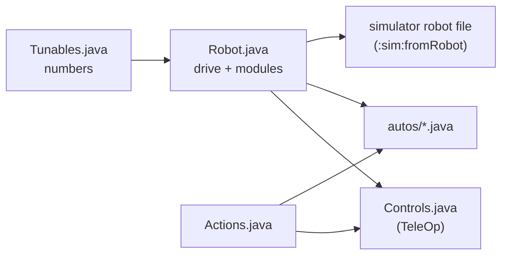

# Robot.java

What every part shares: `define()`, `drive(...)`, `add(...)`, parts that are not on the robot yet, parts
not in the catalog, and shapes for the simulator. Each part has its own page: [Reference](README.md).
Learn it step by step: [Robot.java: what is on the robot](../five-files/01-robot-java.md).

Package: `com.crossbotics.ftchelper.robot`. Worked examples:
[`examples/.../gobildabot`](../../examples/src/main/java/com/crossbotics/ftchelper/examples/gobildabot)
(goBILDA's starter bot), [`flywheelbot`](../../examples/src/main/java/com/crossbotics/ftchelper/examples/flywheelbot)
and [`turretbot`](../../examples/src/main/java/com/crossbotics/ftchelper/examples/turretbot). The
[cookbook](../cookbook.md) has code to copy.

## The five files

A team's whole robot program is five files. Each file answers one question. Each mechanism is a
**module**: one line in `Robot.java` that brings its own numbers and autonomous steps. Its buttons are
lines in `Controls.java`.

| File | Answers | Changes when | Reference |
| --- | --- | --- | --- |
| `Robot.java` | What is on the robot, and its name in the configuration? | a part is added, moved or renamed | this page |
| `Tunables.java` | What are the numbers? | tuning (speeds, positions, PID) | [Tunables.java](tunables.md) |
| `Controls.java` | Which button does what? (It is also the TeleOp.) | the drivers change their minds | [Controls.java](controls.md) |
| `Actions.java` | Which steps use several parts together? | a new combo move | [Action](steps.md#action) |
| `autos/` | What does the robot do on its own? | new or changed autonomous programs | [Steps for autos](steps.md) |

For a new robot, `./gradlew :sim:newRobot` writes the five files from the robot configuration
([Making the files](#making-the-files)). A part added later is one line in `Robot.java`. Its numbers
and its simulator lines come with it. Its buttons are lines in `Controls.java`.



## Every class

| Class | Use it to | Page |
| --- | --- | --- |
| `RobotDefinition` | describe the robot in `Robot.java`: `drive(...)` and one `add(...)` per mechanism | [below](#robotdefinition) |
| `Drive` | the drivetrain: mecanum or tank, motor names, motor, wheel, IMU | [Drive](parts/drive.md) |
| `Odometry` | where the robot is on the field: a goBILDA Pinpoint, a SparkFun OTOS, or dead wheels | [Odometry](parts/odometry.md) |
| `PathFollower`, `PathAt` | a path-following add-on (Pedro), and things to start along a path | [PathFollower](parts/path-follower.md) |
| `Intake` | a roller on a motor and/or CR servos: in, out, on at the start | [Intake](parts/intake.md) |
| `Lift` | a slide on a motor with named heights and a bottom switch | [Lift](parts/lift.md) |
| `Arm` | an arm on a motor with named angles in degrees | [Arm](parts/arm.md) |
| `Claw` | a claw servo: open, closed | [Claw](parts/claw.md) |
| `Wrist` | a wrist servo with named positions | [Wrist](parts/wrist.md) |
| `Positioner` | any servo with named positions (deploy, fold, gate) | [Positioner](parts/positioner.md) |
| `Turret` | a turret inside its limits, by hand or following the camera's goal | [Turret](parts/turret.md) |
| `Interlock` | two parts that must never be in their zones at the same time | [Interlock](parts/interlock.md) |
| `Launcher` | a flywheel and its indexer: spin up, fire, speed from distance | [Launcher](parts/launcher.md) |
| `Indexer` | feeds one piece at a time (servo, CR servo or motor) | [Indexer](parts/indexer.md) |
| `Hood` | a launcher's hood (servo or motor): its angle from the shot table, by hand, a trim | [Hood](parts/hood.md) |
| `Camera` | a Limelight or webcam; the alliance's goal | [Camera](parts/camera.md) |
| `Aim` | aim the robot or the turret at the goal | [Aim](parts/aim.md) |
| `Pieces`, `PieceSensor` | which game piece is at a spot (color sensor, distance sensor, second webcam); how many the robot holds and which fires next | [Pieces](parts/pieces.md) |
| `Lights`, `LightColor` | a colored light for the drivers (goBILDA RGB Indicator Light or REV Blinkin): which color when | [Lights](parts/lights.md) |
| `Action` | steps across several parts that never block (never make the loop wait) | [Action](steps.md#action) |
| `Mode` | a rule a module follows every loop while the mode is on | [Modes](steps.md#modes) |
| `ControlMap`, `Pad`, `Toggleable` | `Controls.java`: the TeleOp and the button map; anything one button switches on and off | [Controls.java](controls.md) |
| `Auto`, `Steps` | one autonomous as a list of steps | [Steps for autos](steps.md) |
| `Feature` | what the library does by itself for your robot, ready or not (`robot.features()`) | [below](#what-your-robot-can-do) |
| `EncoderMotor` | one motor for the [Encoder Check](../guides/finders.md#encoder-check-each-encoder-cable-in-its-own-port) (`robot.encoderMotors()`) | [below](#robotdefinition) |
| `Motors` | the encoder counts and speed of common motors, by catalog id (a part's name in the [parts catalog](../guides/parts-catalog.md), e.g. `"gobilda-5203-312"`) | [below](#motors) |
| `Shape`, `Parts` | how each part looks and where it sits, for the simulator; wheels, rollers and servos by catalog id | [below](#shapes-and-parts) |
| `Module`, `MotorPositions`, `ServoPositions`, `Devices` | what the modules share (most code does not use these by name) | [below](#module) |

## RobotDefinition

```java
public class Robot extends RobotDefinition {
    public Intake intake;
    public Lift lift;
    public Claw claw;

    @Override protected void define() {
        drive(Drive.mecanum("front_left", "front_right", "back_left", "back_right")
                .motor("gobilda-5203-312").wheelMm(96)
                .imu("imu", LogoFacingDirection.UP, UsbFacingDirection.FORWARD));
        // .part(...): which motor or servo it is, by the id on its label (optional, recommended)
        intake = add(Intake.motor("intake").part("gobilda-5203-1150"));
        lift = add(Lift.slide("lift").part("gobilda-5203-435").bottomSwitch("lift_bottom"));
        claw = add(Claw.servo("claw").part("gobilda-2000-torque"));
        atStart(() -> Actions.deployIntake(this));   // optional: an action right after ▶ (start)
    }
}
```

- **Name each part** with `.part(...)`. For a launcher, an arm or a motor turret, write the motor's id in
  its brackets. For the drive, use `.motor(...)`. It is optional, but recommended: then the starting values
  come from that part's real numbers, and the simulator moves it like the real one
  ([First run](tunables.md#first-run-what-you-get-before-tuning)). For a part not in the catalog, see
  [Parts not in the catalog](#parts-not-in-the-catalog).
- **`define()` only describes the robot.** It runs in INIT, and also without a robot (to write the
  simulator file). The OpMode classes make the hardware (`setup`) and update every part each loop.
  Nothing moves in INIT.
- **What INIT checks:** a device name used twice, two parts (or a part and an interlock rule) that read the
  same Tunables section, an indexer added twice. Each stops INIT with the name.

| In `define()` | What it does |
| --- | --- |
| `drive(Drive d)` | the drivetrain (required) ([Drive](parts/drive.md)) |
| `odometry(Odometry o)` | optional: what tells the robot where it is on the field ([Odometry](parts/odometry.md)) |
| `follower(PathFollower.Maker m)` | optional: a path follower, e.g. `follower(Pedro.follower(...))` ([PathFollower](parts/path-follower.md)). It needs an `odometry(...)` line |
| `T add(T module)` | a mechanism. It gives the mechanism back, so you can keep it in a field (`lift = add(...)`) |
| `add(...optional())` | a part that may not be on the robot yet: while its device is not in the configuration, the part is off and INIT does not stop ([Parts not on the robot yet](#parts-not-on-the-robot-yet)) |
| `atStart(Supplier<Action>)` | an action that runs once right after ▶ (start on the Driver Hub), in autonomous and TeleOp |
| `Interlock keepApart(name, zoneA, zoneB)` | an interlock rule: two parts never in their zones at the same time. Write it after the parts' `add` lines. Its numbers are in `Tunables.<name>` ([Interlock](parts/interlock.md)) |
| `tunables(Class)` | the Tunables class, if it is not `Tunables` in the same folder |
| `addOwn(Subsystem)`, `everyLoop(Runnable)` | your own code with the robot's loop (also after INIT, from `Controls.java`): [Your own code every loop](#your-own-code-every-loop) |
| `chassisMm(l, w, h)`, `heightMm(h)`, `fixed(Shape...)` | for the simulator: the chassis box, the whole robot's height, parts the code does not move ([Shapes](#shapes-and-parts)) |
| `fieldMap(FieldMap.margin(13).keepOut(...))` | the places the robot must not drive through, for `routeTo(...)` and `route(...)` ([keep-out boxes and routes](../modules/odometry.md#keep-out-boxes-and-routes)) |
| `cameraFix(camera)` | ALPHA: nobody has tested it, and it is not for BIOBUZZ. A Limelight corrects the odometry ([camera fix](../modules/odometry.md#camera-fix-alpha)) |

| For your code | What it does |
| --- | --- |
| `run(Action)`, `cancel(Action)`, `cancelAll()` | starts or stops actions |
| `atInit(Runnable)`, `duringInit(Runnable)`, `atStop(Runnable)` | runs your own code once at INIT, every pass of INIT, and at STOP |
| `wasStarted()` | whether ▶ was pressed |
| `pauseAll()`, `resume()`, `togglePause()`, `isPaused()` | stops every part and holds it stopped, goes on again, switches between the two, and tells whether it is paused ([Pause](#pause-and-stop)) |
| `setAlliance(Alliance)` | sets this match's alliance. The OpMode classes do this for you, so use it only in your own plain OpMode |
| `driveWith(gamepad)`, `driveWith(forward, strafeRight, turnRight)` | drives from a gamepad, or from your own numbers (forward, strafe right and turn right are +). Only in your own plain OpMode, after `robot.init(this)`. Anywhere else it stops with an error |
| `interlocks()` | the interlock rules from `define()` (read only) |
| `alliance()` | this match's alliance (from autonomous's menu; TeleOp remembers it) |
| `notes()` | INIT notes: missing Tunables sections or fields (the library uses its defaults), parts that are off (not in the configuration) |
| `checkConfiguration(hardwareMap)` | one line per device Robot.java names that is NOT in the configuration, and what that means ("INIT will stop", or "optional, so the part is off"). The [Hardware Check](../modules/testing.md#hardwarecheckopmode) shows it |
| `modules()`, `drive()`, `all()` | the parts, the drivetrain, the update group |
| `encoderMotors()` | every motor Robot.java names, as `EncoderMotor`s for the [Encoder Check](../guides/finders.md#encoder-check-each-encoder-cable-in-its-own-port): the drive first, then each part's. See the `EncoderMotor` table below. No hardware needed |
| `pose()` | where the robot is now, from the odometry: a [`FieldPose`](../modules/util.md#fieldpose) (x in right, y in away from your wall, heading 0 = away, counterclockwise +). It is a copy, and null with no odometry line |
| `odometry()`, `odometrySpec()`, `odometryChecked()` | the running [`PoseTracker`](../modules/odometry.md#posetracker) (null before `setup`), the odometry line as written, and `Tunables.Odometry.checked` |
| `resetPose()` | "set pose here": the pose becomes the reset spot in `Tunables.Odometry` (`resetX`, `resetY` inches, `resetHeading` degrees, as seen from your wall, written for BLUE; RED mirrored like the start spot). It gives false (nothing changed) with no odometry or no spot. TeleOp's G1 START held 1 s calls it ([Set pose here](controls.md#set-pose-here)) |
| `resetPose(x, y, headingDeg)` | the same with a spot of your own (for BLUE, mirrored for RED). It stops with a message if there is no odometry |
| `follower()`, `hasFollower()`, `makeOdometry(hardwareMap)` | the running path follower (null before `setup`), whether there is a follower line, and the odometry alone for a tool (Pedro's tuners) |
| `robotConfig()` | the drive settings for `EasyTeleOp`/`EasyAuto` |
| `simLines()` | the simulator robot file's lines from the code |
| `setup(hardwareMap)` | makes every module's hardware (the OpMode classes call it in INIT). `setup(devices)` with [pretend devices](../modules/testkit.md) in a test |
| `startForTests()` | in a JUnit test only: what ▶ does (each part's start, the `atStart` actions). The OpMode classes do it themselves ([testkit](../modules/testkit.md)) |
| `checkTunables()` | the Tunables name checks of INIT, without a robot: one line per problem (a field no part reads, a section that looks meant for a part). `:sim:fromRobot` prints them |
| `sectionWarnings()` | after `setup`: INIT's warnings about Tunables sections no part reads that look meant for one |
| `tunablesClass()` | the Tunables class found (null if none) |
| `static changedTunables()` | values tuned on the robot that differ from Tunables.java, as lines to copy back |
| `static freshRobotApp()` | tests and the simulator only: forget what one program leaves for the next (the last autonomous's alliance, pose and report, turret angles, launcher trims, tuned numbers in memory), as if the robot were just turned on. Never use it in robot code |
| `static sectionName(device)` | the Tunables section a device reads: "intake_deploy" -> `IntakeDeploy` |

| `EncoderMotor` | What it is |
| --- | --- |
| `name`, `reversed`, `part` | the motor's name, whether it is reversed, and its catalog id |
| `encoderRead` | whether something reads its encoder (false for an intake, for example) |
| `pushSign()` | +1 or -1: which way it has room, from Tunables.java |
| `skip()` | why it is not checked, e.g. its port reads an odometry pod |
| `isOptional()` | whether the part is `optional()` |
| `alsoMotors()` | a second motor pushed with it, like a lift's second motor |

## Tunables.java

The numbers of every part are in `Tunables.java`: one section per part, named after the device's
configuration name in CamelCase. [Tunables.java](tunables.md) explains how it works, the
names and what INIT checks. Each part's own numbers are in the **In Tunables.java** table on its page.

## DEFAULT and MEASURE

You can write two words in `Tunables.java` in place of a number you do not have yet: `DEFAULT` (the
library's starting value) and `MEASURE` (INIT stops until you measure it). They come from `Starting`.
[DEFAULT and MEASURE](tunables.md#default-and-measure) has the whole story.

## Your own code every loop

Code the library has no part for (a bucket of your own, a value to log) runs with the robot's loop:

```java
// Controls.java, in buttons(robot, g1, g2) (it has the hardwareMap; an autonomous: in steps(...))
robot.addOwn(new Bucket(hardwareMap));                     // class Bucket implements Subsystem
robot.everyLoop(() -> lastHeight = robot.lift.position());  // a small piece of code
```

| Write | What it does |
| --- | --- |
| `addOwn(part)` | your part (a class that `implements Subsystem`). Its `update()` runs every loop after ▶, after the library's parts. Its `stop()` runs at STOP **and when the robot pauses** (BACK), so a motor in it stops with the rest. It is not updated while paused. Nothing runs in INIT: make its hardware in its constructor, and never move anything there. Use it in `define()` for a part with no hardware, or after INIT |
| `everyLoop(code)` | runs a `Runnable` every loop after ▶ (not while paused). It has no `stop()`: for code that moves a motor, use `addOwn` |

Pause stops every part in `all()` that is not the library's own, including one added the old way
with `robot.all().add(...)`. A second motor on a lift or arm needs none of this: use `alsoMotor`
([Lift](parts/lift.md)).

## What your robot can do

The library does some things by itself, once your robot has the parts for them. `robot.features()`
lists them. It works them out from Robot.java alone (no hardware). Each one is **ready**, with the line to use
it, or **not ready**, with what to add. The simulator's auto builder shows this list ("What this robot
can do"), and its Action list starts with the ready actions.

| Feature | Kind | Needs | The line |
| --- | --- | --- | --- |
| Fire 1, Fire 2 ... Fire all | action | a launcher | `robot.launcher.fireAction(2)`, `robot.launcher.fireAllAction()` |
| Ready to launch | auto step | a launcher: spins up and waits until ready | `.readyToLaunch("Ready", 3)`, the action `robot.launcher.readyAction(3)` |
| Wait for the goal | auto step | a camera with `goal(...)`: waits until it sees the goal, still, then goes on | `.waitForGoal("Wait for the goal")` (no limit), `.waitForGoal("Wait for the goal", 10)` |
| Shot modes: CAREFUL, QUICK, SPRAY | automatic | a launcher ([Launcher](parts/launcher.md)) | (nothing to write; SPRAY: `sprayEnabled = true`) |
| Feed stop | automatic | a feed stop servo | `.feedStop("feed_stop")` on the launcher |
| Piece path: parts that push a piece in | automatic | an intake that pushes pieces into the wheel | `.pushedBy(intake)` on the launcher |
| Feed wheel: stages each piece for the arm | automatic | a CR servo (or motor) wheel before a push arm | `.feedWheel(Indexer.crServo("feeder_wheel"))` on the launcher |
| Firing stats (debug lines) | automatic | a launcher (PRACTICE profile only) | (nothing to write) |
| Alliance trim | automatic | a launcher | `Tunables.Launcher` `redTrimPercent`, `blueTrimPercent` |
| Eject | action | a launcher: one piece out at a low speed (`ejectRpm`, `ejectSec`) | `robot.launcher.ejectAction()` |
| Aim at the goal | auto step | a drive, and a camera with `goal(...)` (or `odometry(...)` + `Tunables.Aim` `goalX, goalY`); with a following turret, the turret | `.aimAtGoal("Aim", 3)` |
| Aim at the goal with a sweep | auto step | the same. When the goal is not in view, the robot turns slowly up to the sweep each way to find it, then aims (it turns back to where it started if it never sees the goal). A turret that follows the goal does not sweep | `.aimAtGoal("Aim", 4, 45)` |
| Remember heading, turn back | auto step | a drive (without odometry pods it uses the IMU: better than nothing) | `.rememberHeading("Remember")` ... `.turnBack("Back", 0.5)` |
| Reverse drive | TeleOp toggle | a drive: the back is the front (robot-centric driving; field-centric ignores it) | `g1.x.toggle(robot.reverseDriveMode()).rumble()` |
| Camera live view (webcam) | automatic | a webcam, PRACTICE profile (never at an event): Driver Station menu > Camera Stream, in INIT. A Limelight: plug it into a laptop (its own web page) | `liveView = false` in the webcam's section (`Tunables.Webcam1`) turns it off |
| Camera fix (ALPHA, untested; not for BIOBUZZ) | automatic | off unless you turn it on. **BIOBUZZ teams: ignore it; your robot is not affected.** A Limelight + `odometry(...)` + `cameraFix(camera)`, and `Tunables.CameraFix.enabled = true` ([Odometry: camera fix](../modules/odometry.md#camera-fix-alpha)) | `cameraFix(camera);` in Robot.java |
| Aim mode (the whole robot turns to the goal): it stays aimed while you drive | TeleOp toggle | the same, and no following turret. Mecanum: drive and strafe while it stays aimed; tank: forward and back only | `g1.rb.toggle(robot.aimMode())` |
| Turret follows the goal | TeleOp toggle | a turret with `follows(camera)` or `followsOdometry()` (the robot drives at full speed while it aims) | `g2.rightStickButton.toggle(robot.turret.followMode())` |
| Goal line on the Driver Station: seen, in range, LOCKED | automatic | what aiming needs | (nothing to write) |
| Buzz when aimed | TeleOp | what aiming needs | `g1.rumbleWhenAimed();` |
| Quick turn on fire: RB turns the robot to the goal, then fires | TeleOp (Tunables) | whole-robot aim's needs | `Tunables.Aim.aimOnFire = true` |
| Shoot while moving | TeleOp toggle | aiming, and `odometry(...)` (the speed). Tune it first | `g2.a.toggle(robot.aim().movingShotMode())` |

We keep this table by hand (it reads better than a generated one). A test (`FeaturesTest`) fails when a
feature in the code has no row here.

**The buttons stay yours.** The library never takes a button by itself: two features could want the same
one. The list gives the line, and you pick the button in `Controls.java`. The buttons in the lines are
only examples: pick free ones (INIT lists them, `G1 free: ...`). With one driver (`oneDriver = true`), RB
on gamepad 1 is the launcher's fire button, so put aim mode somewhere else.

```java
for (Feature f : robot.features()) telemetry.addLine(f.toString());   // ready  action: Fire 2  robot.launcher.fireAction(2) ...
```

| `Feature` | What it is |
| --- | --- |
| `kind` | `AUTO_STEP`, `ACTION`, `TOGGLE` or `AUTOMATIC` (`kind.words()`: "auto step" ...) |
| `name`, `code`, `needs`, `note` | what it is called, the line to use it ("" for automatic), what it needs, a short note |
| `ready()`, `missing` | whether it has what it needs; what to add ("" when ready) |

## Parts not in the catalog

For a motor or servo that is not in the [parts catalog](../guides/parts-catalog.md) (another seller, a
custom gearbox), describe it in Robot.java with the seller's numbers. The call gives back its id, and the id
works
wherever a catalog id goes (`Launcher.flywheel`, `Arm.motor`, `Turret.motor`, `Hood.motor`,
`Drive...motor(...)`, `.part(...)`):

```java
launcher = add(Launcher.flywheel("launcher", Motors.custom("my-flywheel-motor", 28, 5800)));  // counts per turn, free RPM
claw = add(Claw.servo("claw").part(Parts.customServo("my-servo", 270, 0.16)));                  // turn in degrees, s per 60 deg (~5 V)
lift = add(Lift.slide("lift").part(Motors.unknown("old-lift-motor")));                           // numbers not known yet
```

| Method | What it does |
| --- | --- |
| `Motors.custom(id, countsPerRev, freeRpm)` | a motor of your own: encoder counts per output turn (as the SDK reports them; goBILDA's "Encoder Resolution" at the output shaft, REV's "Encoder Counts per Revolution") and free speed at 12 V (goBILDA's "No-Load Speed", REV's "Free Speed"). Either may be `Double.NaN` ("I don't know this one"). It refuses a catalog id |
| `Motors.unknown(id)` | a motor whose two numbers are not known |
| `Motors.find(id)`, `Motors.get(id)` | a catalog or custom motor (`find`: null if none; `get`: stops with the list) |
| `Parts.customServo(id, rangeDeg, secPer60Deg)` | a servo of your own: its whole turn, and seconds per 60 degrees at about 5 V (if the seller lists 4.8 V and 6 V, use 4.8 V). **Reference level** (most teams never need it): the library takes the turn over 500-2500 us. `customServo(id, rangeDeg, secPer60Deg, pulseMinUs, pulseMaxUs)` gives the seller's own pulse range |
| `Parts.unknownServo(id)` | a servo whose numbers are not known |
| `Parts.findServo(id)` | a catalog or custom servo, or null |

- **Its numbers work like a catalog part's:** starting values (`DEFAULT`, or no line), INIT says
  `defaults from my-flywheel-motor (custom)`, and `:sim:fromRobot` writes them into the robot file
  (`motor.launcher = flywheel, ticksPerRev=28, rpm=5800`; `servo.claw = 0.30, rangeDeg=243, secPer60=0.16`).
- **When the numbers are not known,** the starting values are the general ones. INIT says so, and how to do better:
  `Lift: the counts per turn of old-lift-motor are not known, so general defaults (kP, kD, slowZone, tolerance made for a goBILDA 312 RPM motor). Give them with Motors.custom(...), or tune them in the tuning menu`.
  The same words show for a part with no `.part(...)` at all (`no part in Robot.java`).
- **Counts per turn are needed** for a launcher, an arm, a motor turret and the drive (they turn counts
  into RPM or degrees). With none, Robot.java stops and says so.
- A launcher whose top speed is not known uses general defaults made for a 6000 RPM motor.
- Safety numbers (`min`, `max`, stops) stay yours, whatever the part.

## Parts not on the robot yet

Robots are built in steps: the drive first, then the intake, the deploy servo when it arrives. Write the
whole robot in Robot.java now, and mark the parts that are not built yet with `optional()`:

```java
intakeDeploy = add(Positioner.servo("intake_deploy").part("gobilda-2000-torque").optional());   // Robot.java
```

- **Without `optional()`,** a device missing from the robot configuration stops INIT:
  `No Servo named "intake_deploy" in the active robot configuration. ... Not on the robot yet? Add .optional() to IntakeDeploy's line in Robot.java ...`.
- **With it,** INIT goes on and says once
  `"intake_deploy" not in the configuration: IntakeDeploy is off (optional part)`. The part is **off**
  until its device is in the configuration. Then it works, with no code to change.
- **Leaving the line out is worse:** then every action, button and autonomous that uses the part must change
  too, and change back later. Team 8938 kept a `HAS_DEPLOY_SERVO` switch for this. `optional()` does it
  for every part.

**A part inside a part** can be optional too. For example, a launcher's feeder that is not built (or was
taken off):

```java
launcher = add(Launcher.flywheel("launcher", "gobilda-5203-6000")
        .feeder(Indexer.crServo("windmill").part("gobilda-2000-torque").optional()));   // Robot.java
```

Without `"windmill"` in the configuration, the launcher still spins, and `fire()` feeds nothing. The
pieces must reach the wheel another way, for example pushed in by the intake. The launcher still counts
each `fire()` as a shot, and a piece count (`Pieces`) does not go down. So with `stopsWhen(pieces::isFull)`
on an intake that also feeds the wheel, the intake could stop when full: leave `stopsWhen` out on such a
robot. The other way round does not work: a feeder cannot be on while its launcher is off.

What "off" means, everywhere:

| Where | A part that is off |
| --- | --- |
| Commands | ignored (`goTo`, `in`, `spinUp`...): no error, nothing moves |
| Questions | never hold anything up: "done" questions are true (`isDone`, `isAtTarget`, `isAt` the position it was last sent to, `isHomed`, a turret's `isAimed`); "busy" ones are false (`isRunning`, `isSpinning`, `isReady`, `isShooting`, `isBusy`, `isJammed`); sensors see nothing. `isPresent()` is false |
| Telemetry | its line is `- (not on the robot)` (a servo part that is on the robot but has had no command yet says `not sent yet`) |
| INIT | PRACTICE: a note. **COMPETITION: a loud warning at the very top** (above every other warning), `!! COMPETITION: "intake_deploy" not in the configuration: IntakeDeploy is OFF (optional part). On the robot? Check its name in the configuration, then INIT again`. At an event, a part that is off is most likely a misspelled or lost name |
| [Actions](steps.md#action) | the action skips the step's command to it and goes on. It also skips a wait right after a step that only used parts that are off (nothing to wait for). `status()` ends with `skipped IntakeDeploy (not on the robot)`, `skipped()` lists them; an autonomous's report says it on the step |
| Buttons | a part's own buttons (with `useStandardButtons()` true), `toggle(part)` and any button given `.needs(part)` do nothing; the button map says `- off: IntakeDeploy not on the robot` (COMPETITION: `- !! OFF: ...`) |
| [Interlock](parts/interlock.md) rules | a rule with it is off (nothing to hit), and needs no Tunables section: INIT says `Interlock TurretLift: off (Lift is not on the robot)` |
| [Aim](parts/aim.md) | a following turret that is off does not aim: you may use whole-robot aim (`robot.aimMode()`) |
| Tunables | its section may be missing or unfinished: no stop. Wrong numbers (max below min) give only a note: `Fix its Tunables before adding it: ...`. Its numbers are **hidden from the tuning menu** (it says `Not on the robot (hidden): IntakeDeploy`): changing them would do nothing. Saved values are kept, and they come back the day the part is there |
| Simulator | `:sim:fromRobot` still writes it. Leave it out of the simulated configuration with `missing = intake_deploy` in the robot file, or `set device intake_deploy missing` in a scenario ([simulator guide](../guides/simulator.md#a-part-not-on-the-robot-yet)) |
| [Hardware Check](../modules/testing.md#hardwarecheckopmode), finders | the check lists it as `optional, so the part is off (fine)`; the Hood Finder and Shot Tuner say it is not in the configuration; the Piece Tuner leaves its sensors out |

- **Several devices** (a lift with a switch, a two-servo intake, a launcher with its feeder and hood):
  only the **first** device, the one named in the `add` line, decides. When it is missing, the whole part is
  off, with everything inside it. When it is there, every other device must be there too, as always (half a part is a
  wiring mistake: INIT stops and names the device). A feeder or hood can be `optional()` on its own.
- **Not for the drive** (a robot always drives) or the odometry. Leave the `odometry(...)` line out until
  it is on the robot: `driveTo` needs it.
- **Your own code:** `if (robot.intakeDeploy.isPresent()) ...` for anything the library cannot see.
- **A part that is off at INIT stays off for the whole program.** Plug it in and add it to the configuration, then INIT again.
- **Careful at events:** with `optional()`, a misspelled or lost configuration name does not stop INIT;
  the part is only off. So in the COMPETITION profile it is a loud `!!` warning (PRACTICE: a note). Read
  the INIT screen before each match, or take `.optional()` off once the part is built (then a missing
  device stops INIT).

| Method | What it does |
| --- | --- |
| `optional()` | on any part's `add` line: it may not be on the robot yet |
| `isOptional()` | whether the part is marked `optional()` |
| `isPresent()` | false only for an optional part whose device was not in the configuration at INIT |
| `Button.needs(part...)`, `Stick.needs(part...)` | in Controls.java, after the job: the button is off while one of these parts is |
| `Action.skipped()` | the parts this run skipped (empty when all were there) |
| `Interlock.isOff()` | whether the rule is off because one of its parts is |

## Shapes and parts

`Robot.java` can also say what each part IS (its catalog id) and how it LOOKS (a `Shape`). Then
`./gradlew :sim:fromRobot` writes the simulator robot file with no TODO shape guesses. The 3D view draws
the robot, the simulator checks the size rules on it, and each shape moves with its part. So the simulator shows
whether the controls do what they should (the intake drops, the rollers spin, a piece is fired). Worked
example: [`flywheelbot/Robot.java`](../../examples/src/main/java/com/crossbotics/ftchelper/examples/flywheelbot/Robot.java).
A lift with a wrist and a claw riding on it: [`v2bot/Robot.java`](../../examples/src/main/java/com/crossbotics/ftchelper/examples/v2bot/Robot.java).

Typing the numbers is hard. Shape the robot with the mouse in the simulator, and copy the Java it prints
([Edit robot: shape your robot](../guides/simulator.md#edit-robot-shape-your-robot)).

**Name the part, give only what is not known.** A part in the [parts catalog](../guides/parts-catalog.md)
brings its numbers: a motor its speed and encoder counts, a servo its speed and range, a wheel or roller
its diameter (and width, when the seller gives it). You always give the places yourself.

**A servo's range** is how far positions 0 to 1 turn it. On the hub's normal 600-2400 us, a goBILDA
2000 servo turns 270 degrees (its seller's 300 needs `.fullRange()`: [Claw](parts/claw.md)). In code:
`Parts.servoPart(id)` gives `rangeDeg` (the seller's), `pulseMinUs`/`pulseMaxUs`, `sdkRangeDeg()` (270) and
`degreesOver(lowUs, highUs)`.

```java
drive(Drive.tank("left_drive", "right_drive").motor("gobilda-5203-312").wheel("gobilda-hogback-96")
        .wheelsAtMm(380, 290).reversed("right_drive"));
chassisMm(400, 400, 100);                     // the chassis box, mm
heightMm(300);                                // the whole robot

// One shape: inside looks(...), on the part's line.
intakeDeploy = add(Positioner.servo("intake_deploy").part("gobilda-2000-torque")
        .looks(Shape.arm().name("kicker").atMm(150, 90, 100).sizeMm(60, 20, 15)
                .angle("stowed", 90).angle("deployed", 20)));

// Two shapes: name each one first, then give the names to looks(...).
Shape intakeArm = Shape.arm().name("intake_arm").atMm(150, 0, 100).sizeMm(110, 200, 20)
        .range(-15, 90).startAt(90).dropsWhen(intakeDeploy, "deployed", -15);
Shape intakeRoller = Shape.roller("gobilda-gecko-48-rex").on("intake_arm").atMm(110, 0, 0).lengthMm(300);
intake = add(Intake.motor("intake").part("gobilda-5203-1150").holds(3).looks(intakeArm, intakeRoller));

launcher = add(Launcher.flywheel("launcher", "gobilda-5203-6000").feeder(Indexer.servo("indexer").part("gobilda-2000-speed"))
        .looks(Shape.flywheel("gobilda-hogback-96").atMm(-40, 0, 170)).shotAngle(75));
fixed(Shape.box("tower").atMm(-90, 0, 40).sizeMm(50, 180, 260));
```

**One shape or several on a part:**

- **One shape:** write it inside `looks(...)` on the part's line, as for the kicker and the flywheel
  above. Its settings can go on the next line (8 spaces further in).
- **Two or more shapes** (an intake arm and its roller), or one long shape: give each shape a name first,
  on its own lines, with its comment above it: `Shape intakeArm = Shape.arm()...;`. Then the part's line
  ends with `.looks(intakeArm, intakeRoller)`. **Why:** each shape reads as one sentence, the part's line
  stays short, and you never have to count closing brackets.
- Write the named shapes in `define()`, above the line that adds the part. A shape that rides on another
  part (`on(lift)`) goes below that part's line.
- The names are only for your code (camelCase, like any Java variable). The shape's name in the simulator
  is `name("intake_arm")`, or the part's name when you do not give one.
- Each `Shape` belongs to one part. Make a new one for each part, even when two look the same.
- The simulator's [Edit robot](../guides/simulator.md#edit-robot-shape-your-robot) mode prints shapes the
  same way: one shape inline, several as named shapes.

| On a part | What it does |
| --- | --- |
| `part(id)` | the main motor's or servo's catalog id (a typo stops with the list of ids). A launcher's motor is in `Launcher.flywheel(name, id)`, the drive's in [`Drive.motor(id)`](parts/drive.md). On a CR servo the id is only a note (the simulator turns every CR servo at one speed) |
| `looks(Shape...)` | how it looks. Every part that moves takes shapes: Intake, Positioner, Launcher, Indexer, Lift, Arm, Wrist, Claw, Turret and Hood. A part with no `looks(...)` gets a guessed shape marked TODO (from the chassis, the other parts and the catalog: [simulator guide](../guides/simulator.md#a-robot-file-from-robotjava)) |

| `Shape` | What it is | Moved by |
| --- | --- | --- |
| `roller(ids...)` | a cylinder. Several ids (90 mm and 60 mm rollers taking turns) draw one as big as the biggest. In the simulator every roller of an Intake takes pieces in, and any roller drags the pieces it touches | spins with its part's motor or CR servo |
| `flywheel(id)`, `flywheel()` | a launcher wheel (no id: give `diameterMm` and `lengthMm`) | spins with the launcher's motor |
| `arm()` | swings about a hinge: `atMm` is the hinge, `sizeMm(length, width, thickness)` reaches forward at 0 degrees | a Positioner's, Wrist's or Claw's servo (`angle(position, deg)` twice); an Arm's motor (its Tunables degrees, from `min`); a Hood's servo or motor (its angles: Tunables `angleA`/`angleB` or its calibration table); or nothing (`passive`) |
| `turret()` | turns about the up line: `atMm` is the middle of its bottom, `sizeMm` its box. Parts ride it with `on(turret)` | a Turret's motor, servo or CR servo (its Tunables angles) |
| `slide()` | moves in a straight line along its axis (default up): `sizeMm` is one stage | a Lift's motor (`travelMm`: how far the stage moves from its `min` to its `max`), or nothing (`passive`, `travelMm`) |
| `claw()` | two fingers that open and close; it can hold a game piece in the simulator | a Claw's servo |
| `box(name)` | does not move: `atMm` is the middle of its bottom | nothing |

| Setting | What it sets |
| --- | --- |
| `atMm(forward, left, up)` / `atIn` | from the middle of the chassis on the tiles, or from the hinge (or middle) of the shape it rides on |
| `sizeMm(forward, left, up)` / `sizeIn` | its box (not needed for a catalog roller or flywheel) |
| `lengthMm(mm)`, `diameterMm(mm)` | a roller's length along its axle (needed when the catalog has no width); a part not in the catalog |
| `axis(dir)` | `up`, `down`, `forward`, `back`, `left`, `right`: a roller's axle (`up` = lying flat), an arm's hinge |
| `on(part)`, `on("name")` | rides on another part's first shape, or on a shape by its name |
| `name(n)` | its name in the robot file (default: the part's name, then `name_2`...) |
| `angle(position, deg)` | an arm on a servo: its angle at a named position. Give two (0 = level forward, +90 up) |
| `passive()`, `range(min, max)`, `startAt(deg)`, `travelMm(mm)` | moved by gravity or springs, not the code: the simulator draws it at its start, and the size rules try its whole range (its hard stops) |
| `dropsWhen(servoPart, position, toDeg)` | a passive arm that a servo pushes over: once the servo is three quarters of the way to the position, it falls to `toDeg` and stays (a folded intake) |
| `note(text)` | where a number came from ("est.", "measured 2026-10-20"), written after the line |
| `color(c)` | its color in the 3D view, e.g. `"#2fa84f"` |
| `tiltDeg(deg)` | mounted at an angle on its parent, about the left-right line (front up +): a spinner kept level on an arm that is down at -40 degrees has 40 |
| `soft()` | a soft roller (surgical tubing, flaps): it bends against the field, so in the simulator only game pieces touch it. It still counts for the size rules |
| `reversed()` | a roller that turns the other way from its motor (geared) |

**Mistakes stop with the part's name:**

- a typo in an id (with the known ids);
- a roller with no length;
- an arm with fewer than two angles, or an unknown position name (the names in `angle(...)` must be
  positions in that part's Tunables section);
- shapes on a part that cannot take them;
- a setting that does not fit the shape (`angle` on a passive arm, `range` on a servo arm, `travelMm` on
  anything but a slide, `lengthMm` on a box or arm);
- riding `on` a part that has no shape;
- an intake whose looks have no roller;
- one `Shape` given to two parts, or two parts with one name in the robot file;
- a `shotAngle` outside 0 to 180.

A part without `looks(...)` gets a guessed shape marked `TODO measure`. It starts from the chassis
(`chassisMm`), the height (`heightMm`), the other parts (a claw on the end of the lift, arm or wrist) and
the catalog, and keeps the robot inside the size rules
([simulator guide](../guides/simulator.md#a-robot-file-from-robotjava)).

## Motors

`Motors.get("gobilda-5203-312")` gives `countsPerRev` and `freeRpm`. `Motors.all()` lists them. The ids
are the simulator's [parts catalog](../guides/parts-catalog.md) (a test keeps the two the same). For a motor
of your own, see [Parts not in the catalog](#parts-not-in-the-catalog).

## Module

`Module` is what every mechanism shares.

| Method | What it does |
| --- | --- |
| `name()` | its Tunables section |
| `deviceName()` | its first device's name in the configuration |
| `tunables(section)` | reads another Tunables section |
| `optional()`, `isOptional()`, `isPresent()` | [Parts not on the robot yet](#parts-not-on-the-robot-yet) |
| `stop()` | switches it off now (a launcher fully off, until `spinUp()`/`fire()`). It counts as the driver's command: an action using that part stops. To let a launcher coast while it stays ready, use `idle()` |

| `Devices` | What it does |
| --- | --- |
| `Devices.has(name)` | whether the configuration has a device with that name |
| `Devices.of(hardwareMap)` | where modules find their hardware on the robot. Tests give pretend devices |
| `Devices.batteryVolts()` | the battery now (NaN in tests). It waits for the hubs, so do not use it in the loop |
| `Devices.batteryReader()` | the same, for code in the loop (it asks the hubs on the library's helper thread) |

A new kind of module is a change to the library (its parts are package-private, see AGENTS.md). In team
code, use the plain parts ([mechanism](../modules/mechanism.md)) in your own class, and call it from
Controls.java and your autos.

### Pause and stop

**Pause** (gamepad 1 BACK in a Controls.java TeleOp, or `robot.pauseAll()` / `resume()` /
`togglePause()`, `isPaused()`):

- every part stops at once with its motors on brake, and the wheels hold still;
- actions wait (their time limits too);
- the Driver Station says PAUSED.

When the robot goes on, each part does what it did before: an intake runs again, a lift goes on to its height, a
launcher spins up again. STOP at the end of a program (TeleOp or autonomous) brakes everything the same
way.

## Making the files

**Where:** Android Studio's **Terminal** tab, in the **`ftc-helper-lib` folder**.

```bash
./gradlew :sim:newRobot -Pconfig=path/to/config.xml -PteamCode=../TeamCode
```

It writes `Robot.java`, `Tunables.java`, `Controls.java`, `Actions.java` and `autos/LeaveStart.java` from
the robot configuration (the XML file the Driver Station keeps on the Control Hub). It never overwrites a
file.

- Each device gets its module from its name and type: "lift" is a Lift, a servo called "claw" a Claw, one
  called "light" or "led" and a REV Blinkin are Lights.
- A servo called "hood" goes on the launcher, `.hood(Hood.servo("hood"))`, with a `TODO` for the Hood
  Finder.
- A goBILDA Pinpoint or SparkFun OTOS becomes the `odometry(...)` line (offsets 0 and a `TODO` for the
  Odometry Tuner) with a `Tunables.Odometry` section.
- It marks every guess it is not sure of with a `TODO` in Robot.java.

**Where:** Android Studio's **Terminal** tab, in the **`ftc-helper-lib` folder**.

```bash
./gradlew :sim:fromRobot -PteamCode=../TeamCode
```

It writes (or refreshes) `simulator/robot.properties` from Robot.java and Tunables.java: every device
name, the drive, each module's lines (from its part and shapes when Robot.java gives them,
[Shapes](#shapes-and-parts)). Lines it writes end with `# from Robot.java`. It keeps your own lines (measured,
from photos or CAD). It stops if the file describes a device differently from the code. See
the [simulator guide](../guides/simulator.md#a-robot-file-from-robotjava).

---

**Look it up:** [`RobotDefinition` in the Javadoc](https://crossbotics.com/ftc-helper/reference/com/crossbotics/ftchelper/robot/RobotDefinition.html)
(every method). **The other pages:** [Reference](README.md).
