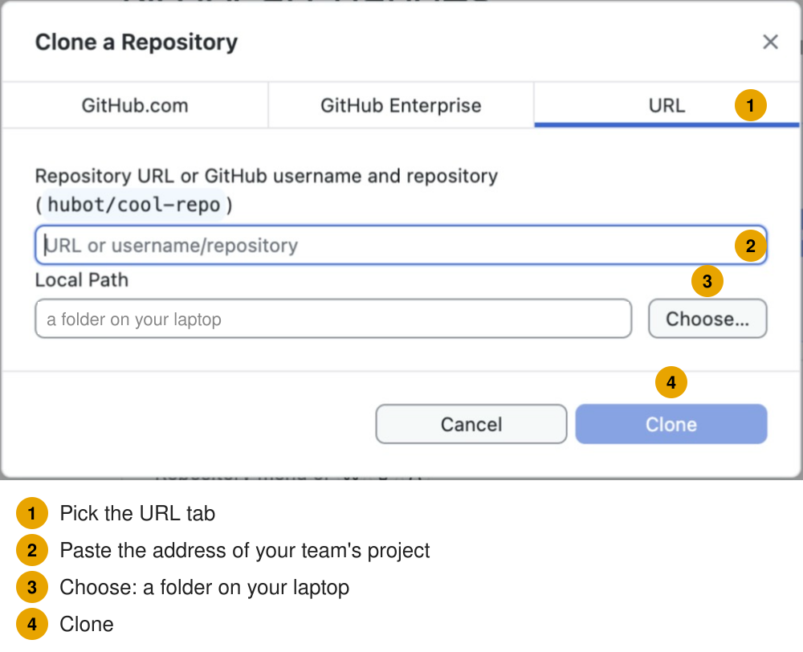
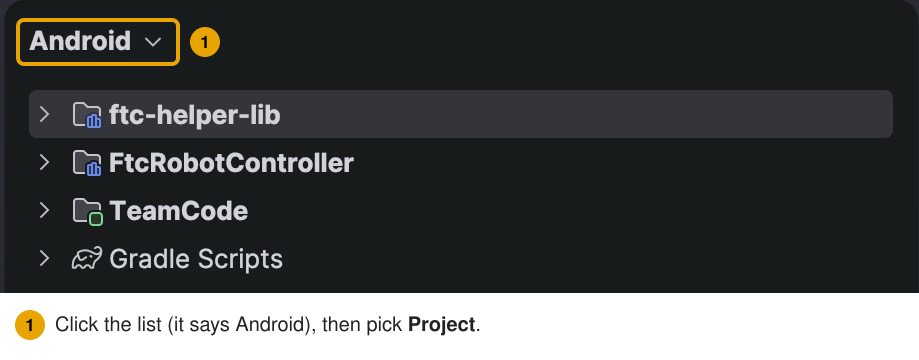

# Set up 3: GitHub and the robot project

**Set up, page 3 of 9.** Do it on each laptop.

You get the **robot project** onto the laptop and open it in Android Studio. Each step is shown two
ways. Use the one your team likes:

- **GitHub Desktop:** a free app with buttons ([desktop.github.com](https://desktop.github.com)).
- **The command line:** commands you type. On this page you type them in your computer's own terminal,
  because no project is open in Android Studio yet ([which terminal](09-the-terminal.md#which-terminal)).

## 1. Tell git who you are

**GitHub Desktop:**

1. Install GitHub Desktop.
2. Open **Settings > Accounts** (Windows: **File > Options > Accounts**).
3. Sign in with your GitHub account.

**Command line:**

1. Find your private GitHub email: on github.com, click your picture (top right) > **Settings** > **Emails**.
2. Tick **Keep my email addresses private**. GitHub then shows an address like
   `12345678+name@users.noreply.github.com`.
3. Type these four lines, one at a time. Change `YOUR-NAME` and the email to your own. Keep the quotes.

   **Where:** your computer's own terminal (Mac: the **Terminal** app; Windows: **PowerShell**). Android Studio has no project open yet, so it has no Terminal tab. ([Which terminal](09-the-terminal.md#which-terminal))

   ```bash
   git --version
   git config --global user.name "YOUR-NAME"
   git config --global user.email "12345678+YOUR-NAME@users.noreply.github.com"
   git config --global pull.rebase false
   ```

   - `git --version` must print `git version 2...`. It says `not recognized`? See
     [git is not recognized](../troubleshooting.md#autonomous-choice-and-git-problems).
   - **Why the private email and a first name:** a public project's history is public.

## 2. Get the robot project

Pick **one**.

### A. Your team already has a project on GitHub (the usual way)

Ask your mentor or code lead for its address.

**GitHub Desktop:**

1. **File > Clone Repository…**
2. Pick the **URL** tab and paste the address.
3. Pick a folder on your laptop.
4. Click **Clone**.



**Command line:**

**Where:** your computer's own terminal (Mac: the **Terminal** app; Windows: **PowerShell**). Android Studio has no project open yet, so it has no Terminal tab. ([Which terminal](09-the-terminal.md#which-terminal)) It starts in your home folder. The clone makes a new folder there, named after the project.

```bash
git clone --recurse-submodules https://github.com/OUR-TEAM/OUR-ROBOT.git
```

**Why `--recurse-submodules`:** the library sits inside the project as a **submodule** (a project kept
inside another project). This option gets it too. GitHub Desktop gets it by itself.

### B. Your team has no project yet

A mentor or code lead does this once for the team.

1. Go to [github.com/FIRST-Tech-Challenge/FtcRobotController](https://github.com/FIRST-Tech-Challenge/FtcRobotController).
2. Click **Fork** (top right), and make the copy under your team's GitHub account.
   **Why fork:** the team gets its own copy on GitHub to share.
3. Clone your team's copy as in **A** above.
4. Then a mentor adds the library: [Add the library](04-add-the-library.md).

## 3. Open the project in Android Studio

1. **File > Open**.
2. Pick the **top** project folder: the one with `TeamCode` and `FtcRobotController` inside it.
   **Why the top folder:** Android Studio needs the whole project, not only `TeamCode`.
3. Wait for the first **Gradle sync**. Gradle is the tool that builds the app. A progress bar is at the
   bottom right. The first sync downloads a lot, so it takes a while.
   **Why wait:** until the sync is done, Android Studio shows many false red errors.
4. In the **Project** panel (left), click the list at its top (it says **Android**) and pick **Project**.

   

5. Open the folders down to `TeamCode/src/main/java/org/firstinspires/ftc/teamcode/`.
   This is where your team's code goes.

   

## Problems

| You see | Do this |
| --- | --- |
| The `ftc-helper-lib` folder is empty | In Android Studio's Terminal tab, in the project folder: `git submodule update --init` |
| The build says `Project directory '.../ftc-helper-lib/library' does not exist` | The same command |
| There is no `ftc-helper-lib` folder | Nobody has added the library yet: [Add the library](04-add-the-library.md) |

## Done when

The project is open in Android Studio, the sync is finished, and you can see the `teamcode` folder.

**Next:** [Add the library](04-add-the-library.md). Is there already an `ftc-helper-lib` folder with
files in it? Skip to [Update the hubs](05-update-the-hubs.md).
