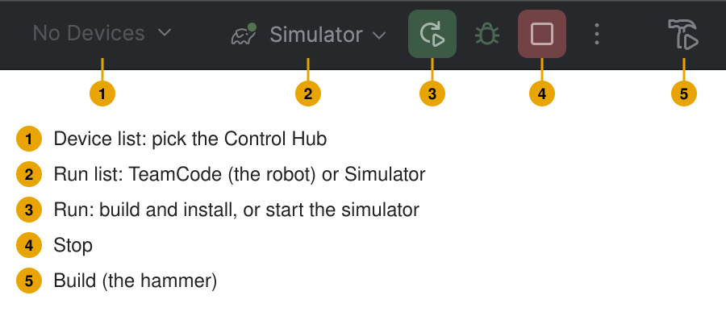

# Set up 6: build and install

**Set up, page 6 of 9.** You build the robot project and install it on the Control Hub.

**Only using the simulator on this laptop?** Skip this page. The simulator needs no hubs. Go to [Every practice](08-every-practice.md).

**Why:** the robot runs the app that is on the hub, not the code on your laptop. You repeat steps 1, 3
and 4 after every change.

## The buttons

The buttons you use are at the top right of Android Studio:

## Steps

1. **Build:** **Build > Make Project** (or the hammer, 5).
   Wait for the **Build** tab (bottom) to say it finished with no errors.
2. **Connect to the Control Hub.** Turn on the robot. Pick **one**:
   - **USB (the easiest):** a USB cable from the laptop to the Control Hub's USB-C port.
   - **Wi-Fi:** join the laptop to the Control Hub's Wi-Fi network (ask your mentor for its name and
     password). Then in Android Studio's [Terminal tab](09-the-terminal.md) (any folder) type `adb connect 192.168.43.1:5555`.
     It says `adb` is not found? Use USB.
3. **Pick the hub.** In the device list (1), pick the Control Hub. Its name starts
   with `REV Robotics`.
4. **Install:** make sure the run list (2) says `TeamCode`, then click **Run** (3).
   It builds again and installs the app on the Control Hub.
5. **Check on the Driver Hub.** It connects to the robot and shows the TeleOp and Autonomous lists.
   - FTC's new project shows **empty** lists. That is normal: its sample OpModes are hidden.

## Problems

| You see | Do this |
| --- | --- |
| Red text, or a red line in the **Build** tab | Read only the **first** error. It names the file, the line and the problem. Fix it, then build again. |
| The hub is not in the device list | Try another USB cable (some only charge). Wait 10 seconds after the robot starts. |
| The Driver Hub shows a version warning | [Update the hubs](05-update-the-hubs.md). |

## Done when

The Driver Hub connects to the robot after the install.

**Next:** [Make the robot configuration](07-robot-configuration.md).
