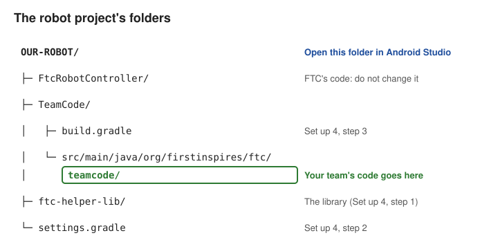

# Set up 9: the Terminal

**Set up, page 9 of 9.** Use this page when another page gives you a command to type.

## Which terminal

A **terminal** is a window where you type commands. These docs mean **Android Studio's Terminal tab**,
except in one place:

| Where you type | When |
| --- | --- |
| **Android Studio's Terminal tab** | Almost always. It opens inside your project. |
| **Your computer's own terminal** (Mac: the **Terminal** app; Windows: **PowerShell**) | Only in [Set up 3](03-github-and-the-project.md), before the project is on the laptop. Android Studio has no project open yet, so it has no Terminal tab. |

**Why Android Studio's:** it starts in the right folder, and it uses the same Java as Android Studio.

## Which folder

Every command in these docs says where to type it, with a **Where:** line above it. There are two folders:

| The **Where:** line says | The folder | It holds |
| --- | --- | --- |
| **the project folder** | The top folder of the robot project | `TeamCode`, `FtcRobotController`, `ftc-helper-lib` |
| **the `ftc-helper-lib` folder** | The library's folder, inside the project folder | `library`, `sim`, `docs` |

Git commands (`git ...`) run in the project folder. The library's commands (`./gradlew ...`: the
simulator, the file maker) run in the `ftc-helper-lib` folder.



## Open it and run a command

1. Open the **Terminal** tab at the bottom of Android Studio (or **View > Tool Windows > Terminal**).
   **It starts in the project folder.**
2. Need the `ftc-helper-lib` folder? Type `cd ftc-helper-lib` and press **Enter**.
3. Type the command (or paste it). Press **Enter**.
4. Wait for the **prompt** (the text before the cursor) to come back. Then type the next one.

### Check which folder you are in

The prompt shows the folder's name, for example `OUR-ROBOT %` or `ftc-helper-lib %`. Not sure? Type `ls`
(Windows: `dir`) and press Enter. It lists what is in the folder:

| You see in the list | You are in |
| --- | --- |
| `TeamCode` and `FtcRobotController` | the project folder |
| `library` and `sim` | the `ftc-helper-lib` folder |

**Lost?** Close the Terminal tab and open a new one. A new tab always starts in the project folder.

| To | Type |
| --- | --- |
| Go into the library's folder | `cd ftc-helper-lib` |
| Go back up one folder | `cd ..` |
| Stop a running command | **Ctrl+C** (on a Mac too) |

**Windows:** type `.\gradlew` (PowerShell) or `gradlew.bat` in place of `./gradlew`.

## Read the output

- Look at the **last** lines.
- `BUILD SUCCESSFUL` is good.
- `BUILD FAILED`: the problem is just above `* What went wrong:`.
- The first Gradle command downloads a lot, so it takes a while.

These warnings are normal. Ignore them:

- `source value 8 is obsolete` (and `target value 8`)
- `Java compiler version 21 has deprecated support for compiling with source/target version 8`
- `SDK processing. This version only understands SDK XML versions up to 3`
- `Deprecated Gradle features were used`
- `[Incubating] Problems report`

Android Studio shows "Start AGP Upgrade Assistant"? Do not click it. The FTC SDK sets its own version.

## Laptop setup for `./gradlew` commands (once per laptop)

The **Simulator** buttons need none of this. Only commands you type that start with `./gradlew` do.
**Why:** the library is its own Gradle build, separate from your robot project.

### Java

The commands need `JAVA_HOME`: the folder where Java is (Java 17 or newer). Android Studio has its own
Java. Set it in Android Studio's Terminal tab, in any folder. It lasts until you close that tab:

```bash
# Mac
export JAVA_HOME="/Applications/Android Studio.app/Contents/jbr/Contents/Home"
# Windows (PowerShell)
$env:JAVA_HOME = "C:\Program Files\Android\Android Studio\jbr"
```

That folder is not there? Find a Java folder:

1. In Android Studio: **Settings > Build, Execution, Deployment > Build Tools > Gradle**. The
   **Gradle JDK** line names a Java and its folder. Use that folder.
2. On a Mac: `/usr/libexec/java_home -V` lists the Javas on the Mac.
3. None found? Install a **JDK** 17 or 21, for example Eclipse Temurin from
   [adoptium.net](https://adoptium.net). You do **not** need the Java from java.com.

### The Android SDK

The first command stops with `SDK location not found`? Make a text file `ftc-helper-lib/local.properties`:

1. Right-click the `ftc-helper-lib` folder > **New > File**.
2. Name it `local.properties` (no `.txt`).
3. Write one line in it. Put your user name in place of `<you>`:
   - Mac: `sdk.dir=/Users/<you>/Library/Android/sdk`
   - Windows: `sdk.dir=C\:\\Users\\<you>\\AppData\\Local\\Android\\Sdk`

Your user name: `whoami` on a Mac, `$env:USERNAME` in Windows PowerShell. Android Studio shows the SDK
folder in **Settings > Languages & Frameworks > Android SDK**.

**Why its own file:** your robot project's `local.properties` does not count. The library is its own build.

## Problems

| You see | Do this |
| --- | --- |
| `git` is `not recognized` (Windows) | [git is not recognized](../troubleshooting.md#autonomous-choice-and-git-problems) |
| `JAVA_HOME is not set` | [Java](#java), above |
| `SDK location not found` | [The Android SDK](#the-android-sdk), above |
