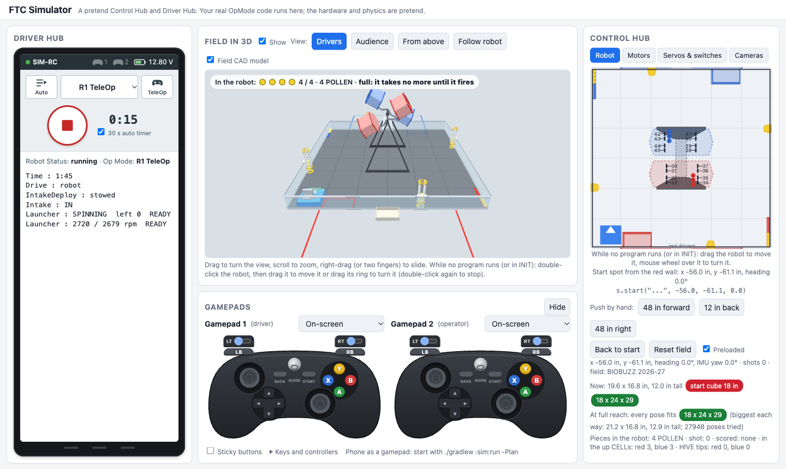
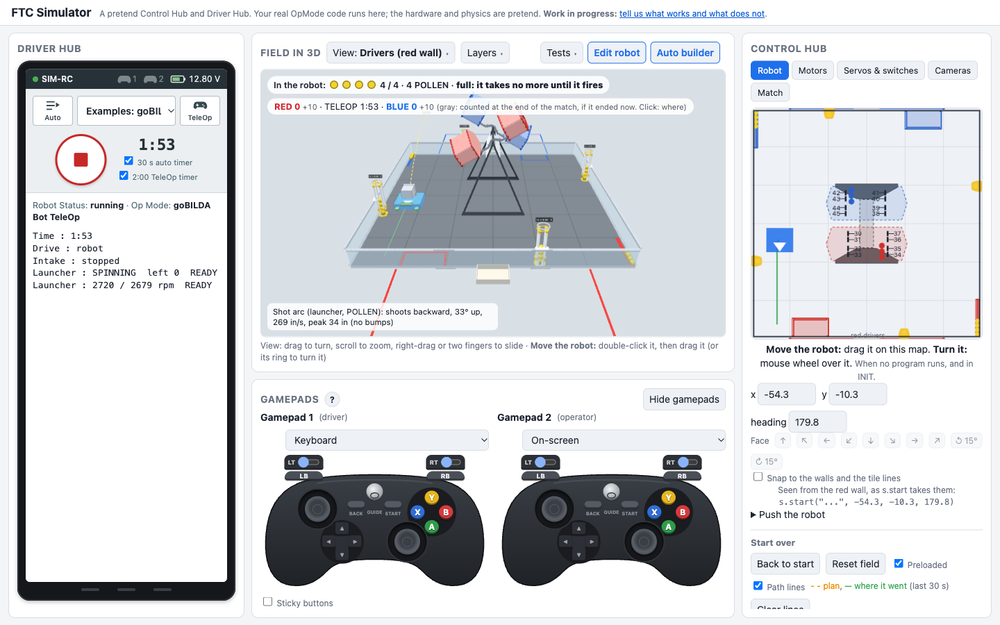
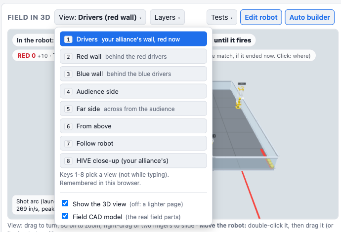

# Start it and drive

Start the simulator, run an OpMode, and drive the pretend robot.

**You need:**

- A laptop with Android Studio ([Install Android Studio](../setup/02-android-studio.md)).
- Your robot project with the library in it ([Add the library](../setup/04-add-the-library.md)).
- No project yet? You can start the simulator from the `ftc-helper-lib` folder alone, with the library's
  example robots ([step 2](#2-or-start-it-in-the-terminal)).

It works on Windows, macOS and Linux, and on a Chromebook with Linux turned on.

## 1. Start it with the Simulator button

The library adds two buttons to Android Studio when it syncs your project.

1. In the list next to the green Run button, pick **Simulator**.
2. Click Run.
3. When the simulator is ready, the page http://localhost:8780 opens in your browser.

No browser opens? Find `Open http://localhost:8780` in the Run window. It is a blue link: click it.

The red square **Stop** button stops the simulator. **Simulator tests**, in the same list, runs your tests
([Tests](../tests/README.md)).

The buttons are not in the list? Close the project (**File > Close Project**) and open it again. The
buttons need no laptop setup.

## 2. Or start it in the terminal

**Why:** the terminal shows every message, and it takes options (for example, another robot file).

The first time on a laptop, do the [laptop setup](#laptop-setup-once) below.

**Where:** Android Studio's **Terminal** tab, in the **`ftc-helper-lib` folder** (type `cd ftc-helper-lib` first).

```bash
./gradlew :sim:run
```

`./gradlew` runs Gradle, the tool that builds the code. `:sim:run` is the job: the `run` job of the `sim`
(simulator) part. It builds your code, makes the robot file from your `Robot.java`
([Your robot file](02-your-robot-file.md)), and starts the simulator.

Open **http://localhost:8780** in a browser. Press Ctrl+C in the terminal to stop it.

**Windows:** type `gradlew.bat` (or `.\gradlew` in PowerShell) instead of `./gradlew`.

**With no robot project:** add `-PteamCode=none`. The simulator then runs the library's own examples.

### Laptop setup (once)

The library is its own Gradle build, apart from your robot project. So the terminal needs two things, even
when the robot project already builds.

- **Java.** Gradle needs `JAVA_HOME`: the folder where Java is. Android Studio has its own Java, in its
  `jbr` folder. Check that the folder exists, then set it. It lasts until you close that terminal.
  - Mac: `export JAVA_HOME="/Applications/Android Studio.app/Contents/jbr/Contents/Home"`
  - Windows PowerShell: `$env:JAVA_HOME = "C:\Program Files\Android\Android Studio\jbr"`

  No such folder? In Android Studio, open **Settings > Build, Execution, Deployment > Build Tools >
  Gradle**. The **Gradle JDK** line names the Java that Android Studio uses, with its folder. Use that
  folder. Still none? Install a JDK 17 or 21 (a **JDK** is Java with the tools that build code), for
  example Eclipse Temurin from [adoptium.net](https://adoptium.net). You do not need the Java from java.com.
- **The Android SDK.** The first command stops with `SDK location not found`? Make a file
  `ftc-helper-lib/local.properties` with one line:
  - Mac: `sdk.dir=/Users/<you>/Library/Android/sdk`
  - Windows: `sdk.dir=C\:\\Users\\<you>\\AppData\\Local\\Android\\Sdk`

  Put your user name in place of `<you>`. Android Studio shows the SDK folder in **Settings > Languages &
  Frameworks > Android SDK**. **Why:** the library is its own build, so your robot project's
  `local.properties` does not count.

**Warnings you can ignore:** `source value 8 is obsolete`, `SDK processing. This version only understands
SDK XML versions up to 3`, `Deprecated Gradle features were used`, `[Incubating] Problems report`.

**Android Studio's "Start AGP Upgrade Assistant" note: do not click it.** The FTC SDK sets its own Android
build version, and an upgrade can break the robot build. Close the note.

## 3. Read the page



The page has three parts. It fits one laptop screen. On a narrow screen, the parts stack and the page
scrolls.

- **Left: the Driver Hub.** It looks like the Driver Station app: the battery, gamepad 1 and 2 (lit while
  used), the **Auto** and **TeleOp** lists, one big button (INIT, then ▶, then STOP), the match time and
  the telemetry.
- **Middle: the field in 3D,** with the gamepads under it. The buttons over it are **View** and
  **Layers** (how to look), then **Tests**, **Edit robot** and **Auto builder** (what to do).
- **Right: the Control Hub.** Its panels show the robot on the field from above, the motors, the servos
  and switches, the cameras, and the match. Each button at the top shows or hides one panel.

The page remembers your choices in this browser: the panels, the view, and whether the gamepads show.

## 4. Run an OpMode

1. Pick an OpMode with the **TeleOp** button (or **Auto**).
2. Press **INIT**. The telemetry shows the OpMode's INIT screen.
3. Press **▶** (the same big button).
4. Press **STOP** when you are done.



Like the real Driver Station:

- An autonomous stops by itself after 30 s, and a TeleOp after 2:00. A box under the clock turns each
  timer off.
- An error shows in red, with the line where it happened. The same OpMode stays picked, so you can fix
  the code and press INIT again.
- OpModes marked "(hidden on robot)" have `@Disabled`. The simulator shows them anyway.

## 5. Drive

Each gamepad has its own source, picked in its list under the 3D view.

| Source | How |
| --- | --- |
| Keyboard | Set the gamepad's list to **Keyboard**. Left stick: W A S D. Right stick: the arrows. D-pad: T F G H. A, B, X, Y: K, L, J, I. LB, RB: Q, E. LT, RT: Z, C. BACK: Backspace. START: Enter. GUIDE: M. Left and right stick click: X, V |
| Controller | Plug in a USB or Bluetooth controller and press one of its buttons (a browser rule). Gamepad 1 takes it, or gamepad 2 when gamepad 1 already has one. Xbox, PS4 and PS5 controllers work everywhere. A Logitech F310 works on Windows (on a Mac, set its back switch to "D"). Chrome and Edge work best |
| On-screen | Click the buttons, drag the sticks, slide the triggers. **Sticky buttons** (the box under the gamepads): a click holds a button until the next click, so you can hold two things with one mouse |
| Phone | Start the simulator with `-Plan` ([options](../reference/robot-file.md#the-commands)). On a phone on the same WiFi, open the address that the page shows, with `?phone=2` at the end. The phone is then gamepad 2 (`?phone=1`: gamepad 1). Set that gamepad's list to **Phone / other page** |

**Keep the simulator tab in front while you drive.** A browser tab in the background sends gamepad
updates only once a second. After 2.5 s with no news, the simulator lets go of every button, like a
pulled cable.

**The GUIDE (PS) button** often does not reach the browser, because Windows and macOS keep it. Use the
on-screen GUIDE, the M key, or hold START (Enter) for 1 second. The library accepts that too.

**`-Plan` on open WiFi:** anyone on that WiFi can open the page and run OpModes. Use it on a team or home
network, not on open school WiFi.

## 6. Look around and move the robot

**The 3D view:** drag to turn the view, scroll to zoom, and right-drag (or use two fingers) to slide. The
**View** menu, or the keys 1 to 8, look from fixed places:

| Key | View |
| --- | --- |
| 1 | Drivers: your alliance's wall (the alliance that the running program uses; red until a program says) |
| 2 | Red wall |
| 3 | Blue wall |
| 4 | Audience side |
| 5 | Far side, across from the audience |
| 6 | From above, your alliance's wall at the bottom |
| 7 | Follow robot, from behind it |
| 8 | HIVE close-up: your alliance's HIVE (on a field with no HIVEs: the goal nearest the robot) |



**The robot:** a gray box with a white arrow at the front, plus its parts. It turns red when it bumps into
something. A roller glows green while it takes pieces in, and orange while it pushes them out. A flywheel
glows yellow while it spins.

**Move it by hand:** while no program runs (or in INIT), drag the robot on the field map (Control Hub,
**Robot** panel), and turn it with the mouse wheel over it. In the 3D view, double-click the robot, then
drag it, or drag its yellow ring to turn it. Under the map, the page shows the spot in the numbers that an
autonomous's `s.start(...)` takes.

**Push the robot** (Robot panel) rolls it like a hand push, also while a program runs. **Back to start**
puts the robot and every game piece back where the match starts them.

**Where the robot starts:** INIT of an autonomous starts a new match. The robot goes to the autonomous's
start spot, and every piece goes back. A TeleOp's INIT keeps the field as it is, so it goes on from the
autonomous. More: [Watch an autonomous](04-watch-an-autonomous.md#2-run-it).

## 7. After a code change

Stop the simulator and start it again (the **Simulator** button, or `./gradlew :sim:run`). **Why:** the
simulator builds your code and makes the robot file only when it starts.

The page connects again by itself, so you do not need to reload it. While the simulator is off, a red bar
across the top of the page says so.

## Problems

| What you see | Why, and the fix |
| --- | --- |
| No **Simulator** in the Run list | Android Studio has not synced the project since the library came in. Close the project and open it again |
| `SDK location not found` | The library's build cannot find the Android SDK. Make `ftc-helper-lib/local.properties` ([laptop setup](#laptop-setup-once)) |
| `JAVA_HOME is not set` | Set it in this terminal ([laptop setup](#laptop-setup-once)) |
| The page says the simulator stopped | The simulator program ended: you clicked Stop, or closed Android Studio. Start it again |
| "press INIT to run it again" under the Driver Hub | The OpMode ended. Press INIT |
| The robot does not move with the keyboard | The gamepad's list is not set to **Keyboard**, or the page is not in front. Click the page once, then try again |
| The robot drives backward or spins | A motor direction in your code, or the robot file's `drive.mirrored`. See [Your robot file](02-your-robot-file.md#problems) |
| The page is slow | Untick **Show the 3D view** in the View menu |

## Done when

- The simulator starts, and the page shows your OpModes.
- You can INIT and run your TeleOp, and drive the robot with a gamepad or the keyboard.

---

**Next:** [Your robot file](02-your-robot-file.md).

**Look it up:** [The commands and their options](../reference/robot-file.md#the-commands).
