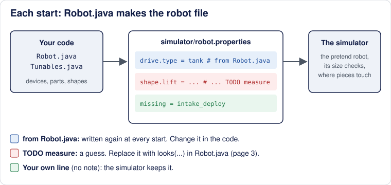

# Your robot file

The simulator learns your robot from one text file. It makes that file from your `Robot.java`, and marks
each number it had to guess.

**You need:**

- The simulator running ([Start it and drive](01-start-and-drive.md)).
- A robot in five files ([The five files](../five-files/README.md)). No five files? See
  [section 6](#6-a-robot-without-the-five-files).

## 1. What the robot file is

The simulator cannot read your robot. It needs to know the device names, the motors and servos, the
size of the robot, and where each part sits. The **robot file** holds that, as plain `name = value` lines
(a "properties" file). Text after `#` is a note for people.

Your robot file is `simulator/robot.properties` in your robot project. The simulator uses it by itself.
Commit it with your code.

## 2. The simulator makes it from Robot.java

Each time the simulator starts (the **Simulator** button, `./gradlew :sim:run`, or a test run), it first
writes the robot file from your Robot class. It prints one line:

```text
Robot file made from Robot.java: simulator/robot.properties
```



It takes these from `Robot.java` and `Tunables.java`:

- every device name, as in the robot configuration.
- the drive: tank or mecanum, the motors, the wheel, and which side the code reverses.
- the motors' and servos' catalog parts (`.part(...)`): speed, encoder counts, range.
- each part's limits and positions: a lift's stops, a claw's open and closed.
- the odometry and the cameras.
- one shape per part, and where game pieces go in and out (the intake, the launcher, the claw).

To make the file alone, with no simulator:

**Where:** Android Studio's **Terminal** tab, in the **`ftc-helper-lib` folder** (type `cd ftc-helper-lib` first).

```bash
./gradlew :sim:fromRobot
```

**Why it helps:** it builds your TeamCode first. So it also tells you, with no Control Hub, whether your
code builds.

## 3. Read what it guessed

Open `simulator/robot.properties`. The top of a small robot's file looks like this:

```properties
# The simulator's robot, made from org.firstinspires.ftc.teamcode.Robot (again at each start of the simulator).
battery = 12.8
field = biobuzz-2026

# ---- from Robot.java ----
drive.type = mecanum                                  # from Robot.java
drive.motors = front_left, front_right, back_left, back_right   # from Robot.java
drive.part = gobilda-5203-312                         # from Robot.java
shape.lift = slide, at=-7,0,4, size=2x2x12, axis=up, motor=lift   # from Robot.java. TODO measure: place, size and travel (at the back; ...)
```

- **`# from Robot.java`:** the simulator wrote this line, and it writes it again at every start.
- **`TODO measure`** after it: a guess. Your code does not say where this part sits, so the simulator put it in a
  typical place: the intake across the front, a lift at the back, a turret on top in the middle, a claw on
  the end of the lift or arm. The guesses fit the size rules (the 18 in start cube, 29 in tall).

The robot drives and its parts move with the guesses. But the size checks, and where game pieces touch
the robot, are guesses too. [Make it match your robot](03-make-it-match-your-robot.md) replaces them.

## 4. Your own lines stay yours

You can add lines, or change the simulator's lines.

- A line with no `# from Robot.java` note is yours. The simulator keeps it, even for the same setting.
- To keep your own number on a simulator line, delete its `# from Robot.java` note.
- A `TODO` line keeps a number that you write on it.
- When the code changes a marked line, the simulator prints the change and keeps the old file as
  `robot.properties.bak`.
- It removes the lines for parts that are no longer in the code.

**Better:** put sizes and places in `Robot.java` (`looks(...)`), not in the robot file. Then `Robot.java`
stays the one record of your robot ([Make it match your robot](03-make-it-match-your-robot.md)).

## 5. MEASURE numbers and missing parts

**A Tunables number written `MEASURE`** ([DEFAULT and MEASURE](../reference/tunables.md#default-and-measure))
stops INIT on the robot until you measure it. In the simulator, the robot file gets a **stand-in** for it:

```properties
tunable.IntakeDeploy.deployed = 0.5   # from Robot.java. Simulator only: a stand-in for MEASURE (the library's default). ...
```

- INIT in the simulator uses 0.5, and says so under the Driver Hub.
- The real robot never reads the robot file, so it still stops at INIT. Safety on the robot does not
  change.
- When you write the real number in `Tunables.java`, the code's number wins, and the stand-in line goes.

**A part not on the robot yet:** a part marked `optional()` in Robot.java
([parts not on the robot yet](../reference/robot-java.md#parts-not-on-the-robot-yet)) is in the robot file
anyway. To try the robot as it is today, without the part, add a line of your own:

```properties
missing = intake_deploy
```

The simulator then acts like a robot whose configuration does not have that device: INIT says
`IntakeDeploy is off`, its buttons are off, and actions skip it.

## 6. A robot without the five files

The simulator still runs your OpModes. It needs a robot file that you start in one of these ways:

- **A starter bot:** the library has a robot file for each season's starter bot, in
  `ftc-helper-lib/sim/robots/` ([Starter bots](../guides/starter-bots.md)). Copy the one for your robot to
  `simulator/robot.properties`.
- **From your robot configuration:** copy the configuration file from the Control Hub, then:

  **Where:** Android Studio's **Terminal** tab, in the **`ftc-helper-lib` folder** (type `cd ftc-helper-lib` first).

  ```bash
  ./gradlew :sim:fromConfig -Pconfig=../my-config.xml -Pout=../simulator/robot.properties
  ```

  It writes every device name, and guesses the rest.
- **With an AI coding agent:** the [robot-file skill](../guides/robot-file-skill.md) writes most of it from
  your configuration, your code and a tape measure.

A robot file that you wrote by hand (no "made from" line at the top) does not change when the simulator
starts.

## Problems

| What you see | Why, and the fix |
| --- | --- |
| The simulator prints why it wrote nothing, and uses the file as it is | The file describes a device in another way than the code (`motor.claw` in the file, a claw servo in the code), or names other drive motors. Fix one of them, or delete the line from the file |
| Stick forward drives the robot backward, or the robot spins | The file's `drive.mirrored` names the wrong side. It must name the side that your code reverses. The simulator writes it from `Robot.java`, so check the drive line there first |
| INIT says a Tunables field is not read by any part | A name in `Tunables.java` has a typo. The simulator runs the same name checks as INIT, and prints them after it writes the file, with a "did you mean" |
| A part sits in a strange place | It is a guess (`TODO measure`). [Make it match your robot](03-make-it-match-your-robot.md) |
| Your number on a line went away | The line had `# from Robot.java`. Delete that note to keep your number, or put the number in `Robot.java` |
| No robot file is made | The simulator found no Robot class. It looks for the class that the file names, then `org.firstinspires.ftc.teamcode.Robot`, then any class in TeamCode that extends `RobotDefinition`. Name yours with `-ProbotClass=...` |

## Done when

- `simulator/robot.properties` exists in your robot project, and it is committed.
- INIT of your TeleOp works in the simulator.
- You know which lines say `TODO measure`.

---

**Next:** [Make it match your robot](03-make-it-match-your-robot.md).

**Look it up:** [The robot file](../reference/robot-file.md): every line, with its default.
