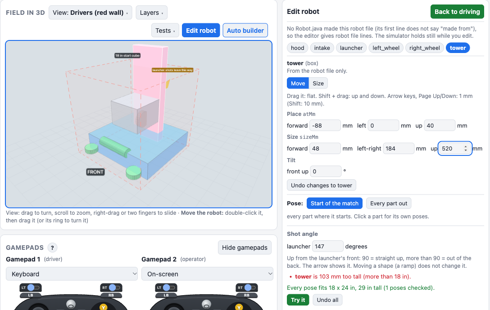
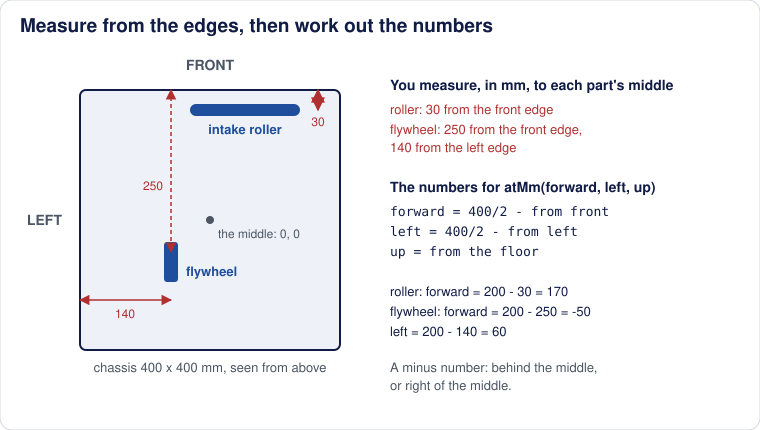

# Make it match your robot

Give the simulator your robot's real size, wheels and parts, so the pretend robot fits, scores and bumps
like yours.

**You need:**

- Your robot file, made from `Robot.java` ([Your robot file](02-your-robot-file.md)).
- A tape measure, or your robot's CAD.

## 1. Why match it

With guesses, the robot still drives and its parts still move. But three things depend on the real
shapes:

- **The size rules.** The simulator checks the 18 in start cube and the 29 in height limit, now and with
  every part out. A guessed lift can pass when the real one does not.
- **Game pieces.** A piece goes in where it touches the intake roller, and leaves the launcher at its
  angle. A roller in the wrong place takes no pieces.
- **Bumps.** The robot's parts hit the field. A tall lift can hit an overhead bar.

Work in this order. Each step makes the next one count.

| Step | What you give | Where |
| --- | --- | --- |
| [2. Size and wheels](#2-size-and-wheels) | the chassis box, the robot's height, the wheels | `Robot.java` |
| [3. The parts](#3-shape-the-parts-with-edit-robot) | where each part sits, and how big it is | **Edit robot**, then `Robot.java` |
| [4. Pieces in and out](#4-where-pieces-go-in-and-out) | the intake roller, the launcher's shot angle, the claw | **Edit robot**, then `Robot.java` |
| [5. CAD (optional)](#5-cad-models-optional) | your CAD parts in place of the boxes | the robot file |
| [6. Real speeds (optional)](#6-real-speeds-optional) | how your motors move | the robot file, from the Characterizer |

**Or let an AI coding agent do steps 2 to 5 with you.** The **robot-file skill** is a set of written
steps for an agent such as Claude Code or Codex. Give it what you have:

- **Photos** of the robot from the side, the top and the front, and of each moving part at both ends of
  its travel. Put a field tile or a tape measure in each photo, so the agent can read sizes.
- **A tape measure.** The agent asks for the few numbers that decide a rule, always from the robot's
  edges and the floor.
- **CAD of the robot,** if you have it. Then the agent reads the exact sizes and draws your real parts.

The agent writes the sizes and shapes into `Robot.java`, runs the simulator's checks, and then checks
its 3D robot against your photos with you. It marks each number it estimated, so you know what to measure.
Your photos stay on your computer. Set it up: [The robot-file skill](../guides/robot-file-skill.md).

Check what it wrote the same way as your own work: open **Edit robot** and look at every pose
([step 3](#3-shape-the-parts-with-edit-robot)).

## 2. Size and wheels

**How to measure:** measure from the robot's edges and the floor, never from its middle. Take the
bumpers off, or measure the frame without them.

Put these lines in `define()` in `Robot.java`, after the drive:

```java
chassisMm(400, 400, 100);   // the chassis box: length front to back, width side to side, height from the tiles
heightMm(300);              // the whole robot: the tallest part that does not move
```

**The wheels:** give the drive its wheel by catalog id, and where the wheels sit. The simulator then turns
the robot like yours.

```java
drive(Drive.tank("left_drive", "right_drive").motor("gobilda-5203-312").wheel("gobilda-hogback-96")
        .wheelsAtMm(380, 290)       // wheel centers: side to side, then front to back
        .reversed("right_drive"));
```

Measure the wheel centers from wheel edge to wheel edge, then add one wheel width: that is center to
center. The wheel ids are in the [parts catalog](../guides/parts-catalog.md).

## 3. Shape the parts with Edit robot

Typing where each part sits, in mm, is hard. **Edit robot** lets you shape the robot with the mouse. Then
it gives you the Java lines for `Robot.java`. The editor writes no file: `Robot.java` stays the one record
of your robot.


1. Click **Edit robot** (over the 3D view). The simulator holds still, the field goes away, and the view
   turns round your robot, close.
2. See-through guides show the size rules: the **18 in start cube**, and the 18 x 24 in box with the
   **29 in** line. A part that sticks out turns red. The panel says how far, and which way.

   
3. Click a shape to pick it. The panel shows its numbers in mm: its place (`atMm`), its size (`sizeMm`,
   or length and diameter for a roller), and its angles.
4. Move it to where the part is on your robot:
   - **Drag** the shape to move it flat. **Shift + drag** moves it up and down. With **Size** on, a drag
     makes it bigger or smaller.
   - **Arrow keys** move it forward, back, left and right. **Page Up / Page Down** move it up and down.
     Each press moves it 1 mm, or 10 mm with Shift.
   - Or type the numbers.
5. **Check every pose.** Each moving part has buttons for its named positions (`stowed`, `deployed`...)
   and its hard stops. **Every part out** puts each part at its farthest pose. The panel says whether
   every pose fits.
6. **Copy into Robot.java.** The panel shows the Java for each part you changed, and where it goes. Click
   **Copy** (or **Copy all**) and paste it there. Then stop the simulator and start it again.

**From your tape measure to the numbers:** the numbers are from the middle of the chassis, on the floor
(forward, left, up). Measure each part from the edges, then work them out:

- forward = (chassis length / 2) - (part from the front edge)
- left = (chassis width / 2) - (part from the left edge)
- up = part from the floor



**Try it** puts the changed shapes into the running simulator, in memory only. Click **Back to driving**,
and game pieces hit the new shapes. **Undo all** goes back to the robot file's shapes.

**Where the lines go in Robot.java:**

- **One short shape:** inside `looks(...)` on the line that adds the part:
  `.looks(Shape.flywheel("gobilda-hogback-96").atMm(-40, 0, 200))`.
- **Two or more shapes:** one `Shape` line each, above the line that adds the part. That line then ends
  with `.looks(intakeArm, roller)`.
- **A part that does not move** (a tower, a ramp): `fixed(Shape.box("tower").atMm(...).sizeMm(...));`.

Every shape and setting: [Shapes and parts](../reference/robot-java.md#shapes-and-parts).

## 4. Where pieces go in and out

The simulator takes these from your parts, so you only check that they sit right.

- **The intake:** a piece comes in where it touches the intake's roller while the roller turns inward.
  Put the roller where it touches the pieces: across the front, low. `holds(n)` sets how many pieces the
  robot holds. More rollers on one intake (`looks(arm, roller1, roller2)`): a piece comes in at any of
  them.
- **The launcher:** a shot leaves its flywheel shape at the **shot angle**: degrees up from the robot's
  front (90 = straight up, more than 90 = out of the back). Edit robot shows it as a yellow arrow. Put it
  in `Robot.java` with `.shotAngle(...)`. A ramp or hood shape does not change the angle: the arrow does.
  A launcher with a hood takes its angle from the hood.
- **The claw:** it holds a piece in its fingers while it is closed, and drops it when it opens.

After a change, run your autonomous again ([Watch an autonomous](04-watch-an-autonomous.md)) and watch
the pieces.

## Worked examples

Each common setup has a robot that already matches. Open its file and copy what fits your robot.

| Setup | Look at | It shows |
| --- | --- | --- |
| A season's starter bot (goBILDA, REV, AndyMark, Studica) | its robot file in `ftc-helper-lib/sim/robots/starter-bot-*.properties` | a robot file written from the seller's CAD: size, wheels, intake rollers and spinners, launcher, a fixed hood and tower. For teams with no five files ([Starter bots](../guides/starter-bots.md)) |
| An intake on a folding arm, and a flywheel launcher | [`flywheelbot/Robot.java`](../../examples/src/main/java/com/crossbotics/ftchelper/examples/flywheelbot/Robot.java) | `chassisMm`, `heightMm`, a servo that pushes the intake arm over at ▶ (`dropsWhen`), a roller on the arm, a flywheel and its `shotAngle` |
| A lift with a wrist and a claw | [`v2bot/Robot.java`](../../examples/src/main/java/com/crossbotics/ftchelper/examples/v2bot/Robot.java) | a slide in a back corner, the wrist riding on the lift (`on(lift)`), the claw on the wrist |
| A drive only (odometry, Pedro, the quick start) | `chassisMm` and `heightMm`, and the drive's `wheel(...)` and `wheelsAtMm(...)` | [step 2](#2-size-and-wheels) is all it needs |

## 5. CAD models (optional)

A team with CAD (Onshape, Fusion, SolidWorks) can draw its real parts in place of the boxes. The size
rules then use the CAD's shape too. The physics and the game pieces still use the boxes, so do steps 2 to
4 first.

1. **Put the CAD robot in its start pose:** each lift and arm where the simulator shows it when it opens,
   and each servo part at its start position.
2. **Make the robot's center on the floor easy to find.** In the assembly, place the drive frame so the
   CAD origin is the middle of the drive frame, at the bottom of the wheels. Then write
   `cad.origin = 0,0,0`. Otherwise, measure that point from the origin and write it in CAD units.
3. **Export each group of parts that move together as one STL file,** in the assembly's positions. The
   chassis and everything fixed to it is one group. The lift's moving stage and what rides on it is
   another.
   - **Onshape:** work in the **Assembly** tab, not a Part Studio. Select every part of the group,
     then right-click > Export. Choose STL, and untick "Export unique parts as individual files".
   - **Fusion:** hide every part that is not in the group. Right-click the top component > Save As Mesh,
     STL, one file.
4. **Name the files in the robot file.** Put them in a `cad` folder next to it:

   ```properties
   cad.units = mm                 # the unit in the export window: mm, cm, m or in
   cad.axes = y,-x,z              # the CAD axes that point the robot's forward, left and up
   cad.origin = 0,0,0             # the robot's center on the floor, in CAD units
   robot.model = cad/chassis.stl  # drawn in place of the chassis box
   shape.lift = slide, ..., model=cad/lift-stage.stl, baseModel=cad/lift-base.stl
   ```

   `cad.axes`: Onshape and SolidWorks have up = z (front along +y: `y,-x,z`). Fusion usually has up = y
   (front along +x: `x,-z,y`).
5. **Check it:** run a scenario with `print cad` ([Scenario files](../reference/scenario-files.md)). It
   lists each model next to the box it covers. "FAR from its box" means `cad.origin`, `cad.axes` or the
   shape's place is wrong. "25 times smaller" means `cad.units` is wrong.

Every CAD setting: [The robot file: CAD](../reference/robot-file.md#cad-models). CAD from a seller belongs
to the seller: keep it in your team's own repository, not a public one, unless the seller allows it.

## 6. Real speeds (optional)

The simulator moves each motor from the catalog's numbers. To make it move like YOUR robot, measure it:

1. Run the **Characterizer** on the real robot ([Characterizer](../tuning/15-characterizer.md)).
2. Copy its logs from the Control Hub (`/sdcard/FIRST/ftc-helper/characterizer/*.csv`) into a folder on
   the laptop.
3. Fit them:

   **Where:** Android Studio's **Terminal** tab, in the **`ftc-helper-lib` folder** (type `cd ftc-helper-lib` first).

   ```bash
   ./gradlew :sim:fit -Plog=../characterizer-logs -Pwrite
   ```

   It writes the numbers into your robot file, and keeps the old file as `robot.properties.bak`. It
   leaves out a poor fit, and says so. Check the file and commit it.

## Problems

| What you see | Why, and the fix |
| --- | --- |
| A part is red in Edit robot | It sticks out of the size box. Move it, or make it smaller. On the real robot, it would fail inspection too |
| "Nothing may go below the tiles" | A shape or a hard stop reaches under the floor. The shape's place or the part's range is wrong |
| The intake takes no pieces | The roller does not reach the pieces. Move it lower and farther forward, and check that it turns inward |
| Shots go the wrong way | The shot angle. 90 is straight up. A launcher that shoots over the back needs more than 90 |
| The pasted Java does not build | A line went in the wrong place. One shape goes inside `looks(...)`; named shapes go above the part's line |
| Your shapes went away after a restart | You did not paste them into `Robot.java`. **Try it** is in memory only |
| The CAD robot is mirrored or on its side | `cad.axes` is wrong. The simulator refuses a choice that draws the robot mirrored |

## Done when

- No line in your robot file says `TODO measure`.
- Edit robot shows every pose inside the size box.
- Your intake takes pieces, and your launcher's shots go toward the goal.

---

**Next:** [Watch an autonomous](04-watch-an-autonomous.md).

**Look it up:** [Shapes and parts](../reference/robot-java.md#shapes-and-parts) in Robot.java.
[The robot-file skill](../guides/robot-file-skill.md): an AI agent that does this with you.
[The robot file](../reference/robot-file.md): every line.
