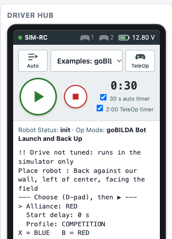
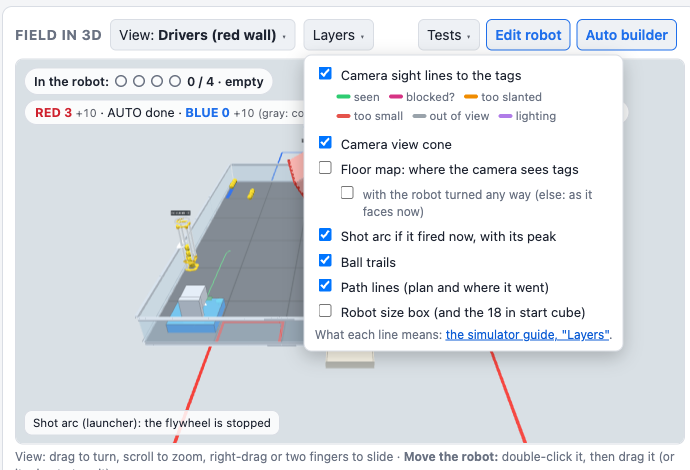
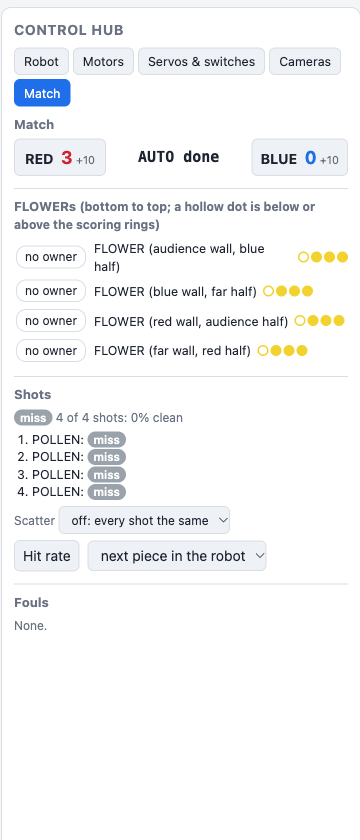
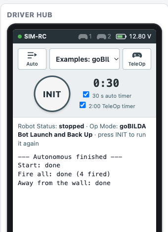

# Watch an autonomous

Run your autonomous in the simulator, watch where it goes and what it scores, and read its report.

**You need:**

- An autonomous in your code ([The autos](../five-files/05-autos.md)).
- The simulator running your code ([Start it and drive](01-start-and-drive.md)).
- Your robot's size and parts in the robot file. Guesses work for a first look
  ([Make it match your robot](03-make-it-match-your-robot.md)).

## 1. Why watch it in the simulator

A practice field is busy, and a bad route can hit a wall at full speed. In the simulator, you see the
whole route, the score and the report in 30 seconds, and nothing breaks. Fix what you see, then try it on
the real field.

The simulator is not the real robot. Its speeds and shots are a model. A route that works here is a
route worth trying, not a route that is done.

## 2. Run it

1. Pick your autonomous with the **Auto** button on the Driver Hub.
2. Press **INIT**. The simulator starts a new match: every game piece goes back to its start, the preload
   goes into the robot, and the robot goes to its start spot.
3. Choose the alliance in the INIT menu (X for BLUE, B for RED, as the screen says).
4. Press **▶**. The autonomous runs, and stops after 30 s.



**Where the robot starts:**

- An autonomous that gives its start in inches (`s.start(note, x, y, heading)`) puts the robot there, for
  the alliance you chose.
- An autonomous that gives its start only in words (`s.start(note, heading)`) puts the robot on your
  alliance's side. The Driver Hub asks you to drag the robot to the exact spot. At ▶, the simulator
  remembers that spot for this autonomous, so the next INIT puts the robot there.

**Then TeleOp:** pick your TeleOp and press INIT. The robot stays where the autonomous left it, and the
score goes on, like a match.

## 3. Watch the route

- **The green line** is where the robot actually went, in its last 30 seconds of driving.
- **The orange dashed line** is the path that a Pedro `follow` step plans. It stays, faded, after the step
  ends, so you can compare the plan with the green line.
- The robot turns **red** when it bumps into something. The Control Hub's Robot panel names what it hit.

**Clear lines** (Robot panel) clears both lines. The **Layers** button over the 3D view adds more:

| Layer | What it shows |
| --- | --- |
| Path lines | the Pedro plan and the green trail |
| Shot arc | where the launcher would send its next piece now, with its peak height |
| Ball trails | the last half second of each loose ball's path |
| Camera sight lines | which tags the camera sees now, and why it does not see the others |
| Robot size box | everything the robot has out now: green while it fits, red when not |



Every layer: [How the simulator works: Layers](../guides/how-the-simulator-works.md#layers).

## 4. Watch the score

The **score bar** over the 3D view shows RED and BLUE, the period (AUTO, TELEOP, FINAL) and the time
left. Click it to open the **Match** panel.

- **The score counts like a referee.** Points that change all match long (pieces in goals, parking) show
  gray, as "+N", until the end. The gray number shows what those points would add if the match ended now.
- **Click a side** to see where its points come from, grouped like FIRST's score calculator.
- **Shots** lists each shot's verdict: clean, rim, other HIVE, frame or miss.
- **Fouls** lists each foul that the simulator can see.



In this run, all 4 shots missed: the starter bot's numbers are not tuned. That is what the panel is for.

The simulator is not a referee. It counts what it can see, and it plays without the other three robots.
What it counts: [Game rules and the score](../guides/how-the-simulator-works.md#game-rules-and-the-score).

## 5. Read the report

When the autonomous ends, the Driver Hub shows `Autonomous finished` and one line per step:

```text
Start: done
To the goal: done
Score high: timed out
Park: done
```



Write down each step that does not say `done`, and fix it:

| The report says | Look in the simulator | The fix |
| --- | --- | --- |
| `STALLED` | where the robot turned red | the route hits a field part. Move the route away from it |
| `timed out` on an action | the part on the robot: did it get there? | the part is slow, or its numbers are off. Check the part's Tunables |
| `cut short (time for park)` | the clock | the autonomous is too long. Remove a step, or drive faster |
| `not seen` | the Camera sight lines layer | the camera does not see the goal from there. Aim from another spot |
| `done`, but the robot ends in the wrong place | the green line against your plan | the numbers in the steps. On the real robot: tune the drive first |

Every word in the report: [Match day: read the report](../building-autos/09-match-day.md#after-the-match-read-the-report).

## 6. Change it, run it again

1. Change the steps in your autonomous.
2. Stop the simulator and start it again. **Why:** it builds your code only when it starts.
3. Run the autonomous again, and compare.

**Faster for routes:** the [auto builder](../building-autos/06-auto-builder-steps.md) runs a plan with your
real code with one click, and shows each step's result next to the plan. Copy its Java into your code
when the route is right.

**Keep it working:** when the autonomous does what you want, record a test of it
([Record a test](../tests/01-record-a-test.md)). The test then checks it after every change.

## Problems

| What you see | Why, and the fix |
| --- | --- |
| The robot does not move at ▶ | The INIT screen has an error, or the INIT menu still waits for a choice. Read the Driver Hub |
| The robot starts in the wrong place | The autonomous gives its start in words only. Drag the robot to the spot in INIT, or give the start in inches |
| The robot drives a mirror route on RED | Autos are written for BLUE, and the library changes them for RED. Check `mirrorForRed()` ([Red and blue](../building-autos/02-put-steps-together.md#red-and-blue)) |
| The score stays at 0 | The field has no rules file, or the pieces did not reach a goal. Watch the Shot arc layer |
| A shot falls short in the simulator but not on the robot | The simulator's shots are a model. Make a shot table ([How shots fly](../guides/how-the-simulator-works.md#how-shots-fly-and-shot-tables)), or trust the real robot |
| The route is right here, but wrong on the real robot | The real robot's numbers differ. Tune it ([Tuning](../tuning/README.md)), and measure its speeds for the simulator ([Real speeds](03-make-it-match-your-robot.md#6-real-speeds-optional)) |

## Done when

- Each of your autonomous programs runs in the simulator, and every step says `done`.
- You know what each one scores.
- Each one has a test ([Record a test](../tests/01-record-a-test.md)).

---

**Next:** [Tuning](../tuning/README.md).

**Look it up:** [Steps](../reference/steps.md): every step an autonomous can use.

**Go deeper:** [How the simulator works](../guides/how-the-simulator-works.md).
