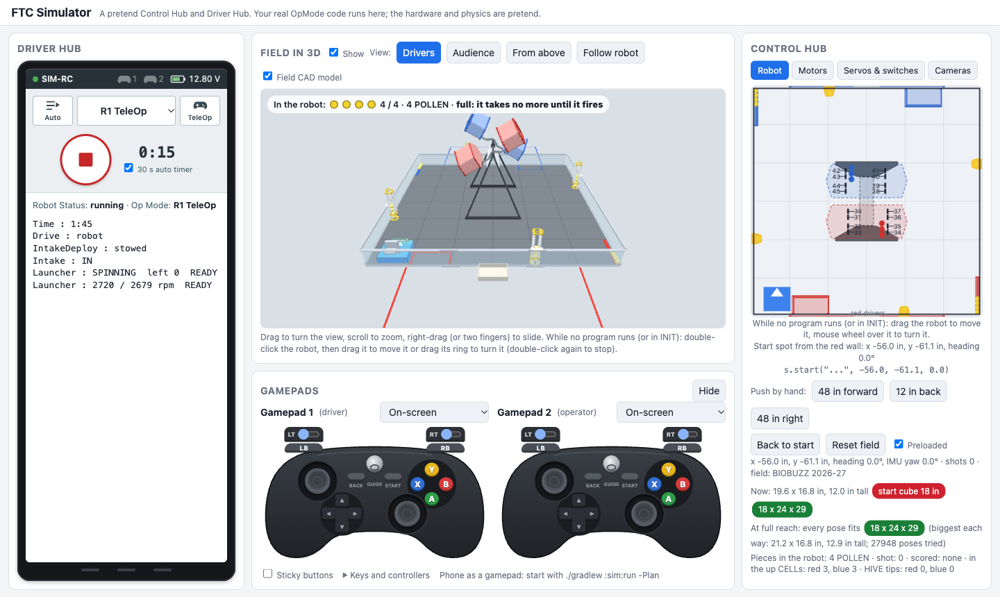
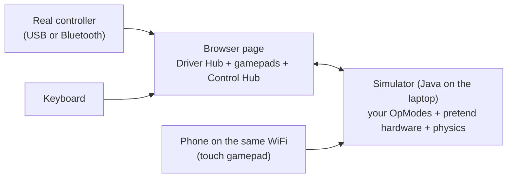

# Simulator

Run your real robot code on a laptop, with a pretend robot on a pretend field.

The simulator is a pretend Control Hub and Driver Hub. Your OpModes run as they are. The motors, servos,
switches, turn sensor (IMU), cameras and the robot on the field are pretend, with simple physics. You drive
the robot from a web page, with a gamepad, the keyboard or a phone.

- **Good for:** checking buttons and screens, trying an autonomous, testing the finders and camera code,
  learning the controls, and finding crashes before a meeting.
- **Not for:** exact speeds, real shots or real camera pictures. You still tune the real robot
  ([Tuning](../tuning/README.md)).

| # | Page | You learn | Use it |
| --- | --- | --- | --- |
| 1 | [Start it and drive](01-start-and-drive.md) | Start the simulator, read the page, and drive with a gamepad, the keyboard or a phone. | when you have the library in your project |
| 2 | [Your robot file](02-your-robot-file.md) | The text file that tells the simulator about your robot. The simulator makes it from `Robot.java`, and marks what it guessed. | when your robot has the five files |
| 3 | [Make it match your robot](03-make-it-match-your-robot.md) | Size and wheels, then the parts and their shapes, where the pieces go in and out, and CAD (your robot's 3D design files). Worked examples for the common setups. | when you want the pretend robot to act like yours |
| 4 | [Watch an autonomous](04-watch-an-autonomous.md) | Run your autonomous, watch the score, and read the report. | after each change to an autonomous |

**Tests:** the simulator can also check your code after every change. That is its own section:
[Tests](../tests/README.md).

---

**Next:** [Start it and drive](01-start-and-drive.md).

**Look it up:** [The robot file](../reference/robot-file.md): every line.
[Scenario files](../reference/scenario-files.md): the test language.

**Go deeper:** [How the simulator works](../guides/how-the-simulator-works.md): the physics, the game
rules and the score, shots, cameras, and what it does not simulate.
