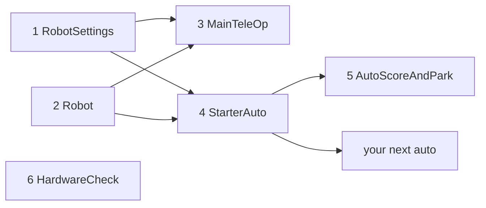

# Starter kit: a whole robot program in 30 minutes

Six files that make a complete, competition-ready robot program: one TeleOp for both alliances,
an autonomous with a menu, a hardware check, and one place for every setting. Copy them, change
names and numbers, and you have a working robot.

**Files:** [`examples/.../starter/`](../examples/src/main/java/io/github/jasoncross/ftchelper/examples/starter)

| # | File | What it is | You change |
| --- | --- | --- | --- |
| 1 | `RobotSettings.java` | drive type, motor names, IMU mounting, autonomous tuning (a [`RobotConfig`](modules/core.md#robotconfig), shared by TeleOp and every autonomous) | names, numbers |
| 2 | `Robot.java` | your mechanisms (lift, claw, intake...) | add/remove mechanisms |
| 3 | `MainTeleOp.java` | the TeleOp, built on [`EasyTeleOp`](modules/teleop.md): driving, timer cues and tuning menu come with it; the file adds the operator's buttons | button map |
| 4 | `StarterAuto.java` | what every autonomous shares | nothing |
| 5 | `AutoScoreAndPark.java` | one autonomous (copy for more) | the steps |
| 6 | `HardwareCheck.java` | tests every device | nothing |

## Steps

1. **Add the library** to the robot project: [Add it to a project](01-add-to-project.md).
2. **Copy the 6 files** into `TeamCode/src/main/java/org/firstinspires/ftc/teamcode/` and change the
   first line of each to `package org.firstinspires.ftc.teamcode;`. Delete each `@Disabled` line.
3. **Configure the robot** on the Driver Station with the names in `RobotSettings` and `Robot`
   (or change the names in the code to match yours).
4. **Hardware Check** (robot on a block): every device listed, every motor turns the right way.
   Fix directions in `RobotSettings` / `Robot`. Write down servo positions.
5. **`Robot.java`**: delete mechanisms you do not have, set positions and limits. Each mechanism
   type is explained in [mechanism.md](modules/mechanism.md).
6. **Main TeleOp**: drive at the PRACTICE profile's gentle power. It starts robot-centric; Y turns
   field-centric on. Check every button on the list at the top of the file. Print that list for the
   drive team.
7. **Tune** the lift with the tuning menu (GUIDE button, PRACTICE profile), copy the numbers into
   `Robot.java` ([tuning guide](guides/tuning.md)).
8. **Autonomous**: tune the drivetrain (tutorial 09's Drive Tuner), set `calibrationConfirmed = true`,
   then change `AutoScoreAndPark`'s steps for your game ([easy autos](guides/easy-autos.md)).
9. **Before the event**: Profile COMPETITION, [testing checklist](guides/testing.md).

## Standard (tank) drivetrain?

In `RobotSettings.drive()` use `DriveConfig.tank()` (4 motors) or `DriveConfig.tankTwoMotor()`.
That is all: `MainTeleOp` drives arcade style by itself (left stick forward/back, right stick turn;
no field-centric). Autonomous: only forward/back moves and turns (`move(d, 0 or 180, p)`, `turn`,
`turnTo`).
