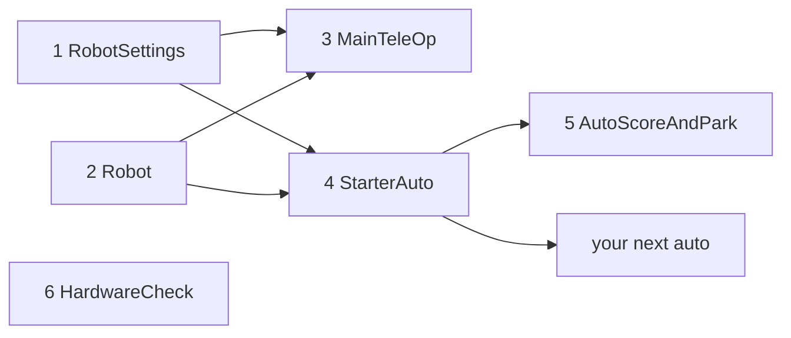

# Starter kit: a whole robot program in 30 minutes

> **Work in progress:** this library and its docs are still changing. Something wrong or unclear? [Tell us](https://github.com/crossbotics/ftc-helper-lib/issues/new/choose).

Six files that make a complete, competition-ready robot program: one TeleOp for both alliances,
an autonomous with a menu, a hardware check, and one place for every setting. Copy them, change
names and numbers, and you have a working robot.

> **Start with the robot in five files instead.** [Lesson 1](tutorials/start/01-robot-in-five-files.md) of the
> tutorials' main track shows a shorter way: `Robot.java`, `Tunables.java`, `Controls.java`, `Actions.java` and autos, made from your robot
> configuration by `./gradlew :sim:newRobot`, with ready-made modules ([robot module](modules/robot.md)).
> This starter kit still works and is kept for teams that use it. New team? Start at
> [Pick your road](quick-start.md#pick-your-road) in the Quick start.

**Before this:** [Add it to a project](01-add-to-project.md).

**Files:** [`examples/.../starter/`](../examples/src/main/java/com/crossbotics/ftchelper/examples/starter)

| # | File | What it is | You change |
| --- | --- | --- | --- |
| 1 | `RobotSettings.java` | drive type, motor names, IMU mounting, autonomous tuning (a [`RobotConfig`](modules/core.md#robotconfig), shared by TeleOp and every autonomous) | names, numbers |
| 2 | `Robot.java` | your mechanisms (lift, claw, intake...) | add/remove mechanisms |
| 3 | `MainTeleOp.java` | the TeleOp, built on [`EasyTeleOp`](modules/teleop.md): driving, timer cues and tuning menu come with it; the file adds the operator's buttons | button map |
| 4 | `StarterAuto.java` | what every autonomous shares | nothing |
| 5 | `AutoScoreAndPark.java` | one autonomous (copy for more) | the steps |
| 6 | `HardwareCheck.java` | tests every device | nothing |
| + | `ServoFinder.java`, `MotorFinder.java`, `FlywheelFinder.java`, `DriveTuner.java`, `Characterizer.java` | [finders](guides/finders.md): measure servo ends, lift limits, flywheel gains, wheel size, how the motors really move (feedforward, simulator), and show the code to copy | `Characterizer`: your lift/arm limits and flywheel names |



## Steps

1. **Add the library** to the robot project: [Add it to a project](01-add-to-project.md).
2. **Copy the 6 files (and the 5 finder files)** into `TeamCode/src/main/java/org/firstinspires/ftc/teamcode/` and change the
   first line of each to `package org.firstinspires.ftc.teamcode;`. Delete each `@Disabled` line.
3. **Configure the robot** on the Driver Station with the names in `RobotSettings` and `Robot`
   (or change the names in the code to match yours).
4. **Hardware Check** (robot on a block): every device listed, every motor turns the right way.
   Fix directions in `RobotSettings` / `Robot`. Write down servo positions.
5. **`Robot.java`**: delete mechanisms you do not have. Find each servo's and lift's limits and
   positions with the **Servo Finder** and **Motor Finder** ([finders](guides/finders.md): small
   OpModes that measure a number and show the code line to copy) and copy the lines they show. Each mechanism type is explained in [mechanism.md](modules/mechanism.md).
6. **Main TeleOp**: drive at the PRACTICE profile's gentle power (a profile is a set of limits:
   PRACTICE is gentle for the shop, COMPETITION is full power). It starts robot-centric; Y turns
   field-centric on. Check every button in [the list](#the-buttons). Print that list for the
   drive team.
7. **Tune** the lift with the tuning menu (GUIDE button, PRACTICE profile), copy the numbers into
   `Robot.java` ([tuning guide](guides/tuning.md)).
8. **Autonomous**: tune the drivetrain with the **Drive Tuner** finder, set `calibrationConfirmed = true`,
   then change `AutoScoreAndPark`'s steps for your game ([easy autos](guides/easy-autos.md)).
9. **Before the event**: Profile COMPETITION, [testing checklist](guides/testing.md).

## Robot.java: the mechanisms

The mechanisms are set up once, in the constructor (the code that runs at `new Robot(hardwareMap)`,
in INIT). Nothing moves there, so it is safe in INIT. TeleOp and every autonomous make one and use
`robot.lift`, `robot.claw` and `robot.intake`. The fields are `public` (TeleOp and autonomous can use
them) and `final` (each is set once and never swapped for another one). Each mechanism type:
[mechanism.md](modules/mechanism.md).

```java
BulkReads.auto(hardwareMap); // (1)!

// Each name in quotes ("lift", "lift_bottom", "claw", "intake") = the device's name in the robot
// configuration on the Driver Station.
// The lift: named heights, in encoder ticks. Measure yours with the Motor Finder.
lift = PositionMotor.create(hardwareMap, "lift")
        // SAFETY: the software range, ticks. It still needs a physical stop at the top.
        .limits(0, 2600) // (2)!
        .lowerSwitch(hardwareMap, "lift_bottom")   // optional: skipped if not configured (3)!
        .slowZone(250, 0.2)                        // near either end: slow down (ticks, power) (4)!
        .pid(0.004, 0, 0.0002, 0.05)               // P, I, D, F: starting values, tune yours (5)!
        .position("DOWN", 0)                       // named heights, ticks
        .position("LOW", 900)
        .position("HIGH", 2400)
        .tunable("Lift");                          // in the tuning menu: copy good values back here (6)!

// The claw: a servo with named positions, 0 to 1. Measure yours with the Servo Finder.
claw = PositionServo.create(hardwareMap, "claw")
        .position("OPEN", 0.20)
        .position("CLOSED", 0.75)
        .travelTime(0.3)                           // seconds for a full move (0 to 1) (7)!
        .tunable("Claw");

// The intake: IN at full power, OUT at 70% so pieces are pushed out, not thrown.
intake = SpinMotor.create(hardwareMap, "intake")
        .powers(1.0, -0.7);

// Every mechanism, in one group. Add a new mechanism here too, or it is never updated or stopped.
all = new Subsystems().add(lift, claw, intake); // (8)!
```

1. One message reads every sensor and encoder of the hub at once, at the start of each loop. Without it,
   each read is its own message, and the loop gets slower with every part.
2. The software never drives the lift below 0 or above 2600 ticks (encoder counts: how far the motor
   shaft has turned). The robot still needs a real, physical stop at the top: the rules ask for one,
   and software can fail.
3. A touch sensor at the bottom. Each time it is pressed, the count goes back to 0, which removes drift.
   Until it is pressed once, the lift only goes down, slowly. No switch in the configuration? The line
   is skipped.
4. Within 250 ticks of either end, the power is cut, down to 20% right at the end, so the lift does not
   slam into its stops.
5. How hard the lift pushes toward a height: P = 0.004 pushes harder when it is far, I = 0 (not used),
   D = 0.0002 calms it so it does not overshoot, F = 0.05 is a small steady push up that holds it
   against gravity. These are starting values: tune yours ([lesson 07](tutorials/07-pid-lift.md)).
6. The gains and heights are then in the tuning menu as "Lift/...": change them from the gamepad in the
   PRACTICE profile, then copy the good values back into this file ([tuning guide](guides/tuning.md)).
   The code is the record.
7. A servo cannot say where it is, so the claw guesses when it has finished moving from this time: about
   how many seconds the servo takes to move the whole way (0 to 1).
8. `all` is the group that is updated, shown and stopped for you. A mechanism that is not in it never
   gets updated (it does not move) or stopped.

## RobotSettings.java: the drivetrain

`RobotSettings` extends the library's [`RobotConfig`](modules/core.md#robotconfig): the robot described
once, which `EasyTeleOp` and `EasyAuto` both read. It is not an OpMode (no `@TeleOp`), so it never shows
on the Driver Station. `drive()` makes a fresh set of settings at each call, so one program cannot change
another's by mistake. `Profile.pick(0.6, 1.0)`: 60% power in the PRACTICE profile (safer around people
and while learning), 100% in COMPETITION ([profiles](guides/profiles.md)). The IMU is the hub's built-in
turn sensor: if its two mounting directions are wrong for your robot, the heading is wrong, and so are
field-centric driving and every autonomous turn ([hardware.md](modules/hardware.md) has a picture).

```java
public AutoDriveConfig auto() {
    AutoDriveConfig c = new AutoDriveConfig();
    // Encoder ticks per turn of the motor's output shaft: look up yours on the seller's page.
    c.ticksPerRev = 537.7;           // goBILDA 312 RPM
    // Start with the real size, then adjust until a 48-inch move really moves 48 inches.
    c.wheelDiameterIn = 3.78;        // 96 mm wheels, then tune
    // Mecanum wheels slip sideways: tune this on field tiles with the Drive Tuner.
    c.strafeCorrection = 1.15; // (1)!
    // SAFETY: autonomous refuses to start while this is false. Set it true only after you checked
    // the wheel size, motor directions and IMU mounting.
    c.calibrationConfirmed = false;  // true after tuning (2)!
    return c;
}
```

1. Mecanum wheels slip sideways, so the robot moves less sideways than the wheels turn. 1.15 makes up
   for that. The [Drive Tuner](guides/finders.md#drive-tuner-wheel-size-and-strafe-correction) measures
   yours on field tiles.
2. A safety switch: the autonomous stops in INIT with a message while it is false. A wrong wheel size,
   a reversed motor or a wrong IMU mounting makes an autonomous drive somewhere you did not plan.

## The buttons

Print this list for the drive team. Gamepad 1 comes from `EasyTeleOp`; gamepad 2 from `MainTeleOp.java`.
Each operator button only sets a target: the mechanisms do the moving in their `update()`, so nothing in
the TeleOp waits.

| Gamepad 1 (driver) | | Gamepad 2 (operator) | |
| --- | --- | --- | --- |
| left stick | drive | D-pad up/down | lift one position up/down |
| right stick X | turn | A / Y | lift DOWN / HIGH |
| left trigger | slow (squeeze) | left stick Y | lift by hand |
| Y | field-centric on/off | right bumper | claw open/close |
| BACK | reset "forward" | left bumper | intake on/off |
| GUIDE | tuning menu (PRACTICE) | B (hold) | intake reverse |
| BACK + START together | debug telemetry on/off | | |

The lift by hand: a deadband of 0.1, so a bumped stick does not cancel a button height. The gamepad
buzzes at 1:00 and 0:20 left (2026-27 BIOBUZZ: FLOWER ownership unlocks at 1:00; the final 20 s).

## AutoScoreAndPark.java: an autonomous

Written for BLUE; RED is mirrored for you. `preselectTeleOp` makes the Driver Station pick Main TeleOp
after the autonomous. `extends StarterAuto` gives it the shared setup from file 4 (drive, IMU, robot,
INIT menu), so this file only says where to start, which extra choices to offer, and the steps.
`startHeadingDeg()` is the way the robot faces at the start, compared with "straight away from your
driver": TeleOp uses it, so field-centric "forward" is right as soon as TeleOp starts. The step names
show on the Driver Station while each one runs, and in the report at the end: make them clear. More:
[easy autos](guides/easy-autos.md), [tutorial 16](tutorials/16-easy-autos.md).

```java
protected void buildRoutine(AutoRoutine r) {
    // Close the claw on the preloaded piece, then pull 4 in off the wall so the turn does not rub it.
    r.run("Hold the piece", () -> robot.claw.goTo("CLOSED")) // (1)!
     .move("Leave the wall", 4, 0, 0.4);

    // Only if the drivers left "Score" at YES in the INIT menu.
    if (menu("Score")) {
        r.step("Start the lift", robot.lift.startStep("HIGH"))   // rises during the next moves (2)!
         .move("Drive to the goal", 24, 0, 0.6)
         .turn("Face the goal", 45, 0.5)                        // left 45 on BLUE, right 45 on RED
         // At most 2 s, so a stuck lift cannot use up the whole autonomous.
         .waitUntil("Lift up", robot.lift::isAtTarget, 2.0) // (3)!
         // Open the claw and wait until it should be open (from the claw's travel time).
         .step("Drop", robot.claw.goToStep("OPEN"))
         // Start the lift down and go straight on (it comes down during the next steps).
         .step("Lift down", robot.lift.startStep("DOWN"))
         // Turn back to heading 0 (the way the robot faced at the start) before parking.
         .turnTo("Square up", 0, 0.5);
    }

    // Everything after thenPark() is the park: it still runs when the steps above ran out of time.
    r.thenPark() // (4)!
     .move("Park", 20, 90, 0.7);                                // right on BLUE, left on RED
}
```

1. `() -> ...` is a **lambda**: a small piece of code the routine runs when it gets to this step.
   Leaving the wall slowly (40%) keeps the robot from rubbing the wall when it turns.
2. `startStep` starts the lift and goes straight on: the lift rises while the robot drives, which saves
   time.
3. `robot.lift::isAtTarget` is a **method reference**: it hands over "how to ask the lift if it is
   there", checked again and again until it is true, or 2 s have passed.
4. The steps before `thenPark()` stop when `parkReserveSec()` (4 s) is left, so the park always runs.
   70% power: the park is a straight, simple move, and time is short.

## Standard (tank) drivetrain?

In `RobotSettings.drive()` use `DriveConfig.tank()` (4 motors) or `DriveConfig.tankTwoMotor()`.
That is all: `MainTeleOp` drives arcade style by itself (left stick forward/back, right stick turn;
no field-centric). Autonomous: only forward/back moves and turns (`move(d, 0 or 180, p)`, `turn`,
`turnTo`).
