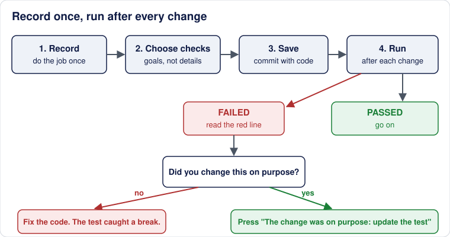
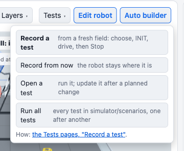
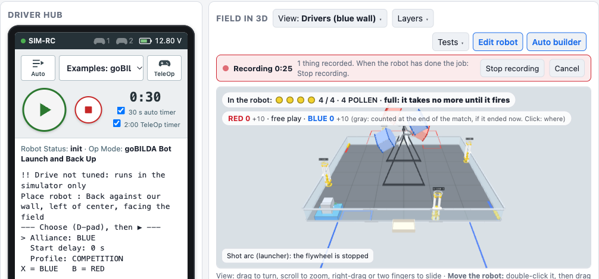
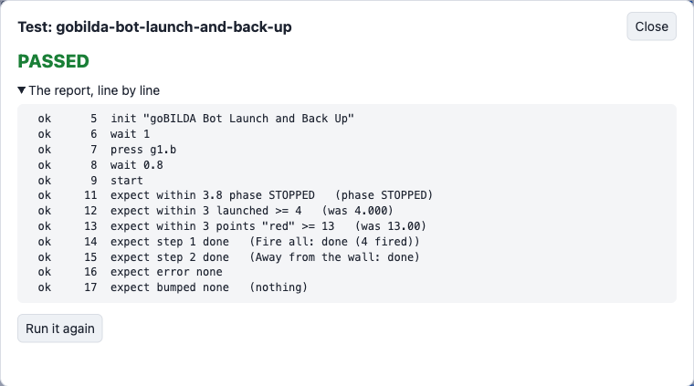
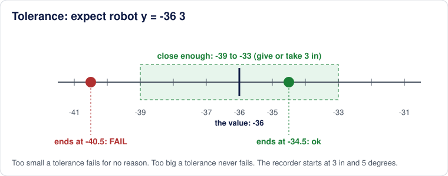
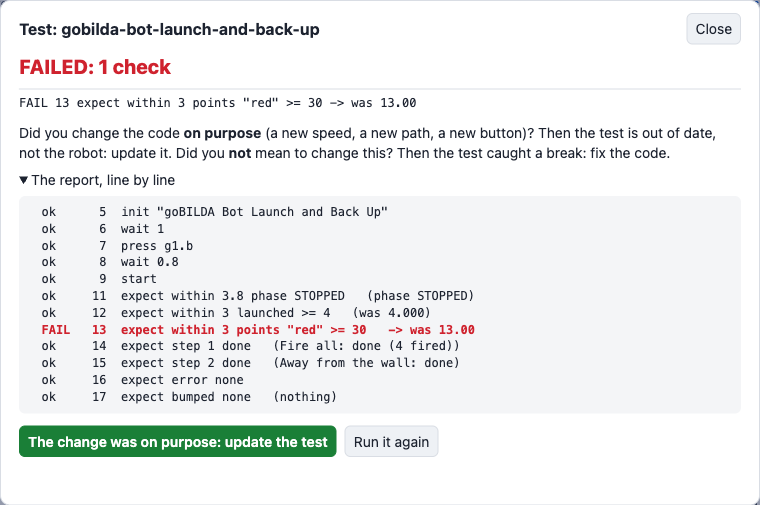

# Record a test

Drive your robot on the simulator page once, and the simulator writes a test that checks the same job
after every change.

**You need:**

- A robot that drives and has an autonomous ([The autos](../five-files/05-autos.md)).
- Your robot project with the simulator running your code: the **Simulator** button in Android Studio,
  or `./gradlew :sim:run` ([the simulator guide](../simulator/01-start-and-drive.md)).
- No project yet? Try it first with goBILDA's starter bot
  ([Run all your tests: try it](02-run-all-your-tests.md#try-it-with-gobildas-starter-bot)).

## 1. Why tests?

You change one number for the lift, and the autonomous stops scoring. You find out at the next event.
A **test** finds it on your laptop, before the robot does. It does what a driver does (INIT, ▶ on the
Driver Hub, sticks, buttons), then checks the result ("the autonomous finished", "4 pieces were shot").

A test does not prove that the robot is good. It proves that **what worked yesterday still works
today**. It finds the break you did not mean to make: a typo, a wrong button, a number changed in the
wrong section.



## 2. Record a test

1. Start the simulator with your code and open http://localhost:8780.
2. Open **Tests** (in the row of buttons above the 3D field, next to **View** and **Layers**) and choose
   **Record a test**. A red bar says `Recording`. The field starts fresh: the robot on its start spot,
   every game piece back, your numbers as in `Tunables.java`. **Why fresh:** the test always starts this
   way, so you must record it this way too.

   
3. Choose your OpMode and press **INIT**. In the INIT menu, choose the alliance (gamepad 1 **B** for RED,
   **X** for BLUE). On the keyboard (set gamepad 1's list to "Keyboard"), B is the **L** key and X is
   the **J** key. Or click B or X on the on-screen gamepad 1.

   
4. Press **▶** and do the job, as in a match: drive to a piece, pick it up, shoot. For an autonomous, do
   nothing, and let it run to its end.
5. Press **Stop recording** in the red bar. A window opens: **Your test: choose the checks**.

   
6. Leave the ticked checks ticked ([section 5](#5-check-goals-not-details) says why). Type a name, for
   example `main-teleop`, and press **Save**. The test is now `simulator/scenarios/main-teleop.sim` in your
   robot project. To find it in Android Studio's Project panel, open the top folder (the one that holds
   `TeamCode`), then `simulator`, then `scenarios`. Commit it with your code
   ([Every practice: pull, change, commit, push](../setup/08-every-practice.md)).
7. Press **Run it now**. The simulator plays your test back from a fresh field and shows **PASSED**, or
   **FAILED** with the line that failed. Keep your hands off, because the test drives.

   

The recorder writes down every gamepad button and stick (from the keyboard, a real controller or the
on-screen gamepad). It also writes down how long you waited, INIT, ▶, STOP, and the robot or a piece moved by hand.

- A quick tap becomes a `press`.
- A button held down becomes `hold` and `release`.
- A stick becomes `hold g1.left_stick_y -0.5`, in steps of 0.25. **Why:** nobody holds a stick at exactly
  0.53 twice.

**Record from now** (in the same menu) starts from where the robot is, without a fresh field. Use it for a
quick try. A test that starts from INIT is more reliable.

## 3. Read the test, line by line

A test is a short text file that you can read and change. The recorder made this test for goBILDA's
starter bot's autonomous ([`sim/scenarios/recorded-gobilda-auto.sim`](../../sim/scenarios/recorded-gobilda-auto.sim)):

```text
# recorded-gobilda-auto.sim: made by the simulator's test recorder on 2026-10-22, from "goBILDA Bot Launch and Back Up".
init "goBILDA Bot Launch and Back Up"
wait 1
press g1.b
wait 0.92
start
# The checks
expect within 6 phase STOPPED
expect within 3 launched >= 4
expect within 3 points "red" >= 13
expect step 1 done
expect step 2 done
expect error none
expect bumped none
```

| Line | What it does |
| --- | --- |
| `# ...` | a note for people; the test skips it |
| `init "goBILDA Bot Launch and Back Up"` | INIT this OpMode (the name exactly as on the Driver Station) |
| `wait 1` | wait 1 second (the recorder cuts waits before ▶ to 1 s, because they change nothing) |
| `press g1.b` | press and let go of gamepad 1's B: RED in the INIT menu |
| `start` | press ▶ |
| `expect within 6 phase STOPPED` | **a check:** within 6 s, the OpMode stops by itself (the autonomous ends). The **phase** is where the OpMode is: `IDLE` before INIT, then `INIT`, `RUNNING` (after ▶) or `STOPPED` |
| `expect within 3 launched >= 4` | within 3 s, at least 4 pieces were shot |
| `expect within 3 points "red" >= 13` | RED has at least 13 points |
| `expect step 1 done` | the first step of the autonomous's report says `done` ([the report](../five-files/05-autos.md#what-you-get-with-no-extra-code)) |
| `expect error none` | no error on the Driver Station |
| `expect bumped none` | the robot does not push against a wall or a field element at the end |

Every `expect` line is a check. The test **passes** when every check passes. The report shows each line as
`ok` or `FAIL`, with the value it saw: `FAIL 13 expect within 3 launched >= 4 -> was 2`.

## 4. How close is close enough? Tolerances

A robot never stops at exactly the same spot twice, not even in the simulator. So a check says how close
is close enough:

| Check | What it checks | Use it for |
| --- | --- | --- |
| `expect robot y = -36 3` | y is -36, give or take 3 inches (from -39 to -33) | where the robot ends |
| `expect robot heading = 90 5` | 90 degrees, give or take 5 | which way it faces |
| `expect launched >= 4` | 4 or more | counts: pieces, points |
| `expect time < 25` | less than 25 s since ▶ | "fast enough" |
| `expect within 4 stored >= 1` | wait up to 4 s for it to become true | anything that takes time |

The number after `=` is the value. The next number is the **tolerance**: how far off it may be. Without a
tolerance, `=` means exactly, and that almost never works for a measured number.



The recorder picks loose numbers: 3 inches, 5 degrees, `>=` for counts, and `within` 1.5 times the time
it took.

- **A test that is too strict** fails for no reason, and soon nobody trusts it.
- **A test that is too loose** never fails, even when the robot is broken.

If a test fails now and then for no reason, make the tolerance a little bigger: in the window before you
save, or in the file.

## 5. Check goals, not details

The window shows two lists:

- **Goal checks** (ticked): what the test is for. The autonomous finishes, its steps are done, the pieces
  are shot or scored, and there is no error. For a driving test with no pieces: where the robot ends.
- **Details** (not ticked): the exact spot after an autonomous, the time, lines on the Driver Station
  screen. Tick one only if it is what you want to test.

**Why:** a detail changes every time you improve something. A test that checks "the screen says
`Launcher : 2600 rpm`" fails when you tune the speed, but nothing is broken. A test that checks "4 pieces
were shot" fails only when the shooting is broken. Fewer, better checks make a test you trust.

## 6. A few good tests

You do not need many tests. Start with these:

- **One test per autonomous.** Its goal: it finishes, every step is `done`, and it scores.
- **TeleOp basics:** drive forward and turn (the robot ends near the spot). Add one test for each job the
  drivers use most (pick up a piece: `stored >= 1`; shoot: `launched >= 1`).

That is 3 to 5 tests. When a bug surprises you, add a test for it. Then it cannot come back without a
warning.

## 7. After a planned change: update the test

Say you made the robot faster on purpose. Now the TeleOp test fails, because the robot ends 12 inches
further than the test says. The robot is right, and the test is out of date.

1. Choose **Tests > Open a test**, choose the test, and press **Run it now**. It shows FAILED.
2. Read the failed lines, and decide whether you meant to change this.
   - **Not on purpose:** the test caught a break. Fix the code, not the test.
   - **On purpose:** press **The change was on purpose: update the test**.

   
3. The simulator runs the test once more and measures. It shows each failed check with its old and its
   new number. Only the failed checks change. The steps, the tolerances and the other checks stay.
4. Press **Save the update**, then **Run it again**. It shows PASSED.

A check of words (`phase`, `step`, `screen`) cannot take a new number. The window lists it, and you change
it or delete it by hand. The file gets a note with the date and the lines that changed. The old numbers
are in git.

## 8. Write or change a line by hand (optional)

A test is plain text, so you can add a line the recorder did not write. Open the file in Android Studio
(`simulator/scenarios/`) and type it. For example, check that the claw is closed:

```text
expect servo claw target = 0.75 0.01
```

**A number you have not measured yet.** A `MEASURE` in `Tunables.java` stops INIT on the robot, but not in
the simulator. When the simulator starts, it puts a stand-in for it in the robot file
(`tunable.IntakeDeploy.deployed = 0.5`), and the simulator uses that
([MEASURE in the simulator](../simulator/02-your-robot-file.md#5-measure-numbers-and-missing-parts)). So most tests need nothing
for it.

For another number, put this line before `init`. The test then uses 0.6, for this file only, and your
code does not change:

```text
set tunable IntakeDeploy.deployed 0.6
```

**Button names in a test are the FTC names, not the Java names:** `g2.dpadLeft` in `Controls.java` is
`g2.dpad_left` in a test.

## Fix a problem

| What you see | Why, and the fix |
| --- | --- |
| The test fails on the first run after recording | Something in the run was not the same: a check is too strict ([section 4](#4-how-close-is-close-enough-tolerances)), or the robot still moved when you stopped recording. Loosen the tolerance, or record again and wait a moment before **Stop recording** |
| `FAIL ... robot y = ... 3 -> was ...`, a little more than 3 off | A fast robot ends a few inches off from run to run. Make the tolerance 5 |
| It fails now and then, then passes | The same cause: the check is too strict. A test you cannot trust is worse than no test |
| `true only after 5.3 s` | It happens, but later than `within` allows. If the robot is slower on purpose, update the test ([section 7](#7-after-a-planned-change-update-the-test)) |
| `waited 3 s: the OpMode shows nothing in INIT` | The OpMode sends no telemetry in INIT, so the test cannot count its loops. It still runs |
| `unknown command`, or a check says `too short` | A line typed by hand has a mistake. The report names it. See [Scenario files](../reference/scenario-files.md) |
| The page says `a test is running` | A test drives the robot. Wait for it, or press **Stop the test** in the blue bar |
| Save says `no robot project` | The simulator was started with `-PteamCode=none`. Press **Download**, and put the file in your robot project's `simulator/scenarios` folder |
| The auto builder's Run is not in the test | A test runs your own OpModes. Copy the builder's plan into your code (its Code tab), then record that autonomous |

## Done when

- Each autonomous has a test, and it passes.
- One TeleOp test drives and does the drivers' main job, and it passes.
- The tests are in `simulator/scenarios`, committed with your code.

---

**Next:** [Run all your tests](02-run-all-your-tests.md).

**Look it up:** [Scenario files](../reference/scenario-files.md): every
command and check. [Record a test](../reference/scenario-files.md#the-recorder): the recorder.
