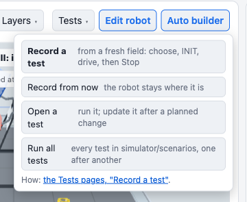

# Run all your tests

Run every test in your robot project with one button or one command, after every change to your code.

**You need:**

- At least one test in your robot project's `simulator/scenarios` folder ([Record a test](01-record-a-test.md)).
- Or no project yet: [try it with goBILDA's starter bot](#try-it-with-gobildas-starter-bot).

## 1. Run them all

Each of these three ways runs every test in your `simulator/scenarios` folder:

- **On the simulator page:** **Tests > Run all tests**. The page shows passed or failed for each test, with
  the failed lines. Click a test's name to open it.

  

- **In Android Studio:** pick **Simulator tests** in the list next to the green Run button, and click Run.
  If the list has no such button,
  [add the buttons once](../setup/04-add-the-library.md#the-simulator-buttons-you-do-nothing).
- **In the Terminal:**

  **Where:** the Terminal, in the `ftc-helper-lib` folder.

  ```bash
  ./gradlew :sim:scenario
  ```

Each test starts from a fresh robot, so nothing carries over from one test to the next. The button and the
command end with a list (paths shortened here):

```text
== 3 of 3 passed
  PASSED  ../simulator/scenarios/launch-and-back-up.sim
  PASSED  ../simulator/scenarios/main-teleop.sim
  PASSED  ../simulator/scenarios/pick-up.sim
```

- **The button and the command build your code first,** and make the robot file from `Robot.java`.
- **The page runs the code that the simulator started with.** So after a code change, stop the simulator
  and start it again before you press **Run all tests**.

## 2. Run one test

**Where:** the Terminal, in the `ftc-helper-lib` folder.

```bash
./gradlew :sim:scenario -Pfile=../simulator/scenarios/main-teleop.sim
```

For several files, put commas between them: `-Pfile=a.sim,b.sim`. A folder runs every `.sim` file in it.

## 3. When to run them

- **Before you commit:** a failed test means the change broke something.
- **Before every event:** run them all on the code you will take.
- **After you change a number in `Tunables.java`:** a test that fails tells you which job the number
  changed.

The simulator's own automatic tests (`./gradlew :sim:testDebugUnitTest`) also run every file in your
`simulator/scenarios` folder.

## 4. For programmers: laptop tests in Java (optional)

A simulator test drives the whole robot, in real time. A **JUnit test** checks one piece of your code in a
fraction of a second, with pretend motors and servos. For example: "after `Actions.scoreHigh`, the lift
was sent to 2400 counts".

**Where:** the Terminal, in your robot project's folder (the one that holds `TeamCode`).

```bash
./gradlew :TeamCode:testDebugUnitTest
```

- **It can check:** INIT's checks (a misspelled Tunables field, a missing safety number, a device used
  twice), which power or position each command sends, limits, interlock rules, pause and STOP, and your
  own `Actions.java` steps that do not wait.
- **It cannot check:** how the real robot moves (gravity, a heavy lift, a slipping belt), anything that
  waits for time to pass (an action's `waitSeconds`), or cameras. Use a simulator test for those, and the
  [checks on the real robot](03-checks-before-practice-and-matches.md).

JUnit tests need a little Java. How to set up TeamCode once, and a first test of your robot in five files:
[Tutorial 13: Testing](../tutorials/13-testing.md#7-test-your-robot-in-five-files). The pretend devices:
[the test kit](../modules/testkit.md). A complete example:
[`V2botTest.java`](../../examples/src/test/java/com/crossbotics/ftchelper/examples/v2bot/V2botTest.java).

## Try it with goBILDA's starter bot

With no robot project yet, try the recorder and the runner with goBILDA's starter bot.

**Where:** the Terminal, in the `ftc-helper-lib` folder.

```bash
./gradlew :sim:run -PteamCode=none -Probot=sim/robots/starter-bot-gobilda.properties
```

1. Open http://localhost:8780. Choose **Tests > Record a test**.
2. Choose "goBILDA Bot Launch and Back Up", press INIT, press gamepad 1 **B** (RED; the **L** key on the
   keyboard), then ▶. Wait until the Driver Station says `Autonomous finished`.
3. Press **Stop recording**. Look at the goal checks: it finishes, steps 1 and 2 are done, and 4 pieces
   are shot.
4. With `-PteamCode=none` there is no robot project, so **Download** saves the file in your browser's
   downloads. Press **Run it now**, and it shows PASSED.
5. Run the same test without the page. This runs the library's own copy of the test (in `sim/scenarios`),
   not the file you downloaded.

   **Where:** the Terminal, in the `ftc-helper-lib` folder.

   ```bash
   ./gradlew :sim:scenario -PteamCode=none -Pfile=sim/scenarios/recorded-gobilda-auto.sim
   ```

6. Record a TeleOp test the same way: "goBILDA Bot TeleOp", B, ▶. Hold the left stick forward for a
   second, let go, and press **Stop recording**. The goal is where the robot ends.

## Fix a problem

| What you see | Why, and the fix |
| --- | --- |
| A test passes on the page but fails with the button or the command | The page runs the code the simulator started with. Stop the simulator, start it again, and run the test on the page again |
| `No scenario file. Use: ./gradlew :sim:scenario -Pfile=...` | The command found no `simulator/scenarios` folder. Check that it is in the folder that holds `TeamCode`, and that it has a test |
| `PROBLEM: no such file: ...` | A wrong `-Pfile` path. Paths start from the `ftc-helper-lib` folder: `../simulator/scenarios/...` |
| **Simulator tests** is not in the Run list | [Add the buttons once](../setup/04-add-the-library.md#the-simulator-buttons-you-do-nothing) |
| A test failed, and you did not change that part | Read the failed line: it names the check and the value it saw. Fix the code, or update the test if the change was on purpose ([Record a test, section 7](01-record-a-test.md#7-after-a-planned-change-update-the-test)) |
| More problems with one test | [Record a test: fix a problem](01-record-a-test.md#fix-a-problem) |

## Done when

- One button or one command runs all your tests, and they pass.
- You run them before each commit, and before each event.

---

**Next:** [Checks before practice and matches](03-checks-before-practice-and-matches.md).

**Look it up:** [Scenario files](../reference/scenario-files.md): every
command, check and flag.

**Go deeper:** [Tutorial 13: Testing](../tutorials/13-testing.md): JUnit tests on the laptop.
