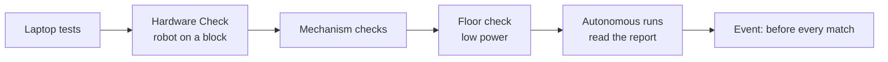
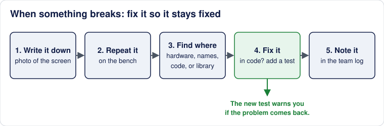

# Checks before practice and matches

Check the real robot in a fixed order, from the laptop to the field, and print the checklists for the
pit.

**You need:**

- A robot that runs your code, and the **Tune and check** OpMode on it (its Hardware Check:
  [Wiring checks](../tuning/02-wiring-checks.md)).
- A block to put the robot on, so the wheels are off the floor.
- The whole team: programmers, builders and drivers.

## 1. A fixed order

Do the steps in this order. Each step finds problems that would be dangerous or confusing in the next
step. For example, the Hardware Check finds a reversed drive motor at once. On the floor, the same motor
looks like "the robot spins for no reason".

| Step | When |
| --- | --- |
| 2. Laptop tests | after every code change |
| 3. Hardware Check | after any change to the wiring or the robot configuration |
| 4. Mechanism checks | after you build or change a mechanism |
| 5. Floor check | before practice runs |
| 6. Autonomous check | after a change to an autonomous |
| 7. Before every match | at an event |

## 2. Laptop tests (every code change)

Run all your simulator tests, and your JUnit tests if you have them
([Run all your tests](02-run-all-your-tests.md)). They need no robot.

**Without tests:** run the OpMode in the [simulator](../guides/simulator.md) first. It shows many
problems before you touch the robot: a crash at INIT, a wrong button, a screen that does not fit. The
simulator builds its robot from your code, so it cannot find a wrong wire or a motor that turns the
wrong way. Only the real robot can.

## 3. Hardware Check (after a wiring or configuration change)

Run the **Hardware Check** in Tune and check, with the robot on a block
([how to get there](../tuning/02-wiring-checks.md#get-to-the-checks)). It lists every device in the
active configuration and the battery voltage. Check each device:

| Device | Check | If wrong |
| --- | --- | --- |
| every motor | moves with positive power the way you expect, and its encoder counts UP | `.reversed()` on its part in `Robot.java`; check the encoder cable port |
| drive motors | each wheel rolls FORWARD with positive power ([Motor Direction Check](../tuning/02-wiring-checks.md#motor-direction-check-each-wheel-rolls-forward)) | `Drive.mecanum(...).reversed("front_left", ...)` in `Robot.java` |
| every motor with an encoder | its own port counts, up ([Encoder Check](../tuning/02-wiring-checks.md#encoder-check-each-encoder-cable-in-its-own-port)) | the encoder cable in its own motor's port, plugged in |
| a lift or arm on two motors | with the chain or belt OFF, both turn the way that lifts | `alsoMotor` / `alsoMotorReversed` ([two motors](../reference/parts/lift.md#two-motors-on-one-lift-or-arm)) |
| servos | find and write down each position you need ([Servo Finder](../tuning/03-servo-finder.md)) | the named positions in `Tunables.java` |
| CR servos | spin both ways | the configuration must say "Continuous Rotation Servo" |
| touch and magnetic switches | change when pressed, or with a magnet near | wiring; magnetic: false = near |
| IMU | yaw (the heading) goes UP when the robot turns LEFT | the logo and USB directions in the drive's `.imu(...)` in `Robot.java` |
| distance and color sensors | sensible numbers | wiring, I2C port, configuration type |
| camera | listed; Limelight "connected"; HuskyLens `Answers: yes` and a `Sees` line per box | USB, Ethernet or I2C cable, configuration name; a HuskyLens's Protocol Type |
| battery | 12.5 V or more when charged | charge or replace it. Never play a match under 12.0 V |
| `Robot.java`'s devices | `Robot.java: every device is in the configuration`, or only the parts you know are not built yet (`optional, so the part is off`) | add the device to the configuration, or fix its name ([parts not on the robot yet](../reference/robot-java.md#parts-not-on-the-robot-yet)) |

**On a lift or an arm:** the Hardware Check has no limits, and RB gives full power. Use short, gentle
taps. Know where its hard stop is, and keep hands clear.

## 4. Mechanism checks (after you build or change a mechanism)

| Mechanism | Procedure | Pass |
| --- | --- | --- |
| Lift or arm | the steps under this table | stops before the hard stops; reaches each position in about 1 s; holds |
| Intake | in, out, stop; block it by hand (with jam detection) | backs out and goes on; the jam count goes up |
| Servo parts | each named position; toggle; slow move | no buzzing at the ends (a buzz means the range is too wide) |
| Flywheel | spin to 3 speeds; compare the RPM on the screen with a tachometer or a slow-motion video | the numbers agree within about 3%; READY within about 1 s |
| Launcher | shoot 1, then 3 | each piece only when READY; `whyNotReady` names what is missing |
| Turret | home; aim at 0, 90, -90, 180 and back; turn it by hand to each limit | the short way round; never past a limit; cables slack |
| Camera | point it at a tag; read the bearing (positive = left), and the distance against a tape measure | the bearing sign is right; the distance is within about 5% |

**Lift or arm steps:**

1. Put the hard stops in place.
2. Set a low `maxPower` in `Tunables.java`.
3. Home it (push it down to the switch).
4. Drive it by hand to each end. It slows and stops before the hard stop.
5. Try each named position.
6. Pause (gamepad 1 BACK) while it moves. It stops (both motors, if it has two).

## 5. Floor check (before practice runs)

1. Set the PRACTICE profile, and a low `Tunables.Drive.maxPower` (for example 0.4) for the first runs.
2. Drive: forward, sideways, turn, field-centric.
3. Every button on the drivers' sheet does what it says.
4. The match timer buzzes. To test it fast, use a short timer: `new MatchTimer(30)`.

## 6. Autonomous check (after a change to an autonomous)

1. Run it at low speed, and read the step report.
2. Run it as RED once.
3. Run it with a start delay once.
4. Run it at full speed: it ends in less than 28 s, and parks.
5. Put a box in the way: the move ends `STALLED`, and the robot stops pushing.

More: [Match day: before the event](../building-autos/09-match-day.md#before-the-event).

## 7. Before every match (print it)

The drive team's auto checklist (the partner talk, the auto, the alliance, the profile, where to place the
robot) is on [Match day: before each match](../building-autos/09-match-day.md#before-each-match). Add
these checks on the robot:

- [ ] Battery 12.5 V or more (the Hardware Check shows it), and a spare on the cart
- [ ] The robot starts inside its size limit, with everything folded and the hard stops tight
- [ ] The lift and the turret are at their start positions (the home switches in reach)
- [ ] No `!! COMPETITION: ... is OFF (optional part)` warning at INIT for a part that IS on the robot (a renamed or unplugged device)
- [ ] No "tuned values differ" warning at INIT
- [ ] After the autonomous, TeleOp's INIT screen says "Forward: from autonomous"
- [ ] Gamepads: 1 = driver (Start+A), 2 = operator (Start+B)

## 8. When something breaks

1. **Write it down:** what you did, what you expected, what happened. Turn the debug lines on and take a
   photo of the screen.
2. **Make it happen again** on the bench, before you change code. You can fix a problem for sure only
   when you can repeat it.
3. **Find where it lives:** the hardware (the Hardware Check shows it), the configuration (names), your
   code, or the library.
4. **Fix it.** When the problem was in the code, also **add a test**
   ([Record a test](01-record-a-test.md)). Then it cannot come back without a warning. When it is a
   library bug, tell us ([Contributing](../contributing.md)).
5. **Note it** in the team's log. The next driver or programmer will meet it again.

## Fix a problem

| Problem | Why, and the fix |
| --- | --- |
| The robot spins on the floor when it should drive straight | A drive motor is reversed. Go back to the Hardware Check (step 3) |
| A motor turns, but its encoder stays at 0 | The encoder cable is not plugged in, or is in another motor's port ([Encoder Check](../tuning/02-wiring-checks.md#encoder-check-each-encoder-cable-in-its-own-port)) |
| A servo buzzes at one end | The position is past what the servo can reach. Find the end again with the [Servo Finder](../tuning/03-servo-finder.md) |
| INIT says a part is OFF, but the part is on the robot | Its device name in the configuration is wrong, or the cable is out |
| The battery drops under 12 V in a run | Charge it or replace it. Low voltage changes how far and how fast parts move |
| A problem shows on the robot, but not in the simulator | The simulator cannot see wiring. Use the Hardware Check |

## Done when

- The Hardware Check passes for every device.
- Each mechanism passes its check.
- The team has a printed copy of the before-every-match list, and of the Match day checklist.

---

**Next:** [Match day](../building-autos/09-match-day.md): the auto at an event.

**Look it up:** [Wiring checks](../tuning/02-wiring-checks.md): the Hardware, Motor Direction and Encoder
Checks. [The testing module](../modules/testing.md): the Hardware Check OpMode.

**Go deeper:** [Tutorial 19: Hardware Check](../tutorials/19-testing-procedures.md): the Hardware Check
in your own 3-line OpMode, and what each button does.
