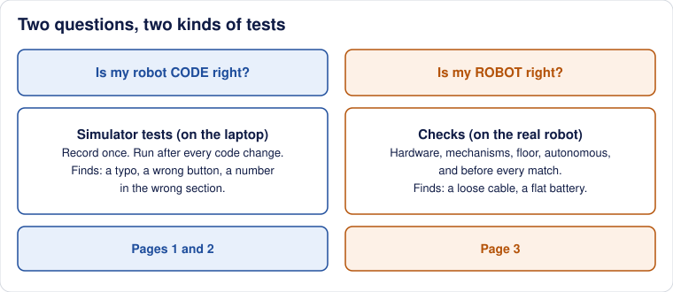

# Tests

Check that your robot code still does its job, and that the robot itself is ready to run.

A test asks one of two questions:

- **Is my robot code right?** A simulator test drives your robot on the laptop and checks the result. It
  finds a break you did not mean to make: a typo, a wrong button, a number in the wrong section.
- **Is my robot right?** A check on the real robot finds a loose cable, a reversed motor, a flat battery
  or a wrong setting before a match.

| # | Page | You learn | Use it |
| --- | --- | --- | --- |
| 1 | [Record a test](01-record-a-test.md) | Record a test in the simulator, read it line by line, set how close is close enough, and update it after a planned change. | when your robot drives and has an autonomous |
| 2 | [Run all your tests](02-run-all-your-tests.md) | Run every test with one button or one command. For programmers: laptop tests in Java. | after every code change, and before you commit |
| 3 | [Checks before practice and matches](03-checks-before-practice-and-matches.md) | A fixed order of checks on the real robot, printable checklists, and what to do when something breaks. | after wiring, after a mechanism change, before practice, and before every match |

**Why both:** a simulator test cannot find a loose cable, and a check on the robot cannot find a break
in code that you did not run. Do both.

---

**Next:** [Record a test](01-record-a-test.md).
