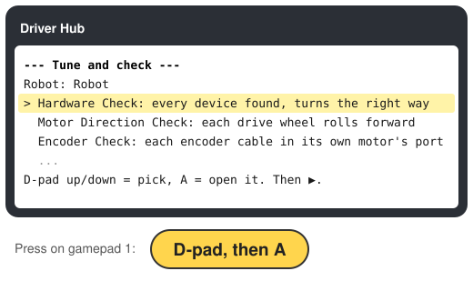
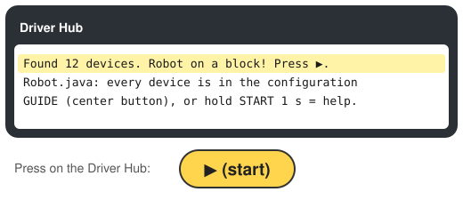
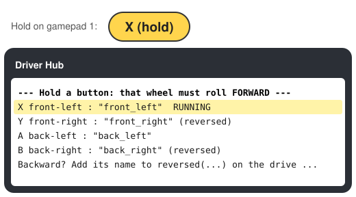
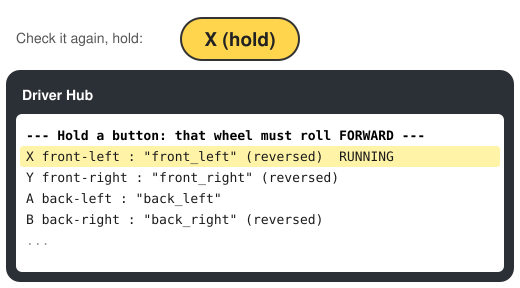
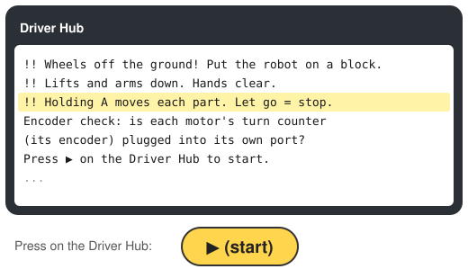
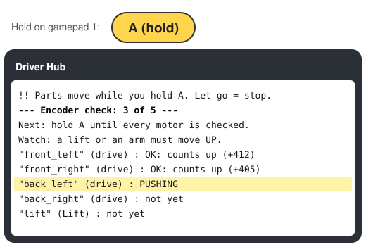
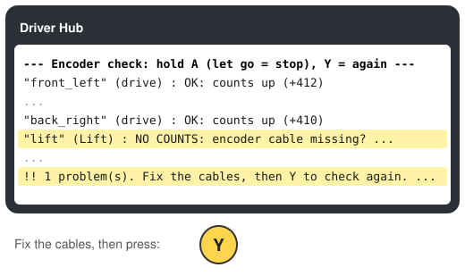

# Wiring checks: motors and encoders

Check that every device answers, every wheel rolls forward, and every encoder cable is in its own port.

**In Tune and check:** always.
**You need:** the robot on a block (the wheels spin), lifts and arms at their bottom stop, hands clear.

Do these three checks first, on every new robot, and again after you change a motor or a cable. Every
other number trusts the wiring.

## Get to the checks

1. On the Driver Hub, open the TeleOp list and pick **Tune and check** (group "Finders"). Press **INIT**.

   

2. The menu shows. Press **D-pad up/down** until the arrow (`>`) is on the check you want: **Hardware
   Check**, **Motor Direction Check** or **Encoder Check**. Then press **A**.

   

3. The check's INIT screen shows. Nothing moves yet. Put the robot on a block, and press **▶** (start) on
   the Driver Hub.

   

For the next check, press STOP, then INIT again, and pick it in the menu.

## Hardware Check: every device answers

The Hardware Check finds every device and moves each motor and servo. It spins a motor in its raw
direction, so it does not check `reversed(...)`: the next check does. What to look for, device by device:
[Hardware check](../tests/03-checks-before-practice-and-matches.md#3-hardware-check-after-a-wiring-or-configuration-change).

**It waits for your hands.** At ▶, when you choose another device, and when help closes, let go of every
stick and button. Until then, nothing moves. Without this, a stick that you still hold would move the next
device.

## Motor Direction Check: each wheel rolls forward

The Hardware Check spins a motor in its raw direction. This check uses your directions, so it shows what
the robot will do. It spins ONE drive motor at a time at 30%, set up exactly as Robot.java says:
its direction comes from `reversed(...)` on the drive line.

1. Hold **X** (front-left), **Y** (front-right), **A** (back-left) or **B** (back-right). On a tank drive,
   X = left and Y = right. The screen shows the motor's name, and "(reversed in code)" when the code reverses
   it. That is normal for some wheels.

   

2. The top of each wheel must move toward the front of the robot. Then that wheel drives the robot FORWARD.
   For the robot in five files, the front is the end that Robot.java says.
3. When a wheel rolls backward, let go. The screen shows the whole `.reversed(...)` for that wheel's fix.
   Write it on the drive line in Robot.java, in place of any that is there. Build and install the code, then
   check it again: press STOP, then INIT, open Motor Direction Check, and press ▶.

   

4. When the wrong wheel turns, its name in the robot configuration is on the wrong port. Swap the names on
   the Driver Hub, not the wires.

A wrong direction makes the robot drive in circles, strafe the wrong way, or fight itself. So run the check
on every new robot, and again after you change any motor or wire.

## Encoder Check: each encoder cable in its own port

A motor's encoder counts its turns. It has its own small cable, plugged into the hub next to the motor's
power cable. A lift, an arm, a flywheel's speed and the drive's distances all trust that count. When the
cable is in ANOTHER motor's port, the lift reads the wrong motor and never stops. When the cable is
missing, the count stays at 0 and the lift pushes into its stop.

The check pushes each motor in Robot.java a little (30% power for 0.3 s), one at a time. It reads EVERY
motor port's count, and shows a result for each motor:

| Result | What it means | Fix |
| --- | --- | --- |
| OK: counts up (or down) | its own port counted, the way the check pushed it | nothing |
| NO COUNTS | no port counted | plug in the encoder cable, or replace it. Or the motor did not turn: check that you saw it move |
| counts on "X" instead | another motor's port counted | the encoder cables are swapped: put each one in its own motor's port |
| counts on "lift_right" instead: plug the encoder cable into "lift_left" | a two-motor lift or arm: the library reads only the first motor's encoder | move the cable to the first motor's port |
| counts BACKWARD | its port counted the other way from the push | the motor's power wires are swapped (red and black), or an outside encoder is mounted the other way |
| no counts (fine: not used) | an intake or feeder with no encoder cable | nothing |
| could not read its encoder | the hub did not answer | press **Y** to check again. When the result stays, check the hub's cables |
| NOT IN THE CONFIGURATION | Robot.java names a motor the configuration does not have | add it to the configuration, or mark the part `optional()` |

1. Put the robot on a block, with lifts and arms down. In **Tune and check**, open **Encoder Check**, then
   press **▶**.

   

2. Hold **A**. Each motor gets its short push in turn. When you let go of **A**, everything stops at once.

   

3. Read the results. The screen says which motor to fix first, and how. Press STOP before you touch a cable.
   Fix it, then run the check again (**Y** starts over).

   

The check sets up each motor as Robot.java says (its direction). It pushes the motor toward the side where
its part has room. It reads that side from your `Tunables.java`: a lift up from its bottom stop, a hood toward `posB`, a turret
toward the end of its range that is farther from its start angle. Its count must move the same way.

**Watch each part while the check pushes it.** The count turns with the direction setting, so the check
cannot see a wrong `reversed()` in Robot.java. Only your eyes can. A lift or arm must move UP, away from
its stop. When it moves down, fix `reversed()` on its line in Robot.java. For the drive, use the
[Motor Direction Check](#motor-direction-check-each-wheel-rolls-forward).

Before each push, the check waits until every port is still (for example, until a flywheel spins down).
So it never mistakes one motor for another. When something keeps moving, the screen names it. The check
does not check servos, CR servos, a CR servo turret, or a motor whose port reads something else. Those are
an odometry pod (the [Odometry Tuner](09-odometry-tuner.md) checks pods) and
a CR servo turret's encoder.

Run it on every new robot, and again after you change any motor or cable.

## Fix a mistake

- **Hardware Check:** it moves motors and servos, and saves nothing. Let go of the stick, and the motor's
  power is off. A servo stays at the last number you sent it.
- **Motor Direction Check:** a wheel runs only while you hold its button. Let go, and it stops.
- **Encoder Check:** press **Y** to run the check again.

**Start over:** press STOP, then INIT, and open the tool again. It starts empty: nothing carries over. The lines saved at STOP stay in the results file, the newest at the end.

## Put the numbers in your code

These checks give no numbers to copy. You fix what they find in two places:

| The check finds | Fix it in |
| --- | --- |
| a wheel rolls backward | `reversed(...)` on the drive line in `Robot.java` |
| a lift or arm moves down when the check pushes it | `.reversed()` on its line in `Robot.java` |
| the wrong wheel turns | the robot configuration on the Driver Hub (swap the names, not the wires) |
| an encoder cable is missing, swapped or backward | the cables on the hub |

## Done when

- The Hardware Check finds every device.
- Every drive wheel rolls the way that drives the robot forward.
- The screen says `Done:`, and every motor says OK (or "no counts (fine...)" for a motor whose encoder nothing reads).

---

**Next:** [Servo Finder: ends and positions](03-servo-finder.md).

**Look it up:** [Hardware Check module](../modules/testing.md), [Troubleshooting: robot behavior](../troubleshooting.md#robot-behavior).
