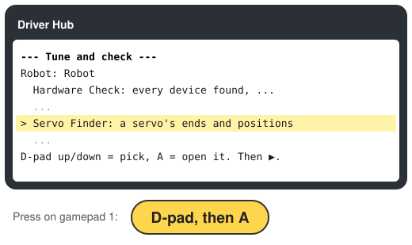
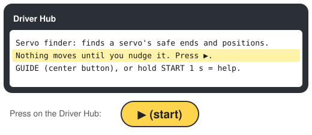
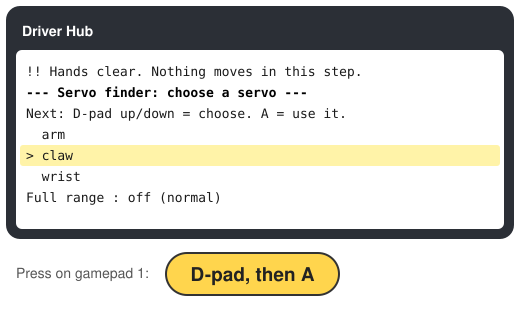
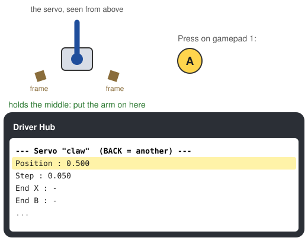
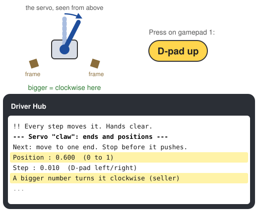
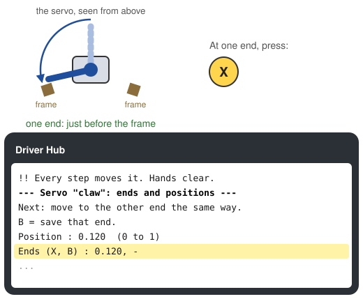
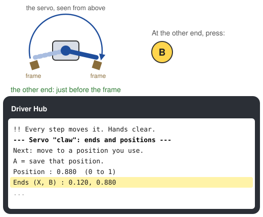
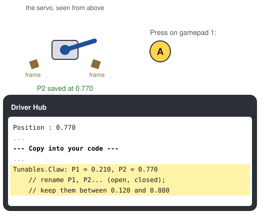
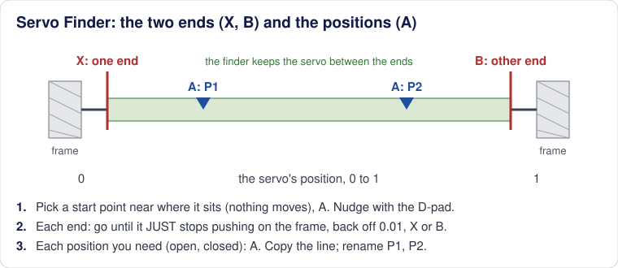
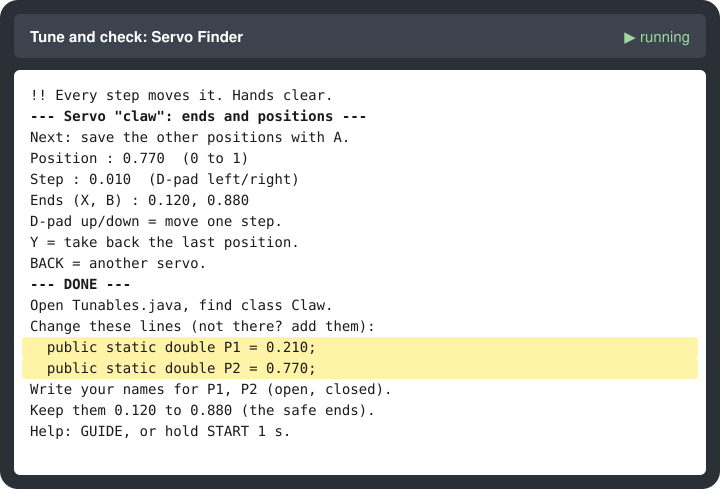

# Servo Finder: ends and positions

Find where a servo part stops at each end, and the positions you use between them.

**In Tune and check:** yes, when the configuration has a servo.
**You need:** the robot on a block.

## Get to the Servo Finder

1. On the Driver Hub, open the TeleOp list and pick **Tune and check** (group "Finders"). Press **INIT**.

   

2. The menu shows. Press **D-pad down** until the arrow (`>`) is on **Servo Finder**, then press **A**.

   

3. The Servo Finder's INIT screen shows. Nothing moves yet. Press **▶** (start) on the Driver Hub.

   

4. Press **D-pad up/down** until the arrow is on your servo's name, then press **A**. The names come from
   the robot configuration.

   

The screen now shows `Start point : 0.500`. Nothing has moved yet. Go on with the steps below.

## A new servo part, step by step

With a new servo, the hard part is that you do not know which way it turns, or where its ends are. Go in
this order, slowly. Use **Tune and check > Servo Finder**: it knows Robot.java (`reversed()`, a second
servo, the servo's catalog part).

1. **Arm off.** Put the servo in, but leave its arm (the horn) off, or its screw loose. Then nothing can hit the
   frame while you start.
2. **Go to the middle.** Leave the start point at 0.500 and press **A**. The servo goes to the middle of its
   turn and holds there.

   

3. **Put the arm on in the middle of the part's swing**, so the part can move both ways from here. Tighten the
   screw. Mark the horn and the shaft with a paint pen, so a new horn later goes on the same tooth
   ([Put an arm back on](#put-an-arm-back-on)).
4. **Find the direction.** Press **D-pad left** once (a 0.01 step), then press **D-pad up** (bigger) a few
   times and watch the part. Write it down: "bigger = open", "bigger = up". No standard says which way a
   servo turns ([why](../conventions.md#servos-and-motors-which-way-is-bigger)). For a catalog servo, the
   screen shows the seller's word (goBILDA: "A bigger number turns it clockwise"). But only your test counts,
   because the part's way depends on how you mount the servo.

   

5. **Find the first end, slowly.** Move toward one end in small steps (D-pad up/down) until the part
   is about to touch the frame. Stop before it presses. D-pad left makes the step smaller, down to 0.001. **A servo that hums is pushing on
   something: back off at once.** It gets hot and can strip its gears. Back off 0.01 more and press **X**.

   

6. **Find the other end.** Move the part all the way back with the D-pad, past the middle, to the other
   end. Use a big step first, then small steps near the frame. Stop just before the frame in the same way,
   and press **B**.

   

7. **Save each position you need** (open, closed, rest, push...): move there and press **A**. Then copy the
   lines into `Tunables.java` ([Put the numbers in your code](#put-the-numbers-in-your-code)).

   

8. **To make "bigger" go the other way** (for example, bigger = up), add `.reversed()` to the part in
   Robot.java. Then find the positions again: each old number becomes 1 minus it.

**Two servos on one part:** do step 1 for BOTH arms. Choose the FIRST servo: the second moves with it,
mirrored. Then put both arms on at the middle (step 3), so they match, and go on from step 4. If they do
not quite meet, set `alsoTrim` afterward, in TeleOp.

**In your TeleOp, at ▶**, the part goes straight to its first position from wherever it is: a servo holds
its own angle, but it cannot tell the program that angle. Keep hands clear.

## The finder's buttons

0. **Full range:** when the part has `.fullRange()` in Robot.java, press **Y** while you choose the servo,
   so the finder uses the same range. Full range is the servo's whole turn: for a goBILDA 2000 servo, 300
   degrees instead of 270 ([why](../modules/hardware.md#full-range)). Positions that you find with one range
   are wrong with the other.
1. Choose the servo (D-pad, A). A servo cannot tell the program where it is. So first choose a START POINT
   near where it sits now (D-pad up/down; nothing moves), then press A, and it moves there. Then nudge it
   with the D-pad. Up/down moves it by the step. Left/right makes the step smaller/bigger (0.1, 0.05, 0.01,
   0.005, 0.001). The step starts at 0.05, and the screen shows it. Use a big step to get close, then a
   small one for the exact spot.
2. Move it slowly toward one end. Stop before the part presses on the frame. A straining servo hums.
   Back off a little (0.01), and press **X**. Do the same at the other end, and press **B**. From then on,
   the finder keeps the servo between them. To go past an end, for example to mark it again, hold **LB**
   while you nudge. The ends are for you: keep every position you save between them. In five files, there
   are no end lines to copy. The older helpers get the ends as the servo's limits.
3. Move to each position you need (open, closed...) and press **A**. Rename P1, P2 in your code.
   Five files: in class Claw, `public static double P1 = 0.210;` becomes
   `public static double open = 0.210;` with your name. Keep every position
   between the ends that the finder shows. **Y** undoes the last saved position. **BACK** chooses another
   servo, and the lines found so far stay on the screen.

**`reversed()` in Robot.java:** in **Tune and check**, the finder turns the servo the same way. The screen
says `Direction : reversed, as in Robot.java`, so its numbers go straight into Tunables.java. Either order is
fine: `rest` may be higher or lower than `push`, and `open` higher or lower than `closed`. Which way a bigger
number turns depends on the servo, because there is no standard. D-pad up shows you
([Signs and units](../conventions.md#servos-and-motors-which-way-is-bigger)).

**A part on two servos** (`alsoServoReversed(...)` or `alsoServo(...)` in Robot.java): for example, a claw
with a servo for each finger, or two feed arms. Choose the FIRST servo. In **Tune and check**, the second
servo moves with it (mirrored or the same way, as Robot.java says). Their arms must match, or they push
against each other: put both on at the middle. The screen shows `Moves with it : claw_right (mirrored)`. You cannot choose the second servo alone. The finder does not use
`alsoTrim`: check it afterward, in TeleOp. A Servo Finder of your own (not from Tune and check) does not
know Robot.java and moves only one servo. It would drag the other, unpowered servo through its gears. So
disconnect the other servo from the part first. Unplugging its wire does not disconnect its gears.

## Fix a mistake

- **Saved a wrong position (A):** press **Y**. It undoes the last saved position. Press it again for the one
  before.
- **Marked the wrong end (X or B):** move to the right place and press the same button again. The new end
  replaces the old one. To move past the old end, hold **LB** while you press the D-pad.
- **Chose the wrong servo:** press **BACK** and choose again. When you choose a servo again, its ends and
  positions start over.

**Start over:** press STOP, then INIT, and open the tool again. It starts empty: nothing carries over. The lines saved at STOP stay in the results file, the newest at the end.

## Put the numbers in your code

When you have saved both ends and your positions, the screen says DONE and looks like this. A project with
no Robot.java gets `PositionServo.create(...)` lines in their place.

The robot uses `Tunables.java` and `Robot.java`, not the finder's screen. Take a photo of the screen,
and type each line into the file. Or copy it from the [results file](01-tune-and-check.md#get-the-results-file-on-the-laptop):

| The finder shows | Put it in |
| --- | --- |
| `Open Tunables.java, find class Claw.` and `public static double P1 = 0.210;` | class `Claw` in `Tunables.java`. Write your names: `public static double open = 0.210;` |

## Put an arm back on

Do this after a new horn, a broken arm, or a repair. Then your numbers in `Tunables.java` stay right.

**Keep the servo on while you put the arm on.** A servo with no power turns freely. When you push the horn
onto the shaft, the shaft can turn, and the arm goes on one tooth off. A servo with power holds its shaft
still.

1. **Look for the paint pen marks** on the horn and the shaft. No marks? Make them before you take the old
   arm off.
2. **Hold the servo at a known number.** In **Tune and check > Servo Finder**, choose the servo. Set the
   start point to a number from `Tunables.java`, for example your `rest` (D-pad up/down), and press **A**.
   The servo goes there and holds. It holds only while the finder runs: do not press STOP yet.
3. **Put the part where that number puts it**, for example against its rest stop. A block or a jig helps
   you find the same spot each time.
4. **Push the horn on**, with the paint marks lined up. When the teeth do not let the part sit exactly
   there, use the closest tooth. Do not turn the servo by hand: it is holding.
5. **Tighten the screw** while the servo still holds. Mark the horn and the shaft again.
6. **Check each position.** Press STOP, run your TeleOp, and move the part to each position. A little off
   (less than one tooth)? Find that position again with the finder and change its number in
   `Tunables.java`. One spline tooth on a goBILDA servo is about 0.05 in position.

**Two servos on one part:** loosen or take off BOTH arms first. Choose the first servo in step 2: both
servos go to the number and hold. Put both arms on, then check that they meet.

## Done when

every position you use is in `Tunables.java`, between the two ends.

---

**Next:** [Hood Finder](04-hood-finder.md).

**Look it up:** [Claw, Wrist and Positioner: In Tunables.java](../reference/parts/claw.md#in-tunablesjava), [ServoFinderOpMode](../modules/finders.md).
