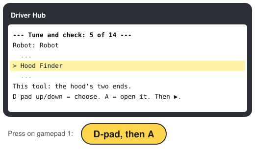
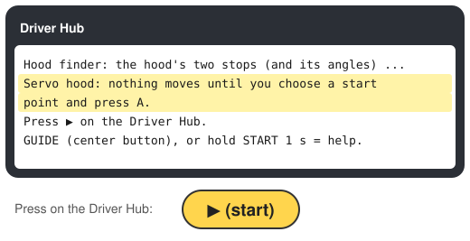
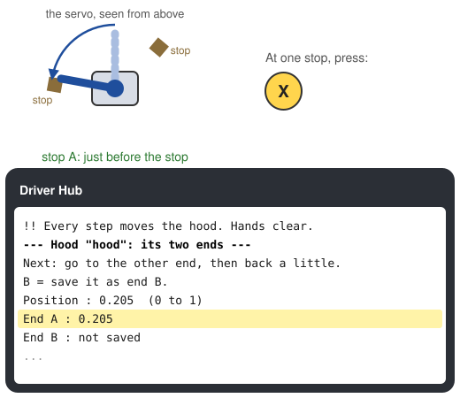
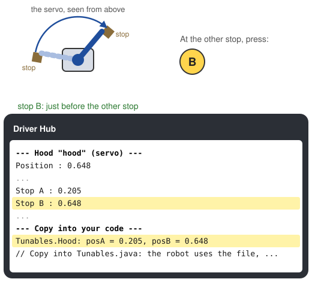
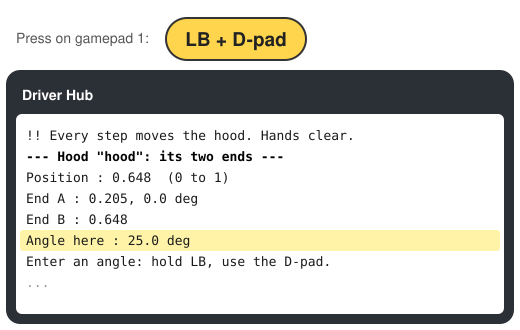

# Hood Finder

Find a launcher hood's two stops, and its angles if you want them.

**In Tune and check:** yes, when the robot has a hood.
**You need:** the hood mounted, the flywheel off.

## Get to the Hood Finder

1. On the Driver Hub, open the TeleOp list and pick **Tune and check** (group "Finders"). Press **INIT**.

   

2. The menu shows. Press **D-pad down** until the arrow (`>`) is on **Hood Finder**, then press **A**.

   

3. The Hood Finder's INIT screen shows. Nothing moves yet. Press **▶** (start) on the Driver Hub. A motor
   hood's screen says `Motor hood: nothing is powered` instead.

   

## Steps

The Hood Finder is for a launcher's [hood](../reference/parts/hood.md) (`Tunables.Hood`). It reads the hood
from Robot.java, so it works before Tunables.Hood has numbers. A hood with `.fullRange()` gets the same full
range here.

1. **A servo hood:** choose a START POINT near where the hood sits (D-pad up/down; nothing moves), and press
   **A**. Then nudge it with the D-pad. Up/down moves it by the step. Left/right makes the step
   smaller/bigger (0.1, 0.05, 0.01, 0.005, 0.001). The step starts at 0.05, and the screen shows it.
   **A motor hood:** nothing is powered. Start the OpMode with the hood on the stop that you want as 0 ticks
   (the same as before a match). Then move the hood by hand and watch the encoder.

   

2. Go to one stop until the hood BARELY touches it (a servo hums when it strains). Back off a little, and
   press **X** (stop A).

   

3. Move the hood to the other stop in the same way, and press **B** (stop B). The screen shows
   `Tunables.Hood: posA = 0.205, posB = 0.648`. That is all you need: the hood then works in servo
   positions, and the Shot Tuner writes positions into the table.

   

4. **Angles (optional).** Measure the hood's angle at each stop, with an angle app on a phone laid on the
   hood. **Hold LB + D-pad** to type it in BEFORE you press X / B. Then you get `angleA = 0, angleB = 25`
   too. The finder uses each angle you type for ONE place (a stop or a point), so measure again at the
   next place. When only one stop has an angle, the finder writes no angles, and the screen says which stop
   still needs its angle. An angle of 0 counts only when you type it: hold LB and press D-pad up, then
   D-pad down, so the screen shows `Angle here : 0.0`.

   

5. **A linkage** (the angle is not a straight line of the servo position): add points in between. Move
   there, type in the angle (LB + D-pad), and press **A**. With points and the angles at both stops, you
   get a `calibration` line INSTEAD of the posA / posB line. The hood reads one or the other, and both
   together stop INIT. The table's first and last rows are the stops. INIT checks that the angles keep
   going one way along the hood. The finder shows a point that breaks this as a warning, and writes no
   table. **Y** undoes the last point.
6. Copy the lines into `Tunables.java`: the robot uses the file, not this screen. Then, for a servo hood,
   time a stop-to-stop move for `travelSec`. The launcher waits that long before firing (a share of it for
   a shorter move).

## Fix a mistake

- **Saved a wrong point (X, B or A):** press **Y**. It undoes the last point.
- **Marked the wrong stop:** move to the right place and press the same button (X or B) again. The new stop
  replaces the old one.
- **Typed a wrong angle:** hold LB and press the D-pad again, before you press X, B or A. After you press,
  the angle is used: press **Y**, then type the angle and mark the place again.

**Start over:** press STOP, then INIT, and open the tool again. It starts empty: nothing carries over. The lines saved at STOP stay in the results file, the newest at the end.

## Copy the numbers

The robot uses `Tunables.java` and `Robot.java`, not the finder's screen. Copy each line:

| The finder shows | Put it in |
| --- | --- |
| `Tunables.Hood: posA = 0.205, posB = 0.648` | `Tunables.Hood` |
| `angleA = 0, angleB = 25` (optional) | `Tunables.Hood` |
| a `calibration` line (a linkage) | `Tunables.Hood`, in place of `posA` / `posB` |
| `travelSec` (you time it) | `Tunables.Hood` |

## Done when

`posA`, `posB` (or a `calibration` table) and `travelSec` are in `Tunables.Hood`.

---

**Next:** [Motor Finder: limits, positions, top speed](05-motor-finder.md).

**Look it up:** [Hood](../reference/parts/hood.md).
