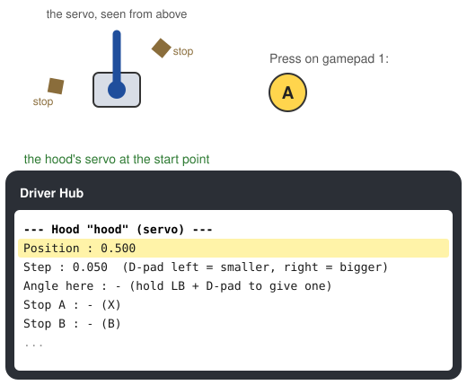

# Hood Finder

Find a launcher hood's two ends, and its angles if you want them.

**In Tune and check:** yes, when the robot has a hood.
**You need:** the hood mounted, the flywheel off.

## Get to the Hood Finder

1. On the Driver Hub, open the TeleOp list and pick **Tune and check** (group "Finders"). Press **INIT**.

   

2. The menu shows. Press **D-pad down** until the arrow (`>`) is on **Hood Finder**, then press **A**.

   

3. The Hood Finder's INIT screen shows. Nothing moves yet. Press **▶** (start) on the Driver Hub. A motor
   hood's screen says `Its motor gets no power in this tool.` instead.

   

## Steps

The Hood Finder is for a launcher's [hood](../reference/parts/hood.md) (`Tunables.Hood`). It reads the hood
from Robot.java, so it works before Tunables.Hood has numbers. A hood with `.fullRange()` gets the same full
range here.

1. **A servo hood:** choose a START POINT near where the hood sits (D-pad up/down; nothing moves), and press
   **A**. Then nudge it with the D-pad. Up/down moves it by the step. Left/right makes the step
   smaller/bigger (0.1, 0.05, 0.01, 0.005, 0.001). The step starts at 0.05, and the screen shows it.
   **A motor hood:** nothing is powered. After ▶, move the hood by hand to the end where it starts each match.
   Press **A**: that place is 0. The finder saves nothing before this press. Then move the hood by hand and
   watch the count.

   

2. Move to one end. Stop before the hood presses on it (a servo hums when it strains). Back off a little,
   and press **X** (end A).

   

3. Move the hood to the other end in the same way, and press **B** (end B). The screen says DONE and shows
   the two lines for class Hood: `posA` and `posB`. That is all you need: the hood then works in servo
   positions, and the Shot Tuner writes positions into the table.

   

4. **Angles (optional).** Measure the hood's angle at each end, with an angle app on a phone laid on the
   hood. **Hold LB + D-pad** to enter it BEFORE you press X or B. Then you get `angleA` and `angleB` lines
   too. The finder uses each angle for ONE place (an end or a point), so measure again at the next place.
   When only one end has an angle, the finder writes no angles, and the screen says which end still needs
   its angle. An angle of 0 counts only when you enter it: hold LB and press D-pad up, then D-pad down, so
   the screen shows `Angle here : 0.0 deg`.

   

5. **A linkage** (the angle is not a straight line of the servo position): add points in between. Move
   there, enter the angle (LB + D-pad), and press **A**. With points and the angles at both ends, you get a
   `calibration` table INSTEAD of the posA and posB lines. The hood reads one or the other, and both
   together stop INIT. The table's first and last rows are the ends. INIT checks that the angles keep
   going one way along the hood. The finder shows a point that breaks this as a warning, and writes no
   table. **Y** takes back the last point.
6. Copy the lines into `Tunables.java` when the screen says DONE: the robot uses the file, not this screen.
   Then, for a servo hood, time an end-to-end move for `travelSec`. The launcher waits that long before
   firing (a share of it for a shorter move).

## Fix a mistake

- **Saved a wrong point (A):** press **Y**. It takes back the last point. Y does not undo an end.
- **Marked the wrong end:** move to the right place and press the same button (X or B) again. The new end
  replaces the old one.
- **Entered a wrong angle:** hold LB and press the D-pad again, before you save. Saved already: for an end,
  enter the angle and press X or B again. For a point, press **Y**, then enter it and press A again.

**Start over:** press STOP, then INIT, and open the tool again. It starts empty: nothing carries over. The lines saved at STOP stay in the results file, the newest at the end.

## Put the numbers in your code

The robot uses `Tunables.java` and `Robot.java`, not the finder's screen. Take a photo of the screen,
and type each line into the file. Or copy it from the [results file](01-tune-and-check.md#get-the-results-file-on-the-laptop):

| The finder shows | Put it in |
| --- | --- |
| `public static double posA = 0.205;` and the same for `posB` | class `Hood` in `Tunables.java` |
| `public static double angleA = 0;` and `angleB` (optional) | class `Hood` |
| a `calibration` table (a linkage) | class `Hood`. Delete `posA`, `posB`, `angleA` and `angleB` |
| `travelSec` (you time it) | `Tunables.Hood` |

## Done when

`posA`, `posB` (or a `calibration` table) and `travelSec` are in `Tunables.Hood`.

---

**Next:** [Motor Finder: limits, positions, top speed](05-motor-finder.md).

**Look it up:** [Hood](../reference/parts/hood.md).
