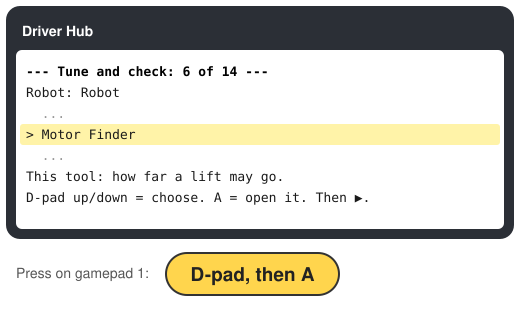
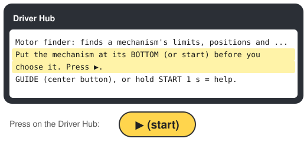
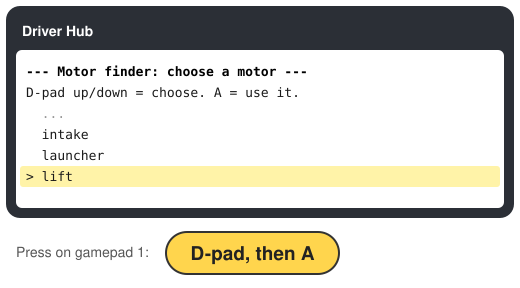
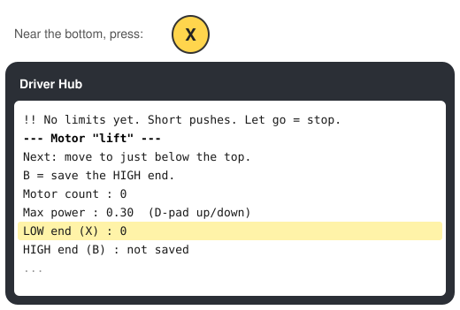
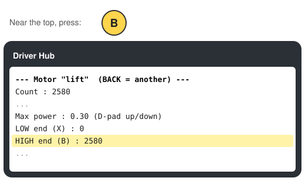
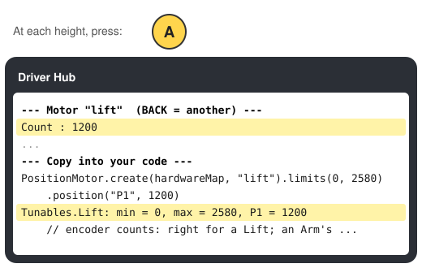
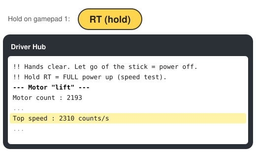

# Motor Finder: limits, positions, top speed

Find a lift's, an arm's or a turret's limits and named positions, and its top speed.

**In Tune and check:** yes, when the robot has a lift or an arm (or there is no Robot.java).
**You need:** the robot on a block, the mechanism at its bottom.

## Get to the Motor Finder

1. On the Driver Hub, open the TeleOp list and pick **Tune and check** (group "Finders"). Press **INIT**.

   

2. The menu shows. Press **D-pad down** until the arrow (`>`) is on **Motor Finder**, then press **A**.

   

3. The Motor Finder's INIT screen shows. Nothing moves yet. Put the mechanism at its bottom, then press
   **▶** (start) on the Driver Hub.

   

4. Press **D-pad up/down** until the arrow is on your motor's name, then press **A**. The names come from
   the robot configuration.

   

## Steps

1. **Put the mechanism at its bottom**, then choose the motor (D-pad, A). Its count starts at 0 there.
2. Move it slowly with the right stick (max power starts at 0.3). Stop a little before the bottom, and
   press **X**.

   

3. Move it up to the top. Stop a little before the top, and press **B**. From now on, the power goes off
   at those marks. The mechanism coasts a little past them (more at a higher max power), so mark them with
   some room.

   

4. Press **A** at each height you need. A height outside the two marks gets a warning, because the robot
   stops at min and max and could never get there. **Y** undoes it.

   

5. Hold **RT** for a speed test: full power up, stopping before the top. The top speed helps you
   choose a max power and PID gains.

   

6. Five files: the line `Tunables.Lift: min = 0, max = 2580, P1 = 1200` becomes `min = 0, max = 2580`
   and `low = 1200` (your name) in `Tunables.Lift`. When it also says `Robot.java: add .reversed()`,
   add `.reversed()` to that part in `Robot.java`. An `Arm` reads degrees, not counts: see the
   [reference](../modules/finders.md#motorfinderopmode).

Watch the current (amps). A high number while the part does not move means it is pushing on something. Stop.

## Fix a mistake

- **Saved a wrong position (A):** press **Y**. It undoes the last saved position.
- **Marked the wrong end (X or B):** move to the right place and press the same button again. The new end
  replaces the old one.
- **Chose the wrong motor:** press **BACK** and choose again. **Put the mechanism at its bottom first**:
  choosing a motor sets its encoder to 0 where it is now.

**Start over:** press STOP, then INIT, and open the tool again. It starts empty: nothing carries over. The lines saved at STOP stay in the results file, the newest at the end.

## Put the numbers in your code

The robot uses `Tunables.java` and `Robot.java`, not the finder's screen. Take a photo of the screen,
and type each line into the file. Or copy it from the [results file](01-tune-and-check.md#get-the-results-file-on-the-laptop):

| The finder shows | Put it in |
| --- | --- |
| `Tunables.Lift: min = 0, max = 2580, P1 = 1200` | `Tunables.Lift`. Rename `P1` to a real name: `low = 1200` |
| `Robot.java: add .reversed()` | the part's line in `Robot.java` |

## Done when

`min`, `max` and every named height are in `Tunables.java`.

---

**Next:** [Flywheel Finder: gains and recovery](06-flywheel-finder.md).

**Look it up:** [Lift and Arm: In Tunables.java](../reference/parts/lift.md#in-tunablesjava), [MotorFinderOpMode](../modules/finders.md#motorfinderopmode).
