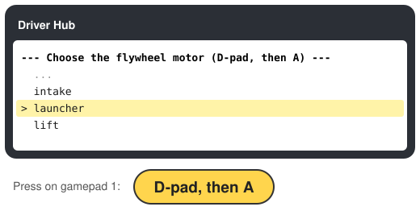
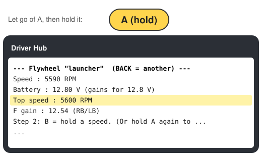

# Flywheel Finder: gains and recovery

Find the gains that hold a flywheel at its speed, and how fast it recovers after a shot.

**In Tune and check:** yes, when the robot has a launcher (or there is no Robot.java).
**You need:** safety glasses, nobody in the line of fire, a charged battery.

## Get to the Flywheel Finder

1. On the Driver Hub, open the TeleOp list and pick **Tune and check** (group "Finders"). Press **INIT**.

   

2. The menu shows. Press **D-pad down** until the arrow (`>`) is on **Flywheel Finder**, then press **A**.

   

3. The Flywheel Finder's INIT screen shows. Nothing moves yet. Put your safety glasses on, then press
   **▶** (start) on the Driver Hub.

   

4. Press **D-pad up/down** until the arrow is on the flywheel motor's name, then press **A**. The names come
   from the robot configuration.

   

## Steps

1. After you choose the motor, let go of A, then hold **A** again: the wheel runs at full power until the
   speed stops rising. The finder works out the gains from the top speed. When the wheel spins the wrong
   way, let go, press **X** (reverse), and try again.

   

2. Press **B**: the finder holds a speed (60% of the top). Change it with the D-pad to the speed you shoot at.

   

3. When the measured speed stays below the target at every speed, press **RB** (more F). When it stays
   above, press **LB**.

   

4. Feed one piece with the robot's own feeder, or push it in with a stick. **Never use your fingers**:
   they would be next to a wheel at full speed. Put safety glasses on. The screen shows the recovery time
   (on the robot only, because the simulator has no piece to feed). Use it for the launcher's
   `shotInterval(...)`: make that a little longer than the recovery time.
5. Check that the robot sees each shot (for `stopOnShot`). Set the target to your shot speed with the
   D-pad. Feed 10 pieces, one at a time. Wait for "Ready: YES" before each. Read two lines:
   - "Shots seen": the drops of more than 150 RPM (the default `shotDropRpm`).
   - "Shot drop": every drop, also the ones under 150. It shows the last drop, the smallest drop and how
     many drops it saw.

   "Shots seen" shows 10: the default is good. It shows fewer: set `shotDropRpm` in `Tunables.Launcher` to
   about half the smallest shot drop. Keep it more than `readyBandRpm`. Then fire with no piece in TeleOp:
   the feed must run its full `feedSec`. The finder always counts with 150, not with your `shotDropRpm`.
6. Five files: copy the `Tunables.Launcher: kP = ..., kI = ..., kD = 0, kF = ..., nominalVolts = ...` line
   into `Tunables.Launcher` (the section is the motor's name). A slow recovery adds `shotIntervalSec`.
   `nominalVolts` is the battery voltage at which the finder found the gains. The launcher's battery
   compensation uses it, so a low battery spins the wheel back up as fast. The compensation is off unless
   you write `batteryCompensation = true`. The RB/LB F changes are only on the screen: copy the line (with
   the F you ended on) into `Tunables.java`.

## Fix a mistake

- The finder saves no positions, so there is nothing to undo. Each button changes one setting, and you
  can change it back. **X** again turns the reverse off, **B** again stops the held speed, and **LB** lowers F
  again after an **RB**.
- **Chose the wrong motor, or a bad top-speed test:** press **BACK** and choose the motor again. It starts
  over, with a new top-speed test.

**Start over:** press STOP, then INIT, and open the tool again. It starts empty: nothing carries over. The lines saved at STOP stay in the results file, the newest at the end.

## Put the numbers in your code

The robot uses `Tunables.java` and `Robot.java`, not the finder's screen. Take a photo of the screen,
and type each line into the file. Or copy it from the [results file](01-tune-and-check.md#get-the-results-file-on-the-laptop):

| The finder shows | Put it in |
| --- | --- |
| `Tunables.Launcher: kP = ..., kI = ..., kD = 0, kF = ..., nominalVolts = ...` | `Tunables.Launcher` (the section is the motor's name) |
| the recovery time | `shotIntervalSec` in `Tunables.Launcher`: a little longer than the recovery time |
| "Shots seen" fewer than the pieces | `shotDropRpm` in `Tunables.Launcher`: about half the smallest "Shot drop" (from the screen) |

## Done when

you copied the `Tunables.Launcher` gains line, and the speed holds the target.

---

**Next:** [Feed Stop Finder](07-feed-stop-finder.md).

**Look it up:** [Launcher: In Tunables.java](../reference/parts/launcher.md#in-tunablesjava).
