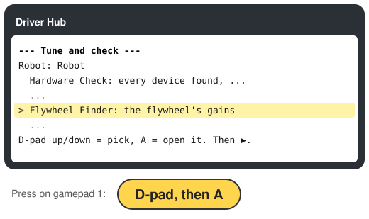
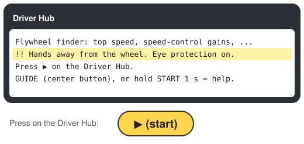
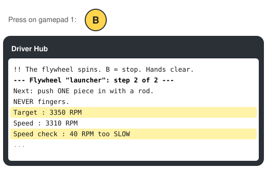
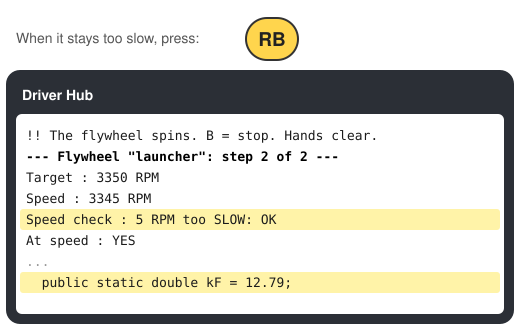

# Flywheel Finder: gains and recovery

Find the gains that hold a flywheel at its speed, and how fast it recovers after a shot.

**In Tune and check:** yes, when the robot has a launcher (or there is no Robot.java).
**You need:** the robot on a block, safety glasses, nobody in the line of fire, a charged battery, a rod (a ruler).

**This tool tunes PID only.** When your robot uses bang-bang (`speedControl = "BANG_BANG"`), use the
[Flywheel Tuner](06-flywheel-tuner.md). In Tune and check, the finder's first screen says so too. Its `kP`, `kI`,
`kD` and `kF` are not bang-bang's settings.

## Get to the Flywheel Finder

1. On the Driver Hub, open the TeleOp list and pick **Tune and check** (group "Finders"). Press **INIT**.

   

2. The menu shows. Press **D-pad down** until the arrow (`>`) is on **Flywheel Finder**, then press **A**.

   

3. The Flywheel Finder's INIT screen shows. Nothing moves yet. Put your safety glasses on, then press
   **▶** (start) on the Driver Hub.

   

4. The arrow starts on the flywheel motor: the launcher's motor in Robot.java (from Tune and check), else a
   name with "fly", "launch" or "shoot" in it. Check the name, then press **A**. Another motor: press
   **D-pad up/down** first. The names come from the robot configuration.

   

## Already have gains in Tunables.java?

From Tune and check, when your launcher's part of `Tunables.java` has `kP`, `kI` and `kF`, the finder holds the
wheel with **those** gains (and their battery compensation). The screen shows `Numbers in use : Tunables.java`
and the numbers under it: `kP 10.00, kI 0.000, kF 14.68`.

- Step 1 is not needed: press **B** at once (step 2), set your shot speed, and fine-tune F with **RB** / **LB**.
- The lines for class Launcher keep your kP, kI and kD. Only kF is new.
- After step 1, **Y** switches to the finder's own gains (from the top speed) and back. The F you fine-tuned on
  each stays.

**Why:** F does most of the work, and it fits only the kP and kI it was tuned with. With the finder's own kI, a
small F error is hidden while the wheel is held, then shows up in a match with your kI. Tuned with your own
gains, F is right for the robot as it is.

## Steps

1. After you choose the motor, let go of A, then hold **A** again: the wheel runs at full power until the
   speed stops rising. The finder works out starting gains from the top speed. They say NOT DONE until step 2 sees
   the wheel hold its speed with them. From Tune and check, the motor
   starts in the direction Robot.java gives it: with `.reversed()` on the launcher, the screen shows
   `Direction : reversed, as in Robot.java`. When the wheel spins the wrong way, let go, press **X**
   (reverse), and try again. Then the results tell you to add or remove `.reversed()` in Robot.java.

   **Why the direction matters:** a wheel that spins backward pushes the piece back. The piece jams on the
   wheel, and the wheel stops when the piece touches it.

   **`Still speeding up at 5 s`:** full power stops after 5 s, for safety. A heavy wheel (a wheel with added
   weight) can still speed up then, so its real top speed is higher than the one shown. Extra weight does
   not lower the top speed much, but it makes the wheel take longer to get there. Because the finder works
   out F from the top speed, F is then a little high. Check that the wheel turns freely by hand, with no
   rubbing. Then fine-tune F in step 2 (point 3 below): `Speed check` must stay OK at your shot speed.

   

2. Press **B**: the finder holds a speed (60% of the top, or 3000 RPM before step 1). Change it with the D-pad to the speed you shoot at.

   

3. When the measured speed stays below the target at every speed, press **RB** (more F). When it stays
   above, press **LB**.

   

4. Push one piece into the wheel with a rod (a ruler). This tool has no feeder button. **Never use your
   fingers**: they would be next to a wheel at full speed. Put safety glasses on. The screen shows the recovery time
   (on the robot only, because the simulator has no piece to feed). Use it for the launcher's
   `shotInterval(...)`: make that a little longer than the recovery time.
5. Check that the robot sees each shot (for `stopOnShot`). Set the target to your shot speed with the
   D-pad. Push in 10 pieces, one at a time. Wait for `At speed : YES` before each. Read two lines:
   - "Speed drops counted": the drops of more than 150 RPM (the default `shotDropRpm`). A speed drop can
     happen with no piece, so count the pieces yourself.
   - "Below target at a drop": every drop, also the ones under 150. It shows the last drop and the least
     drop, as RPM under the target.

   "Speed drops counted" shows 10: the default is good. It shows fewer: set `shotDropRpm` in `Tunables.Launcher` to
   about half the least drop. Keep it more than `readyBandRpm`. Then fire with no piece in TeleOp:
   the feed must run its full `feedSec`. The finder always counts with 150, not with your `shotDropRpm`.
6. Five files: when the screen says DONE, copy its `kP`, `kI`, `kD`, `kF` and `nominalVolts` lines into the
   class it names. With this finder's own gains, a recovery over 0.25 s adds a `shotIntervalSec` line. With
   the gains from Tunables.java, the finder shows the recovery but adds no such line.
   `nominalVolts` is the battery voltage at which the finder found the gains. The launcher's battery
   compensation uses it to change the power for the battery. Test the recovery again on a lower battery. The compensation is off unless
   you write `batteryCompensation = true`. The RB/LB F changes are only on the screen: copy the line (with
   the F you ended on) into `Tunables.java`.

## Fix a mistake

- The finder saves no positions, so there is nothing to undo. Each button changes one setting, and you
  can change it back. **X** again turns the reverse off, **B** again stops the held speed, and **LB** lowers F
  again after an **RB**.
- **Chose the wrong motor, or a bad top-speed test:** press **BACK** and choose the motor again. It starts
  over, with a new top-speed test.

**Start over:** press STOP, then INIT, and open the tool again. It starts empty: nothing carries over. The lines saved at STOP stay in the results file, the newest at the end.

## Put the numbers in your code

The robot uses `Tunables.java` and `Robot.java`, not the finder's screen. Take a photo of the screen,
and type each line into the file. Or copy it from the [results file](01-tune-and-check.md#get-the-results-file-on-the-laptop):

| The finder shows | Put it in |
| --- | --- |
| `Open Tunables.java, find class Launcher.` and the lines for `kP`, `kI`, `kD`, `kF`, `nominalVolts` | that class in `Tunables.java` |
| `Back at speed after a piece` | `shotIntervalSec` in `Tunables.Launcher`: a little longer than the recovery time |
| "Speed drops counted" fewer than the pieces | `shotDropRpm` in `Tunables.Launcher`: about half the least "Below target at a drop" |

## Done when

the screen says DONE, you copied the lines, and the speed holds the target.

---

**Next:** [Flywheel Tuner](06-flywheel-tuner.md): it compares PID and bang-bang settings, starting from these numbers.

**Look it up:** [Launcher: In Tunables.java](../reference/parts/launcher.md#in-tunablesjava).
