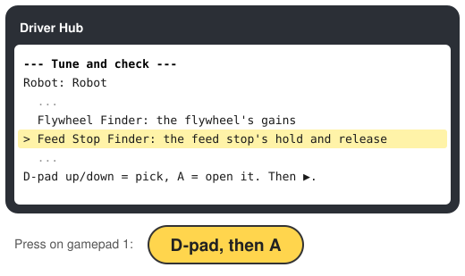
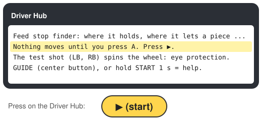
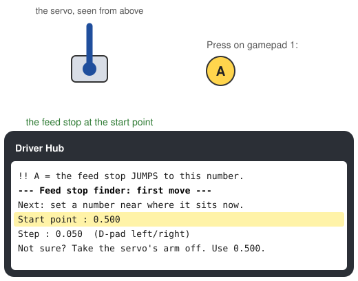
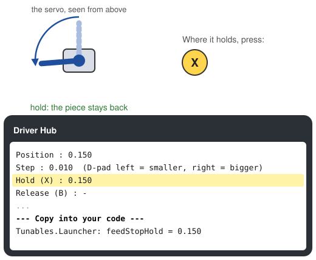
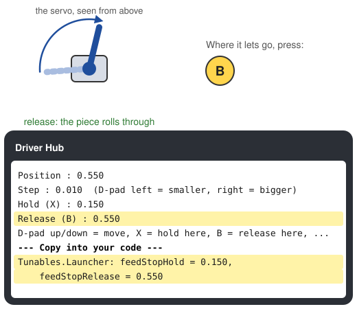
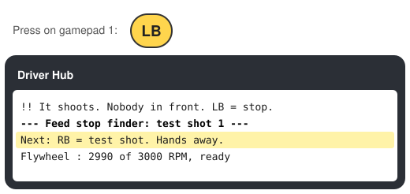
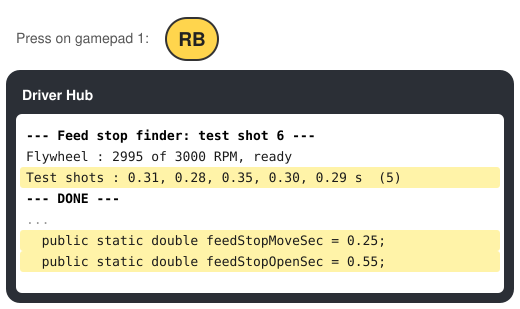

# Feed Stop Finder

Find where a launcher's feed stop holds the pieces back, and where it lets one through.

**In Tune and check:** yes, when the launcher has a `.feedStop(...)`.
**You need:** the launcher's Robot.java line with `.feedStop(...)`, 5 pieces, and eye protection for the
test shots.

## Get to the Feed Stop Finder

1. On the Driver Hub, open the TeleOp list and pick **Tune and check** (group "Finders"). Press **INIT**.

   

2. The menu shows. Press **D-pad down** until the arrow (`>`) is on **Feed Stop Finder**, then press **A**.

   

3. The Feed Stop Finder's INIT screen shows. Nothing moves yet. Press **▶** (start) on the Driver Hub.

   

## Steps

A feed stop holds the pieces back, and lets one through at a time. This finder finds both positions, for a
launcher with `.feedStop("feed_stop")` in Robot.java. For such a robot, it is in
[Tune and check](01-tune-and-check.md#the-tune-and-check-menu).

1. Put a piece behind the feed stop. The wheel stays off.
2. A servo's position is a number from 0 to 1. With the D-pad, pick a start number near where the feed
   stop sits now (nothing moves yet). **A** moves the servo there.

   

3. D-pad up/down moves it by the step. Left/right makes the step smaller/bigger (0.1, 0.05, 0.01, 0.005,
   0.001). The step starts at 0.05, and the screen shows it.
4. Where the stop holds the piece firmly, without straining on the frame, press **X** to save the hold
   position.

   

5. Move the feed stop with the D-pad until the piece rolls through freely. Press **B** to save the release
   position. **A** then goes between the two, so you can try them.

   

6. Copy the line it shows, for example `Tunables.Launcher: feedStopHold = 0.150, feedStopRelease = 0.550`.
   The section is your launcher's: a launcher on `shooter` says `Tunables.Shooter`.

## Find the firing times

Two times are in your launcher's section of `Tunables.java`. With both positions saved, the finder finds
them too:

| Time | What it does | Start value | The finder finds it |
| --- | --- | --- | --- |
| `feedStopMoveSec` | how long the stop takes to open. The indexer and the pushing parts wait this long before they push | 0.1 s | from the servo's speed in the parts catalog |
| `feedStopOpenSec` | the backup time. When the wheel sees no shot, the stop closes after this time | 0.5 s | with test shots |

The stop does not stay open for the whole `feedStopOpenSec`. It closes as soon as the wheel sees the shot
(the wheel's speed drops). `feedStopOpenSec` is a backup, for a piece that does not reach the wheel.

### The open time

The finder works out the open time from the angle between hold and release and the servo's speed from the
seller. It adds 25%, because the seller's speed is with no load. For this, Robot.java must name the servo's
part.

**Where:** `Robot.java`, the launcher's line.

```java title="Robot.java"
.feedStop("feed_stop", "gobilda-2000-speed")   // the servo's catalog id
```

The screen then shows, for example, `Opens in : about 0.25 s (gobilda-2000-speed, +25%)`.

**Why it matters:** a goBILDA torque servo that turns from 0.150 to 0.550 needs about 0.6 s. That is much
more than the 0.1 s start value. With 0.1 s, the indexer pushes the piece against a stop that is still
half closed.

A servo that is not in the catalog: measure the open time with a video (below).

### The backup time: test shots

1. Wear eye protection, and keep everybody out of the line of fire. Put a piece behind the stop, where it
   sits in a match.
2. Press **LB**. The wheel spins up to your `speedRpm`. While the wheel is on, the D-pad, A, X and B do
   nothing, so the positions you saved stay.

   

3. When the screen says `ready`, press **RB**. The stop opens, and the indexer and the pushing parts run as
   in a match. The finder measures the time until the wheel sees the shot.
4. Put the next piece behind the stop. Do 5 test shots in all. The screen shows each time.

   

5. Copy the times line, for example `Tunables.Launcher: feedStopMoveSec = 0.25, feedStopOpenSec = 0.55`.
   The backup time is the longest test shot plus 0.2 s, because a low battery or a worn piece is slower.
6. Press **LB** to stop the wheel.

When you change hold or release after the test shots, the old times are cleared: do the test shots again.

### When the finder warns

- **`No shot seen in 3 s`:** the piece did not reach the wheel. Check the release position (the piece must
  roll through freely). With `.pushedBy(...)`, try a larger `assistSec`. A heavy wheel that slows by less
  than 150 RPM gives this warning too, even when the piece fired: then measure the time with a video
  (below).
- **`2 pieces in one opening`:** the next piece got past before the stop closed. Check that the hold
  position catches the next piece. Pieces that sit tight against each other can slip through together: a
  gap between them, or a faster servo, helps.

### Check the times in TeleOp

To check the times as the robot fires in a match, use the PRACTICE profile
([profiles](../guides/profiles.md)): the debug lines show only there. Fire 5 to 10 pieces, and read:

```
Last feed ended : shot seen
```

`shot seen` for every piece is right. `backup time` means that the stop closed before the wheel saw a shot:
do the test shots again, or measure with a video.

### Measure the times with a slow-motion video

Use a video only when the finder cannot find a time: a servo that is not in the catalog, or a heavy wheel
that the finder cannot see slow down. A phone's slow-motion video shows what happens too fast for your eyes.

1. Film the feed stop and the wheel from the side, in slow motion. Use 240 frames a second, if the phone
   can.
2. Fire one piece.
3. Go through the video one frame at a time, and count the frames:
   - **The open time:** from the frame where the stop starts to move to the frame where it is fully open.
   - **The piece time:** from the frame where the stop starts to move to the frame where the piece
     touches the wheel.
4. Change frames to seconds: time = frames ÷ frames a second. For example, 60 frames at 240 frames a
   second is 0.25 s.
5. Do it 3 times, and use the longest of each time.
6. Set `feedStopMoveSec` to the open time, rounded up to the next 0.05 s. Set `feedStopOpenSec` to the
   piece time plus 0.2 s.

**Why extra time:** a low battery makes the parts slower, and a worn piece can roll slower.

## Fix a mistake

- **Saved the wrong hold or release:** move to the right place and press the same button (X or B) again.
  The new position replaces the old one. While the wheel is on, press **LB** first to stop it.
- **A bad test shot** (no piece, or a piece that was not loaded right): stop the wheel with **LB**, then
  press **X**. It saves the same hold again and clears all the test shots. Then do the 5 test shots again.
- A test shot that saw no shot does not count. Its time is not used.

**Start over:** press STOP, then INIT, and open the tool again. It starts empty: nothing carries over. The lines saved at STOP stay in the results file, the newest at the end.

## Put the numbers in your code

The robot uses `Tunables.java` and `Robot.java`, not the finder's screen. Take a photo of the screen,
and type each line into the file. Or copy it from the [results file](01-tune-and-check.md#get-the-results-file-on-the-laptop):

| The finder shows | Put it in |
| --- | --- |
| `Tunables.Launcher: feedStopHold = 0.150, feedStopRelease = 0.550` | your launcher's section (a launcher on `shooter`: `Tunables.Shooter`) |
| `Tunables.Launcher: feedStopMoveSec = 0.25, feedStopOpenSec = 0.55` | the same section |

## Done when

- `feedStopHold`, `feedStopRelease`, `feedStopMoveSec` and `feedStopOpenSec` are in `Tunables.java`.
- In 5 test shots, the wheel saw every shot, and no shot let 2 pieces through.

---

**Next:** [Drive Tuner: wheel size and strafe correction](08-drive-tuner.md).

**Look it up:** [Launcher](../reference/parts/launcher.md).
