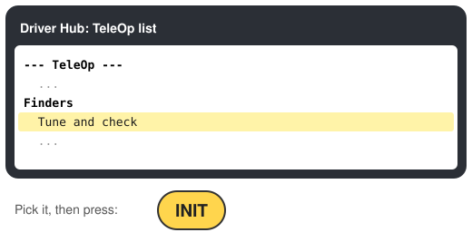
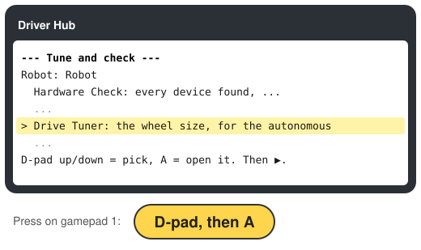
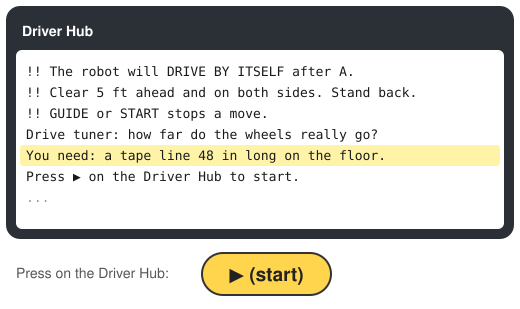
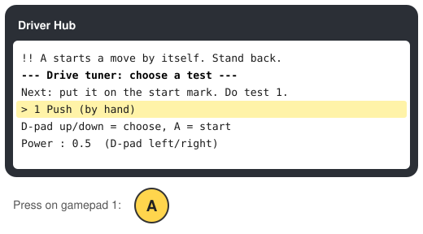
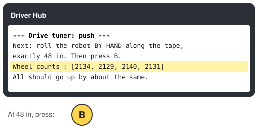
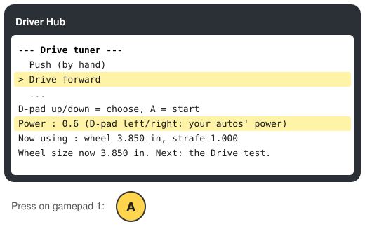
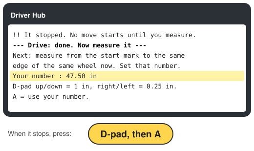
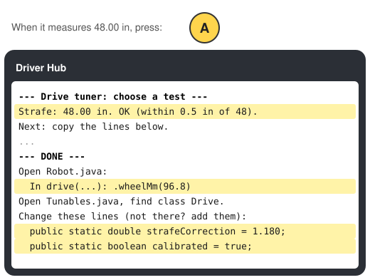

# Drive Tuner: wheel size and strafe correction

Measure the real wheel size and how far a mecanum robot slips sideways, so autonomous moves go the right distance.

**In Tune and check:** yes, when there is a Robot.java.
**You need:** a charged battery, tape, 5 ft of clear floor.

## Get to the Drive Tuner

1. On the Driver Hub, open the TeleOp list and pick **Tune and check** (group "Finders"). Press **INIT**.

   

2. The menu shows. Press **D-pad down** until the arrow (`>`) is on **Drive Tuner**, then press **A**.

   

3. The Drive Tuner's INIT screen shows. Nothing moves yet. Press **▶** (start) on the Driver Hub.

   

The screen now shows the test list, with the arrow on `Push (by hand)`. Go on with the steps below.

## Steps

**Set up the floor:** a straight line of tape, marked **0** and **48 in**. Clear 5 ft of floor ahead
of the robot and to its right (and to its left, for the optional Strafe left test). **Start each test**
with the robot's **left wheels touching the tape** (their outside edge) and the front left wheel's front
edge on **0**. **Why the left wheels:** when you push by hand, a wheel edge against a line is easy to keep
straight. It is also easy to measure from: forward from 0 to that wheel's front edge, and sideways from the
tape to the left wheels.

1. **Start the push test:** with the arrow on `Push (by hand)`, press A. The wheels are now free to roll.

   

2. **Push and stop:** roll the robot by hand, its left wheels along the tape, until the front left
   wheel's front edge is on 48 in. Then press B.
   This gives the wheel size from the encoder counts alone. Every wheel must count up by about the
   same amount. When one does not, fix its direction or encoder cable first.

   

3. **The power:** on the test list, D-pad left/right sets the power for the Drive and Strafe tests
   (`Power : 0.5`; 0.3 to 1.0). Set the power that your autonomous moves use
   (`.move("...", 24, 0, 0.6)`: 0.6). **Why:** a faster robot slides farther when it stops, so the numbers
   fit the power you measured them at. When you change the power, the tests must measure right again. For
   moves of very different lengths, see `Tunables.Drive.slowDownIn`
   ([tunables](../reference/parts/drive.md#in-tunablesjava)).
4. **Start the drive test:** put the arrow on `Drive forward` and press A. The robot drives 48 in. While
   it drives, the screen keeps showing the heading and the wheel counts.

   

5. **Measure the drive:** when the robot stops, measure how far it went. Set the real distance with the
   D-pad, and press A. The tuner uses the new wheel size at once. Run the test again until it measures 48.
   Wheels slip a little on tiles, so this test has the final word. The tuner does not measure a move that
   got stuck.

   

6. **Strafe test** (mecanum): put the robot back at the start, and press A. It strafes right, away from the
   tape. Measure from the tape to the left wheels, straight across. The steps are the same as in the Drive
   test, for `c.strafeCorrection`. There is no push test sideways. When you push a mecanum robot sideways by
   hand, its wheels' rollers spin, and its encoders count almost nothing. The strafe correction is about
   the slip of a **powered** strafe, so only the robot strafing by itself can measure it.
   **Strafe left:** use it only when moves to the left come up short or long while moves to the right are
   right. Start with the robot's **right** wheels on the tape, and it strafes left. Measure from the tape
   to the right wheels. The steps are the same, for `Tunables.Drive: strafeCorrectionLeft`. When you do not
   write it, the left uses `strafeCorrection` too.

   

7. **Turn 90 left** (a check, with nothing to copy): the robot turns 90 degrees left. Put a square against
   the robot to see it. The screen shows the IMU's heading, and it should say 90.
8. Copy the lines, then switch autonomous on:
   - five files: `Robot.java: .wheelMm(96.8)` goes in the drive line, after `.wheel(...)` if you used
     a catalog wheel (the last one wins). `Tunables.Drive: strafeCorrection = 1.180` goes in `Tunables.Drive`. Once the
     Drive test (and on a mecanum the Strafe test) measures 48 within 0.5 in, the tuner also shows
     `Tunables.Drive: calibrated = true`: copy that too.
   - older helpers: the `c.` lines go in `RobotSettings.auto()`, then `c.calibrationConfirmed = true`.

## Fix a mistake

- **Typed a wrong distance:** run the same test again. Each run corrects the number in use now, so the
  next good run fixes a bad one.
- **Stop a test that drives:** press **GUIDE** (or hold **START**). The robot stops, and that run is not
  used.

**Start over:** press STOP, then INIT, and open the tool again. It starts empty: nothing carries over. The lines saved at STOP stay in the results file, the newest at the end.

## Put the numbers in your code

The robot uses `Tunables.java` and `Robot.java`, not the finder's screen. Take a photo of the screen,
and type each line into the file. Or copy it from the [results file](01-tune-and-check.md#get-the-results-file-on-the-laptop):

| The finder shows | Put it in |
| --- | --- |
| `Robot.java: .wheelMm(96.8)` | the drive line in `Robot.java`, after `.wheel(...)` (the last one wins) |
| `Tunables.Drive: strafeCorrection = 1.180` | `Tunables.Drive` (and `strafeCorrectionLeft`, if you ran Strafe left) |
| `Tunables.Drive: calibrated = true` | `Tunables.Drive`. Autonomous moves run only with it |

## Done when

the Drive test (and on a mecanum the Strafe test) measures 48 within 0.5 in, and you copied `calibrated = true`.

---

**Next:** [Odometry Tuner: directions, offsets and a loop check](09-odometry-tuner.md).

**Look it up:** [Drive: In Tunables.java](../reference/parts/drive.md#in-tunablesjava).
