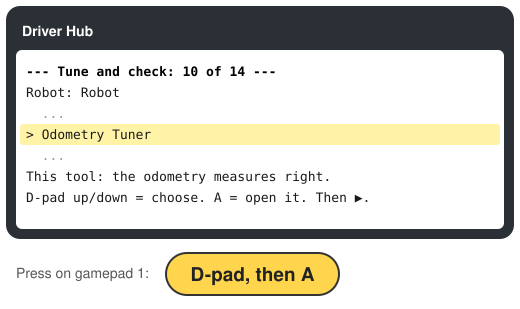
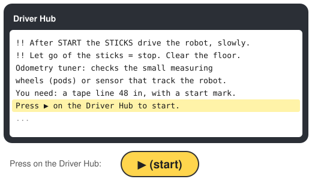
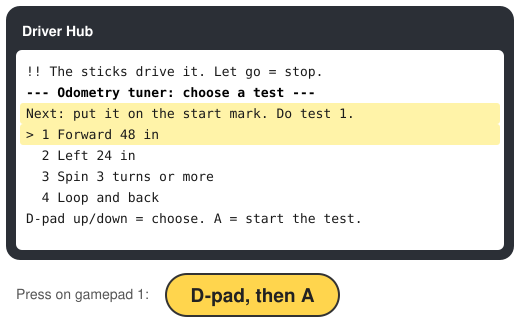
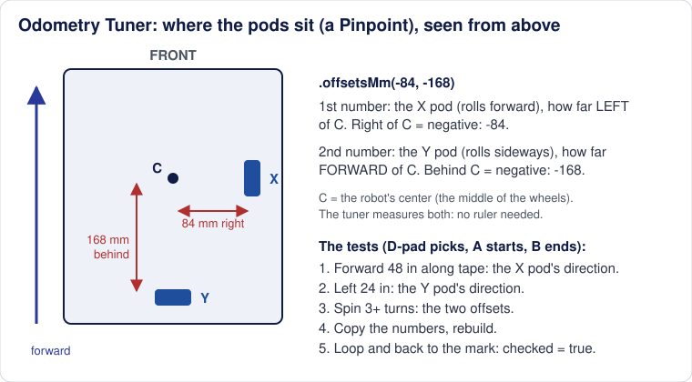
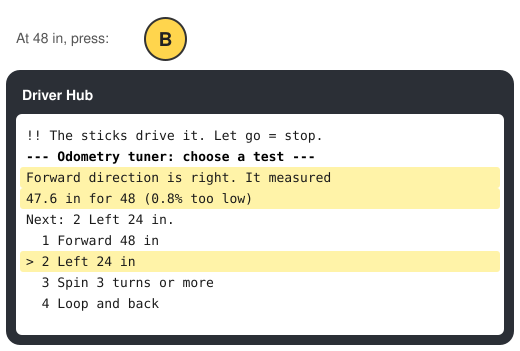
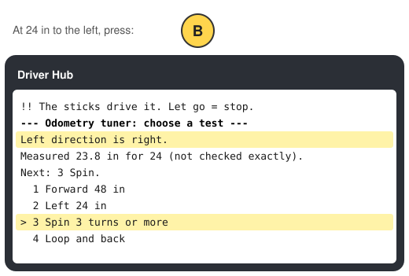
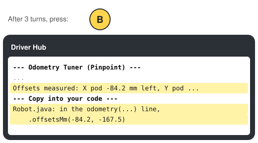
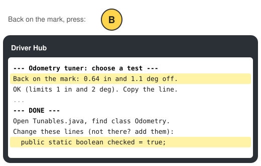

# Odometry Tuner: directions, offsets and a loop check

Check which way each odometry pod counts, measure where the pods sit, and prove the pose comes back to its start.

**In Tune and check:** yes, when Robot.java has an `odometry(...)` line.
**You need:** a 48 in tape strip with a start mark, room to spin.

## Get to the Odometry Tuner

1. On the Driver Hub, open the TeleOp list and pick **Tune and check** (group "Finders"). Press **INIT**.

   

2. The menu shows. Press **D-pad down** until the arrow (`>`) is on **Odometry Tuner**, then press **A**.

   

3. The Odometry Tuner's INIT screen shows. Press **▶** (start) on the Driver Hub.

   

4. The test list shows. For each test below, press **D-pad up/down** until the arrow is on the test, then
   press **A** to start it.

   

## Steps

The Odometry Tuner is for a robot in five files with an `odometry(...)` line ([odometry](../modules/odometry.md)).
It needs your robot, in a small file next to `Robot.java` (the odometry robot's
[OdometryTuner.java](../../examples/src/main/java/com/crossbotics/ftchelper/examples/odometrybot/OdometryTuner.java);
the whole file to type: [the odometry module](../modules/odometry.md#the-odometry-tuner)). Put a 48 in
strip of tape on the floor, with a mark at its start. The sticks drive slowly (30%), in a test and between tests.
At ▶, after help and at the end of each test, let go of the sticks first: until then they do not drive. You
can also push the robot by hand. The D-pad chooses, **A** starts, and **B** ends the test.

1. **Forward 48 in:** drive or push the robot 48 in straight forward along the tape, and press B. The
   screen says "Forward direction is right" (and how many % off), or "counted BACKWARD". For BACKWARD, the
   screen names the pod and says to add it to `.reversed(...)` or to take it out.
   The simulator's Pinpoint works the same way.
   `odometry.reversed = x` in the robot file is a pod wired backward. The code's `.reversed(...)` (and
   `.offsetsMm(...)`) is what the library tells the Pinpoint. So a robot file that differs from Robot.java
   shows the same mistakes as a real robot. An OTOS gets a `linearScalar` line to copy: the final
   number, already multiplied with the one in Tunables.java.
   More than 2% off: check the pod type (Pinpoint) or `ticksPerMm(...)` (dead wheels), and the tape.
   More than 10% off: the screen asks if it was 48 in. Measure and run it again. When it stays that far off,
   check the pod settings in Robot.java.

   

2. **Left 24 in:** drive or push the robot 24 in to its LEFT, and press B. The screen says "Left direction is right", or
   "counted RIGHT" and the fix for `.reversed(...)`. This test checks the direction, not the exact distance.
   Push a tank robot by hand.

   

3. **Spin 3 turns or more:** turn the robot in place at least 3 times with the right stick, and press B. With
   fewer turns, the screen says how many and asks for more. The tuner measures the turn from the
   Pinpoint's own heading. For dead wheels and the OTOS, it uses the Control Hub's IMU, so they need
   `.imu(...)` in `drive(...)`. Without it, the tuner stops at INIT and says so. The tuner shows the
   offsets under `Open Robot.java:` as `.offsetsMm(-84.2, -167.5)`
   (three wheels: `.trackWidthIn(..).perpForwardIn(..)`; two: `.parallelLeftIn(..).perpForwardIn(..)`).
   Change only those numbers: `.reversed(...)` and the pod type stay as you wrote them.
   With `.podsFromEdgesMm(...)` in the line, write the measured `.offsetsMm(...)` in its place.
   The tuner cannot measure where an OTOS sits. Measure it from the robot's edges with a tape
   (`.robotSizeMm(...).mountFromEdgesMm(...)`), and its turn scale
   [by hand](../modules/odometry.md#otos-turn-scale-by-hand).

   

4. Copy the numbers into your odometry line, and rebuild.
5. **Loop and back:** start on the mark and drive anywhere, at least 24 in away. A robot that never left
   the mark proves nothing, and the tuner says so. Come back onto the mark, facing the same way, and press
   B. Within 1 in and 2 degrees, the screen says DONE and shows `public static boolean checked = true;` for
   class Odometry. A Loop that ran before you installed new numbers does not count: the tuner says so.
   A failed test takes the line away. Until the line is in `Tunables.java`, the robot skips autonomous
   `driveTo` steps.

   

## Fix a mistake

- **A bad test** (the robot slipped, or you pressed B at the wrong place): choose the same test and run it
  again (**A**, then **B**). The old result goes when the test starts. A test that fails leaves no line to copy.
- The Forward test does not use a result that is more than 10% off. The screen says so: run it again.

**Start over:** press STOP, then INIT, and open the tool again. It starts empty: nothing carries over. The lines saved at STOP stay in the results file, the newest at the end.

## Put the numbers in your code

The robot uses `Tunables.java` and `Robot.java`, not the finder's screen. Take a photo of the screen,
and type each line into the file. Or copy it from the [results file](01-tune-and-check.md#get-the-results-file-on-the-laptop):

| The finder shows | Put it in |
| --- | --- |
| `Open Robot.java:` and `.offsetsMm(-84.2, -167.5)` | the odometry line in `Robot.java`. Change only those numbers |
| `public static double linearScalar = ...;` (OTOS) | `Tunables.Odometry`, as it is |
| `public static boolean checked = true;` | `Tunables.Odometry`. Autonomous `driveTo` steps run only with it |

## Done when

the Loop test shows `checked = true` and it is in `Tunables.java`.

---

**Next:** [Move Tuner: how exactly moves stop and turns end](10-move-tuner.md).

**Look it up:** [Odometry: In Tunables.java](../reference/parts/odometry.md#in-tunablesjava), [Odometry module](../modules/odometry.md).
