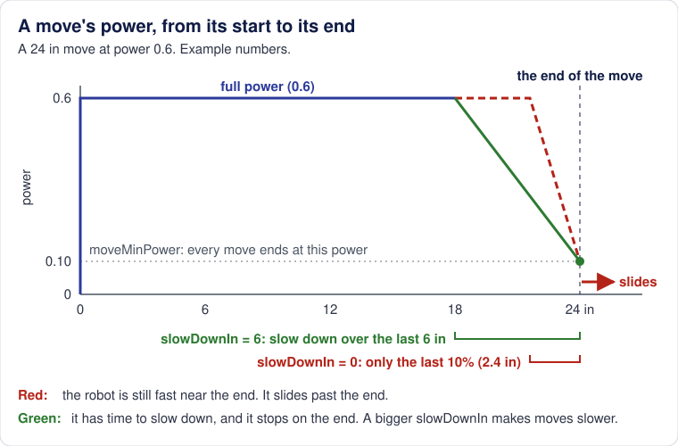

# Move Tuner: how exactly moves stop and turns end

Make autonomous moves stop where they should, and turns end on their heading.

**In Tune and check:** yes, when there is a Robot.java.
**You need:** a charged battery, the Drive Tuner done (`calibrated = true`), clear floor (about 6 ft by 6
ft of tiles; on a game field, see [On a game field](#on-a-game-field)), a tape measure.

The Drive Tuner makes a move the right length. The Move Tuner makes it **stop** in the right place. A
fast robot slides past the end of a move, and a turn can swing past its heading or stop short of it. Each
test drives real autonomous moves, measures them, and changes one number. The tuner uses the new number at
once, so you run the test again until it says PASSED. Each test ends with one of three words:

- **PASSED:** it is right. Go to the next test.
- **RUN AGAIN:** a number changed, or a move did not finish. Run the same test again.
- **CAN'T FIX:** it is wrong, and no number here fixes it. The screen says what to do.

## Get to the Move Tuner

1. On the Driver Hub, open the TeleOp list and pick **Tune and check** (group "Finders"). Press **INIT**.

   

2. The menu shows. Press **D-pad down** until the arrow (`>`) is on **Move Tuner**, then press **A**.

   

3. The Move Tuner's INIT screen shows. Nothing moves yet. After ▶, A makes the robot drive and turn by
   itself: everybody stands back. **GUIDE** or **START** stops any test at once. Press **▶** (start) on the Driver Hub.
   When the screen says `Run the Drive Tuner first`, do that first ([Drive Tuner](08-drive-tuner.md)).

   

4. The test list shows. For each test below, press **D-pad up/down** until the arrow is on the test, then
   press **A** to start it. **D-pad left/right** sets the power of the moves and turns (`Power : 0.5`; 0.3
   to 1.0). Set the power that your autonomous moves use (`.move("...", 24, 0, 0.6)`: 0.6). **Why:** a
   faster robot slides farther, so the numbers fit the power you measured them at.

   

## On a game field

Spare tiles off the field are best: the same floor, with nothing in the way. On a game field, the tests can fit
between the field's parts. Check the whole path before each test: a move can slide past its end, and Creep
leaves the robot a little away from where it started. Each test needs room on some sides only,
and you can put the robot in a new spot before each test:

| Test | Clear floor it needs |
| --- | --- |
| 1 Creep | a few inches ahead, and (mecanum) to the right |
| 2 Stops | 24 in ahead of the robot's front edge, and room for the slide past it |
| 3 Turns | a circle as wide as the robot's diagonal (an 18 in robot: about 26 in), with the robot in its middle |
| 4 Drift | 48 in ahead of the front edge. Mecanum: also 48 in to the right of the right edge |
| 5 Move and turn | 24 in to the left of the left edge and 24 in to the right of the right edge, and room to turn |

**BIOBUZZ:** only the HIVE frame's two feet are on the floor in the middle of the field. The HIVE is higher
than 29 in, so the robot drives under it. Between the frame's feet and each side wall there is a clear
strip, about 50 in wide and as long as the field. In that strip:

- **Creep, Stops, Turns and Drift:** the robot's front points along the strip (along the side wall). On a
  mecanum, Drift's 48 in move to the right does not fit. Drift only gives a report, so do it on spare tiles,
  or skip it.
- **Move and turn:** the robot's front points at the side wall, in the middle of the strip. Then its moves
  to the left and right go along the strip.

Keep the robot away from the FLOWERs on the walls, and from the frame's feet.

## Steps

Run the tests in this order. Each one uses the numbers that the tests before it found.

1. **1 Creep** (finds `moveMinPower`): the robot creeps forward, then (mecanum) to the right, with a little
   more power each step. It stops when the robot rolls. The tuner sets `moveMinPower` to that power x 1.3,
   for a lower battery. **Why:** each move ends at `moveMinPower`. With too much, the robot arrives fast and
   slides. With too little, it stalls before the end.

   

2. **2 Stops** (finds `slowDownIn`): the robot drives 6, 12 and 24 in, each out and back. Then it tries
   again with a bigger `slowDownIn` (0, 3, 6, 9, 12) until every move slides 0.5 in or less past its end.
   The screen shows a line for each try: the worst slide, and how long the 24 in move took. A bigger
   `slowDownIn` stops better, but every move takes longer, so the tuner keeps the smallest one that is good.

   

   - `RUN AGAIN: a move did not finish`: clear the path, or run Creep first. That run leaves no line to copy.
   - `Slowing longer does not help`: every move already ends at `moveMinPower`. Run Creep, then Stops again.

   

3. **3 Turns** (finds the turn numbers): the robot turns 90, 135 and 45 degrees left, and back each time.
   The screen shows a line per turn: how far it went past its target, how far off it stopped, and how long
   it took. Then the tuner changes **one** number:

   | What the turns do | The tuner changes |
   | --- | --- |
   | stop off target (short of it, or past it) and stay there | `turnMinPower` up (0.05, then 0.08, then 0.11), then `turnKp` up |
   | rock in and out, just outside the tolerance | `turnToleranceDeg` + 0.5 (up to 3) |
   | swing past the target, or back and forth | `turnKd` up (more brake), or `turnKp` down (less push) |
   | end on target, but a 90-degree turn takes more than 2 s | `turnKp` up |

   

   **Why `turnMinPower` first:** near the target, the push (`turnKp` x the degrees left) is too weak to move
   the robot at all. More `turnKp` would also make the turn come in faster and swing more. Run Turns again
   until it says `PASSED`.

   

4. **4 Drift** (a report, nothing to copy): the robot drives 48 in forward and back (on a mecanum, also
   right and left). The screen shows how much the heading changed on each move. A plain move does not
   correct its heading. More than 2 degrees: check the weight and the wheels, and use `moveWithTurn` on long
   moves (it holds the heading).

   

5. **5 Move and turn** (mecanum; finds `moveTurnScale` and `moveMaxTurnPower`): the robot drives 24 in
   sideways while it turns 90 degrees (`moveWithTurn`), four times. The screen shows how far the heading was
   still off when the move ended. When the turn lags, the tuner raises `moveTurnScale` (up to 1), then
   `moveMaxTurnPower`. When the heading swings past its target, it lowers `moveTurnScale`. Run it again
   until it says `PASSED`. A move that got stuck cannot pass. When the turn still lags at the most turn power,
   it says `CAN'T FIX` and shows no numbers to copy: use less move power, or turn first and then move.

   

6. **Check with a tape:** without odometry, the tuner measures with the wheel counts. A robot can slide with
   its wheels locked, and the wheel counts do not see that. So check one move with a tape. Use the Drive
   Tuner's tape line ([Set up the floor](08-drive-tuner.md#steps)): the front left wheel's front edge on
   **0**. Run a 24 in forward move in an autonomous, at your autonomous's power. Read where that wheel edge
   stops. Within 0.5 in of 24: done. Else, find what you see in the table:

   | The tape shows | Why | Do this |
   | --- | --- | --- |
   | short or long by the same share on every move (run a 48 in move too: 1 in short on 24 and 2 in short on 48) | the wheel size number is wrong | run the [Drive Tuner](08-drive-tuner.md) again, then the Move Tuner again |
   | past the end, by more than the tuner's screen said | the wheels skid when the move stops, and the wheel counts miss it | in `Tunables.Drive`, make `slowDownIn` 3 bigger. Install, then run the move again |
   | still past the end with `slowDownIn = 12` | the robot is too fast for this floor | use a lower power for the move (0.6 to 0.5), and run the Move Tuner at that power. Clean the tiles and check the wheels |

   **Why `slowDownIn`, and not the tuner:** the tuner cannot see the skid, so it thinks the stops are good.
   A bigger `slowDownIn` makes the robot slower at the end, so it skids less. With an `odometry(...)` line,
   the tuner measures with the odometry, which sees a skid. Then the tuner
   finds this number by itself.

## Fix a mistake

- **A test went wrong** (something was in the way, the robot hit a wall): run the same test again. Each run
  starts from the numbers in use now.
- **Stop a test that drives:** press **GUIDE** or **START**. The robot stops, and that run is not
  used. A Stops test that you stop goes back to the `slowDownIn` it had before.
- **A number got worse:** start over to
  go back to the numbers in `Tunables.java`.

**Start over:** press STOP, then INIT, and open the tool again. It starts from the numbers in `Tunables.java`:
nothing carries over. The lines saved at STOP stay in the results file, the newest at the end.

## Put the numbers in your code

The robot uses `Tunables.java`, not the finder's screen. Take a photo of the screen, and type each line
under `Open Tunables.java, find class Drive.` into that class, when the screen says DONE. Or copy it from the
[results file](01-tune-and-check.md#get-the-results-file-on-the-laptop):

| The finder shows | What it does |
| --- | --- |
| `public static double moveMinPower = 0.10;` | the slowest power at the end of a move |
| `public static double slowDownIn = 3;` | every move slows down over at least its last 3 in |
| `public static double turnMinPower = 0.05;` | the least turn power while the heading is still off |
| `public static double turnKp = ...;`, `turnKd` | how hard a turn pushes, and how hard it brakes near the end |
| `public static double turnToleranceDeg = 1.5;` | a turn is done this close to its heading |
| `public static double moveTurnScale = ...;`, `moveMaxTurnPower` | how hard `moveWithTurn` turns while it moves |

Older helpers (a tuner with `robotConfig()`) get `c.` lines for `RobotSettings.auto()` in their place.

## Done when

Stops, Turns and (on a mecanum) Move and turn say `PASSED`, the lines are in `Tunables.Drive`, and one 24 in move
ends within 0.5 in on the tape.

---

**Next:** [Camera lighting](11-camera-lighting.md).

**Look it up:** [Drive: In Tunables.java](../reference/parts/drive.md#in-tunablesjava), [Move Tuner in the finders reference](../modules/finders.md#movetuneropmode).
