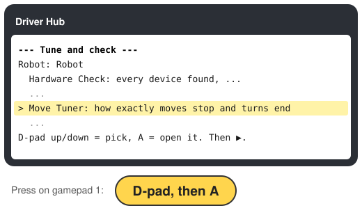
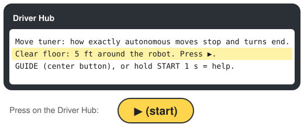
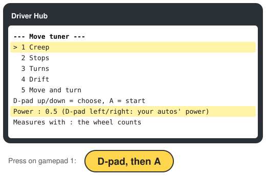
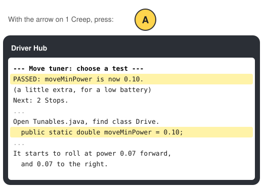
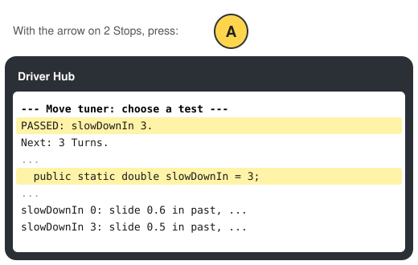
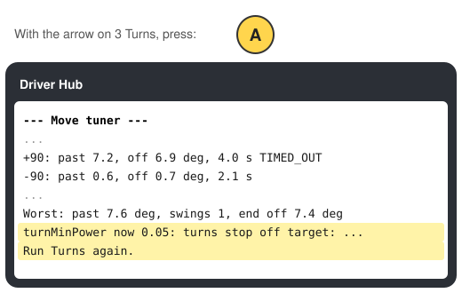
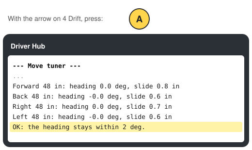
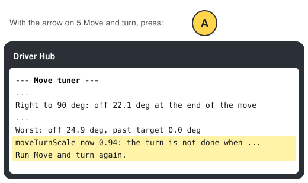

# Move Tuner: how exactly moves stop and turns end

Make autonomous moves stop where they should, and turns end on their heading.

**In Tune and check:** yes, when there is a Robot.java.
**You need:** a charged battery, the Drive Tuner done (`calibrated = true`), 5 ft of clear floor around
the robot, a tape measure.

The Drive Tuner makes a move the right length. The Move Tuner makes it **stop** in the right place. A
fast robot slides past the end of a move, and a turn can swing past its heading or stop short of it. Each
test drives real autonomous moves, measures them, and changes one number. The tuner uses the new number at
once, so you run the test again until it says OK. Every test ends about where it began.

## Get to the Move Tuner

1. On the Driver Hub, open the TeleOp list and pick **Tune and check** (group "Finders"). Press **INIT**.

   

2. The menu shows. Press **D-pad down** until the arrow (`>`) is on **Move Tuner**, then press **A**.

   

3. The Move Tuner's INIT screen shows. Nothing moves yet. Press **▶** (start) on the Driver Hub.
   When the screen says `Run the Drive Tuner first`, do that first ([Drive Tuner](08-drive-tuner.md)).

   

4. The test list shows. For each test below, press **D-pad up/down** until the arrow is on the test, then
   press **A** to start it. **D-pad left/right** sets the power of the moves and turns (`Power : 0.5`; 0.3
   to 1.0). Set the power that your autonomous moves use (`.move("...", 24, 0, 0.6)`: 0.6). **Why:** a
   faster robot slides farther, so the numbers fit the power you measured them at.

   

## Steps

Run the tests in this order. Each one uses the numbers that the tests before it found.

1. **1 Creep** (finds `moveMinPower`): the robot creeps forward, then (mecanum) to the right, with a little
   more power each step. It stops when the robot rolls. The tuner sets `moveMinPower` to that power x 1.3,
   for a lower battery. **Why:** each move ends at `moveMinPower`. With too much, the robot arrives fast and
   slides. With too little, it stalls before the end.

   

2. **2 Stops** (finds `slowDownIn`): the robot drives 6, 12 and 24 in, each out and back. Then it tries
   again with a bigger `slowDownIn` (0, 3, 6, 9, 12) until every move slides 0.5 in or less past its end.
   The screen shows a line for each try: the worst slide, and how long the 24 in move took. A bigger
   `slowDownIn` stops better, but every move takes longer, so the tuner keeps the smallest one that is good.
   - `STUCK`: a move stalled before its end. Run Creep first, or clear the path.
   - `slowDownIn does not help`: every move already ends at `moveMinPower`. Run Creep, then Stops again.

   

3. **3 Turns** (finds the turn numbers): the robot turns 90, 135 and 45 degrees left, and back each time.
   The screen shows a line per turn: how far it went past its target, how far off it stopped, and how long
   it took. Then the tuner changes **one** number:

   | What the turns do | The tuner changes |
   | --- | --- |
   | stop off target (short of it, or past it) and stay there | `turnMinPower` up (0.05, then 0.08, then 0.11), then `turnKp` up |
   | rock in and out, just outside the tolerance | `turnToleranceDeg` + 0.5 (up to 3) |
   | swing past the target, or back and forth | `turnKd` up (more brake), or `turnKp` down (less push) |
   | end on target, but a 90-degree turn takes more than 2 s | `turnKp` up |

   **Why `turnMinPower` first:** near the target, the push (`turnKp` x the degrees left) is too weak to move
   the robot at all. More `turnKp` would also make the turn come in faster and swing more. Run Turns again
   until it says `OK`.

   

4. **4 Drift** (a report, nothing to copy): the robot drives 48 in forward and back (on a mecanum, also
   right and left). The screen shows how much the heading changed on each move. A plain move does not
   correct its heading. More than 2 degrees: check the weight and the wheels, and use `moveWithTurn` on long
   moves (it holds the heading).

   

5. **5 Move and turn** (mecanum; finds `moveTurnScale` and `moveMaxTurnPower`): the robot drives 24 in
   sideways while it turns 90 degrees (`moveWithTurn`), four times. The screen shows how far the heading was
   still off when the move ended. When the turn lags, the tuner raises `moveTurnScale` (up to 1), then
   `moveMaxTurnPower`. When the heading swings past its target, it lowers `moveTurnScale`. Run it again
   until it says `OK`.

   

6. **Check with a tape:** without odometry, the tuner measures with the wheel counts. A robot can slide with
   its wheels locked, and the wheel counts do not see that. Run one 24 in move in an autonomous and measure
   where it ends. With an `odometry(...)` line, the tuner measures with the odometry, which sees a skid
   (`Measures with : the odometry`).

## Fix a mistake

- **A test went wrong** (something was in the way, the robot hit a wall): run the same test again. Each run
  starts from the numbers in use now.
- **Stop a test that drives:** press **GUIDE** (or hold **START**). The robot stops, and that run is not
  used. A Stops test that you stop goes back to the `slowDownIn` it had before.
- **A number got worse:** the screen's `Now using` and `Turns` lines show the numbers in use. Start over to
  go back to the numbers in `Tunables.java`.

**Start over:** press STOP, then INIT, and open the tool again. It starts from the numbers in `Tunables.java`:
nothing carries over. The lines saved at STOP stay in the results file, the newest at the end.

## Put the numbers in your code

The robot uses `Tunables.java`, not the finder's screen. Take a photo of the screen, and type each line
that starts with `Tunables.Drive:` into `Tunables.Drive`. Or copy it from the
[results file](01-tune-and-check.md#get-the-results-file-on-the-laptop):

| The finder shows | What it does |
| --- | --- |
| `Tunables.Drive: moveMinPower = 0.10` | the slowest power at the end of a move |
| `Tunables.Drive: slowDownIn = 3` | every move slows down over at least its last 3 in |
| `Tunables.Drive: turnMinPower = 0.05` | the least turn power while the heading is still off |
| `Tunables.Drive: turnKp = ...`, `turnKd = ...` | how hard a turn pushes, and how hard it brakes near the end |
| `Tunables.Drive: turnToleranceDeg = 1.5` | a turn is done this close to its heading |
| `Tunables.Drive: moveTurnScale = ...`, `moveMaxTurnPower = ...` | how hard `moveWithTurn` turns while it moves |

Older helpers: the `c.` lines go in `RobotSettings.auto()`.

## Done when

Stops, Turns and (on a mecanum) Move and turn say `OK`, the lines are in `Tunables.Drive`, and one 24 in move
ends within 0.5 in on the tape.

---

**Next:** [Camera lighting](11-camera-lighting.md).

**Look it up:** [Drive: In Tunables.java](../reference/parts/drive.md#in-tunablesjava), [Move Tuner in the finders reference](../modules/finders.md#movetuneropmode).
