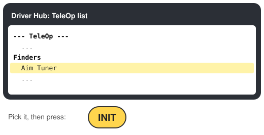
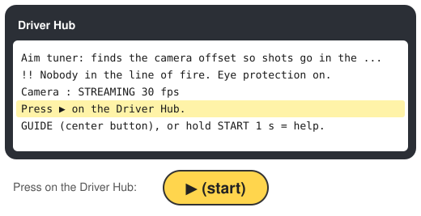
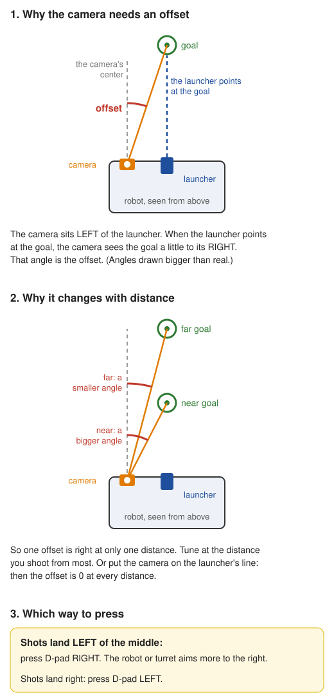
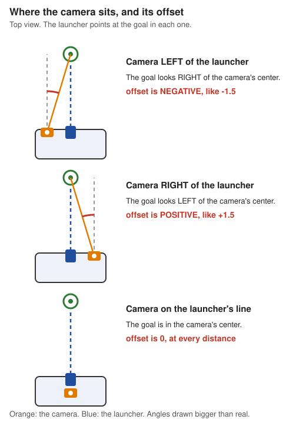
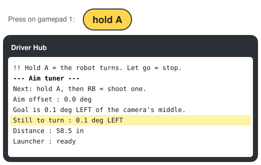
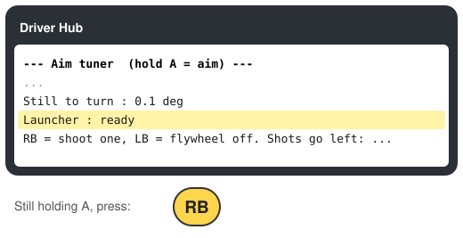
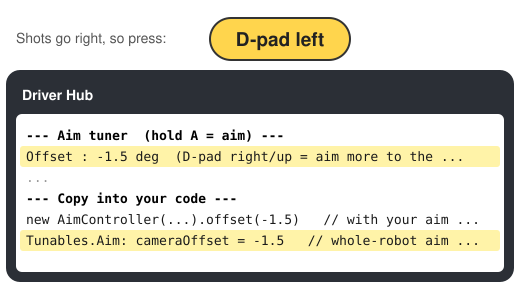

# Aim Tuner: camera offset

Make the turret or the robot aim at the middle of the goal, when the camera sits off to one side.

**In Tune and check:** no. It has its own file: it needs your camera.
**You need:** its own file, safety glasses, pieces, the target 4-6 ft away, and the
[camera lighting](11-camera-lighting.md) set up.

## Get to the Aim Tuner

1. On the Driver Hub, open the TeleOp list and pick your Aim Tuner file (group "Finders"). Its name is the
   one in its `@TeleOp(name = ...)` line, like **Aim Tuner**. Press **INIT**.

   

2. The Aim Tuner's INIT screen shows, with the camera's status. Press **▶** (start) on the Driver Hub.

   

## What the offset is

The camera finds the goal, and the turret or the robot turns until the goal is in the camera's center. But
the camera is not on the launcher. So when the goal is in the camera's center, the launcher points a
little to the side. The **offset** is the angle that fixes this: the robot aims until the goal sits that
far from the camera's center.

The sign of the offset depends on where the camera sits:

The Aim Tuner finds this angle by test shots. It does not change how fast or how smoothly the robot turns.
For the whole robot, `turnKp` and `turnKd` in `Tunables.Aim` set that ([Fix it by what you see](17-fix-by-symptom.md)).

## See what the camera sees

Before you tune, check the camera's picture. The goal's tag must be in the picture, sharp, and not too
dark or too bright.

- **A webcam:** the Driver Hub can show its picture.
  1. Use the PRACTICE profile ([profiles](../guides/profiles.md)). In COMPETITION the live view is off,
     because it slows the robot.
  2. Press INIT. Do not press ▶ yet.
  3. On the Driver Hub, open the menu (the three dots, top right) and choose **Camera Stream**. Tap the
     picture to get a new one.
  4. Close it, then press ▶.

  A webcam in Robot.java does this by itself. In an Aim Tuner file of your own with the older helpers, add
  `.liveView(true)` to the webcam.
- **A Limelight:** it sends no picture to the Driver Hub. Leave it where it is on the robot, and plug its
  USB-C cable into a laptop instead of the Control Hub. Open http://limelight.local:5801: the page shows
  the live picture, with the tags it finds marked. Plug it back into the Control Hub after.
  ([Limelight lighting](../guides/limelight-lighting.md) has more.)
- **No picture? Use the numbers.** While the tuner runs, the screen shows `Goal is ... deg LEFT` (or RIGHT)
  `of the camera's middle.` when the camera sees the goal, and `Next: point the camera at the goal's tag.`
  when it does not. Turn the robot a little to the left: the goal must move to the right.

## Steps

**Before you start:** the Aim Tuner is set up with pieces. It needs your
`createCamera()`, and `createTurret()` or `robotConfig()` (to aim by turning the robot), and
`createLauncher()` for test shots ([reference](../modules/finders.md#aimtuneropmode)). For a robot in five
files, also give `robot()` (`return new Robot();`): then the tuner starts at the `cameraOffset` in
Tunables.java, uses that robot's drive, and shows the line for Tunables.java. Without `robot()`, it starts
at the offset set on your turret or aim controller. The Characterizer needs `robotConfig()`
(`return new Robot().robotConfig();`).

The first screen says what it starts from, for example `Starts from : -10.0 deg (Tunables.java)`. Check
that this is your code's number.

1. Park the robot 4-6 ft from the target, facing it. For a turret with a home switch, press **X** first: the turret
   turns to find its start. **B** stops it.
2. Hold **A**. The robot (or the turret) turns by itself to the goal. Let go, and it stops. With a turret,
   the sticks drive also while it aims: keep the sticks still.

   

3. Still holding **A**, shoot (**RB**). LB stops the flywheel.

   

4. When shots go LEFT of the middle, press D-pad RIGHT (aim more to the right). When shots go right, press
   LEFT.

   

5. Repeat until shots go in the middle, at two or three distances. Copy the offset line
   (five files: `public static double cameraOffset = -1.5;`, in class Turret with a turret, in class Aim
   when the whole robot aims).
   When the offset that works changes with distance, the camera is off to the side of the launcher.
   Move the camera onto the launcher's line (or as close as you can), or tune at the distance you shoot
   from most.

## Fix a mistake

- **Pressed the D-pad the wrong way:** press it the other way. Each press changes the offset by 0.5 degrees
  (left and right) or 2 degrees (up and down), so the opposite press undoes it.

**Start over:** press STOP, then INIT, and open the tool again. It starts from the offset in
your installed code: nothing else carries over. The lines saved at STOP stay in the results file, the newest at the end.

## Put the numbers in your code

The robot uses `Tunables.java` and `Robot.java`, not the finder's screen. Take a photo of the screen,
and type each line into the file. Or copy it from the [results file](01-tune-and-check.md#get-the-results-file-on-the-laptop):

| The finder shows | Put it in |
| --- | --- |
| `Open Tunables.java, find class Turret.` and `public static double cameraOffset = -1.5;` (a turret) | `Tunables.Turret` |
| `Open Tunables.java, find class Aim.` and the same line (the whole robot aims) | `Tunables.Aim` |

## Done when

shots go in the middle at two or three distances, and you copied the `cameraOffset` line.

---

**Next:** [Shot Tuner: the shot table](13-shot-tuner.md).

**Look it up:** [Aim](../reference/parts/aim.md), [AimTunerOpMode](../modules/finders.md#aimtuneropmode).
