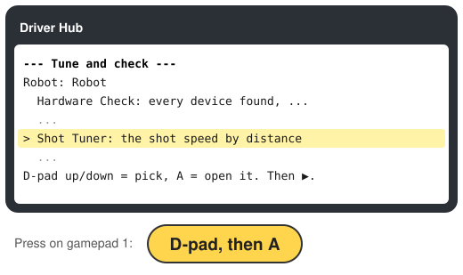
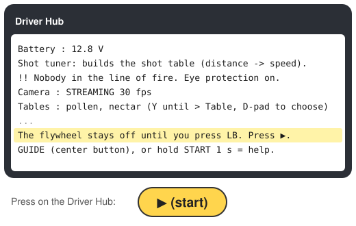
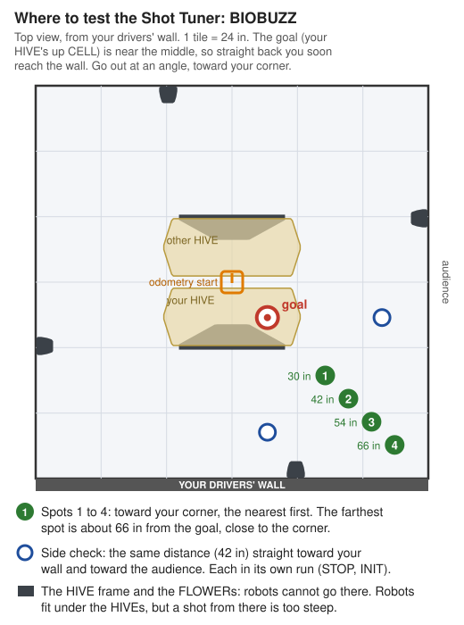
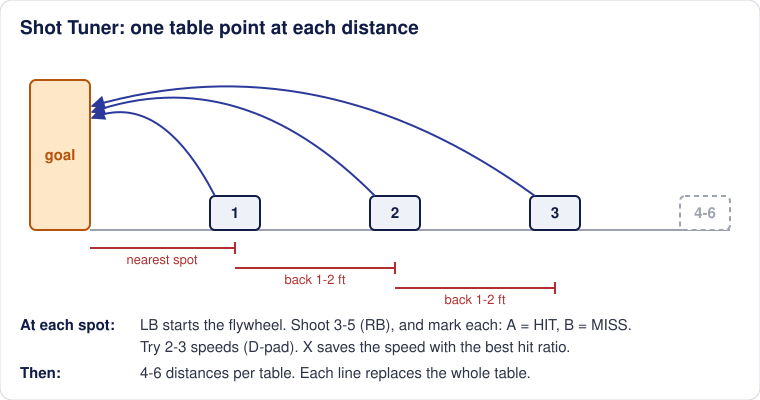
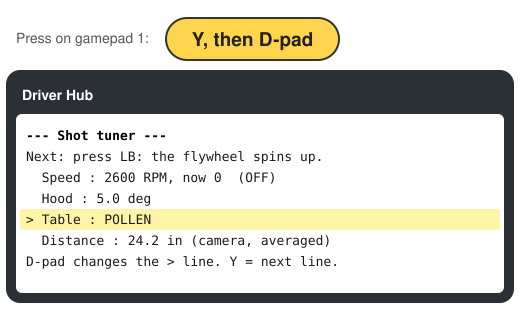
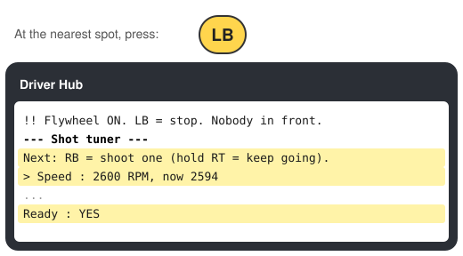
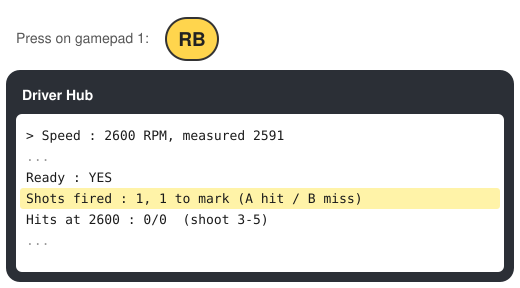
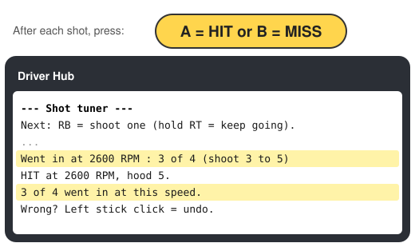
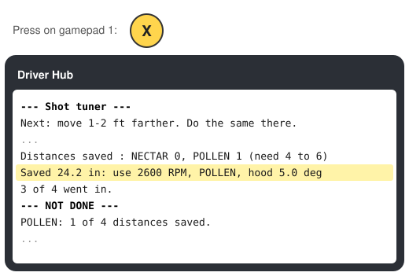

# Shot Tuner: the shot table

Find the flywheel speed (and hood angle) that hits the goal at each distance.

**In Tune and check:** yes, when the robot has a launcher.
**You need:** a charged battery, safety glasses, pieces, the aim tuned.

## Get to the Shot Tuner

1. On the Driver Hub, open the TeleOp list and pick **Tune and check** (group "Finders"). Press **INIT**.

   

2. The menu shows. Press **D-pad down** until the arrow (`>`) is on **Shot Tuner**, then press **A**.

   

3. The Shot Tuner's INIT screen shows. The flywheel stays off. Press **▶** (start) on the Driver Hub.

   

## One table or two

A **shot table** is a list of rows: at this distance, this flywheel speed. A bigger or heavier piece needs
a different speed. In BIOBUZZ, POLLEN (2.8 in, 25 g) and NECTAR (3.6 in, 41 g) fly differently. So a robot
that shoots both needs a table for each.

| Your robot shoots | The tables in `Tunables.Launcher` | In a match, the table comes from |
| --- | --- | --- |
| one kind only (only POLLEN, or only NECTAR) | one: `speedByDistance` | nothing to choose |
| both kinds | two: `speedByDistancePollen` and `speedByDistanceNectar` | a piece sensor, or a driver's button (below) |

### One kind only

Use the plain `speedByDistance` table. When Robot.java takes the speed from the distance
(`.speedFromDistance(...)`), INIT stops without a table, so write one guess row first:

**Where:** `Tunables.java`, inside `Tunables.Launcher`.

```java title="Tunables.java"
public static double[][] speedByDistance = {{36, 3000}};   // a guess: the Shot Tuner replaces it
```

Load only that kind of piece, and tune. The screen shows no `Table` line.

### Both kinds

1. **Before you tune, write both tables, with one row each.** The tuner shows only the tables that have a
   row. A guess is fine: the tuner replaces the rows.

   **Where:** `Tunables.java`, inside `Tunables.Launcher`.

   ```java title="Tunables.java"
   public static double[][] speedByDistancePollen = {{36, 3000}};   // a guess: the Shot Tuner replaces it
   public static double[][] speedByDistanceNectar = {{36, 3200}};   // a guess: the Shot Tuner replaces it
   ```

2. **Tune one table at a time, with only that piece loaded.** Pick POLLEN (step 1 below), load only POLLEN,
   and do every spot. Then pick NECTAR, load only NECTAR, and do every spot again. A NECTAR shot marked in
   the POLLEN table makes both tables wrong.
3. **Check the `Table` line before you press X.** X saves the point in the table that the screen shows.
   `Points: POLLEN 4, NECTAR 0` says how many points each table has.
4. **Copy one line for each table** (step 7 below).
5. **Tell the launcher which piece it holds, in a match.** In `Robot.java`, on the launcher's line:
   - **A piece sensor (best):** `.tableFrom(pieces.nextKind())` picks the table for the next piece, by
     itself. Both NECTAR colors use one table: add `.tableFor("nectar", "RED_NECTAR", "BLUE_NECTAR")`
     ([Pieces](../reference/parts/pieces.md); find the sensor's colors with the
     [Piece Tuner](13-piece-tuner.md)). A robot that holds both kinds at once needs this.
   - **No sensor:** a driver's button picks the next table:
     `robot.launcher.tableOn(g2.dpadRight);` in `Controls.java`. The Driver Station shows
     `Shot table: POLLEN, 48 in (camera)`, so the driver sees which one is in use.
   - At the start, the launcher uses `.startTable("pollen")`, or NECTAR when you write none.

## Where the distance comes from

The table holds a speed for each **distance** to the goal. The tuner gets the distance in one of three
ways. The screen says which one, after the distance: `Distance : 36.2 in (camera, 12 readings)`.

| Way | When | You can tune from |
| --- | --- | --- |
| **camera** | the camera sees the goal | spots where the camera sees the goal |
| **odometry** | the camera does not see the goal, and the robot has odometry and a goal point | **any spot on the field**, even with no camera |
| **by hand** | neither | spots you measure with a tape |

When the camera sees the goal, it wins. The tuner uses the average of the last half second of readings,
so one bad picture does not go into the table.

### Tune from any spot with odometry

With odometry, the robot knows where it is on the field. It also knows where the goal is, from
`Tunables.Aim`. So it can work out the distance from any spot: in front of the goal, from the side, or
from far away. Tune from the spots where your drivers really shoot.

**BIOBUZZ:** the goal is your HIVE's up CELL, near the middle of the field. Straight back from it, you
reach the wall after about 4 ft, and the HIVE frame is in the way on one side. So do not test in one
line: go out toward your corner. The farthest spot is about 66 in from the goal.



**Before you start:**

1. **The odometry works.** Robot.java has an `odometry(...)` line, and the
   [Odometry Tuner](09-odometry-tuner.md) is done (`Tunables.Odometry: checked = true`).
2. **The goal point is in `Tunables.Aim`:** `goalX` and `goalY`, in inches, for the BLUE goal, seen from
   your drivers' wall (x to the right of the center line, y from the center toward the far wall). Take
   them from the season's field map ([Aim](../reference/parts/aim.md)). The tuner mirrors the goal for RED
   when the last OpMode you ran chose RED.

**Each time you start the tuner:**

1. Put the robot in the **middle of the field**, facing away from your drivers' wall. This is where the
   odometry starts counting. (In a Shot Tuner file of your own, `startSpotIn()` can give another start
   spot.)
2. INIT, then **▶**.
3. Check that the screen says `(odometry, ...)` after the distance. Drive straight away from the goal by
   one field tile (24 in): the distance must grow by about 24 in.
4. Drive with the sticks to your first spot, and tune there (the steps below). Then drive to the next
   spot. The distance follows the robot.

The screen also shows a `bearing`: how far the goal is to the side. Turn the robot with the sticks until
the bearing is near 0, so that the robot points at the goal before you shoot.

**When the camera also sees the goal,** the screen shows both: `Distance` (from the camera) and
`Odometry says` (from the odometry). They should be within a few inches. When they are far apart, the goal
point in `Tunables.Aim` is wrong, or the robot did not start in the middle of the field facing away from
you. Fix it before you tune: one table must fit both.

**Odometry drifts a little over time,** most after bumps. When the distance looks wrong, press STOP: it
saves the points so far in the results file (step 7). Put the robot back in the middle of the field, and
INIT again. The new run starts with no points, and its table line has only the new ones. So put the lines
of both runs together by hand in `Tunables.java`: one `{distance, speed}` pair per point, nearest first.

## Steps



The Shot Tuner works the way experienced teams tune. At each distance, shoot 3-5 pieces at a speed, and
mark each one **HIT** or **MISS**. Try the next speed. Keep the speed with the best **hit ratio** (hits out
of shots: 3 in out of 4 beats 2 out of 3). Every button is on **gamepad 1**.

1. **Pick the table** (only with two tables: [One table or two](#one-table-or-two)). Press **Y** until
   `> Table`. Then **D-pad left / right** picks the table. Load only that kind of piece.

   

2. Park at the nearest distance you will shoot from. The screen shows the distance and where it came
   from ([Where the distance comes from](#where-the-distance-comes-from)). Press **LB** to start the
   flywheel (it is off at the start).

   

3. The speed starts at what your table already gives at this distance (or `Tunables.Launcher.speedRpm`),
   so you only fine-tune. Shoot 3-5 (**RB** one at a time, or hold **RT**).

   

4. After each shot, press **A** = HIT or **B** = MISS. The marks go to the shots in the order they were
   fired. Each shot keeps the speed, hood angle and distance it was **fired** with. So when you change the speed or the hood before
   you mark, the mark does not move. The screen shows `Hits at 2600: 3/4` and every speed tried here
   (`Tried here: 2500: 1/3, 2600: 3/4 (best)`). Change the speed with the D-pad, and shoot 3-5 again.
   **Y** steps through what the D-pad changes: SPEED, HOOD with a hood, TABLE with two tables, and
   DISTANCE. DISTANCE is a distance you type in when neither the camera nor the odometry gives one. 2-3
   speeds are usually enough.
   - **When you pressed the wrong one,** a **left stick click** takes back the last HIT / MISS. That shot
     waits to be marked again.
   - **A "shot" with no piece:** the wheel slowed down by itself, so `Shots fired` went up. A
     **right stick click** drops the last shot that is not marked yet.

   

5. Press **X** to save. The tuner keeps the speed with the **best hit ratio** at this distance. In a tie,
   it keeps the one with more shots. You must mark all shots before you save. With no shots marked at all,
   X only warns. X again within 3 s saves the speed now anyway: a guess, not a tested speed. With a hood,
   it also saves the hood angle that those shots were fired with. Each point also keeps the flywheel speed
   **measured** as the pieces were fed. When the flywheel was well under the speed asked for, it
   **sagged**: the last shot or a low battery slowed it, and it was not back yet. Then the screen warns.
   Wait for `Ready: YES` between shots and charge the battery, or the table will not match a match. To
   delete a wrong point, stand there and **hold BACK 1 s**. It is a hold, so that nobody presses it by
   mistake.

   

6. Move 1-2 ft further from the goal (drive with the sticks) and do it again. The spots do not need to be
   in a line: when the wall or a field part is in the way, go out at another angle
   ([BIOBUZZ](#tune-from-any-spot-with-odometry)). When the distance moves more than 4 in, the
   hit counts start again by themselves, and the tuner drops the unmarked shots fired at the old spot.
   `Points: POLLEN 3, NECTAR 0  (4-6 per table)` says how far you are: 4-6 points per table cover the
   field. Then go to the next table (step 1).
7. **Copy the tables into `Tunables.java`**: the robot uses the file, not the tuner's screen. There is
   one line per table, like `public static double[][] speedByDistancePollen = {{24, 2600}, {48, 3100}};   // in Tunables.Launcher`
   (with a hood: `{{24, 2600, 4}, {48, 3100, 12.5}}`, where the third number is the hood).
   It replaces the line with the same name in `Tunables.Launcher`. When you press STOP, the tuner also
   saves the lines on the Control Hub (`/sdcard/FIRST/ftc-helper/finder-results.txt`). Older helpers: the
   `new ShotTable()` lines go into your Robot class (each with a comment like `// 4/5 in, measured 2531 RPM`).
   Between the points, the launcher **blends** the speed: halfway between two points, it uses the speed
   halfway between theirs. Outside them, it uses the nearest point.

With `robot()`, the Shot Tuner uses your robot's launcher, camera and drive. A turret stays still, and the
"fire only when aimed" checks are off: point the robot at the goal with the sticks. **With a hood**
(`.hood(...)` in Robot.java, or the older helpers' `.hood(servo)`), **Y** also chooses HOOD. The D-pad then
steps the hood by a fifth / a fiftieth of its range: 5 / 0.5 deg for a 0-25 deg hood. The hood starts at
the table's hood for this distance, like the speed. Each speed and hood angle is its own try in the hit
counts (`Tried here: 2550 @ hood 10: 3/4 (best), 2550 @ hood 12.5: 1/3`). X saves the hood that the
winning shots were fired with.

A weak battery changes how far the shots go, so charge the battery before you tune speeds. The screen
shows the battery and warns below 12.5 V. The tuner does not use the launcher's speed trim (the D-pad in a
match), so the table holds the real speeds.

## Fix a mistake

- **Marked HIT when it was a MISS (or the other way):** click the **left stick**. It undoes the last mark,
  and that shot waits to be marked again.
- **A shot counted that did not happen:** click the **right stick**. It drops the newest shot that is not
  marked yet.
- **Saved a wrong speed at this spot (X):** find the right speed, and press **X** again at the same spot.
  The new point replaces the old one.
- **Delete the point at this spot:** hold **BACK** for 1 second.
- **Saved a point in the wrong table:** pick that table (**Y**, then the D-pad), stand at the same spot,
  and hold **BACK** for 1 second. Then pick the right table and tune the spot again.

**Start over:** press STOP, then INIT, and open the tool again. It starts empty: nothing carries over. The lines saved at STOP stay in the results file, the newest at the end.

## Put the numbers in your code

The robot uses `Tunables.java` and `Robot.java`, not the finder's screen. Take a photo of the screen,
and type each line into the file. Or copy it from the [results file](01-tune-and-check.md#get-the-results-file-on-the-laptop):

| The finder shows | Put it in |
| --- | --- |
| `public static double[][] speedByDistance = {{30, 2600}, {42, 2850}, ...};` | one kind only: `Tunables.Launcher`, in place of the line with the same name |
| `public static double[][] speedByDistancePollen = {{30, 2600}, {42, 2850}, ...};` and the same for `Nectar` | both kinds: `Tunables.Launcher`, in place of the lines with the same names. One line per table |

## Done when

- each table has 4-6 points, copied into `Tunables.Launcher`.
- with both kinds: the launcher picks the right table in a match (a piece sensor, or a driver's button).

---

**Next:** [Piece Tuner: what each sensor sees](13-piece-tuner.md).

**Look it up:** [Launcher: In Tunables.java](../reference/parts/launcher.md#in-tunablesjava).
