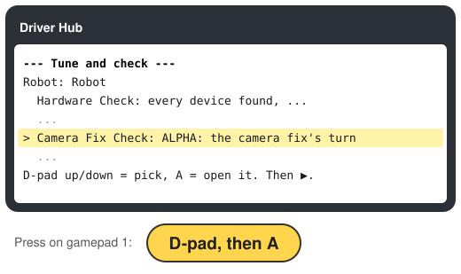
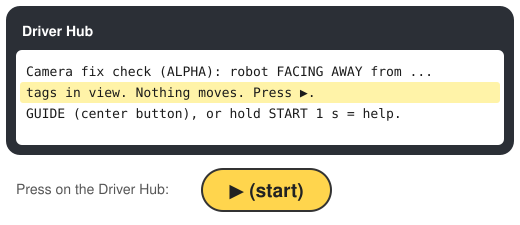
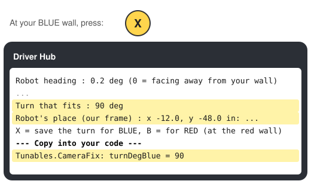
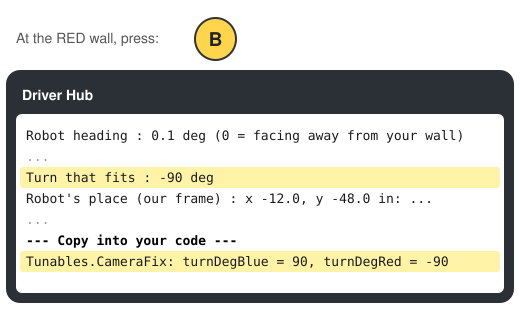

# Camera Fix Check (alpha)

Check where the camera puts the robot on the field, and save the turn for each alliance.

**In Tune and check:** yes, when Robot.java has `cameraFix(camera)`. BIOBUZZ teams: skip it.
**You need:** a `cameraFix(camera)` line in Robot.java and AprilTags in view.

## Get to the Camera Fix Check

1. On the Driver Hub, open the TeleOp list and pick **Tune and check** (group "Finders"). Press **INIT**.

   

2. The menu shows. Press **D-pad down** until the arrow (`>`) is on **Camera Fix Check**, then press **A**.

   

3. The Camera Fix Check's INIT screen shows. Nothing moves. Press **▶** (start) on the Driver Hub.

   

## Steps

1. Put the robot on the field facing AWAY from your drivers' wall (heading 0), with tags in view.
2. The screen shows where the camera puts the robot. Check it with a tape measure.
3. Press **X**. It saves the turn for BLUE.

   

4. Stand at the RED wall and press **B**. It saves the turn for RED.

   

5. Copy the line into `Tunables.CameraFix`. Details: [camera fix](../modules/odometry.md#camera-fix-alpha).

## Fix a mistake

- **Saved a wrong turn:** put the robot right, and press the same button (X for BLUE, B for RED) again. The
  new turn replaces the old one.

**Start over:** press STOP, then INIT, and open the tool again. It starts empty: nothing carries over. The lines saved at STOP stay in the results file, the newest at the end.

## Copy the numbers

The robot uses `Tunables.java` and `Robot.java`, not the finder's screen. Copy each line:

| The finder shows | Put it in |
| --- | --- |
| `Tunables.CameraFix: turnDegBlue = ..., turnDegRed = ...` | `Tunables.CameraFix` |

## Done when

`turnDegBlue` and `turnDegRed` are in `Tunables.CameraFix`. Nothing moves.

---

**Next:** [Piece Tuner: what each sensor sees](14-piece-tuner.md).

**Look it up:** [Camera: CameraFix](../reference/parts/camera.md#camerafix).
