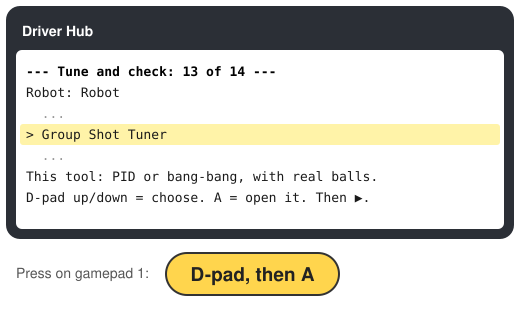

# Group Shot Tuner: PID or bang-bang, with real balls (experimental)

Shoot groups of 4 balls with no break between them, with each speed-control setting, and find the one that
scores every ball.

**In Tune and check:** yes, when Robot.java has a launcher and a camera with `goal(...)`.
**You need:** the [Flywheel Tuner](06-flywheel-tuner.md) done (or not: then it tests today's settings), the
shot table done ([Shot Tuner](13-shot-tuner.md)), the aim done ([Aim Tuner](12-aim-tuner.md)), 12 balls, safety
glasses, nobody in front of the robot, and a feeder that can feed without a break (a roller, a motor, or
spinning servos: not a push servo).

**Experimental:** this tool is new. The simulator cannot show real scoring. Check the result on the field
before a match.

## Why use it

Continuous fire (`continuousOnHold = true`) feeds every ball while you hold the fire button, with no wait
between balls. Each ball takes speed from the flywheel. The wheel has only the time between two balls to get
back to speed. The [Flywheel Tuner](06-flywheel-tuner.md) finds the best PID and the best bang-bang setting
with pretend shots. This tool shoots real balls with both, and says which one scores.

It uses the match's camera, its lighting test and the alliance you choose, your shot table (the speed for the
camera's distance, with no trim) and your code's `cameraOffset`. So a ball that goes short because the wheel
slowed is not mixed up with a bad aim. It changes nothing in `Tunables.java`.

## How it works

It shoots at 3 spots: the camera's distance to the goal at your table's first row, halfway, and its last row
(27, 36 and 45 in for a table from 27 to 45 in). The camera must be within 1.5 in of the spot.

At each spot:

1. **4 check shots**, one ball at a time, with today's settings. Each one waits until the robot is aimed and
   the wheel is at speed. 3 must score. If fewer score, the spot stops: fix the shot table or the aim first.
   4 shots is a small sample: this only catches a table or an aim that is clearly wrong.
2. **Groups of 4 balls**, taking turns between the settings, until each setting has 3 groups that count.
   Each group is a fresh press: aimed, at speed, then the feed runs with no break.

After each check shot or group, you enter where the balls went. The robot's power is off while you enter.

**A group does not count, and runs again,** when it was not aimed when the feed started, the aim moved off
the goal, the camera lost the goal, a setting changed, or it stopped early (a button, a jam, the wheel under
half speed, the robot moved). It never asks you about a group that does not count.

**The settings it tests:** the Flywheel Tuner's best PID and its best bang-bang, and today's settings when
they differ from both. When the Flywheel Tuner found no best for a control, the screen says so and it tests
what there is. When the Flywheel Tuner ran with other settings (another `kF`, table, ready band, ball drop or
encoder count), the screen says `Flywheel Tuner results are for other settings. Run it again.` Then it tests
only today's settings.

**Its saved shots and groups** belong to the robot as it is: the shot table (speeds and hood angles), the
aim offset, the feed and the alliance. Change one, and it starts a new session (the old file is kept).

**When no setting scores every ball,** it tries the next step, one round at a time:

| The groups' misses | What it means | What it tries next |
| --- | --- | --- |
| short, and the wheel lost speed (it fell more than one ball's drop under its target) | the wheel did not get back to speed between balls | a boost: 50 RPM, then 100 RPM more target while the feed runs (`continuousBoostRpm`) |
| long, with a boost | too much boost | no more boost |
| long, with no boost | not the speed setting | check the shot table at that spot |
| to the left or right, or short with the speed and aim held | the feed or the launcher | no speed change |
| still not all scored at full pace | the feed is too fast for the wheel | last: a slower feed, 90%, then 80% of the feeder's power (`continuousFeedPower`), for every setting it tests |

**One ball's drop** comes from the check shots: how far each check shot pulled the wheel under its target.
It judges whole groups. It cannot tell which ball of a group missed: there is no ball sensor.

## Get to the Group Shot Tuner

1. On the Driver Hub, open the TeleOp list and pick **Tune and check** (group "Finders"). Press **INIT**.
2. The menu shows. Press **D-pad down** until the arrow (`>`) is on **Group Shot Tuner**, then press **A**.

   

3. The INIT screen shows. Nothing moves yet. After ▶ only the sticks drive, until you press **A**. Read the
   `!!` lines. Choose your alliance: **X** = BLUE,
   **B** = RED. Point the camera at a tag: the lighting test runs now, as in a match.
4. Read the `Aim offset` line. It must say `OK`. Then press **▶** (start) on the Driver Hub.

A feed stop and a feed wheel that runs all the time (`alwaysOn`) start only after your first **A** and the
countdown: the tool sets the robot up but does not start it, so nothing moves in INIT.

## Steps

1. **Place the robot.** The screen says the spot (`spot 1 of 3 (27.0 in)`). The sticks drive the robot at
   30% power, only on this screen. Drive until `Camera distance` says `OK`, facing the goal. Press **A**.
2. **Check shot.** Load ONE ball. Press **A**. It counts down 3 s, turns the robot to the goal, waits for the
   speed, and shoots.
3. **Enter where it went.** D-pad up/down moves the arrow: `scored`, `short`, `long`, `to the LEFT`,
   `to the RIGHT`. Press **A** to save. Not sure? Press **X**: it shoots that one again.
4. Do 4 check shots. Then the groups start.
5. **Group.** Load exactly 4 balls. Press **A**. It counts down, aims, waits for the speed, then feeds all 4
   with no break.
6. **Enter where the 4 went.** D-pad up/down chooses a line, D-pad right adds a ball to it, left takes one
   off. `Entered : 4 of 4` must show. Press **A**. A ball that missed in two ways (short and to the left):
   enter its bigger miss. Not sure? **X** repeats the group.
7. Repeat until it moves to the next spot. Then place the robot again.

**To stop:** press ANY button. The power goes off at once. Every finished shot and group is saved. Press
**A** to go on. A group that already fed when you pressed does not count: load 4 balls again.

**A power cycle or a new battery:** open the tool again. It goes on where it was (place the robot first).

## The screen says

| The screen says | What to do |
| --- | --- |
| `Aim offset NOT the same. In the code: ... Saved in the tuning menu: ...` | Your drivers' last number is the saved one. Copy it into `Tunables.java`, install, then erase the saved numbers in the tuning menu. No shot counts until then. |
| `The code makes RED shots ...% faster.` | The table is tested with no trim. Set that alliance's trim to 0 for the test. |
| `NOT at the spot` | Drive the way the next line says. |
| `Outside the shot table` | Your table does not continue past its ends (`extendTableEnds`). Move a little toward the middle. |
| `No shot: NOT aimed ...` | The robot could not aim in 10 s. The balls are still in. Check that the camera sees the goal. |
| `Only 2 of 4 check shots scored.` | Fix the table (Shot Tuner) or the aim (Aim Tuner). Then **A** shoots 4 again. |
| `NOT counted: ...` | That group runs again. Load 4 balls. The next line says the cause. |
| `The flywheel had power, but its speed read 0 or backward.` | Check the flywheel's encoder cable. Still wrong? Press STOP and run the [Encoder Check](02-wiring-checks.md). Press **A** when it is fixed; the next **A** shoots. |

## The result

The winner scored every ball in every group that counted at every spot. A tie goes to the faster feed, then
to the setting that got back to speed faster in the Flywheel Tuner, then to less boost, then to less
overshoot. The feed time on the screen is how long the feeder was told to run, not how long the 4 balls took.

- **Page 1:** DONE and the winner, or NOT DONE (no winner: keep today's settings) and the best score.
- **Page 2 (D-pad right):** the lines to copy: `speedControl`, the control's numbers, `continuousOnHold`,
  `continuousBoostRpm`, and `continuousFeedPower` only for a slower feed.
- **Page 3:** each setting's score and what its misses say.
- **Page 4:** what it cannot show.
- **X** two times: a new session. The old one is kept as `group-shot-tuner-old.txt`.

3 groups at each spot is a small sample. Shoot some groups in a practice match before you trust it.

## Put the numbers in your code

| The tool shows | Put it in |
| --- | --- |
| `public static String speedControl = "PID";` (or `"BANG_BANG"`) | `Tunables.Launcher` |
| `kP`, `kI`, `kD`, `kF`, or the six `bang...` lines | `Tunables.Launcher` |
| `continuousOnHold`, `continuousBoostRpm`, `continuousFeedPower` | `Tunables.Launcher` |

## Done when

- page 1 says DONE, and the lines are in `Tunables.Launcher`; or it says NOT DONE, and you changed nothing.
- a hold of the fire button in TeleOp shoots 4 balls into the goal from each spot.

---

**Next:** [Piece Tuner: what each sensor sees](14-piece-tuner.md).
