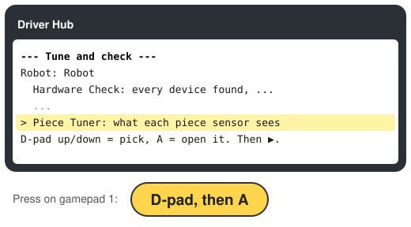
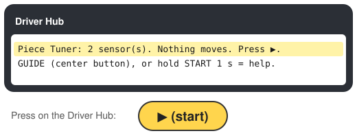
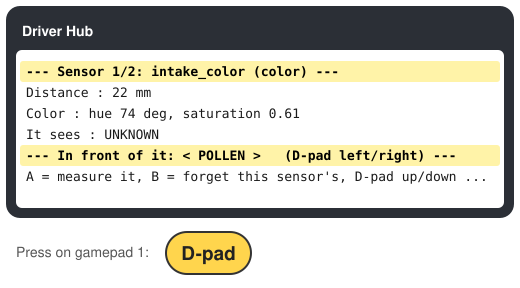
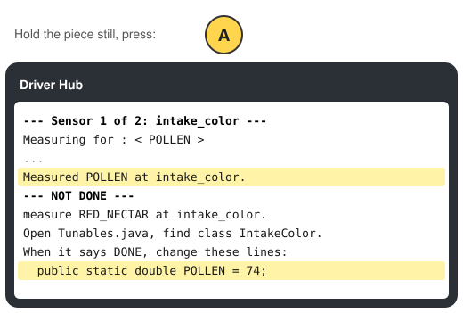
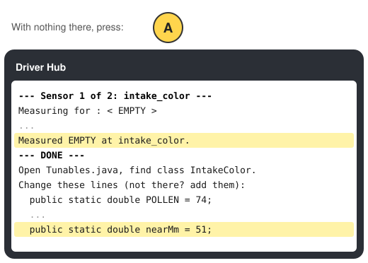

# Piece Tuner: what each sensor sees

Teach each piece sensor what each kind of game piece looks like, and what "nothing there" looks like.

**In Tune and check:** yes, when the robot has a piece sensor.
**You need:** one piece of each kind.

## Get to the Piece Tuner

1. On the Driver Hub, open the TeleOp list and pick **Tune and check** (group "Finders"). Press **INIT**.

   

2. The menu shows. Press **D-pad down** until the arrow (`>`) is on **Piece Tuner**, then press **A**.

   

3. The Piece Tuner's INIT screen shows. Nothing moves. Press **▶** (start) on the Driver Hub.

   

## Steps

The Piece Tuner is for a robot with a [`Pieces` or `PieceSensor`](../reference/parts/pieces.md) line. Its
file names your robot, like the Odometry Tuner (the cookbook's [piece-tuner recipe](../cookbook/05-game-pieces.md#how-do-i-tune-the-piece-sensors)).
Nothing moves, so you need no block.

1. Mount the sensor where it will stay. Put a piece where it really sits or passes. At the intake, that is
   the spot where the sensor sees it go by.
2. D-pad up/down chooses the sensor. D-pad left/right chooses which kind is in front of it.

   

3. Hold that kind of piece in its spot. **A** measures (20 readings, about half a second: hold still).

   

4. Do every kind, then EMPTY (nothing there).

   

5. Copy the lines into `Tunables.java` (for example `Tunables.IntakeColor: POLLEN = 74`), rebuild, and run
   it again. "It sees" should name each piece you hold up, and NONE with nothing there.

The tuner warns about two problems. One: two kinds that read nearly the same (a color sensor too far
away, a distance sensor that does not look straight across). Two: EMPTY that looks like a piece. For that,
aim the sensor at a far wall or a gray or black background.

## Fix a mistake

- **Measured the wrong piece:** put the right piece in front of the sensor, choose its kind, and press
  **A** again. The new measurement replaces the old one.
- **Start this sensor over:** press **B**. It forgets every measurement for this sensor.

**Start over:** press STOP, then INIT, and open the tool again. It starts empty: nothing carries over. The lines saved at STOP stay in the results file, the newest at the end.

## Put the numbers in your code

The robot uses `Tunables.java` and `Robot.java`, not the finder's screen. Take a photo of the screen,
and type each line into the file. Or copy it from the [results file](01-tune-and-check.md#get-the-results-file-on-the-laptop):

| The finder shows | Put it in |
| --- | --- |
| `Tunables.IntakeColor: POLLEN = 74` | the sensor's section in `Tunables.java` |

## Done when

"It sees" names each piece you hold up, and NONE with nothing there.

---

**Next:** [Characterizer: how the robot really moves](15-characterizer.md).

**Look it up:** [Pieces and PieceSensor](../reference/parts/pieces.md).
