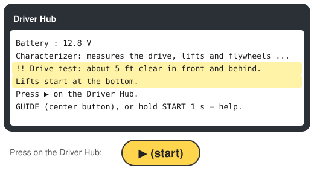

# Characterizer: how the robot really moves

Measure how each motor behaves, for feedforward and for the simulator. **Advanced: you can skip this
tool.** A robot drives and shoots without it.

**In Tune and check:** no. It has its own file: it needs your lifts.
**You need:** its own file, a charged battery, 5 ft of clear floor.

## Get to the Characterizer

1. On the Driver Hub, open the TeleOp list and pick **Characterizer** (group "Finders"). Press **INIT**.

   

2. The Characterizer's INIT screen shows. Nothing moves yet. Clear the floor, then press **▶** (start) on
   the Driver Hub.

   

## Steps

Run the **Characterizer** last, when the robot drives and its lifts work. It measures how each motor
behaves: the power to start moving, the power per speed, how fast it speeds up, and for a lift the power
that holds it against gravity. You use these numbers in two places: for feedforward in your code (see
[Feedforward](../modules/control.md#feedforward)), and as real numbers for the
[simulator](../simulator/03-make-it-match-your-robot.md#6-real-speeds-optional).

1. In `Characterizer.java`, list your lifts/arms with soft limits a little inside the hard stops
   (counts from the bottom), and your flywheels.
2. Each test moves the robot or a part by itself. Drive test: 5 ft clear in front and behind, on tiles.
   Turn test: room to turn. Flywheel test: safety glasses, hands and pieces away.
3. Lifts start at the BOTTOM. An arm's high limit stays below straight up.
4. The D-pad chooses a test, and **A** runs it.

   

5. **B** stops the test now. The tool stops by itself when something turns the wrong way, goes past a
   limit, or pushes without moving.

   

6. Run each test 2-3 times on a charged battery.

   

Details: [finders module](../modules/finders.md#characterizeropmode).

## Fix a mistake

- **Stop a test:** press **B** (or **GUIDE**). The robot stops, and that test gives no numbers.
- **A bad test** (the robot hit something, or the lift was not at the bottom): run the same test again with
  **A**. Its old lines go when the test starts. A poor match (under 0.9) says NOT DONE: do not copy it.

**Start over:** press STOP, then INIT, and open the tool again. It starts empty: nothing carries over. The lines saved at STOP stay in the results file, the newest at the end.

## Put the numbers in your code

These numbers do not go in `Tunables.java` or `Robot.java`. They have two other places. Take a photo of the
screen, and type each line into its place. Or copy it from the [results file](01-tune-and-check.md#get-the-results-file-on-the-laptop):

| The finder shows | Put it in |
| --- | --- |
| the feedforward numbers | your code ([Feedforward](../modules/control.md#feedforward)) |
| the motor numbers | the simulator's robot file ([real numbers](../simulator/03-make-it-match-your-robot.md#6-real-speeds-optional)) |

## Done when

each test ran 2-3 times and the numbers agree.

---

**Next:** [Live tuning: change numbers while the robot runs](16-live-tuning.md).

**Look it up:** [CharacterizerOpMode](../modules/finders.md#characterizeropmode).
