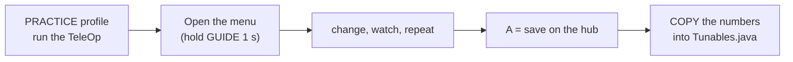

# The tuning menu

Change a number while the robot runs, from the gamepad, then copy it back into `Tunables.java`.

**You need:** a robot whose parts work, and the PRACTICE [profile](../guides/profiles.md) (the menu stays
closed in COMPETITION).

The finders FIND a number the first time. This menu adjusts numbers you already have: a PID gain, a
position, a speed. Building and installing again for each small change is slow. The menu changes the number
at once.



## What is in the menu

With the robot in five files, you set up nothing. Every part's numbers are in the menu already, and so is
every number in your own sections of `Tunables.java` (a section no part reads). Limits (`min`, `max`) are
never in the menu, so tuning can never drive a part past a hard stop. Each part's reference page says, for
each number, whether the menu has it
([the "In tuning menu" column](../reference/tunables.md#the-in-tuning-menu-column)).

## Open it and change a number

**Where:** the Driver Hub, in your TeleOp, after ▶ (start on the Driver Hub). Hold **GUIDE** for 1 s. (A tap
of GUIDE shows the button map.) While the menu is open, gamepad 1's buttons and sticks do not drive the
robot. Gamepad 2 keeps working.

| Button | Does |
| --- | --- |
| GUIDE, held 1 s | open / close. A tap shows the button map |
| D-pad up / down | choose |
| D-pad right / left | +/- one step (hold a bumper: x10) |
| A | save all on the hub |
| X | the chosen one back to the code value |
| Y | ALL back to the code values, and deletes the saved values |
| B | the changed values as lines to copy into `Tunables.java` (also in the robot log, tag `ftc-helper`). B again: the list |

Changed values show the code value next to them: `Lift/kP = 0.0050  (code 0.004)`.

## Copy the numbers back

**The code is the record.** A value saved only on the hub is lost with a new Control Hub. Teammates cannot
see it, and you can forget it at an event.

1. Press **B** in the menu. It shows the changed values as lines to copy, for example
   `Lift: kP = 0.0050`. The lines are in the robot log too (tag `ftc-helper`).
2. Put each value in its section in `Tunables.java`.
3. Press **Y** to put every value back to the code values and delete the saved values.

The next INIT lists every value you did not copy yet, under "Tuned on this robot (copy into
Tunables.java)". A save cannot leave a half-written file: after a power cut, the hub has either the old
values or the new ones.

## The battery

Numbers that set a power (a hold power, a drive gain) are right only for
about the battery you tuned them on. Tuned on a low battery, they are too strong on a charged one.
So the menu shows the battery's voltage, and warns below 12.5 V. Each change notes the
battery: the copy lines say `Lift: kF = 0.06   // tuned at 12.7 V`. Copy that note into
`Tunables.java` too. Tune on a charged battery (12.5 V or more).

## Older programs: add the menu yourself

A TeleOp in five files has the menu already. Your own TeleOp (`LinearOpMode`, `EasyTeleOp`) needs two
things.

**Make numbers tunable.**

On mechanisms, add `.tunable(...)`:

```java
PositionMotor lift = PositionMotor.create(hardwareMap, "lift")
        .pid(0.004, 0, 0.0002, 0.05)
        .position("DOWN", 0).position("HIGH", 2400)
        .tunable("Lift");          // "Lift/kP".."Lift/kF", "Lift/DOWN", "Lift/HIGH"

PositionServo claw = PositionServo.create(hardwareMap, "claw")
        .position("OPEN", 0.2).position("CLOSED", 0.75)
        .tunable("Claw");          // "Claw/OPEN", "Claw/CLOSED"
```

For any other number, make a `Tunable`. `static final` makes one `Tunable` for the whole program, made once. The menu still
changes its value:

```java
// (menu name, value in the code, change per D-pad press), kept between 0.1 and 1.0
static final Tunable SLOW_SPEED = Tunable.number("Drive/slow", 0.35, 0.05).range(0.1, 1.0);
...
double speed = slowMode ? SLOW_SPEED.get() : 1.0;     // read it EVERY loop
```

For a PID controller you made yourself, call `PidTunables.of("Arm", kP, kI, kD, kF).applyTo(pid)` every loop.

**Add the menu to the TeleOp.**

The menu uses gamepad 1's D-pad, A, X, Y and bumpers. Without a pause, pressing Y in the menu ("reset all")
would ALSO do whatever Y does for the driver. So give the menu key its own small button
list, and pause the driver's gamepad-1 buttons (and sticks) while the menu is open:

```java
TuningMenu tuning = new TuningMenu(gamepad1);
ControllerBindings menuKey = new ControllerBindings().bindPress(Pad.G1, Btn.GUIDE, tuning::toggle);   // tuning::toggle = run toggle() on press
ControllerBindings driver = new ControllerBindings()...;     // gamepad 1 buttons
ControllerBindings operator = new ControllerBindings()...;   // gamepad 2 buttons (keep working)
boolean menuWasOpen = false;   // was the menu open last loop?
// loop:
menuKey.update(gamepad1, gamepad2);
operator.update(gamepad1, gamepad2);
tuning.update();               // the menu reads gamepad 1 (only while open)
if (tuning.isOpen()) {
    menuWasOpen = true;
    tuning.addTelemetry(t);                                   // and ignore gamepad 1's sticks
} else {
    if (menuWasOpen) driver.ignoreHeldButtons(gamepad1, gamepad2);   // a button held from the menu does not fire
    menuWasOpen = false;
    driver.update(gamepad1, gamepad2);
}
```

The starter kit's `MainTeleOp` already has this code.

## FTC Dashboard (practice only)

> **Not at events (2026-27 rule R704.D):** the game manual bans "additional logging/streaming
> services, such as those hosted by third party plugins and tools such as FTC Dashboard, FTControl
> Panels, and others". Only the Driver Station app may stream telemetry. Use these tools at home and
> in practice only, and **take them out of the robot project before an event**: remove or comment out
> their Gradle lines, then build and install again. The library's own tuning menu works through the
> Driver Station, so the rule allows it.

[FTC Dashboard](https://acmerobotics.github.io/ftc-dashboard/) shows graphs. It also lets you change
`public static` fields (settings that belong to the class, not to one object) from a laptop browser. Teams used it in the 2025-26 season. You add it in the
robot project, not in this library. Add its Maven repository and dependency (where to download it,
and its name and version) to `build.dependencies.gradle`. Then put `@Config` on a class with `public static` fields. It works
alongside the tuning menu. Use the one that fits the job: Dashboard for graphs, and the menu at the field
without a laptop.

## Done when

- The menu opens in PRACTICE, and a change shows on the robot.
- Every value you keep is in `Tunables.java`, and INIT lists no "Tuned on this robot" lines.

---

**Next:** [Fix it by what you see](17-fix-by-symptom.md).

**Look it up:** [Tunable](../modules/tuning.md), [Tunables.java](../reference/tunables.md).
