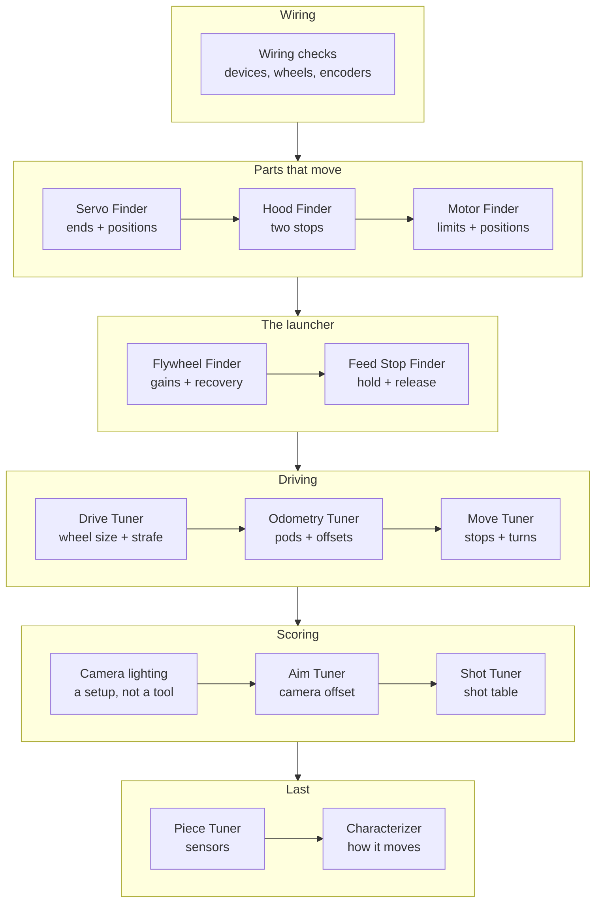

# Tuning

Find your robot's numbers in the right order, then fix what you see on the field.

Every robot program is full of numbers: where a servo opens, how high a lift may go, how fast a flywheel
spins, how big the wheels really are. When you guess them, you waste practice time and break parts. The
**finders** measure them for you and show the lines to copy into `Tunables.java` and `Robot.java`.

## The tuning order

Go from top to bottom. Skip a tool for a part your robot does not have: the **Tune and check** menu leaves
it out.

| # | Page | It finds | Why it comes here |
| --- | --- | --- | --- |
| 1 | [Before you tune: the Tune and check OpMode](01-tune-and-check.md) | nothing: the menu, safety, help | read it once |
| 2 | [Wiring checks](02-wiring-checks.md) | Hardware Check, Motor Direction, Encoder | every other number trusts the wiring, so it comes first |
| 3 | [Servo Finder](03-servo-finder.md) | ends and positions | a servo pushed past its end breaks, so find the ends before code moves it |
| 4 | [Hood Finder](04-hood-finder.md) | a hood's two stops | the Shot Tuner writes hood positions, so the hood needs its stops first |
| 5 | [Motor Finder](05-motor-finder.md) | limits and positions | a wrong limit breaks parts, so do it before you drive a mechanism with code |
| 6 | [Flywheel Finder](06-flywheel-finder.md) | gains and recovery | the shot table is only true when the wheel holds its speed |
| 7 | [Feed Stop Finder](07-feed-stop-finder.md) | hold and release | the launcher must feed one piece at a time before you tune shots |
| 8 | [Drive Tuner](08-drive-tuner.md) | wheel size and strafe | autonomous moves need the right distances. Autonomous stays off until it passes |
| 9 | [Odometry Tuner](09-odometry-tuner.md) | pod directions and offsets | `driveTo` and the shot distance need a true pose. Path steps stay off until it passes |
| 10 | [Move Tuner](10-move-tuner.md) | where moves stop, how turns end | it needs the right distances (Drive Tuner) and, with odometry, a true pose to measure with |
| 11 | [Camera lighting](11-camera-lighting.md) (a setup, not a tool) | the camera setting for each kind of light | the camera must see the tags well before you aim or tune shots |
| 12 | [Aim Tuner (own file)](12-aim-tuner.md) | camera offset | aim first, so you build the shot table with straight shots |
| 13 | [Shot Tuner](13-shot-tuner.md) | the shot table | it needs a steady wheel, straight aim and a true distance: everything above |
| 14 | [Piece Tuner](14-piece-tuner.md) | what each sensor sees | nothing moves, so it can also come earlier |
| 15 | [Characterizer (own file)](15-characterizer.md) | how the motors really move | it needs a robot that drives and lifts that work, so it comes last |

**After the finders:**

- [Live tuning](16-live-tuning.md): change a number from the gamepad while your TeleOp runs (the tuning menu in TeleOp, not Tune and check).
- [Fix it by what you see](17-fix-by-symptom.md): "the lift sags" -> which number to change, and which way.

---

**Next:** [Before you tune: the Tune and check OpMode](01-tune-and-check.md).
