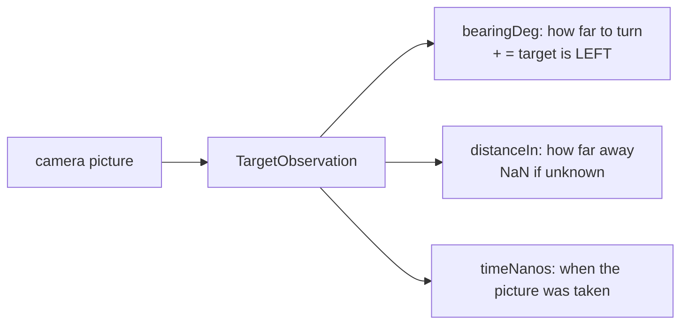

# Tutorial 18: Vision aiming (webcam or Limelight 3A)

**You will learn:** how to find AprilTags with a webcam or a Limelight 3A through ONE interface,
what bearing and distance mean, and how to aim the drivetrain (or a turret) at a tag safely.

**You need:** the drivetrain and `RobotSettings` (tutorial 09), and a webcam named `Webcam 1` or a
Limelight named `limelight` (with an AprilTag pipeline set up on its web page). An AprilTag to point at.

**Full program:** [`Tut18VisionAim.java`](../../examples/src/main/java/io/github/jasoncross/ftchelper/examples/tutorials/Tut18VisionAim.java)
**Reference:** [vision.md](../modules/vision.md)

---

## 1. What the camera tells you



**Bearing** is the angle between "straight ahead" and the target. Positive = the target is to the
LEFT (counterclockwise, like the IMU). The Limelight reports the opposite sign; the library flips it
for you, so both cameras agree.

## 2. One interface, two cameras

```java
TargetSource camera = menu.get("Camera").equals("Limelight")
        ? LimelightTags.create(hardwareMap, "limelight").pipeline(0)
        : WebcamTags.create(hardwareMap, "Webcam 1").resolution(640, 480);
camera.start();
```

After this line, the program never cares which camera it is: `camera.update()`, `camera.target(20)`,
`camera.status()`. Next year's camera is a new class with the same methods.

The webcam needs 1-2 s to start, so start it in INIT. The INIT loop shows `camera.status()` and how
many tags it sees: check that before START.

## 3. Aim the drivetrain

```java
AimController aim = new AimController(0.02, 0.003).deadband(1.5).maxPower(0.5).maxAgeMs(150);
...
if (gamepad1.right_bumper) {
    turn = aim.turnPower(target);     // same sign as the drive's turn (clockwise +)
} else {
    aim.reset();
}
drive.drive(forward, strafe, turn);
```

While the driver holds RB, the robot turns toward the tag; they keep control of driving.

**Safety built in:** `turnPower` returns **0** when there is no target, when the picture is older than
150 ms, or when there is no bearing. The robot never turns toward a tag it cannot see NOW. (Without
this, a robot keeps spinning toward where a tag WAS.)

`turnPower` already uses the drive's sign (clockwise +), so no minus sign is needed. (Bearings are
counterclockwise +; `ccwPower` gives that sign if you ever need it. See [Signs and units](../conventions.md).)

## 4. Feel it

```java
AimRumble feel = new AimRumble(gamepad1).setThreshold(3);
feel.update(target.bearingDeg);       // buzzes inside 3 degrees, stronger when closer
```

## 5. With a turret instead

```java
turret.aimAtTarget(camera.target(20), true);    // true = the camera turns with the turret
```

`aimAtTarget` uses a picture only if it is fresh, and each picture only ONCE. (Turning "by the
bearing" with the same old picture again and again would push the turret further each loop.) No
fresh target: the turret holds where it is. And `launcher.setDistance(target.distanceIn)` picks the
shot from the table (tutorial 17); check `target.hasDistance()` first.

## 2026-27 notes

- BIOBUZZ tags are on the HIVE cells, and the cells move: good for aiming, not for working out
  where the robot is on the field.
- SDK 12 "clusters": groups of tags with one aiming point (the center of a cell opening).
  `WebcamTags` reports a cluster with id `TargetObservation.CLUSTER` and its name:
  `camera.target("cluster name")`.

## Run it

1. INIT: choose the camera and the tag id with the D-pad, press A. Wait for "STREAMING" (webcam) or
   "pipeline 0" (Limelight) and "Tags seen: 1".
2. START. Point the robot so the tag is off to the left. Hold RB: the robot turns left until aimed;
   a buzz; "Aimed: true".
3. Cover the camera while holding RB: the robot stops turning (no target = 0 power).

## If something goes wrong

| Problem | Fix |
| --- | --- |
| Webcam "OPENING..." forever | USB cable / hub port; the configuration name must match |
| Limelight "not connected" | Ethernet/USB cable; its name in the configuration; restart the robot |
| Tags seen 0 | pipeline is not AprilTag (Limelight); tag family; too far: higher resolution or decimation 1 |
| Turns the wrong way | a minus sign was added in front of `aim.turnPower(...)`: remove it |
| Shakes around the tag | lower kP or raise the deadband |
| Distance NaN | webcam: the tag is not in the SDK's library; Limelight: no 3D pose in the pipeline (set tag size) |

## Try this

1. Aim at the nearest tag: pick the observation with the smallest `distanceIn`.
2. Show "LOCKED" in big letters at the top when `aim.isAimed()`.
3. Add `offset(...)` when the camera is not centered on the shooter. The **Aim Tuner**
   ([tutorial 21](21-finders.md)) finds the number.

## Next

[Tutorial 19: Testing procedures](19-testing-procedures.md)
