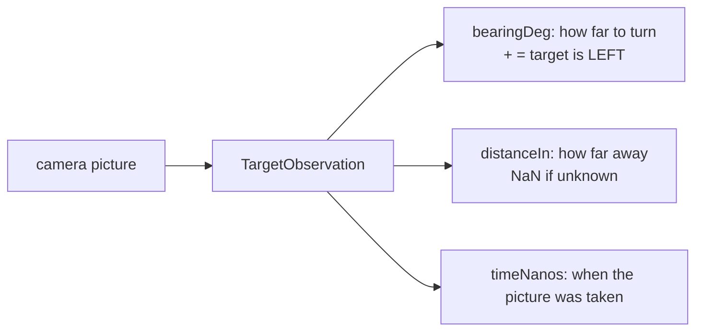

# Tutorial 18: Vision aiming (webcam or Limelight 3A)

> **Work in progress:** this library and its docs are still changing. Something wrong or unclear? [Tell us](https://github.com/crossbotics/ftc-helper-lib/issues/new/choose).

**You will build:** a drive program that turns the robot toward an AprilTag (a printed square code on the field) while the driver holds a button.
The main track adds a camera with less code: [A shooter, a camera and a turret](start/09-shooter-and-camera.md).

**You will learn:** how to find AprilTags with a webcam or a Limelight 3A through ONE interface, what
bearing and distance mean, and how to aim the drivetrain (or a turret) at a tag safely.

**You need:** the drivetrain and `RobotSettings` (tutorial 09), and a webcam named `Webcam 1` or a
Limelight named `limelight`. A Limelight needs an AprilTag pipeline (a set of camera settings you save
on the Limelight by number), set up on its web page. You also need an AprilTag to point at.

**Full program:** [`Tut18VisionAim.java`](../../examples/src/main/java/com/crossbotics/ftchelper/examples/tutorials/Tut18VisionAim.java)
**Reference:** [vision.md](../modules/vision.md)

---

## 1. What the camera tells you



`NaN` means "not a number": the camera could not tell the distance.

**Bearing** is the angle between "straight ahead" and the target. Positive = the target is to the LEFT
(counterclockwise, like the IMU). The Limelight reports the opposite sign. The library flips it for you,
so both cameras agree.

## 2. One interface, two cameras

An **interface** is a list of methods that several classes promise to have. `TargetSource` is one:
both camera classes have its methods, so your code can use either.

```java
TargetSource camera = menu.get("Camera").equals("Limelight")
        ? LimelightTags.create(hardwareMap, "limelight").pipeline(0) // (1)!
        : WebcamTags.create(hardwareMap, "Webcam 1").resolution(640, 480); // (2)!
camera.start();
```

1. Pipeline 0 is a setup saved on the Limelight itself (its web page).
2. 640 x 480 pixels is a good start. A higher resolution sees tags farther away, but runs slower.

The program must know WHICH camera to start. So the driver chooses the camera in an INIT menu, and the
camera starts only after A. `a ? b : c` is a short if/else: when the menu says Limelight, make a
Limelight, otherwise a webcam.

After this line, the program works the same with either camera: `camera.update()`,
`camera.target("RED SCORING")`, `camera.status()`. Next year's camera is a new class with the same
methods.

**A third kind: the HuskyLens.** It has the same methods, with one difference you must handle. It says
the number you TAUGHT it on its screen. List each one with the tag's real number:

```java
TargetSource camera = HuskyLensCamera.create(hardwareMap, "huskylens")
        .tag(1, 34).tag(2, 35); // (1)!
```

1. The first tag you taught is number 1. It is really AprilTag 34. Now `camera.target(34)` works.

This lesson's program offers only the other two cameras in its menu. The HuskyLens's bearing comes from
a box in the picture, and its distance is only a rough estimate. Its limits, and how to teach it:
[the HuskyLens section](../modules/vision.md#huskylenscamera).

The webcam needs 1-2 s to start, so start it in INIT. The INIT loop shows `camera.status()` and how many
tags the camera sees. Check them before ▶ (start on the Driver Hub).

## 3. Aim the drivetrain

`AimController` is a small PID for aiming: the two numbers are kP and kD (Tutorial 07). kP 0.02 is the
turn power per degree off (10 degrees off gives 0.2). kD 0.003 eases off as the robot closes in, so the
robot does not swing past the tag. `deadband(1.5)`: within 1.5 degrees counts as aimed and gives 0
power. Then the robot does not twitch back and forth forever. `maxPower(0.5)`: never turn harder than
0.5 while aiming.

```java
AimController aim = new AimController(0.02, 0.003).deadband(1.5).maxPower(0.5).maxAgeMs(150);
...
if (gamepad1.right_bumper) {
    turn = aim.turnPower(target);     // same sign as the drive's turn (clockwise +)
} else {
    aim.reset();   // the next aim starts fresh
}
drive.drive(forward, strafe, turn);
```

While the driver holds RB, the robot turns toward the tag, and the driver keeps control of driving.
When the driver lets go of RB, `aim.reset()` forgets the old aim. Then the next aim does not start with
a wrong kick from an old picture.

`target` is `null` when the camera sees nothing right now. With "any", the program takes the first
target in `camera.targets()`. Always check for `null` before you use a target. Otherwise the program
crashes.

**Safety built in:** `turnPower` returns **0** when there is no target, when the picture is older than
150 ms, or when there is no bearing. The robot never turns toward a tag it cannot see NOW. Without this
rule, a robot keeps spinning toward where a tag WAS.

`turnPower` already uses the drive's sign (clockwise +), so you need no minus sign. Bearings are
counterclockwise +. `ccwPower` gives that sign when you need it. See [Signs and units](../conventions.md).

## 4. Feel it

```java
AimRumble feel = new AimRumble(gamepad1).setThreshold(3);
feel.update(target.bearingDeg);       // buzzes inside 3 degrees, stronger when closer
```

## 5. With a turret instead

```java
turret.aimAtTarget(camera.target("RED SCORING"), true);    // true = the camera turns with the turret
```

`aimAtTarget` uses a picture only when it is fresh, and each picture only ONCE. A turn "by the bearing"
with the same old picture again and again would push the turret further each loop. With no fresh
target, the turret holds where it is. `launcher.setDistance(target.distanceIn)` picks the shot from the
table (tutorial 17). Check `target.hasDistance()` first.

**In the robot in five files,** all of this is built in:

- `g1.rb.toggle(robot.aimMode())` aims the whole robot. The driver's turn stick still wins.
- `g2.rumbleWhenAimed()` buzzes.
- A turret's `follows(camera)` follows the goal. Whole-robot aim and a following turret are separate
  modes: use one.
- With odometry and `Tunables.Aim.goalX, goalY`, they keep working from the odometry when the camera
  loses the goal.

See [Lesson 9](start/09-shooter-and-camera.md#9-when-the-camera-loses-the-goal-the-odometry)
and [robot.md: Aim](../reference/parts/aim.md).

## 2026-27 notes

- BIOBUZZ tags are on the HIVE cells, and the cells move. So the tags are good for aiming, but not for
  working out where the robot is on the field.
- SDK 12 has "clusters": groups of tags with one aiming point. The SDK puts the point 7.2 in toward the
  tags' printed top and 5.6 in behind them. For BIOBUZZ, that is about 9 in beyond the tag row and 1 in
  higher. It is not the CELL opening. These numbers come from the SDK and the manual. Nobody has checked
  them on a real field yet.
- BIOBUZZ has 4 clusters: "RED SCORING", "RED AUDIENCE", "BLUE AUDIENCE", "BLUE SCORING" (the 4 tags
  under each CELL). `WebcamTags` reports each one with id `TargetObservation.CLUSTER` and its name.
- `LimelightTags` reports the same groups by the same names. A Limelight sees single tags. The library
  groups them with `TagGroup`, aimed at the middle of the tag row. So `camera.target("RED SCORING")`
  works with either camera.
- A robot can score only in the CELL that is up, and that CELL's tags read right side up.
  `TagGroup.goalTarget(camera, "RED SCORING")` gives the red HIVE's up CELL (either group). It gives
  null when only the down CELL (upside-down tags) is in view
  ([vision.md](../modules/vision.md#taggroup)).
- With a Limelight, single tags also work by number (`camera.target(31)`). The webcam reports a tag that
  belongs to a cluster ONLY as part of its cluster, so there `camera.target(31)` gives null. To see
  single tags with a webcam, give `WebcamTags.library(...)` a tag library without clusters.

## Run it

1. In INIT, choose the camera and the target with the D-pad, then press A. Wait for "STREAMING" (webcam)
   or "pipeline 0" (Limelight), and for "Targets seen: 1" or more. A Limelight shows each tag and the
   group.
2. Press ▶. Point the robot so the tag is off to the left. Hold RB: the robot turns left until it is
   aimed. The gamepad buzzes, and the screen says "Aimed: true".
3. Cover the camera while you hold RB: the robot stops turning (no target = 0 power).

## If something goes wrong

| Problem | Fix |
| --- | --- |
| Webcam "OPENING..." forever | Check the USB cable and the hub port. The configuration name must match. |
| Limelight "not connected" | Check the Ethernet/USB cable and its name in the configuration. Restart the robot. |
| Targets seen 0 | On a Limelight, the pipeline is not AprilTag. Or check the tag family. When the tag is too far, use a higher resolution or decimation 1. |
| Turns the wrong way | Someone added a minus sign in front of `aim.turnPower(...)`. Remove it. |
| Shakes around the tag | Lower kP or raise the deadband. |
| Distance NaN | Webcam: the tag is not in the SDK's library. Limelight: the pipeline has no 3D pose (set the tag size). |

## Try this

1. Aim at the nearest tag: pick the observation with the smallest `distanceIn`.
2. Show "LOCKED" in big letters at the top when `aim.isAimed()`.
3. Add `offset(...)` when the camera is not centered on the shooter. The **Aim Tuner**
   ([tutorial 21](21-finders.md)) finds the number.

## Next

[Check the hardware (lesson 2b, tutorial 19)](19-testing-procedures.md)
