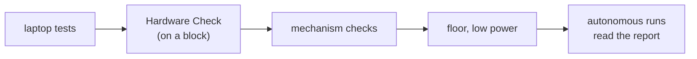

# Check the hardware (lesson 2b, also tutorial 19)

> **Work in progress:** this library and its docs are still changing. Something wrong or unclear? [Tell us](https://github.com/crossbotics/ftc-helper-lib/issues/new/choose).

**You will build:** a 3-line OpMode that lets you test every motor, servo and sensor on the robot by hand.
This is also lesson 2b of the main track (after lesson 2, Drive).

**You will learn:** how to use the Hardware Check OpMode, a fixed order for testing a robot (laptop,
bench, floor, autonomous, event), and how to turn a problem into a fix that stays fixed.

**You need:** any robot. On the main track: [lesson 1](start/01-robot-in-five-files.md) and
[lesson 2](start/02-drive.md) (on the under-the-hood track: tutorials 01-03). The page's file is
`19-...` because it is also tutorial 19 of that track.

**Full program:** [`Tut19HardwareCheck.java`](../../examples/src/main/java/com/crossbotics/ftchelper/examples/tutorials/Tut19HardwareCheck.java) (yes, it is 3 lines)
**Reference:** [testing.md](../modules/testing.md). Guide with all checklists: [Testing procedures](../guides/testing.md).

---

## 1. The 3-line OpMode

The OpMode itself is 3 lines. With the lines every Java file needs, the whole file is this. Make a
new Java file `HardwareCheck.java` in your `teamcode` folder
([how to make a file](../start-from-zero.md#make-a-new-file-or-folder)), and replace everything in it
with:

```java
package org.firstinspires.ftc.teamcode;

import com.qualcomm.robotcore.eventloop.opmode.TeleOp;
import com.crossbotics.ftchelper.testing.HardwareCheckOpMode;

@TeleOp(name = "Hardware Check", group = "Tests")
public class HardwareCheck extends HardwareCheckOpMode {
}
```

- **File name:** `HardwareCheck.java`, the same as the class name after `public class`.
- **The `package` line** says the file is in the `teamcode` folder.
- **The two `import` lines** say where `TeleOp` (from the FTC SDK) and `HardwareCheckOpMode` (from
  this library) are. **Why:** without them, the build says `cannot find symbol`.
- **No `@Disabled` line:** the Driver Station lists it.

`extends` means "is a kind of": this OpMode is a `HardwareCheckOpMode`, so it does everything that
class does. The library wrote the OpMode; you only give it a name. (The tutorial's own copy is named
"Tutorial 19: Hardware Check"; the name in `@TeleOp(name = ...)` can be anything.)

## 2. Use it

Put the robot on a block, so the wheels are off the ground. Run it. It lists every device in the active configuration and the battery voltage.

- **D-pad up/down**: choose a device. Changing device stops the last motor.
- **Motor**: right stick = power (50% max; hold RB for 100%). **Stick up = positive power** (the SDK
  reads a stick pushed up as a negative number; the Hardware Check flips it for you, like the
  library's driving). Watch: does positive power turn it the way you expect? Does the encoder count
  UP? A = zero the encoder.
- **Servo**: a servo cannot tell where it is, so first choose a **start point** near where the servo
  sits now: D-pad right/left = +/- 0.01, bumpers +/- 0.1, X = 0.5. Nothing moves yet. Hands clear,
  then A: the servo moves to the start point. After that, the same buttons move it. To find the safe
  ends and positions, use the Servo Finder.
- **Sensors**: live values. Press the switch, wave a hand at the distance sensor.
- **IMU**: turn the robot left by hand: **yaw** (the heading: which way the robot faces, in degrees)
  goes UP (if your hub is mounted logo up, USB forward).

## 3. A fixed order



Do the steps in this order. Each step catches problems the next one would make dangerous or confusing. Example: a reversed drive
motor (found in seconds at step B) looks like "the robot spins randomly" at step D.

The full checklists, including the 2-minute pre-match check, are in
[Testing procedures](../guides/testing.md). Print them for the pit.

## 4. When something breaks

1. **Write it down**: what you did, what you expected, what happened. Turn debug telemetry on and
   take a photo of the screen.
2. **Reproduce it** on the bench. A problem you cannot repeat cannot be fixed on purpose.
3. **Find the layer** (where the problem lives): hardware (Hardware Check shows it)? configuration (names)? your code? the library?
4. **Fix it and add a test** if it was logic (tutorial 13), so it can never come back silently.
5. **Note it** in the team's log: the next driver or programmer will meet it again.

## Try it in the simulator

The simulator lists the Hardware Check with the library's examples. From the `ftc-helper-lib` folder:

```bash
./gradlew :sim:fromRobot -PteamCode=none -ProbotClass=com.crossbotics.ftchelper.examples.lessonbot.Robot -Pout=build/lessonbot.properties
./gradlew :sim:run -PteamCode=none -Probot=build/lessonbot.properties
```

Open http://localhost:8780, choose "Tutorial 19: Hardware Check", INIT, START. Pick `lift` with the
D-pad, push gamepad 1's right stick up: the lift rises and its count goes up. Pick `claw` and step it
with the D-pad. Your own robot: `./gradlew :sim:run -PteamCode=../TeamCode` with your `HardwareCheck.java`
in TeamCode (lesson 1 shows how to make its robot file). The simulator builds its robot from your code,
so it cannot find a wrong wire or a motor that turns the wrong way: only the real robot can.

## Run it

1. Make the file from section 1 in TeamCode (the whole file, with its `package` and `import` lines), build, install and run it.
2. Go through every device once. Fix any direction or name problem you find.
3. Take the pre-match checklist from the guide and time yourself: it should take about 2 minutes.

## Try this

1. Make your own OpMode that runs every drive motor forward for 1 second in turn, and shows its encoder change.
2. Write a test (tutorial 13) for something that once went wrong on your robot.

## You finished the tutorials

On the main track, next: [Lesson 3: Buttons](start/03-buttons.md). Under the hood: [Tutorial 20: Easy TeleOp](20-easy-teleop.md), [21: Find your numbers](21-finders.md), and
[Lesson 1: The robot in five files](start/01-robot-in-five-files.md), the shortest way to a whole robot program.
[Extending the library](../guides/extending.md) when you build something new.
