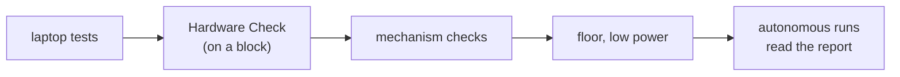

# Tutorial 19: Testing procedures

> **Work in progress:** this library and its docs are still changing. Something wrong or unclear? [Tell us](https://github.com/crossbotics/ftc-helper-lib/issues).

**You will learn:** how to use the Hardware Check OpMode, a fixed order for testing a robot (laptop,
bench, floor, autonomous, event), and how to turn a problem into a fix that stays fixed.

**You need:** any robot. Tutorials 01-03.

**Full program:** [`Tut19HardwareCheck.java`](../../examples/src/main/java/com/crossbotics/ftchelper/examples/tutorials/Tut19HardwareCheck.java) (yes, it is 3 lines)
**Reference:** [testing.md](../modules/testing.md). Guide with all checklists: [Testing procedures](../guides/testing.md).

---

## 1. The 3-line OpMode

```java
@TeleOp(name = "Tutorial 19: Hardware Check", group = "Tutorials")
public class Tut19HardwareCheck extends HardwareCheckOpMode {
}
```

`extends` means "is a kind of": this OpMode is a `HardwareCheckOpMode`, so it does everything that
class does. The library wrote the OpMode; you only give it a name.

## 2. Use it

Robot on a block. Run it. It lists every device in the active configuration and the battery voltage.

- **D-pad up/down**: choose a device. Changing device stops the last motor.
- **Motor**: right stick = power (50% max; hold RB for 100%). Watch: does positive power turn it the
  way you expect? Does the encoder count UP? A = zero the encoder.
- **Servo**: D-pad right/left = +/- 0.01, bumpers +/- 0.1, X = 0.5. Write down the positions you need.
- **Sensors**: live values. Press the switch, wave a hand at the distance sensor.
- **IMU**: turn the robot left by hand: yaw goes UP (if your hub is mounted logo up, USB forward).

## 3. A fixed order



Each step catches problems the next one would make dangerous or confusing. Example: a reversed drive
motor (found in seconds at step B) looks like "the robot spins randomly" at step D.

The full checklists, including the 2-minute pre-match check, are in
[Testing procedures](../guides/testing.md). Print them for the pit.

## 4. When something breaks

1. **Write it down**: what you did, what you expected, what happened. Turn debug telemetry on and
   take a photo of the screen.
2. **Reproduce it** on the bench. A problem you cannot repeat cannot be fixed on purpose.
3. **Find the layer**: hardware (Hardware Check shows it)? configuration (names)? your code? the library?
4. **Fix it and add a test** if it was logic (tutorial 13), so it can never come back silently.
5. **Note it** in the team's log: the next driver or programmer will meet it again.

## Run it

1. Copy the 3 lines into TeamCode (package line, delete `@Disabled`), run it.
2. Go through every device once. Fix any direction or name problem you find.
3. Take the pre-match checklist from the guide and time yourself: it should take about 2 minutes.

## Try this

1. Make your own OpMode that runs every drive motor forward for 1 second in turn, and shows its encoder change.
2. Write a test (tutorial 13) for something that once went wrong on your robot.

## You finished the tutorials

Next: [Tutorial 20: Easy TeleOp](20-easy-teleop.md). Then the [starter kit](../starter-kit.md) for a complete robot program, and
[Extending the library](../guides/extending.md) when you build something new.
