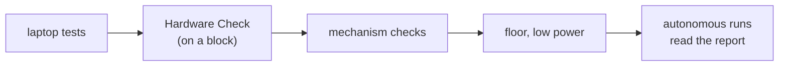

# Check the hardware (lesson 2b, also tutorial 19)

> **Work in progress:** this library and its docs are still changing. Something wrong or unclear? [Tell us](https://github.com/crossbotics/ftc-helper-lib/issues/new/choose).

**You will build:** a 3-line OpMode. With it, you test every motor, servo and sensor on the robot by hand.
This page is also lesson 2b of the main track (after lesson 2, Drive).

**You will learn:** how to use the Hardware Check OpMode, a fixed order for testing a robot (laptop,
bench, floor, autonomous, event), and how to turn a problem into a fix that stays fixed.

**You need:** any robot. On the main track, do [lesson 1](start/01-robot-in-five-files.md) and
[lesson 2](start/02-drive.md) first. On the under-the-hood track, do tutorials 01-03 first. The page's
file is `19-...` because it is also tutorial 19 of that track.

**Full program:** [`Tut19HardwareCheck.java`](../../examples/src/main/java/com/crossbotics/ftchelper/examples/tutorials/Tut19HardwareCheck.java) (only 3 lines)
**Reference:** [testing.md](../modules/testing.md). Guide with all checklists: [Testing procedures](../guides/testing.md).

---

## 1. The 3-line OpMode

The OpMode itself is 3 lines. With the lines every Java file needs, the whole file is below. Make a new
Java file `HardwareCheck.java` in your `teamcode` folder
([how to make a file](../start-from-zero.md#make-a-new-file-or-folder)). Replace everything in it with:

```java
package org.firstinspires.ftc.teamcode;

import com.qualcomm.robotcore.eventloop.opmode.TeleOp;
import com.crossbotics.ftchelper.testing.HardwareCheckOpMode;

@TeleOp(name = "Hardware Check", group = "Tests")
public class HardwareCheck extends HardwareCheckOpMode {
}
```

- **File name:** `HardwareCheck.java`, the same as the class name after `public class`.
- **The `package` line** says the file is in the `teamcode` folder.
- **The two `import` lines** say where `TeleOp` (from the FTC SDK) and `HardwareCheckOpMode` (from
  this library) are. **Why:** without them, the build says `cannot find symbol`.
- **No `@Disabled` line:** the Driver Station lists the OpMode.

`extends` means "is a kind of": this OpMode is a `HardwareCheckOpMode`, so it does everything that class
does. The library wrote the OpMode, and you only give it a name. The tutorial's own copy has the name
"Tutorial 19: Hardware Check". The name in `@TeleOp(name = ...)` can be anything.

## 2. Use it

Put the robot on a block, so the wheels are off the ground. Run the OpMode. It lists every device in
the active configuration, and the battery voltage.

- **D-pad up/down**: choose a device. When you change the device, the last motor stops.
- **Motor**: right stick = power (50% max; hold RB for 100%). **Stick up = positive power.** The SDK
  reads a stick pushed up as a negative number. The Hardware Check flips it for you, like the library's
  driving. Check whether positive power turns the motor the way you expect, and whether the encoder
  counts UP. A = zero the encoder.
  **On a lift or an arm:** no limits apply here, and RB gives full power. Use short, gentle taps. Know
  where its hard stop (the end of its travel) is, and keep hands clear.
- **Servo**: a servo cannot tell where it is. So first choose a **start point** near where the servo
  sits now: D-pad right/left = +/- 0.01, bumpers +/- 0.1, X = 0.5. Nothing moves yet. Keep hands clear,
  then press A: the servo moves to the start point. After that, the same buttons move it. To find the
  safe ends and positions, use the Servo Finder.
- **Sensors**: the screen shows live values. Press the switch, and wave a hand at the distance sensor.
- **IMU**: turn the robot left by hand. The **yaw** (the heading: which way the robot faces, in degrees)
  goes UP. That is for a hub mounted logo up, USB forward.

## 3. A fixed order



Do the steps in this order. Each step catches problems that would be dangerous or confusing in the next
step. For example, step B finds a reversed drive motor at once. At step D, the same motor looks like
"the robot spins randomly".

The full checklists, with the short pre-match check, are in [Testing procedures](../guides/testing.md).
Print them for the pit.

## 4. When something breaks

1. **Write it down**: what you did, what you expected, what happened. Turn debug telemetry on and take
   a photo of the screen.
2. **Reproduce it** on the bench. You can fix a problem on purpose only when you can repeat it.
3. **Find the layer** (where the problem lives): the hardware (the Hardware Check shows it), the
   configuration (names), your code, or the library.
4. **Fix it.** When the problem was in the logic, also **add a test** (tutorial 13). Then it can never
   come back without a warning.
5. **Note it** in the team's log: the next driver or programmer will meet it again.

## Try it in the simulator

The simulator lists the Hardware Check with the library's examples.

**Where:** the Terminal tab, in the `ftc-helper-lib` folder.

```bash
./gradlew :sim:fromRobot -PteamCode=none -ProbotClass=com.crossbotics.ftchelper.examples.lessonbot.Robot -Pout=build/lessonbot.properties
./gradlew :sim:run -PteamCode=none -Probot=build/lessonbot.properties
```

Open http://localhost:8780 and choose "Tutorial 19: Hardware Check". Press INIT, then ▶ (start on the
Driver Hub). Pick `lift` with the D-pad, and push gamepad 1's right stick up: the lift rises and its
count goes up. Pick `claw` and step it with the D-pad. **For your own robot:** run
`./gradlew :sim:run -PteamCode=../TeamCode` with your `HardwareCheck.java` in TeamCode (lesson 1 shows
how to make its robot file). The simulator builds its robot from your code. So it cannot find a wrong
wire or a motor that turns the wrong way: only the real robot can.

## Run it

1. Make the file from section 1 in TeamCode (the whole file, with its `package` and `import` lines).
   Build, install and run it.
2. Go through every device once. Fix any direction or name problem you find.
3. Take the pre-match checklist from the guide, and practice it until it is quick.

## Try this

1. Make your own OpMode that runs each drive motor forward for 1 second in turn, and shows its encoder
   change.
2. Write a test (tutorial 13) for something that once went wrong on your robot.

## You finished the tutorials

On the main track, go on to [Lesson 3: Buttons](start/03-buttons.md). Under the hood, go on to
[Tutorial 20: Easy TeleOp](20-easy-teleop.md), [21: Find your numbers](21-finders.md), and
[Lesson 1: The robot in five files](start/01-robot-in-five-files.md), the shortest way to a whole robot
program. When you build something new, read [Extending the library](../guides/extending.md).
