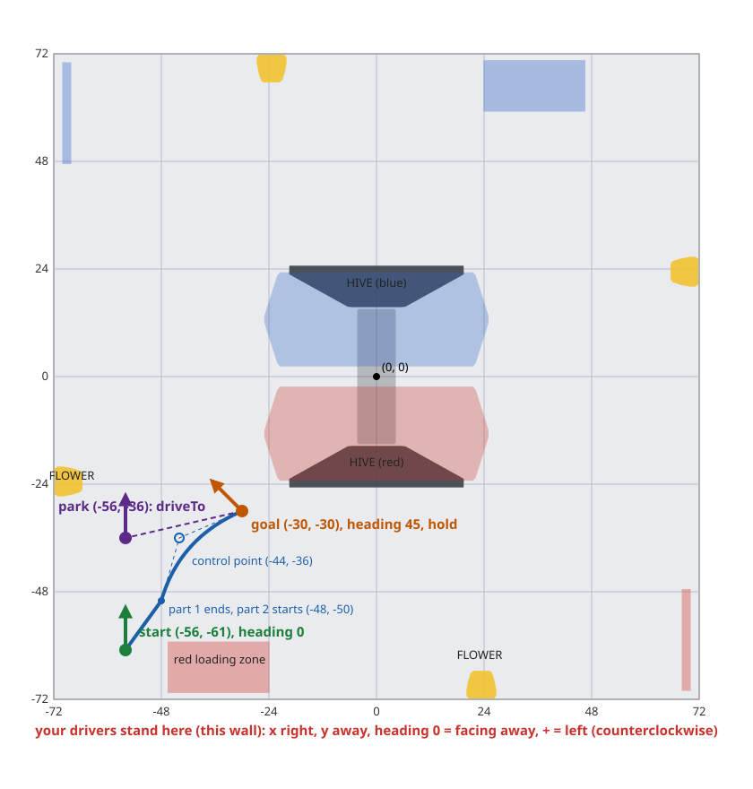

# Lesson 8: Paths with Pedro Pathing (optional)

> **Work in progress:** this library and its docs are still changing. Something wrong or unclear? [Tell us](https://github.com/crossbotics/ftc-helper-lib/issues).

**Goal:** your autonomous drives along **paths**: smooth curves and lines, one after another, fast, and
correcting all the way. Pedro Pathing does the driving; you write the path in the same field numbers
as lesson 7.

**You need:**

- A **mecanum** drive.
- **Odometry**: a goBILDA Pinpoint, a SparkFun OTOS, or dead-wheel pods, set up and checked in
  [lesson 7](07-odometry.md) (`Tunables.Odometry.checked` is `true`).
- About 5 by 8 ft of clear floor (a field is best).
- About two hours: about one hour for Pedro's tuning, the rest to set up and try paths.

> **Why odometry is required.** Pedro steers by where the robot really is on the field, every loop. Only
> odometry tells it that: a goBILDA Pinpoint, a SparkFun OTOS, or dead-wheel pods, set up and checked
> in [lesson 7](07-odometry.md). The drive wheels' encoders are not enough (they slip). Without an
> `odometry(...)` line, INIT stops with `follower(...) needs an odometry(...) line too`, and until
> `Tunables.Odometry.checked` is `true` every `follow` step is skipped.

> **Why mecanum only.** Pedro corrects the robot's position by sliding it sideways, so it needs
> wheels that can strafe. Pedro has no tank (two-side) drive. **On a tank drive** the library stops
> INIT with a clear message; use odometry with `turnTo` and `move` instead (lesson 7 and the
> [autonomous builder](../../guides/autonomous-builder.md)). `driveTo` needs mecanum too.
> A swerve drive can work through Pedro's own `Swerve` drivetrain (see the
> [escape hatches](../../modules/pedro.md#escape-hatches)); this is not tested.

**This lesson is optional.** Lesson 7's `driveTo` already drives to field points. Many teams never
need more. Read section 1, then decide.

**The code:** the Pedro robot, [`examples/.../pedrobot`](../../../examples/src/main/java/com/crossbotics/ftchelper/examples/pedrobot):
[`Robot.java`](../../../examples/src/main/java/com/crossbotics/ftchelper/examples/pedrobot/Robot.java),
[`PedroConstants.java`](../../../examples/src/main/java/com/crossbotics/ftchelper/examples/pedrobot/PedroConstants.java),
[`Tunables.java`](../../../examples/src/main/java/com/crossbotics/ftchelper/examples/pedrobot/Tunables.java) and
[`autos/CurveToTheGoal.java`](../../../examples/src/main/java/com/crossbotics/ftchelper/examples/pedrobot/autos/CurveToTheGoal.java).
It is lesson 7's robot plus one line.
**Reference:** [the pedro module](../../modules/pedro.md).

---

## 1. What a path follower does, and do you need one?

**`driveTo` is "go to that spot".** The robot points itself at the spot and drives there. On the way
it corrects, but it does not care how it gets there. To go around something, you add a spot in
between, and the robot slows down and stops at each one.

**A path follower is "drive along this road".** You draw the road: a line or a smooth curve. The
robot drives along it without stopping, at full speed where it can, and brakes at the end so it stops
on the point. If it is pushed off the road, it steers back onto it.

**Pedro Pathing** is a free path follower that many FTC teams use ([pedropathing.com](https://pedropathing.com)).
This library connects it to your five files, so you write paths in your own field numbers.

| | `driveTo` (lesson 7) | Pedro (this lesson) |
| --- | --- | --- |
| How you say where | a point and a heading | a road: lines and curves |
| Around a field element | a point in between (it stops there) | a curve (no stop) |
| Speed | good | faster, with smooth braking |
| Extra setup | none | an add-on, and Pedro's own tuning (about an hour of the lesson's two) |

**Our advice:** start with `driveTo`. Change to Pedro when you want curves, or when stopping at
every point costs you time in autonomous. You can use both in one autonomous.

---

## 2. Words you will meet

| Word | What it means |
| --- | --- |
| **path** | the road the robot follows, from a start point to an end point |
| **line** | a straight path between two points |
| **curve** | a smooth bent path. Pedro uses **Bezier** curves (say "bez-ee-ay") |
| **control point** | a point that **pulls** a curve toward it, like a magnet. The robot does **not** drive through it |
| **part** | one line or curve. A path can have several parts, driven with no stop between them |
| **follower** | the code that drives the robot along the path (Pedro's `Follower`) |
| **Foresight** | the name of Pedro's way of driving. It looks ahead to know when to brake |
| **hold** | after the path, keep the robot on the end point and push back if it is bumped |

**A curve with one control point:**

```text
   start (-48, -50) ----.
                          `.          (-44, -36) is the control point:
                            \             the curve bends toward it,
                             \            but does not touch it
                              `----> end (-30, -30)
```

**How far does a curve bulge?** With one control point, the middle of the curve is halfway between
the middle of the straight line (start to end) and the control point. Then check it in the
simulator: it shows where the robot really drove.

---

## 3. Add Pedro to your project

Pedro is a separate library. You add it once. Do these steps on the computer with Android Studio.

1. Open `settings.gradle` (in the project folder, not in TeamCode). Under the two `ftc-helper-lib`
   lines, add:

   ```groovy
   include ':ftc-helper-lib-pedro'
   project(':ftc-helper-lib-pedro').projectDir = new File(rootDir, 'ftc-helper-lib/pedro')
   ```

   **Why:** this tells Gradle (the tool that builds your app) that the Pedro add-on is in the
   `pedro` folder of the library.

2. Open `TeamCode/build.gradle`. In `dependencies { ... }`, under the `ftc-helper-lib` line, add:

   ```groovy
   implementation project(':ftc-helper-lib-pedro')
   ```

   **Why:** this lets your TeamCode use it. Pedro itself is downloaded for you.

3. Click **Sync Now** (or **File > Sync Project with Gradle Files**). Wait for it to finish with no red
   errors.

---

## 4. Robot.java: one line, and Pedro's numbers

Add one line to `define()`, **after** the `odometry(...)` line:

```java
odometry(Odometry.pinpoint("pinpoint").offsetsMm(-84, -168));
follower(Pedro.follower(PedroConstants.foresight));
```

Android Studio shows `Pedro` in red: click it and press **Alt+Enter** to add the `import` line.

**What this line does:** Pedro gets the drive motors from your `drive(...)` line and the robot's place
from your `odometry(...)` line. You do not set them up again.

Now copy [`PedroConstants.java`](../../../examples/src/main/java/com/crossbotics/ftchelper/examples/pedrobot/PedroConstants.java)
from the example into your TeamCode folder, next to `Robot.java`. Then make its first line (the one
that starts with `package`) **the same as the first line of your `Robot.java`**: copy that line over.

**You do not need to read or understand this file.** Copy it as it is. The tuner fills it in, in
section 7.

**Its numbers are not for your robot.** They are Pedro's sample numbers: how fast a sample robot goes,
how it brakes, how hard it corrects. They are good enough for the simulator. On your robot, Pedro's
tuner measures your own numbers (section 7). Until then, do not trust a path on the real robot.

---

## 5. Write your first path

Here is the example's autonomous. Read it step by step:

```java
// Two parts with no stop between them, then hold the end point.
static final PedroPath TO_GOAL = PedroPath.line(-56, -61, -48, -50).keepHeading(0)   // part 1
        .then(PedroPath.curve(-48, -50,  -44, -36,  -30, -30)).turnTo(0, 45)        // part 2
        .holdEnd();

@Override
protected void steps(Steps s, Robot robot) {
    s.start("Against our wall, in the left corner tile, facing the field", -56, -61, 0)
     .follow("To the goal", TO_GOAL, PathAt.fraction(0.5, "Intake on", robot.intake::in))
     .waitSeconds("Score (the robot holds still)", 0.5)
     .run("Intake off", robot.intake::stop)
     .parkWithSeconds(4)
     .driveTo("Park", -56, -36, 0, 0.7);
}
```

- **`PedroPath.line(-56, -61, -48, -50)`**: a straight line from the start spot to (-48, -50). The
  numbers are the same field numbers as lesson 7: x right, y away from your wall, in inches.
- **`.keepHeading(0)`**: the robot keeps facing away from you on this part. (A mecanum robot can slide
  sideways while it faces one way.)
- **`.then(PedroPath.curve(-48, -50,  -44, -36,  -30, -30))`**: a second part, a curve. Read the
  numbers in pairs: start (-48, -50), control point (-44, -36), end (-30, -30). **Start each part where the last one ended** (here, -48, -50). The robot does not stop
  between the parts.
- **`.turnTo(0, 45)`**: on this part, it turns evenly from heading 0 to heading 45.
- **`.holdEnd()`**: at the end, Pedro keeps the robot on the point while it scores (at most 5 s;
  `.holdEnd(2)` for 2 s).
- **`static final`**: the path is made once, when the program starts. It is the same every match.
- **`.follow("To the goal", TO_GOAL, ...)`**: the step that drives the path. It waits until the robot is
  at the end. Then the next step runs.
- **`PathAt.fraction(0.5, "Intake on", robot.intake::in)`**: halfway along the path, the intake starts,
  and the robot keeps driving (more just below).
- **`.driveTo("Park", ...)`**: you can mix `driveTo` and `follow`. A driving step ends the hold first.

**Headings must match at a join.** Part 1 ends facing 0, and part 2 starts at 0 (`turnTo(0, 45)`).
If part 2 started at another heading, the robot would turn fast at the join.

Like lesson 7, the example also has `mirrorForRed()` returning `false` (BIOBUZZ's field is turned, not
mirrored). Keep yours.

**Settings after a part apply to that part.** `.turnTo(0, 45)` comes after the curve, so it is the
curve's heading. `.holdEnd()` is for the whole path.

**Other choices** (all in [the module page](../../modules/pedro.md#pedropath-paths-in-our-field-numbers)):
`.facePath()` faces along the road (the default), `.facePathBackwards()` drives backwards along it,
`.facePoint(x, y)` keeps facing a spot, `.maxSpeed(0.5)` drives that part at half speed (write it
after each part that needs it; the robot slows down inside that part, so make it long enough).

**Do something while the robot drives.** Put `PathAt` things after the path, in the `follow` step.
Each one starts once, at its place along the path, and the robot keeps driving:

```java
.follow("To the goal", TO_GOAL, 15,                              // at most 15 s, then the things to do
        PathAt.fraction(0.5, "Intake on", robot.intake::in),        // halfway along the whole path
        PathAt.part(2, "Intake off", robot.intake::stop),           // where part 2 starts
        PathAt.inchesLeft(12, "Spin up", robot.launcher::spinUp))   // 12 in before the end
```

The `15` is the time limit (seconds), as in a `follow` without `PathAt`: write it before the `PathAt`
things. `robot.intake` and `robot.launcher` are parts in your `Robot.java` (a launcher comes in lesson 9):
use your own parts' names.

| Write | It starts |
| --- | --- |
| `PathAt.inchesDone(10, ...)` | after 10 in of the path |
| `PathAt.inchesLeft(12, ...)` | 12 in before the end |
| `PathAt.fraction(0.5, ...)` | when that much of the WHOLE path is done (0.5 = halfway, all parts counted) |
| `PathAt.part(2, ...)` | where part 2 starts (a path made with `then`) |
| `PathAt.near(x, y, 6, ...)` | when the robot is within 6 in of a field point |

Give each one a name and a command (`"Spin up", robot.launcher::spinUp`), or an action from your
`Actions.java` (`PathAt.inchesLeft(12, Actions.scoreHigh(robot))`, or any action you wrote; it keeps
running after the step). Android Studio shows `PathAt` in red: **Alt+Enter**
adds the `import`. Write them in the order they come along the path. If the path ends early
(`STALLED`, `timed out`), the report says which did not start: `To the goal: STALLED, not fired: Spin up`.
`.alongside(action)` before the `follow` still works too: it starts the action before the path.

**Do not drive straight back along the same line in one path.** In tests, Pedro took a shortcut onto
the way back at once. Use two `follow` steps (out, then back), or a curve that turns around.

**Start each path where the robot is:** the first path at the start spot in `s.start(...)`, and each
next path where the last one ended.

**Here is the example's path on the field** (seen from the red wall, like lesson 7's map). The thin
dashed line goes to the control point: the curve bends toward it but does not touch it.



**Plan your own path on the field map** the same way: check that no part goes through a field element.
A curve bulges toward its control point, so check the bulge too.

**Or draw it:** the [Pedro Path Builder](https://crossbotics.com/ftc-helper/path-builder/) (a web page, no
install) shows the BIOBUZZ field like this map. Tap to add parts and drag the points. It draws the
18 x 18 in robot along the path and marks in red where it hits a field element or a wall. Then it
writes the `PedroPath` code for you to copy. You can also paste your path into it to change it.

**Or draw it in the simulator and run it:** the simulator's **Auto builder** (over the 3D view, "Pedro
path") is the same builder with a Run button: it follows your path with the real Pedro follower on your
robot, shows the plan and where the robot really went, and offers fixes ("hold the end"). The Java is the
same. ([The auto builder](../../guides/simulator.md#the-auto-builder).)

---

## 6. Try it in the simulator first

The simulator runs Pedro like the real robot. It is the safe place to find a path that hits a wall.

**The example first.** From the `ftc-helper-lib` folder, as in lesson 7 but with the Pedro robot:

```bash
./gradlew :sim:fromRobot -PteamCode=none -ProbotClass=com.crossbotics.ftchelper.examples.pedrobot.Robot -Pout=build/pedrobot.properties
./gradlew :sim:run -PteamCode=none -Probot=build/pedrobot.properties
```

Open http://localhost:8780, choose **"Pedro Bot Curve to the Goal"**, choose **RED** in the INIT menu,
INIT, START.

**What you should see:** the robot drives a short straight line, then curves to the goal without
stopping, turning to 45 degrees. Halfway, the intake starts. It stays still there for half a second (the Driver Station shows
`Path: holding the end`), then drives to park. At the end the report says `done` for every step.

**Look at the path lines** on the field map (Control Hub, Robot tab) or in the 3D view:

- **Orange, dashed:** the plan, the path Pedro drives. It shows as soon as the `follow` step starts.
- **Green:** the trail, where the robot really went.

Here the two lines lie on top of each other: the robot drove the plan.

**Check your own path this way.** Before you run it, look at the orange line: does it cross a field
element? The robot is wider than the line, so keep half its width (9 in for an 18 in robot) clear on
each side. Then run it. Where the green line leaves the orange one, something went wrong: the robot hit
something (it turns red), or it went too fast to turn or brake in time. Fix the path (move a control
point, or slow that part with `maxSpeed(0.5)`), press **Clear lines**, and run it again.

**Your own robot.** From the `ftc-helper-lib` folder:

```bash
./gradlew :sim:fromRobot -PteamCode=../TeamCode
./gradlew :sim:run -PteamCode=../TeamCode
```

Choose your autonomous, INIT, START, and read the report at the end. (The example has `@Disabled`
so it does not show up on your real robot's list; the simulator shows it anyway. Your own autonomous
must not have `@Disabled`.)

In the simulator, `follow` runs even when `Tunables.Odometry.checked` is `false`. On the real robot it
is skipped until then (lesson 7).

---

## 7. Tune Pedro on the robot

Pedro needs to measure your robot: its top speed, how far it slides when it brakes, and how hard to
correct. Pedro's **Foresight tuner** does this for you. It drives the robot by itself, so you need
clear floor and a person ready at the Driver Station to stop it.

**Before you start:** lesson 7 is done (the odometry is checked). Use a charged battery.

1. **Add Pedro's tuning library.** Open `build.dependencies.gradle`. It is in the project folder,
   next to `settings.gradle`. It has a `repositories { ... }` block and a `dependencies { ... }` block.
   Add one line to each (keep the lines that are already there):

   ```groovy
   repositories {
       // ...the lines already here...
       maven { url 'https://repo.dairy.foundation/releases/' }
   }

   dependencies {
       // ...the lines already here...
       implementation 'com.pedropathing:tuning:1.0.1'
   }
   ```

   Sync again. The simulator sees this line too and adds Pedro's tuning library to its own build, so
   `:sim:run` still builds your TeamCode with the tuner files in it (nothing to add in `simulator/`).

2. **Copy Pedro's tuner files.** From [Pedro's Quickstart](https://github.com/Pedro-Pathing/Quickstart),
   folder `TeamCode/src/main/java/org/firstinspires/ftc/teamcode/pedro`, copy the `procedures` folder
   and `Tuning.java` into a new `pedro` folder in your TeamCode. To make the folder in Android Studio:
   right-click the `teamcode` folder (the one with `Robot.java`), **New > Package**, type `pedro`.
   Pedro's files already start with `package org.firstinspires.ftc.teamcode.pedro...`: if your
   TeamCode uses that standard package, they fit as they are.

3. **Point the tuner at your robot.** `Tuning.java` is empty. Make it this (fix the `Robot` import if
   your `Robot.java` is in another package):

   ```java
   package org.firstinspires.ftc.teamcode.pedro;   // the folder you just made

   import com.crossbotics.ftchelper.pedro.PedroTuning;
   import com.pedropathing.tuning.autotune.Procedure;
   import com.pedropathing.tuning.autotune.Tuner;
   import org.firstinspires.ftc.teamcode.Robot;
   import org.firstinspires.ftc.teamcode.pedro.procedures.ForesightTuner;

   public class Tuning {
       @Tuner
       public static Procedure foresightTuner() {
           return new ForesightTuner(PedroTuning.localizer(Robot::new), PedroTuning.drivetrain(Robot::new));
       }
   }
   ```

   New Java here: `Robot::new` means "make a new Robot" (the tuner makes one when it starts).
   `@Tuner` tells Pedro's web page to list this procedure.

   The `import org.firstinspires.ftc.teamcode.Robot;` line must name your `Robot.java`: its folder
   (from its first line) plus `.Robot`.

   **What this does:** the tuner uses your own `drive(...)` and `odometry(...)` lines, so it measures
   the robot the same way the autonomous drives it.

4. **Run it.** Send the code to the robot. Connect the laptop to the robot's WiFi and open
   **http://192.168.43.1:10158** in a browser. Choose **Foresight Procedure** and follow the page. It
   drives forward, sideways, brakes and turns, many times, **at full power** (the PRACTICE limit does
not work here). Keep clear of the robot, and keep a hand on STOP.

5. **Copy the numbers.** At the end, the page shows a **Java** tab with lines like
   `c.maxAchievableForwardVelocity.set(68.4);`. In your `PedroConstants.java`, **replace every
   `c.something.set(...);` line** (the lines between `c -> {` and `});`) with the lines from the Java
   tab. Keep the first and last lines of the file as they are. **Copy them into the file every time:**
   the tuner does not change your code.

6. Send the code again.

7. **Before an event, take the tuner out.** Pedro's tuner runs a web page on the robot, and this
   season's rule R704.D bans tools like that at events (like FTC Dashboard). Comment out the
   `tuning` line in `build.dependencies.gradle` (put `//` in front of it), move `Tuning.java` and the
   `procedures` folder out of TeamCode, then build and install again. Your paths still work: they
   only need `PedroConstants`. Put them back after the event to tune again.

---

## 8. The first real run

0. **Optional but useful:** Pedro's own **Tests** procedure (its Line and Curve tests) checks the
   numbers before your autonomous does. Add it to `Tuning.java` the same way, from Pedro's
   [testing page](https://pedropathing.com/docs/pathing/tuning/test).
1. Make the path short: one straight `PedroPath.line(...)` of about 24 in, in open floor.
2. Use the **PRACTICE** profile: the wheels get at most `practiceMaxPower` (0.6).
3. Put the robot on the start spot, facing the start heading. INIT, then START. Hand on STOP.
4. Watch: it drives the line and stops near the end. Pedro calls it done within about 2.5 in and
   11.25 degrees ([how to make that tighter](../../modules/pedro.md#when-is-a-path-done)).
5. Then try your real path, still in PRACTICE. Then COMPETITION.

**If it goes the wrong way, press STOP.** Then check the table below.

---

## If something goes wrong

| What you see | What to do |
| --- | --- |
| `Pedro` or `PedroPath` is red in Android Studio | section 3, then Sync |
| INIT stops: `follower(...) needs an odometry(...) line too` | the `follower` line needs the `odometry` line above it |
| INIT stops: `Pedro.follower needs a mecanum drive(...) line` | Pedro needs mecanum. On a tank drive, use `turnTo` and `move` |
| Every `follow` says `skipped` in the report | `Tunables.Odometry.checked` is `false`: finish lesson 7 |
| It overshoots and comes back, or shakes | `PedroConstants` still has the sample numbers: section 7 |
| It drives the wrong way at once | STOP. Run lesson 7's Odometry Tuner again; check the motor directions (lesson 2) |
| It stops a little short of the end | normal: Pedro is done within 2.5 in. To change it, see [the module page](../../modules/pedro.md#when-is-a-path-done) |
| The report says `STALLED` | the robot was stuck (against a wall or a robot). The next steps still run |
| The report says `timed out` | the path took more than 10 s: make it shorter, or give `follow` more seconds: `.follow("To the goal", TO_GOAL, 15)` |
| It is slow | PRACTICE uses `practiceMaxPower`. COMPETITION uses `maxPower` |
| The tuner's page does not open | the laptop must be on the robot's WiFi; check the address |
| The tuner does not compile | step 1 of section 7 (both lines), then Sync |

## Next

The main track is lessons 1 to 6, plus the lessons your robot needs. Is your robot a shooter? Next:
[Lesson 9: A shooter, a camera and a turret](09-shooter-and-camera.md).

- [The pedro module](../../modules/pedro.md): every option, how it works inside, the escape hatches.
- [Pedro Pathing's own docs](https://pedropathing.com): more about tuning and what Foresight does.
- [The autonomous builder](../../guides/autonomous-builder.md): everything an autonomous can do.
