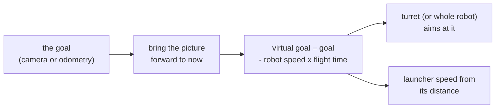

# Lesson 9: A shooter, a camera and a turret (for robots that shoot)

> **Work in progress:** this library and its docs are still changing. Something wrong or unclear? [Tell us](https://github.com/crossbotics/ftc-helper-lib/issues).

**Goal:** add a flywheel shooter with a feeder, then a camera that aims a turret and picks the shot speed.
Then the helpers that let the drivers focus on driving and firing: one shot table per game piece, the
odometry as a backup when the camera loses the goal, aiming the whole robot (no turret), a buzz
when the aim is on target, and shooting while the robot drives.

**You need:** lessons 1 to 6 (the last one: [Your first autonomous](06-first-autonomous.md)); lessons 7 and 8
are not needed. Skip this lesson if your robot does not shoot. A flywheel
(a heavy wheel that spins fast and throws the game piece) on a motor with its encoder cable, and a feeder (a servo, a CR
servo or a motor). For the second half, a Limelight 3A (or a webcam) and a turret on a motor.
**Safety glasses:** a flywheel throws things.

The lesson robot has no shooter, so this lesson reads two other example robots built the same way:

- [`gobildabot`](../../../examples/src/main/java/com/crossbotics/ftchelper/examples/gobildabot): goBILDA's
  BIOBUZZ starter bot. A flywheel fed by a "windmill" on a CR servo.
- [`turretbot`](../../../examples/src/main/java/com/crossbotics/ftchelper/examples/turretbot): a turret with a
  Limelight on it that follows the goal, and a flywheel whose speed comes from the distance (one table
  per game piece).
- [`flywheelbot`](../../../examples/src/main/java/com/crossbotics/ftchelper/examples/flywheelbot): no turret;
  a webcam, and the whole robot turns to face the goal (section 10).

**Reference:** [Launcher](../../modules/robot.md#launcher), [Indexer](../../modules/robot.md#indexer), [Hood](../../modules/robot.md#hood),
[Camera](../../modules/robot.md#camera), [Turret](../../modules/robot.md#turret), [Aim](../../modules/robot.md#aim).

> **A long lesson: you can skip sections 8 to 14 on a first read.** Sections 1 to 7 are what most
> shooters need: a flywheel, a feeder, a camera, a turret and the speed from the distance. Each of
> sections 8 to 14 adds one helper (two shot tables, a hood, the odometry backup, whole-robot aim, a
> buzz, a piece count, a light, shooting while moving). Come back to one when your robot has that part.

---

## 1. A flywheel and its feeder

From [`gobildabot/Robot.java`](../../../examples/src/main/java/com/crossbotics/ftchelper/examples/gobildabot/Robot.java):

```java
launcher = add(Launcher.flywheel("launcher", "gobilda-5203-6000")
        .feeder(Indexer.crServo("windmill").reversed()));
```

- `Launcher.flywheel("launcher", "gobilda-5203-6000")`: the flywheel motor's name in the configuration,
  and the motor by its [catalog id](../../guides/parts-catalog.md). From the id the library knows the
  encoder counts per turn and the top speed, so it can work in RPM (turns per minute).
- `.feeder(...)`: the part that pushes ONE piece into the wheel. The launcher decides when.
- `Indexer.crServo("windmill")`: a CR servo (a servo that spins all the way round, like a small motor)
  that runs for a moment per piece. `.reversed()`: it turns the other way.
- Other feeders: `Indexer.servo("indexer")` pushes and comes back; `Indexer.motor("feeder")` runs a roller.

**Imports:** each part class needs one at the top of `Robot.java`, all from
`com.crossbotics.ftchelper.robot`: `import com.crossbotics.ftchelper.robot.Launcher;` and
`...robot.Indexer;` here, `...robot.Camera;` and `...robot.Turret;` in sections 5 and 6. Careful with
Alt+Enter (Option+Enter on a Mac): it may offer a second `Launcher` and `Turret` in
`com.crossbotics.ftchelper.launcher` (the building blocks of the under-the-hood tutorials). Pick the
`robot` ones.

**Why a feeder the launcher controls?** A piece only flies right when the wheel is at its speed. If the
driver fed by hand, some pieces would go in too early and fall short.

## 2. Its numbers

From [`gobildabot/Tunables.java`](../../../examples/src/main/java/com/crossbotics/ftchelper/examples/gobildabot/Tunables.java):

```java
public static class Launcher {
    public static double speedRpm = 2679, stepRpm = 50, readyBandRpm = 107, idleRpm = 0;
    public static double kP = 40, kI = 0, kD = 0, kF = 12.5, nominalVolts = 12.8;
}

public static class Windmill {
    public static double power = 1.0, feedSec = 0.3;
}
```

| Number | Means |
| --- | --- |
| `speedRpm` | the shot speed. Above the motor's top speed, INIT stops with a message. |
| `stepRpm` | how much one D-pad press changes the speed |
| `readyBandRpm` | how close to `speedRpm` counts as "at speed" (it must stay there 0.15 s) |
| `idleRpm` | the speed it drops back to when the driver spins it down (0 = coast to a stop) |
| `kP`, `kI`, `kD`, `kF` | the **gains**: how hard the hub pushes to hold the speed. goBILDA published tested ones for this kit bot. Your own robot can leave them out at first ([below](#the-first-spin-up-with-no-numbers)). |
| `nominalVolts` | the battery voltage when the gains were measured. Used only by battery compensation, which is off unless you turn it on ([section 8](#speed-trim-and-a-low-battery)). |
| `power`, `feedSec` (Windmill) | the feeder's power, and how long it runs per piece |

A servo feeder (`Indexer.servo`) has `rest`, `push`, `pushSec`, `returnSec` instead. It goes to `rest`
at START, never in INIT.

### The first spin-up with no numbers

A new launcher can run before you know any of its numbers. Leave out `kP` to `kF` and `speedRpm`:
the library works out starting ones from the motor named in Robot.java
(`Launcher.flywheel("launcher", "gobilda-5203-6000")`) and its numbers in the parts catalog, and INIT says
so:

```text
Launcher: starting values from the parts catalog (kF 11.7, kP 1.17, kI 0.117, speed 3600 rpm): run the Flywheel Finder, then the Shot Tuner
```

- **kF** is the power for a speed: the hub's full power is 32767, and the motor's top speed is 6000 RPM x
  28 counts / 60 = 2800 counts a second, so F = 32767 / 2800 = 11.7. With it the wheel gets close to
  any speed by itself. kP (F / 10) and kI (kP / 10) fix the rest. This is REV's starting formula, and the
  same math the Flywheel Finder uses with the speed it measures on YOUR wheel.
- **speed 3600** is 60% of the motor's top speed: the speed control needs room above the speed to push
  harder after each shot and on a tired battery, and a middle speed is a gentle first shot.

Without these, the hub would use its own gains (P 10, I 3, F 0): no F, so the wheel would only creep up
to its speed. Spin up with LB and check that it reaches the speed (Driver Station). Then:

**Find the gains with the Flywheel Finder** ([how](../../guides/finders.md#flywheel-finder-gains-and-recovery)).
It needs no code. Choose the `launcher` motor; it shows a line to copy into `Tunables.Launcher`:

```text
Tunables.Launcher: kP = 1.17, kI = 0.117, kD = 0, kF = 11.70, nominalVolts = 12.6
```

`nominalVolts` is the battery voltage while it measured: the gains are right for that voltage. Copy
it too: only battery compensation uses it, which is off unless you turn it on
([section 8](#speed-trim-and-a-low-battery)).

If the wheel needs longer than 0.25 s to get back to speed after a shot, the line also has
`shotIntervalSec` (the time between two feeds), a little above that time.

You can change `speedRpm` and `stepRpm` with the tuning menu (PRACTICE profile, hold GUIDE 1 s). The
others are read once at INIT: change them in the file.

## 3. The buttons it brings

You write nothing in `Controls.java` for these. They are on the operator's gamepad (gamepad 2), or
gamepad 1 with `oneDriver = true`, as in the goBILDA bot:

| Button | Does |
| --- | --- |
| LB | spin up / spin down (to `idleRpm`) |
| RB | fire one: spins up if needed, feeds as soon as it is at speed |
| RB held | keeps firing, one piece after another; let go and no more are fed |
| D-pad up / down | speed + / - `stepRpm`; with speed from distance (below), the speed trim + / - 1% |
| D-pad up / down held | one more step every 0.25 s (after half a second), for a big change |
| D-pad down double-tap | back to `speedRpm` (no trim) |
| D-pad up double-tap | use last time's trim (only when the Driver Station offers it at INIT) |

Spinning up early with LB saves time: the wheel is ready when the shot is lined up. The goBILDA bot adds
one job of its own, Y to fire all three: `g1.y.press(Actions.fireAll(robot)).says("fire all");`

**Are LB and RB still free?** A job of yours in `Controls.java` on one of these buttons takes it from
the launcher. If you followed lesson 5, your actions are on gamepad 2's RB and LB, so the launcher gets
no spin-up and no fire button. INIT says so, for example
`Launcher fire one; hold: keep firing: no button (G2 RB is your "score high" in Controls.java)`.
Move your own jobs to free buttons (INIT lists them: `G2 free: ...`), so the launcher gets its
buttons back.

**Spin up at START.** Add `.spinAtStart()` and the wheel spins up right after START, in autonomous and
TeleOp, so the first shot does not wait. LB still spins it down.

```java
launcher = add(Launcher.flywheel("launcher", "gobilda-5203-6000")
        .feeder(Indexer.crServo("windmill").reversed())
        .spinAtStart());
```

## 4. The two safety rules

The launcher keeps two rules for you. Know them, because they explain what the robot does.

1. **Never feed into a slow flywheel.** A piece is fed only when the wheel has stayed within
   `readyBandRpm` of its speed, and every other check (step 7) is true. Between two pieces it waits
   `shotIntervalSec`, so the wheel can get back to speed.
2. **Never wait forever.** If it is not ready within 3 s, it gives up the shots still waiting and the
   Driver Station says why: `Launcher gave up: flywheel`. A robot that fired late, at a bad moment,
   would be worse than one that did not fire.

## 5. A camera that knows the goal

From [`turretbot/Robot.java`](../../../examples/src/main/java/com/crossbotics/ftchelper/examples/turretbot/Robot.java):

```java
camera = add(Camera.limelight("limelight").autoPipelines(0, 1, 2).goal("BLUE SCORING", "RED SCORING"));
```

- `Camera.limelight("limelight")`: a Limelight 3A, by its configuration name. A webcam is
  `Camera.webcam("Webcam 1")`.
- `.goal("BLUE SCORING", "RED SCORING")`: this season's goal for each alliance, by the name of its group
  of AprilTags (the square black-and-white codes on the field). The camera then gives the goal for this
  match's alliance, chosen in autonomous's INIT menu (TeleOp remembers it).
- `.autoPipelines(0, 1, 2)`: venue lighting. A **pipeline** is one set of camera settings saved on the
  Limelight, by number (what to look for, how bright the picture is). Every gym has different light,
  and a pipeline that finds tags well at school can miss them at an event. In INIT the robot tries
  each pipeline, counts the pictures that see a tag, and keeps the best. Put your usual pipeline
  first: it wins a tie. A webcam does the same with `.autoExposure()` (it tries exposures instead of
  pipelines). How it works: [vision.md](../../modules/vision.md#venue-lighting).
- Its numbers: `Tunables.Limelight.pipeline` (the pipeline to use when the test is off) and
  `autoLighting` (true = run the test; false = skip it and use `pipeline`).
- The camera starts in INIT, so it is already looking at START. It has no buttons.

**Set up the three pipelines.** On a laptop on the robot's network, open the Limelight's page:
http://limelight.local:5801. Then, for each pipeline:

1. Pick the pipeline number (0, 1 or 2) in the pipeline list at the top.
2. Set its type to AprilTag (Fiducial), and the tag family and size from the game manual.
3. In the **Input** tab, move the **Exposure** slider: 0 = your usual light, 1 = bright light (lower
   exposure, so tags are not washed out white), 2 = dim light (higher exposure, and more **Sensor
   Gain**, which makes the whole picture brighter but grainier, if it is still dark).
4. Save the pipeline. The Limelight's own docs (docs.limelightvision.io) show every setting.

**At INIT and at START.** Have a tag in view at INIT (where the robot starts the match is fine), or the
test cannot help. The Driver Station shows the result, e.g.
`limelight lighting : pipeline 2 (9 of 10 pictures saw tags)`. At START the test stops at once and keeps
the best pipeline so far (the first one if none saw a tag), so the robot never aims with a pipeline
it is only trying.

**At an event:** in the queue (or on the practice field), INIT once with the robot facing a HIVE tag.
Read the pipeline it picks. Under the `limelight lighting` line the Driver Station then shows two lines
to copy, e.g.

```java
public static double pipeline = 2;
public static boolean autoLighting = false;
```

Put them in `Tunables.Limelight` (change the `pipeline` line that is there; add the `autoLighting` line
if it is not), and the robot uses that pipeline at once in every match there, with no test. Back at
school, set `autoLighting = true` again. A webcam shows `exposureMs` instead of `pipeline`: that is a
new line to add to the camera's section (for example `Tunables.Webcam`).

## 6. A turret that follows it

```java
turret = add(Turret.motor("turret", "gobilda-5203-117").gearRatio(5).follows(camera));
```

- `Turret.motor("turret", "gobilda-5203-117")`: the motor's name and its catalog id.
- `.gearRatio(5)`: the motor turns 5 times per turret turn (the gears or belt). It must be right, or
  every angle is wrong.
- `.follows(camera)`: from START, every loop, the turret turns toward the goal. The camera is on the
  turret. (One on the robot's body: add `.cameraOnBody()`.)

```java
public static class Turret {
    public static double min = -90, max = 90;
    public static double kP = 0.02, kI = 0, kD = 0.001;
    public static double maxPower = 0.8, tolerance = 1.5, cameraOffset = 0;
}
```

- `min`, `max`: the range in degrees (0 = straight forward, counterclockwise +). It never turns past
  them. A goal outside waits at the limit, and the Driver Station says "goal out of turret range". A
  goal far outside (behind the robot, more than 10 degrees past a limit, from the odometry of section 9)
  makes it hold where it points instead of swinging from one limit to the other.
- `kP`, `kI`, `kD`: how hard it turns toward the target. Tune `kP` live in the tuning menu: too low and
  it lags, too high and it shakes.
- `tolerance`: how many degrees off still counts as "aimed". `cameraOffset`: if shots land to one side,
  the [Aim Tuner](../../guides/finders.md#aim-tuner-camera-offset) finds it.
- **0 degrees is where the turret points when you press INIT** (`startAngle`, default 0). Point it
  straight forward first, or add a home switch so it finds its angle by itself at START. That is why
  INIT says, on a turret with no home switch:
  `Turret : no angle from a program before: turn it to startAngle 0 deg by hand and INIT again, or every angle is off`.
  A TeleOp right after a program (within 5 minutes) goes on from that program's angle instead and says
  `... carried from the last program ...`. An autonomous says
  `startAngle 0 deg: put the turret there by hand before INIT, or every angle is off`. (The simulator's
  turret always starts at 0: there you can ignore these lines.)
- Its buttons: operator right stick X turns it by hand (following pauses while you move it), BACK
  switches following on and off.

The software limits do not replace hard stops: give the turret a mechanical stop just past each limit.

**Your turret is built differently?** A servo turret, a CR servo with an encoder, a slip ring that turns
round and round, a home switch (touch or magnetic), a range of +/-90, +/-180 or +/-190: the page
[Setting up a turret](../../guides/turret-setup.md) asks you seven questions about yours and gives the
exact lines for each answer. A turret that can hit another part (a lift at the back) needs an
[interlock rule](../../guides/interlocks.md): the [V2 robot](../../../examples/src/main/java/com/crossbotics/ftchelper/examples/v2bot/Robot.java)
has a turret, a lift with a wrist and a claw, and the rule that keeps them apart.

## 7. Speed from distance, and fire only when aimed

```java
launcher = add(Launcher.flywheel("launcher", "gobilda-5203-6000")
        .feeder(Indexer.servo("indexer"))
        .speedFromDistance(camera)
        .startTable("pollen")
        .requireReady("turret aimed", () -> turret.isAimed()));
```

- `.speedFromDistance(camera)`: the speed comes from the camera's distance to the goal, from this table
  (one table; section 8 has two, as the turret robot does):

  ```java
  public static double[][] speedByDistance = {{24, 2200}, {48, 2550}, {72, 2900}, {96, 3250}};
  ```

  `double[][]` is a table of numbers: a list of rows, each row in `{ }`. Each row is `{inches, rpm}`.
  Between rows the speed is blended: at 36 in, halfway between the 24 and 48 rows, it is halfway
  between their speeds (2375). With no goal in view, it keeps the last
  speed (a sudden change would spoil the next shot); before the goal is first seen, it uses `speedRpm`.
  Fill the rows from real shots with the [Shot Tuner](../../guides/finders.md#shot-tuner-the-shot-table).
  Its buttons are all on **gamepad 1**: at each distance shoot 3-5 at a speed (RB), mark each A = HIT or
  B = MISS, try another speed (D-pad), and X keeps the speed with the best **hit ratio** (hits out of
  shots: 4 in out of 5 beats 2 out of 3). Marked one wrong? Left stick click takes the last mark back.
  **Hold BACK 1 s** deletes the saved point where the robot is. It shows the whole line to copy: `public static double[][] speedByDistance = {{24, 2200}, {48, 2550}};   // in Tunables.Launcher`.
  Its file ([the cookbook recipe](../../cookbook.md#how-do-i-build-a-shot-table-speed-for-each-distance))
  needs one method that names your robot (the turret robot's
  [ShotTuner.java](../../../examples/src/main/java/com/crossbotics/ftchelper/examples/turretbot/ShotTuner.java)):
  `@Override protected RobotDefinition robot() { return new Robot(); }`. It uses your launcher, camera
  and drive. The turret stays still and the "turret aimed" check is off: point the robot with the sticks.
- `.startTable("pollen")`: which table to start with (section 8).
- `.requireReady("turret aimed", () -> turret.isAimed())`: one more check before each piece is fed.
  `() -> turret.isAimed()` is a lambda (lesson 5): the launcher asks it again before every piece. The
  words are what the Driver Station shows if it gives up: `Launcher gave up: turret aimed`. For a
  turret that follows the goal, "aimed" means **at the goal now**: the goal is seen this moment (camera,
  or the odometry of section 9), the turret is in range and on it. Lose the goal and it is not aimed,
  even though the motor is still where it last turned to, so the robot never fires blind.

## 8. Two game pieces, two shot tables

BIOBUZZ has two game pieces: POLLEN, a 2.8 in ball, and NECTAR, a 3.6 in ball (game manual, section
9.8). They fly differently, so one speed table cannot fit both. Give each its own table: every
`speedByDistance...` line in `Tunables.Launcher` is a table, named by what comes after
`speedByDistance`. From [`turretbot/Tunables.java`](../../../examples/src/main/java/com/crossbotics/ftchelper/examples/turretbot/Tunables.java):

```java
public static double[][] speedByDistancePollen = {{24, 2200, 2}, {48, 2550, 11}, {72, 2900, 19}, {96, 3250, 23}};
public static double[][] speedByDistanceNectar = {{24, 2400, 0}, {48, 2800, 6}, {72, 3200, 14}, {96, 3600, 18}};
```

Each row is {inches, RPM, hood angle}: the turret robot has a hood ([below](#a-hood-the-shot-angle)).
Without a hood a row is just {inches, RPM}. The tables are called `pollen` and `nectar`. The robot starts on the one in `.startTable("pollen")`
(without it: `speedByDistance` if there is one, else the first one in `Tunables.Launcher`). Switch:

- **A button.** The launcher brings one: gamepad 2's **D-pad right** picks the next table. Or one button
  per piece: `g2.x.press(() -> robot.launcher.useTable("pollen"));`
- **An action.** `.then(() -> r.launcher.useTable("nectar"))` before the shot.
- **Code** (an autonomous, or a sensor that tells which piece is loaded):
  `robot.launcher.useTable("nectar");`, or `robot.launcher.tableFrom(() -> ...)` to let code choose every
  time its answer changes.

The Driver Station shows `Shot table : POLLEN, 48 in (camera)`. A name with no table (a typo) keeps the
table in use and warns: `Launcher: no shot table "nectr" (Tunables.Launcher has: nectar, pollen)`.

**Fill each table with the Shot Tuner** ([its file](../../cookbook.md#how-do-i-build-a-shot-table-speed-for-each-distance)).
Press **Y** (gamepad 1) until `> Table`, pick the table with **D-pad left / right**, load that piece,
and tune as before (3-5 shots per speed, A = HIT, B = MISS, X saves the best, hold BACK 1 s deletes a
point). The screen counts each table's points
(`Points: POLLEN 4, NECTAR 2  (4-6 per table)`), so you know when you are done. Each table gets its own line to copy, e.g.
`public static double[][] speedByDistanceNectar = {{24, 2400}, {48, 2800}};   // in Tunables.Launcher`.
**Copy the lines into `Tunables.java`** (replace the line with the same name): the robot uses the file,
not the tuner's screen. They are also saved on the Control Hub when you press STOP.

### Speed trim and a low battery

Some matches every shot lands a bit short (or long): the wheel is worn, the balls are softer. The
operator can fix it on the spot: with the speed from the distance, **D-pad up / down** makes every shot
1% faster / slower than the table says (all tables alike); hold it and it keeps going, one step every
0.25 s. **Double-tap D-pad down** goes back to 0. The launcher's first line on the Driver Station says
`Speed trim : +3%  READY`. It stops at +/- 15% (`trimMaxPercent`; `trimStepPercent` is one press), and
never asks for more than the motor's top speed (`Speed trim : +3% (motor limit)`: more trim up does
nothing). Code and actions can trim too: `robot.launcher.trimBy(+2)`. The Shot Tuner never uses
the trim, so the tables stay clean.

The trim starts at 0 at every INIT. The one you used last time is remembered (until the robot app
restarts) and offered, never put back by itself: at INIT the Driver Station says
`Trim last time : +3% (double-tap D-pad up after START to use it)`.

**A trim you need again and again** points at the wheel or the balls: the table is off. Make the trim part of the table
and go back to no trim. Say it was +3% all season: every speed in the table times 1.03, so the row
`{48, 2550}` becomes `{48, 2627}` (2550 x 1.03 = 2626.5), and the same for every row (and every
table). **Copy the new lines into `Tunables.java`**, then trim back to 0. (Or tune the table again with
the Shot Tuner.)

**A low battery.** The hub's F gain gives the same **power** for a speed, and the same power on a
weaker battery spins the wheel slower. The I gain catches up, but slowly, so on a low battery the wheel
takes longer to get back to speed after a shot. Under 11.5 V the Driver Station warns
`... battery 11.2 V: low ...`: swap the battery.

> **Battery compensation: OFF by default, not yet proven on a robot.** We are asking testing teams to
> try it (test SHOT-05) before it is turned on for everyone.
> - **What it does:** with `kF` set, every 0.25 s the launcher reads the battery and scales F by
>   `nominalVolts` / the battery: tuned at 12.6 V, at 11.5 V it is F x 1.10 (12.6 / 11.5), so the wheel
>   gets the same push as when you tuned it. It uses the highest battery reading of the last second (a
>   short dip while the drive pulls hard is not a weaker battery), read on the library's helper thread,
>   so the loop never waits. It only makes the slow I gain's job faster: it helps the first shot after
>   spin-up and quick shots in a row. It cannot help when the battery is too low for the speed you ask
>   (the motor is already at full power).
> - **Turn it on:** in `Tunables.Launcher`, add `public static boolean batteryCompensation = true;`, and
>   write `nominalVolts` from the Flywheel Finder's line. Without `nominalVolts`, INIT says it assumes
>   12.8 V (a charged battery under load).
> - **The 4-shot test:** with a battery at about 11.5 V, fire 4 shots quickly and watch the launcher's
>   measured RPM against its target on the Driver Station. Do it with compensation off, then on. If you
>   see no difference, leave it off; if the wheel overshoots (after a battery swap too), turn it off and
>   tell us what you saw.

### A hood: the shot angle

A **hood** is the curved plate (or second wheel) over the flywheel that the ball rolls along. Tilt it
and the ball leaves steeper or flatter. Close to the goal you want a steep shot that drops in; far away,
a flatter one. So a hood gives each distance two numbers: a speed AND an angle. The turret robot's hood
is on a servo. The whole launcher line, from [`turretbot/Robot.java`](../../../examples/src/main/java/com/crossbotics/ftchelper/examples/turretbot/Robot.java)
(the `.hood(...)` line is the new one; add `import com.crossbotics.ftchelper.robot.Hood;` at the top):

```java
launcher = add(Launcher.flywheel("launcher", "gobilda-5203-6000")
        .feeder(Indexer.servo("indexer"))
        .hood(Hood.servo("hood").part("gobilda-2000-torque").shotAngles(80, 55))
        .speedFromDistance(camera)
        .startTable("pollen")
        .requireReady("turret aimed", () -> turret.isAimed()));
```

`.part("gobilda-2000-torque")` is the servo by its catalog id. `.shotAngles(80, 55)` is only for the
simulator: how steep the shot leaves at each stop (80 degrees up at the steep end, 55 at the flat end).

Its numbers (from [`turretbot/Tunables.java`](../../../examples/src/main/java/com/crossbotics/ftchelper/examples/turretbot/Tunables.java),
the team's own turret design):

```java
public static class Hood {
    public static double posA = 0.20, posB = 0.65, angleA = 0, angleB = 25;
    public static double travelSec = 0.45, startAngle = 0;
}
```

- **`posA`, `posB`: the two hard stops.** The servo positions where the hood (almost) touches each of
  its stops. The hood NEVER goes past them, whatever a table, a trim or a stick asks: a servo pushing on
  a stop gets hot and breaks things. Find them with the **Hood Finder** (gamepad 1: nudge to a stop,
  back off a hair, X; the other stop, B). INIT stops if they are missing: a safety number never comes
  from the library.
- **`angleA`, `angleB`: optional.** The hood's angle at each stop, in any scale you like (here 0 = its
  steep end, 25 = its flat end). Leave them out and the hood works in servo positions: the table's third
  number is then a servo position (`{48, 2550, 0.42}`). The Shot Tuner writes whichever you use, so you
  never have to measure an angle.
- **A linkage?** If the hood is moved by a linkage, equal servo steps do not make equal angle steps.
  Then write `calibration = {{0.20, 0}, {0.32, 8}, {0.45, 18}, {0.65, 30}}` instead ({servo position,
  angle} rows; the Hood Finder makes them: type in the angle you measured with LB + D-pad, press A).
- **`travelSec`: why the launcher waits.** A servo cannot say where it is. So the launcher guesses: a
  stop-to-stop move takes `travelSec`, a shorter move a share of it, and it does not fire until then
  (`Launcher waits for: hood`). A piece fired while the hood is still moving flies wrong. A hood on a
  motor with an encoder (`Hood.motor("hood", "gobilda-5203-117")`) knows instead.
- **`startAngle`:** where it goes at START (here the steep end, so the robot fits the start box).
  Nothing moves in INIT.

**From the table.** The launcher blends the hood between rows like the speed: at 60 in the POLLEN
hood is halfway between 11 and 19 = 15. The Driver Station shows `Hood : 15.0 deg (table)`.

**By hand.** Gamepad 2's **left stick up / down**. With the hood from the table it is a **hood trim**:
`Hood : 16.0 deg (table, trim +1.0 deg)`; double-tap D-pad down sets both trims back to 0. Without a
table (a fixed speed) it moves the hood itself. Which trim? Shots short or long: the speed trim. Shots
that arrive at the wrong slope (they bounce off the rim, worn balls leave flatter): the hood trim. Try
the speed trim first; one change at a time.

**Tune it** with the Shot Tuner: **Y** until `> Hood`, the D-pad steps it. Each speed and hood is its
own try, and X saves the winning pair. Copy the line (`{48, 2550, 11}` rows) into `Tunables.java`.

## 9. When the camera loses the goal: the odometry

A robot arm, another robot or a bad angle hides the tag, and the turret stops following. If your robot
has odometry ([lesson 7](07-odometry.md)), it knows where it is on the field, so it can work out where
the goal is too. Tell it where the goal is, in `Tunables.java`. This is the whole `Tunables.Aim` class,
for this section and the next two: **one class, add the lines you use** (every line is optional).

```java
public static class Aim {
    // Section 9: the goal on the field, for the odometry backup.
    public static double goalX = 13, goalY = -13;   // inches, seen from your own wall: your HIVE's up CELL
    public static boolean mirrorForRed = false;     // BIOBUZZ: false (below)
    // Section 10: whole-robot aim (no turret).
    public static double turnKp = 0.02, turnKd = 0.002, maxTurnPower = 0.5, toleranceDeg = 2;
    public static double cameraOffset = 0;
    // Section 11: the buzz.
    public static double rumbleDeg = 4;
}
```

- `goalX`, `goalY`: where the goal is, in the field numbers of [lesson 7](07-odometry.md#1-why-odometry)
  (the same as `driveTo` and the start spots). **Stand at your own drivers' wall:** (0, 0) is the middle
  of the field, x is inches to the right, y is inches away from you (negative = your half).
  - BIOBUZZ: your goal is your alliance's HIVE CELL that is up at the start. Its middle is 13 in right
    of the centre line and 13 in from the middle toward your wall: `goalX = 13, goalY = -13`. (From
    the season's field file, `sim/fields/biobuzz-2026.json`: the HIVE's pivot is 12.75 in toward your
    wall, and the up CELL is on your right.)
  - Put the point where the camera measures to (the goal's tags), so the camera's distance and the
    odometry's agree and one shot table fits both.
- `mirrorForRed`: does RED use BLUE's numbers mirrored? It depends on how the field changes between
  the alliances, like your autonomous's `mirrorForRed()`. **BIOBUZZ: write `false`.** Its field is
  turned half a turn, so from each team's own wall the field looks the same: RED uses the very same
  numbers, from the red wall. On a mirror-image field, `true`: the numbers are written for BLUE and RED's
  goal is at `-goalX`. It is **one setting for the whole robot** (the autonomous, this goal point and
  TeleOp's reset spot all use it): leave the line out, and the robot uses `Tunables.Odometry.mirrorForRed`,
  else your autonomous's `mirrorForRed()`, else `true`. INIT shows the choice, e.g.
  `Aim : RED, goal x 13, y -13 in (the same numbers from each wall: Tunables.Aim.mirrorForRed = false)`:
  check it before the match.

> **One rule for field numbers.** In your code (start spots, `driveTo`, `goalX`/`goalY`, the reset
> spot) always write the numbers **seen from your own drivers' wall**. On BIOBUZZ they are then the same
> for BLUE and RED. Only the simulator's field map and its scenario checks (`expect robot x ...`) use one
> fixed view for both alliances, from the **red** wall: on BLUE their x and y have the other sign.

That is all. The turret (`follows(camera)`) and the speed (`speedFromDistance(camera)`) use the camera
while it sees the goal, and the odometry while it does not. The Driver Station says which:
`Turret : 12 deg  AIMED  following: odometry`, `Shot table : POLLEN, 52 in (odometry)`. No camera at all? Use
`.followsOdometry()` and `.speedFromOdometry()`.

**Why camera first?** The camera sees the real goal; the odometry only knows where it thinks the robot
is, and drifts a little over a match (bumps, wheel slip). It is a backup, good enough until the tag is
back. It needs a good start: the autonomous's start spot, carried into TeleOp. **Without autonomous**,
TeleOp's pose would be (0, 0), the middle of the field, and the aim would be wrong: so the odometry
backup stays **off** until the pose was set, and the Driver Station says `Aim odometry: the pose was never set`.
The pose is set when an autonomous ran in this match, or when the drivers set it with the button: park
on the reset spot and hold gamepad 1 START for 1 s ([lesson 7, section 7](07-odometry.md#7-teleop-starts-where-autonomous-ended)).
Two more checks keep a wrong pose from aiming the robot: the odometry is not used while it says the
goal is farther than the field allows (`maxGoalDistance`, 170 in), and the Driver Station warns when
the camera and the odometry disagree by more than 6 in (`cameraOdometryAgree`): the pose drifted, or
the goal point is not where the camera measures to.

## 10. No turret? Aim the whole robot

A robot without a turret aims by turning. Let it turn by itself while the driver drives: one line in
`Controls.java`. From [`flywheelbot/Controls.java`](../../../examples/src/main/java/com/crossbotics/ftchelper/examples/flywheelbot/Controls.java):

```java
g1.rb.toggle(robot.aimMode()).says("aim the robot at the goal on/off").rumble();
```

While it is on, the robot turns to face the goal (the camera's, or the odometry's) and the driver keeps
forward and sideways. **The driver still wins:** move the turn stick and the robot turns as the stick
says; let go and the aim takes over again. No goal: it does not turn by itself. Its numbers are the
"Section 10" lines of the `Tunables.Aim` class in section 9 (the same class: add them there).

**Turret-following and whole-robot aim are separate modes: use one.** With a turret that follows the
goal (section 6), the turret aims; the robot does not need to turn. Both at once would chase the same
error with two motors and swing back and forth, so `robot.aimMode()` on a robot whose turret follows
the goal stops at INIT with a message.

`turnKp`: turn power per degree off (too low: slow; too high: it shakes). `maxTurnPower`: the most it
turns by itself. `toleranceDeg`: this close is "aimed". `minTurnPower` (optional): the least power that
really turns your robot, if it stops a few degrees short. Tune them live in the tuning menu, then **copy
the values back into `Tunables.java`** (INIT lists every tuned value that differs from the file).

**Fire only when aimed.** Add a `requireReady` check to the launcher line in `Robot.java`. The flywheel
robot's whole launcher line with the check added (its last line is the new one):

```java
launcher = add(Launcher.flywheel("launcher", "gobilda-5203-6000")
        .feeder(Indexer.servo("indexer").part("gobilda-2000-speed"))
        .looks(Shape.flywheel("gobilda-hogback-96").atMm(-40, 0, 170))
        .shotAngle(50)
        .requireReady("aimed", () -> !aimMode().isOn() || aim().isAimed()));
```

Read the check as: "fire when the aim is off (the driver aims), or when it is on and aimed". With
only `aim().isAimed()` the robot would never fire while the aim is off. `aim()` and `aimMode()` here
are the robot's own (the code is inside `Robot.java`); in `Controls.java` and `Actions.java` the same
things are `robot.aim()` and `robot.aimMode()`.

## 11. Feel the aim: a buzz when on target

The driver who fires watches the field, not the screen. One line in `Controls.java`:

```java
g2.rumbleWhenAimed();
```

Gamepad 2 buzzes while the aim is within `Tunables.Aim.rumbleDeg` (4 degrees), and the closer, the
stronger and longer each buzz. It works for a turret that follows the goal and for whole-robot aim.

## 12. Extra: know which piece fires next

Two kinds of piece that fly differently (BIOBUZZ: a 2.8 in POLLEN and a 3.6 in NECTAR) need two
speeds (section 8). A colour sensor where the pieces come in (and one at the "ready to fire" slot) lets the robot
count what it holds and know the next one. In `Robot.java`, two more imports at the top, with the others:

```java
import com.crossbotics.ftchelper.robot.PieceSensor;
import com.crossbotics.ftchelper.robot.Pieces;
```

a field next to the others (`public Pieces pieces;`), and in `define()`, BEFORE the launcher line (the
launcher uses `pieces`):

```java
pieces = add(Pieces.kinds("POLLEN", "RED_NECTAR", "BLUE_NECTAR")
        .comingIn(PieceSensor.color("intake_color"))
        .readyToFire(PieceSensor.color("ready_color"))
        .max(4));
```

Each piece the intake sensor sees counts one in, each feed one out once the piece has gone.
`robot.pieces.next()` says `"POLLEN"`, `"UNKNOWN"` or `"NONE"`; `robot.pieces.isFull()` is true at 4
(rule G407). Each kind's colour goes in Tunables, measured with the Piece Tuner
([finders guide](../../guides/finders.md#piece-tuner-what-each-sensor-sees)): until a kind is tuned,
the sensor reads it as `"UNKNOWN"` (INIT says which kinds are missing), and an UNKNOWN piece keeps the
shot table in use.

**Let the next piece pick the shot table** (section 8): two more lines in the launcher line. The whole
launcher line becomes:

```java
launcher = add(Launcher.flywheel("launcher", "gobilda-5203-6000")
        .feeder(Indexer.servo("indexer"))
        .speedFromDistance(camera)
        .startTable("pollen")
        .tableFrom(pieces.nextKind())                         // the next piece picks the table
        .tableFor("nectar", "RED_NECTAR", "BLUE_NECTAR")      // both NECTAR colours use "nectar"
        .requireReady("turret aimed", () -> turret.isAimed()));
```

Now the speed is right for whatever is loaded, and the drivers do not switch tables by hand. The count
can be wrong (two pieces that touch, a piece that bounces out): the drivers, not the count, keep the
robot to 4 pieces. The whole story, other sensors and the hooks (a shot table per kind, lights, the
buttons that fix a wrong count): [Pieces and PieceSensor](../../modules/robot.md#pieces-and-piecesensor),
and the [cookbook](../../cookbook.md#game-pieces).

## 13. A light for the drivers

The drivers watch the robot, not the Driver Station. The turret robot has a goBILDA RGB Indicator Light
on a servo port (`lights = add(Lights.gobilda("light"));` in Robot.java), and its colors are rules in
[`Controls.java`](../../../examples/src/main/java/com/crossbotics/ftchelper/examples/turretbot/Controls.java).
The rules go **inside `buttons(...)`**, with your button jobs: like a button job, each line is set up
once at INIT and the library checks it every loop.

```java
robot.lights.show(LightColor.YELLOW).blinking().inLastSeconds(20);     // last 20 s: go park
robot.lights.show(LightColor.GREEN).when(() -> robot.launcher.isSpinning() && robot.launcher.isReady());  // fire now
// Purple and orange, not blue or red: at INIT the light shows the alliance in red or blue, so the
// other rules keep away from those colors (nobody reads "following" as "BLUE alliance").
robot.lights.show(LightColor.PURPLE).when(() -> robot.turret.followMode().isOn());   // following the goal
robot.lights.otherwise(LightColor.ORANGE);                             // following is off (BACK)
robot.lights.show(LightColor.WHITE).whenCountGoesUp(() -> robot.launcher.part().getShotsFired());   // a 0.5 s flash per piece fired
```

`LightColor` needs `import com.crossbotics.ftchelper.robot.LightColor;` at the top of `Controls.java`,
and of `Actions.java` too if an action sets a color (Alt+Enter on the red word adds it). No turret (section 10)? Purple while whole-robot aim is on:
`robot.lights.show(LightColor.PURPLE).when(() -> robot.aimMode().isOn());`.

**Before START the light shows the alliance** (the library does it, no line needed): solid red or blue
once it is picked in INIT, white blinking once a second until then, and a 1 s flash of it at START. A
wrong pick is then seen from the field before the match. That is why the rules above use purple and
orange. The game manual has no rule against an alliance-colored light; the ROBOT SIGNS are still
required. To turn it off: `public static boolean allianceAtInit = false;` in `Tunables.Light`
([Lights](../../modules/robot.md#the-alliance-at-init)).

The first true rule wins, so the most important one is written first. A flash beats every rule for half a
second; the launcher counts each piece it feeds, so `fire(3)` gives three flashes. Blinking stops at 5
times a second, and the light never changes faster than every 0.1 s: the game rules (R202 J) let the
referees switch off faster lights. Every way to use it: [Lights](../../modules/robot.md#lights).

## 14. Extra: shooting while moving

Stopping to shoot costs time. But a piece shot from a moving robot **keeps the robot's speed**: driving
sideways at 30 in/s, a piece that is in the air for 0.8 s lands 30 x 0.8 = 24 in to the side. The fix is
to aim that far the OTHER way: at a "virtual goal". And a second, smaller fix: the camera's picture is
a few hundredths of a second old, and the robot has turned since it was taken.



The robot needs odometry (lesson 7): it gives the robot's speed and which way it moves. Add these lines
to the same `Tunables.Aim` class as section 9:

```java
public static class Aim {
    // ... goalX, goalY, mirrorForRed as in section 9 ...
    // Section 14: shooting while moving.
    public static boolean shootOnMove = false;   // true only after testing it on the real robot (below)
    public static double flightSec = 0.8;        // seconds in the air: measure it (below)
    public static double flightSecPerIn = 0;     // extra seconds per inch (longer shots fly longer)
    public static double maxLeadIn = 24;         // never aim more than this far off the goal
    // Where the shooter is from the robot's centre (a turret's pivot): inches forward and left.
    public static double shooterForwardIn = -4, shooterLeftIn = 0;
    // A camera on the robot's body (not on the turret): where it is, inches forward and left.
    public static double cameraForwardIn = 7, cameraLeftIn = 0;
}
```

With `shootOnMove = true`, the turret (or whole-robot aim, section 10), `isAimed()` and the launcher's
speed all use the virtual goal. The Driver Station shows `Aim : moving shot: lead 12.3 deg, 18 in` while the robot
moves; standing still, nothing changes. A button can switch it off in a match (`Controls.java`):

```java
g2.a.toggle(robot.aim().movingShotMode()).says("shoot on the move on/off").rumble();
```

**Measure `flightSec`** with a phone's slow-motion video (240 frames a second): film a shot from the
side, count the frames from the piece leaving the launcher to reaching the goal, and divide by 240
(192 frames = 0.8 s). Do it at a near and a far spot. About the same time: use one `flightSec`. Longer
far away: `flightSecPerIn` = (far time - near time) / (far inches - near inches), and `flightSec` = near
time - `flightSecPerIn` x near inches.

**Where things are matters.** Measure from the robot's centre (the odometry's centre) to the turret's
pivot (or, with no turret, to where the piece leaves the launcher): `shooterForwardIn` (+ = in front),
`shooterLeftIn` (+ = left). A camera on the turret is taken to sit at the pivot; a camera on the body at
`cameraForwardIn`, `cameraLeftIn`. A launcher to one side of a robot with no turret makes the robot turn
a little more, so the launcher's own line passes through the goal. While shooting on the move is on,
these numbers do the job of `cameraOffset`: leave `cameraOffset` at 0 unless shots still go to one side
standing still.

**It must be tuned on the real robot.** Only for the test, set `shootOnMove = true`, and first shoot
with the robot standing still: the shots must land as before. Then drive slowly sideways past the goal and shoot: misses on the side
the robot drives toward mean `flightSec` is too short; on the other side, too long. Then faster. If the
robot drives and turns at once and the shots go wide, keep turning slow while firing. Off
(`shootOnMove = false`, the default) changes nothing. The math, for your own code:
[MovingShot](../../modules/vision.md#movingshot).

## Try it in the simulator

The goBILDA bot has a measured simulator robot. From the `ftc-helper-lib` folder:

```bash
./gradlew :sim:run -PteamCode=none -Probot=sim/robots/starter-bot-gobilda.properties
```

Open http://localhost:8780, choose "goBILDA Bot TeleOp", INIT, START. Tap LB and watch the speed rise,
then tap RB; hold RB to keep firing. Tap RB before the wheel is at speed: the piece waits.

The turret robot: write its robot file from `Robot.java`, then run it:

```bash
./gradlew :sim:fromRobot -PteamCode=none -ProbotClass=com.crossbotics.ftchelper.examples.turretbot.Robot -Pout=build/turretbot.properties
./gradlew :sim:run -PteamCode=none -Probot=build/turretbot.properties
```

Choose "TurretBot TeleOp", pick the alliance in INIT (gamepad 1 X = BLUE, B = RED) and START. Drive until
the goal is in view and watch the turret follow it and the speed change with the distance. Where to
look: each alliance's goal is its "SCORING" CELL on the HIVE in the middle of the field, and the tags
are on the CELL's underside, so the camera must be **below and in front of** them, looking up. RED: the
red CELL on the far side from the audience starts tipped down (low tags, facing the audience side), so
stand on the audience side, e.g. x 44, y -14 facing the HIVE (heading 90). BLUE: the blue CELL on that side starts tipped UP
(tags about 50 in high, facing away from the audience), so stand on the far side, e.g. x -50, y 14
facing the HIVE (heading -90), not too close (the tags must fit in the picture). Drag the robot there on
the map, or drive. The turret robot's camera is tilted 30 degrees up for that. Press BACK on gamepad 2 to stop following, D-pad right to switch
between the POLLEN and NECTAR tables.

**Expect misses.** Spin up (LB) and fire (RB) from those spots: most shots fly over the CELL. The
example's shot tables are made-up numbers, not measured. That is normal: the
[Shot Tuner](#7-speed-from-distance-and-fire-only-when-aimed) finds the speeds that hit, for each
distance, on your robot.

The whole-robot aim: do the same with `flywheelbot` (`-ProbotClass=com.crossbotics.ftchelper.examples.flywheelbot.Robot -Pout=build/flywheelbot.properties`),
choose "FlywheelBot TeleOp", drive until the goal is in view, and press RB on gamepad 1. ([Simulator guide](../../guides/simulator.md).)

**Your own robot** with its shooter (and camera), from the `ftc-helper-lib` folder:

```bash
./gradlew :sim:fromRobot -PteamCode=../TeamCode
./gradlew :sim:run -PteamCode=../TeamCode
```

Pick your TeleOp, INIT (read the map: the launcher's standard buttons are there), START, and fire.
For pieces to be picked up and shot, the simulator needs to know where your intake and flywheel are:
give each a `looks(...)` shape in `Robot.java` ([Lesson 1: Draw your robot from Robot.java](01-robot-in-five-files.md#draw-your-robot-from-robotjava)).

## Check it on the robot

1. Safety glasses, and nobody in front of the launcher.
2. Spin up with LB (the starting values work for this) and read the speed on the Driver Station: does
   it reach the speed and stay there? Then the Flywheel Finder: its gains in `Tunables.Launcher`.
3. Feed by hand at low speed, then fire with RB. Watch the feeder push ONE piece per shot; tune
   `feedSec` (or `push`, `pushSec`) until it does.
4. Turret: point it forward, INIT, and turn it by hand to each end. It must stop before the hard stops.
5. Only then turn following on, and fill `speedByDistance` at 4 to 6 distances on a charged battery
   (each table, with its game piece).
   A hood: the Hood Finder first (`posA`, `posB`), then check on the robot that START sends it to
   `startAngle` and the left stick (gamepad 2) never pushes it into a stop.
6. Odometry backup: run your autonomous first (or set the pose), then TeleOp. Check INIT's `Aim:` line
   (the alliance and `mirrorForRed`). Cover the camera with your hand. The turret should keep pointing
   at the goal and the Driver Station say `following: odometry`. If it points elsewhere, check `goalX`,
   `goalY`, the alliance, and that the pose started right.

## If something goes wrong

| What you see | Why, and what to do |
| --- | --- |
| `Launcher gave up: flywheel` | the wheel never got within `readyBandRpm`: check the encoder cable, find the gains, or lower `speedRpm`. |
| `Launcher gave up: turret aimed` | the goal is not in view, or out of range, or `tolerance` is too tight. |
| INIT stops: `speedRpm` is above the motor's top speed | the number is too high for that motor, or the catalog id is wrong. |
| Two pieces go in at once | the feeder runs too long: lower `feedSec` (or `pushSec`). |
| The turret turns away from the goal | add `.reversed()` to the turret. |
| The turret's angles are wrong | `.gearRatio(...)`, or it did not point forward at INIT. |
| "goal out of turret range" | the goal is past `min` or `max`: turn the robot. |
| The speed never changes with distance | no goal in view; check `Tunables.Limelight.pipeline` and the `goal(...)` names. |
| `Launcher: no shot table "..."` | the name in `useTable(...)` has no `speedByDistance...` line; the warning lists the names there. |
| Shots short (or long) all match | the operator trims with the D-pad ([section 8](#speed-trim-and-a-low-battery)); every match: tune the table again. |
| INIT stops: `Tunables.Hood has no posA` | the hood's stops are needed: run the Hood Finder and copy its line. |
| `Launcher waits for: hood` and never fires | `travelSec` is very long, or (a motor hood) it cannot reach the angle: raise `maxPower`, check `tolerance`. |
| INIT stops: `the row at 48 in has hood 30, outside the hood's range` | a table row asks past a stop: fix the row (or the stops). |
| `battery 11.2 V: low` | swap the battery: the wheel gets back to speed slower on a low battery. |
| `following: odometry` points the wrong way | `Tunables.Aim.goalX`, `goalY` (seen from your own wall), `mirrorForRed`, or the pose did not start right (no autonomous before TeleOp). |
| `Aim: no goal` | whole-robot aim on, but the camera does not see the goal and there is no odometry backup. |
| `Aim odometry: the pose was never set` | TeleOp ran without autonomous: the odometry backup is off (camera only). Run autonomous first, or park on the reset spot and hold gamepad 1 START 1 s ([lesson 7](07-odometry.md#7-teleop-starts-where-autonomous-ended)). |
| INIT: `Launcher fire one; hold: keep firing: no button (G2 RB is your "..." in Controls.java)` | one of your own jobs is on the launcher's button: move it ([section 3](#3-the-buttons-it-brings)). |
| INIT: `Turret : no angle from a program before: ...` | a turret with no home switch counts from where it points at INIT: turn it to `startAngle` by hand, then INIT again. |
| `Aim odometry: ... more than the field allows` | the pose is wrong (it did not start right): the odometry backup is off until it is right. |
| `Aim: camera says 60 in, odometry 48 in` | the pose drifted, or `goalX`, `goalY` are not where the camera measures to. |
| INIT stops: `robot.aimMode() ... separate modes` | the turret follows the goal: remove the `aimMode()` line (the turret aims), or `follows(...)` for whole-robot aim. |
| "goal out of turret range (behind the robot: holding)" | the odometry says the goal is behind: turn the robot toward it. |
| Whole-robot aim stops a few degrees off | raise `turnKp`, or set `minTurnPower` (the least power that turns the robot). |
| `limelight lighting: trying 1 of 3: pipeline 0 (no tags yet: face a tag)` (INIT) | the test has tried every pipeline and none saw a tag. Turn the robot toward a tag; the test keeps going until START. |
| `limelight lighting: NO TAGS SEEN` (after START) | no pipeline saw a tag in INIT, so the first one is kept. Next time have a tag in view at INIT; check each pipeline on the Limelight's web page. |
| `limelight lighting: no pictures from pipeline 2 (missing?)` | that pipeline is not set up on the Limelight: make it (see above), or take it out of `autoPipelines(...)`. |
| `limelight: not found: no Limelight called "limelight"` | the name in the robot configuration is different (case counts), or the Limelight is not in it. The OpMode still runs, without the camera. |

## Where next

- This is the last lesson. The main track is lessons 1 to 6, plus the lessons your robot needs. If you
  skipped them: [Lesson 7: Odometry: where am I on the field?](07-odometry.md) (the robot knows its place
  on the field, and autonomous drives to field points), and
  [Lesson 8: Paths with Pedro Pathing](08-paths-with-pedro.md) (smooth curved paths in autonomous).
- [The autonomous builder](../../guides/autonomous-builder.md): everything an autonomous can do (fire
  during a move with `alongside`, menu choices, branches).
- [The finders](../../guides/finders.md): measure every number instead of guessing.
- **Under the hood:** [17 Launcher](../17-launcher.md) (a flywheel, hood and feeder built by hand),
  [18 Vision aiming](../18-vision-aim.md) (how the camera's distance and bearing are found), and the
  [other under-the-hood tutorials](../README.md#under-the-hood-how-it-works).
